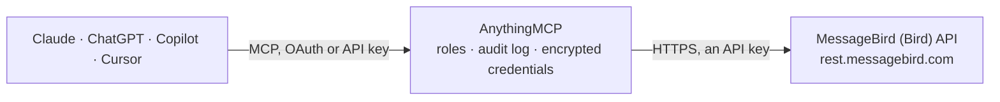

<!-- Generated by scripts/export-github-catalog.mjs in the anythingmcp-website repository. Do not edit by hand. -->

# MessageBird (Bird) MCP connector

Drive MessageBird / Bird (multichannel CPaaS — SMS, voice, WhatsApp via Bird, RCS) from any AI agent. 8 tools, AccessKey header auth. The AnythingMCP connector gives Claude, ChatGPT, Microsoft Copilot, Cursor and Gemini 8 MCP tools for MessageBird (Bird): 5 read and 3 can change data.

**Category:** [Messaging](../messaging.md) · **Tools:** 8 · **Setup guide:** [anythingmcp.com](https://anythingmcp.com/guides/messagebird-to-mcp) · [Deutsch](https://anythingmcp.com/de/guides/messagebird-to-mcp) · [Italiano](https://anythingmcp.com/it/guides/messagebird-to-mcp) · [Español](https://anythingmcp.com/es/guides/messagebird-to-mcp) · [日本語](https://anythingmcp.com/ja/guides/messagebird-to-mcp) · [Русский](https://anythingmcp.com/ru/guides/messagebird-to-mcp) · [中文](https://anythingmcp.com/zh/guides/messagebird-to-mcp)

## Start without code

No installation and no terminal: AnythingMCP Cloud runs the MessageBird (Bird) connector for you, operated by helpcode.ai in Frankfurt, Germany.

1. **Click the button above** and create an account or sign in. The MessageBird (Bird) connector opens, ready to install.
2. **Paste the API key or token from your MessageBird (Bird) account.** Every click is in the [step-by-step guide](https://anythingmcp.com/guides/messagebird-to-mcp).
3. **Click Install.** AnythingMCP shows the address of your MCP server.
4. **Add that address to your assistant:** [Claude](https://anythingmcp.com/guides/connect-messagebird-to-claude) · [ChatGPT](https://anythingmcp.com/guides/connect-messagebird-to-chatgpt) · [Microsoft Copilot](https://anythingmcp.com/guides/connect-messagebird-to-copilot) · [Cursor](https://anythingmcp.com/guides/connect-messagebird-to-cursor) · [Gemini CLI](https://anythingmcp.com/guides/connect-messagebird-to-gemini) · [Meta Muse](https://anythingmcp.com/guides/connect-messagebird-to-muse).
5. **Ask your first question**, for example: *What's delivery status for SMS message ID m-20261105-1023 sent to 358401234567?*

Prefer help with the setup? [Talk to us](https://anythingmcp.com/contact).

## How it works

- **The AI client** speaks MCP (Streamable HTTP) to AnythingMCP and only sees tool names, descriptions and results. It never gets the MessageBird (Bird) credentials.
- **AnythingMCP** checks the client's role, builds the call from the tool definition, adds the credentials (an API key), calls MessageBird (Bird), logs the call and returns the result.
- **MessageBird (Bird)** sees an ordinary API client with the rights of the account the credentials belong to.

## Tools

| Tool | What it does | Access |
|---|---|---|
| [`messagebird_get_balance`](#messagebird_get_balance) | Return account balance (payment) and currency. | read |
| [`messagebird_send_sms`](#messagebird_send_sms) | Send an SMS. | write |
| [`messagebird_get_message`](#messagebird_get_message) | Get an SMS by ID with delivery status per recipient. | read |
| [`messagebird_list_messages`](#messagebird_list_messages) | List SMS messages with filters. | read |
| [`messagebird_send_voice_call`](#messagebird_send_voice_call) | Start an outbound voice call. | write |
| [`messagebird_lookup_phone`](#messagebird_lookup_phone) | Look up phone number details: country, type (mobile/landline), formats. | read |
| [`messagebird_verify_create`](#messagebird_verify_create) | Send a verification code (OTP) via SMS/voice. | write |
| [`messagebird_verify_check`](#messagebird_verify_check) | Verify a token (OTP) against a previously-created verification ID. | read |

## Tool reference

Every parameter as the AI client sees it in `tools/list`. Source: [`packages/backend/src/adapters/intl/messagebird.json`](../../../packages/backend/src/adapters/intl/messagebird.json).

### `messagebird_get_balance`

Return account balance (payment) and currency.

**Access:** read · **Call:** `GET /balance`

No parameters.

### `messagebird_send_sms`

Send an SMS. Required: originator + recipients + body.

**Access:** write · **Call:** `POST /messages`

| Parameter | Type | Required | Description |
|---|---|---|---|
| `originator` | string | yes | Sender ID (≤11 alphanumeric chars) or your owned phone number. |
| `recipients` | any[] | yes | Array of phones in international format WITHOUT '+'. e.g. ['31612345678']. |
| `body` | string | yes | Message body. With plain datacoding ≤160 chars per part. |
| `type` | string | no | sms (default), binary, flash, premium. |
| `datacoding` | string | no | plain (default), unicode, auto. |
| `reference` | string | no | Free-text reference for delivery report correlation. |
| `scheduledDatetime` | string | no | ISO 8601 to schedule send up to 24h ahead. |
| `validity` | integer | no | Validity period in seconds (default 1 day). |

### `messagebird_get_message`

Get an SMS by ID with delivery status per recipient.

**Access:** read · **Call:** `GET /messages/{messageId}`

| Parameter | Type | Required | Description |
|---|---|---|---|
| `messageId` | string | yes | Message ID. |

### `messagebird_list_messages`

List SMS messages with filters.

**Access:** read · **Call:** `GET /messages`

| Parameter | Type | Required | Description |
|---|---|---|---|
| `originator` | string | no | Filter by sender. |
| `recipient` | string | no | Filter by recipient phone. |
| `from` | string | no | From datetime (ISO 8601). |
| `until` | string | no | Until datetime. |
| `status` | string | no | scheduled, sent, buffered, delivered, expired, delivery_failed, sent_failed. |
| `limit` | integer | no | Per page (default 10, max 100). |
| `offset` | integer | no | Offset. |

### `messagebird_send_voice_call`

Start an outbound voice call. The call follows the steps in callFlow (XML or JSON). Required: source + destination + callFlow.

**Access:** write · **Call:** `POST /calls`

| Parameter | Type | Required | Description |
|---|---|---|---|
| `source` | string | yes | Your number (international, no +). Must be MessageBird-issued or verified caller ID. |
| `destination` | string | yes | Recipient phone (no +). |
| `callFlow` | object | yes | {steps: [{action:'say', options:{payload:'Hello', voice:'female', language:'en-US'}}, {action:'transfer', options:{destination:'31612345678'}}]}. |
| `webhook` | object | no | {url, token} — for event callbacks. |

### `messagebird_lookup_phone`

Look up phone number details: country, type (mobile/landline), formats. Useful for validation + carrier detection.

**Access:** read · **Call:** `GET /lookup/{phoneNumber}`

| Parameter | Type | Required | Description |
|---|---|---|---|
| `phoneNumber` | string | yes | Phone number to look up (international, no +). |
| `countryCode` | string | no | ISO country code if you have a local number that needs disambiguation. |

### `messagebird_verify_create`

Send a verification code (OTP) via SMS/voice. Default 6-digit code, 30 sec validity. Use messagebird_verify_check to validate.

**Access:** write · **Call:** `POST /verify`

| Parameter | Type | Required | Description |
|---|---|---|---|
| `recipient` | string | yes | Phone (international, no +). |
| `originator` | string | no | Sender ID. |
| `type` | string | no | sms (default), tts (voice). |
| `template` | string | no | Message template. Default 'Your verification code is %token.'. Must include %token literal. |
| `timeout` | integer | no | Seconds until code expires (default 30, max 3600). |
| `tokenLength` | integer | no | Code length 4-10 (default 6). |
| `voice` | string | no | For tts: male, female. |
| `language` | string | no | For tts: en-us, en-gb, de-de, fr-fr, ... |

### `messagebird_verify_check`

Verify a token (OTP) against a previously-created verification ID.

**Access:** read · **Call:** `GET /verify/{id}`

| Parameter | Type | Required | Description |
|---|---|---|---|
| `id` | string | yes | Verification ID from verify_create response. |
| `token` | string | yes | Code the user entered. |

## Run it yourself

AnythingMCP is open source (AGPL-3.0). [Run it with Docker](../../../README.md#run-it-yourself), open **Connectors → Store**, pick **MessageBird (Bird)** and enter `MESSAGEBIRD_ACCESS_KEY`, then add your MCP server URL to the AI client.

[← Messaging connectors](../messaging.md) · [All categories](../README.md)
