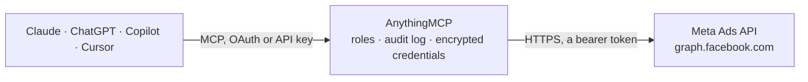

<!-- Generated by scripts/export-github-catalog.mjs in the anythingmcp-website repository. Do not edit by hand. -->

# Meta Ads MCP connector

Let your AI analyse your Facebook and Instagram ads: spend, reach, clicks and conversions by campaign, ad set, ad, age, country or placement, plus campaigns, creatives, audiences and change history. The AnythingMCP connector gives Claude, ChatGPT, Microsoft Copilot, Cursor and Gemini 18 MCP tools for Meta Ads: 16 read and 2 can change data.

**Category:** [Advertising](../advertising.md) · **Tools:** 18 · **Setup guide:** [anythingmcp.com](https://anythingmcp.com/guides/meta-ads-to-mcp) · [Deutsch](https://anythingmcp.com/de/guides/meta-ads-to-mcp) · [Italiano](https://anythingmcp.com/it/guides/meta-ads-to-mcp) · [Español](https://anythingmcp.com/es/guides/meta-ads-to-mcp) · [日本語](https://anythingmcp.com/ja/guides/meta-ads-to-mcp) · [Русский](https://anythingmcp.com/ru/guides/meta-ads-to-mcp) · [中文](https://anythingmcp.com/zh/guides/meta-ads-to-mcp)

## Start without code

No installation and no terminal: AnythingMCP Cloud runs the Meta Ads connector for you, operated by helpcode.ai in Frankfurt, Germany.

1. **Click the button above** and create an account or sign in. The Meta Ads connector opens, ready to install.
2. **Paste the API key or token from your Meta Ads account.** Every click is in the [step-by-step guide](https://anythingmcp.com/guides/meta-ads-to-mcp).
3. **Click Install.** AnythingMCP shows the address of your MCP server.
4. **Add that address to your assistant:** [Claude](https://anythingmcp.com/guides/connect-meta-ads-to-claude) · [ChatGPT](https://anythingmcp.com/guides/connect-meta-ads-to-chatgpt) · [Microsoft Copilot](https://anythingmcp.com/guides/connect-meta-ads-to-copilot) · [Cursor](https://anythingmcp.com/guides/connect-meta-ads-to-cursor) · [Gemini CLI](https://anythingmcp.com/guides/connect-meta-ads-to-gemini) · [Meta Muse](https://anythingmcp.com/guides/connect-meta-ads-to-muse).
5. **Ask your first question**, for example: *Show account balance and amount_spent for ad account act_874512360 right now*

Prefer help with the setup? [Talk to us](https://anythingmcp.com/contact).

## How it works

- **The AI client** speaks MCP (Streamable HTTP) to AnythingMCP and only sees tool names, descriptions and results. It never gets the Meta Ads credentials.
- **AnythingMCP** checks the client's role, builds the call from the tool definition, adds the credentials (a bearer token), calls Meta Ads, logs the call and returns the result.
- **Meta Ads** sees an ordinary API client with the rights of the account the credentials belong to.

## Tools

| Tool | What it does | Access |
|---|---|---|
| [`meta_ads_list_ad_accounts`](#meta_ads_list_ad_accounts) | List the ad accounts the token can reach, with id (act_...), name, account_status (1 active, 2 disabled, 3 unsettled, 7 pending risk review, 9 in grace… | read |
| [`meta_ads_get_ad_account`](#meta_ads_get_ad_account) | Read the ad account in META_ADS_ACCOUNT_ID: name, status, currency, time zone, amount spent, balance, spend cap and minimum daily budget. | read |
| [`meta_ads_list_campaigns`](#meta_ads_list_campaigns) | List the campaigns of the ad account with name, status and effective_status, objective, daily or lifetime budget (minor currency unit), bid strategy and… | read |
| [`meta_ads_get_campaign`](#meta_ads_get_campaign) | Read one campaign by id: name, status, effective_status, objective, budgets, bid strategy, special ad categories and schedule. | read |
| [`meta_ads_list_ad_sets`](#meta_ads_list_ad_sets) | List the ad sets of the ad account with campaign_id, status, budgets, bid strategy, billing event, optimization goal, targeting and schedule. | read |
| [`meta_ads_list_campaign_ad_sets`](#meta_ads_list_campaign_ad_sets) | List the ad sets of one campaign with status, budgets, optimization goal, targeting and schedule. | read |
| [`meta_ads_get_ad_set`](#meta_ads_get_ad_set) | Read one ad set by id: campaign, status, budgets, bid strategy and amount, billing event, optimization goal, full targeting spec and schedule. | read |
| [`meta_ads_list_ads`](#meta_ads_list_ads) | List the ads of the ad account with ad set, campaign, status, effective_status, creative id and issues_info (why an ad does not deliver). | read |
| [`meta_ads_list_ad_set_ads`](#meta_ads_list_ad_set_ads) | List the ads of one ad set with status, effective_status, creative and issues_info. | read |
| [`meta_ads_get_ad`](#meta_ads_get_ad) | Read one ad by id: name, ad set, campaign, status, effective_status, creative and issues_info. | read |
| [`meta_ads_get_account_insights`](#meta_ads_get_account_insights) | Performance of the whole ad account for a period: impressions, reach, frequency, clicks, CTR, CPC, CPM, spend, actions (conversions by action_type) and cost… | read |
| [`meta_ads_get_insights`](#meta_ads_get_insights) | Performance of one campaign, ad set or ad for a period, with the same metrics, periods, breakdowns and levels as meta_ads_get_account_insights. | read |
| [`meta_ads_list_ad_creatives`](#meta_ads_list_ad_creatives) | List the ad creatives of the ad account with name, title, body, call to action, link, image and thumbnail URLs, video id and the object story spec. | read |
| [`meta_ads_get_ad_creative`](#meta_ads_get_ad_creative) | Read one ad creative by id (meta_ads_get_ad shows the creative id of an ad): texts, call to action, link, image and thumbnail, video and the full object… | read |
| [`meta_ads_list_custom_audiences`](#meta_ads_list_custom_audiences) | List the custom and lookalike audiences of the ad account with subtype (CUSTOM, WEBSITE, LOOKALIKE, ENGAGEMENT and others), approximate size range,… | read |
| [`meta_ads_list_account_activities`](#meta_ads_list_account_activities) | Change history of the ad account: who changed what and when (event_type such as update_campaign_run_status or update_ad_set_budget, actor_name, object_name,… | read |
| [`meta_ads_update_status`](#meta_ads_update_status) | Pause or activate a campaign, ad set or ad. | write |
| [`meta_ads_update_budget`](#meta_ads_update_budget) | Change the daily or lifetime budget of a campaign (with campaign budget) or of an ad set (with ad set budgets). | write |

## Tool reference

Every parameter as the AI client sees it in `tools/list`. Source: [`packages/backend/src/adapters/intl/meta-ads.json`](../../../packages/backend/src/adapters/intl/meta-ads.json).

### `meta_ads_list_ad_accounts`

List the ad accounts the token can reach, with id (act_...), name, account_status (1 active, 2 disabled, 3 unsettled, 7 pending risk review, 9 in grace period, 101 closed), currency, timezone and amount_spent. Use it to find META_ADS_ACCOUNT_ID. The answer has data[] and paging.

**Access:** read · **Call:** `GET /me/adaccounts`

| Parameter | Type | Required | Description |
|---|---|---|---|
| `fields` | string | no | Comma-separated ad account fields to return; nested fields use braces, e.g. creative{id,name}. Default: id,account_id,name,account_status,currency,timezone_name,amount_spent,balance,spend_cap,min_daily_budget,business. |
| `limit` | integer | no | Results per page, up to 100 (default 25). |
| `after` | string | no | Cursor from paging.cursors.after of the previous answer, for the next page. |

### `meta_ads_get_ad_account`

Read the ad account in META_ADS_ACCOUNT_ID: name, status, currency, time zone, amount spent, balance, spend cap and minimum daily budget. Money values are strings in the currency's minor unit (cents for EUR and USD).

**Access:** read · **Call:** `GET /{{META_ADS_ACCOUNT_ID}}`

| Parameter | Type | Required | Description |
|---|---|---|---|
| `fields` | string | no | Comma-separated ad account fields to return; nested fields use braces, e.g. creative{id,name}. Default: id,account_id,name,account_status,currency,timezone_name,amount_spent,balance,spend_cap,min_daily_budget,business. |

### `meta_ads_list_campaigns`

List the campaigns of the ad account with name, status and effective_status, objective, daily or lifetime budget (minor currency unit), bid strategy and schedule. Filter by effective_status. The answer has data[] (empty when there are none) and paging.cursors.after for the next page.

**Access:** read · **Call:** `GET /{{META_ADS_ACCOUNT_ID}}/campaigns`

| Parameter | Type | Required | Description |
|---|---|---|---|
| `fields` | string | no | Comma-separated campaign fields to return; nested fields use braces, e.g. creative{id,name}. Default: id,name,status,effective_status,objective,buying_type,daily_budget,lifetime_budget,budget_remaining,bid_strategy,special_ad_categories,start_time,stop_time,created_time,updated_time. |
| `effective_status` | string | no | JSON array of effective statuses to include, e.g. ["ACTIVE","PAUSED"]. Values: ACTIVE, PAUSED, DELETED, ARCHIVED, PENDING_REVIEW, DISAPPROVED, PREAPPROVED, PENDING_BILLING_INFO, CAMPAIGN_PAUSED, ADSET_PAUSED, IN_PROCESS, WITH_ISSUES. Default: everything except deleted and archived. |
| `limit` | integer | no | Results per page, up to 100 (default 25). |
| `after` | string | no | Cursor from paging.cursors.after of the previous answer, for the next page. |

### `meta_ads_get_campaign`

Read one campaign by id: name, status, effective_status, objective, budgets, bid strategy, special ad categories and schedule.

**Access:** read · **Call:** `GET /{campaign_id}`

| Parameter | Type | Required | Description |
|---|---|---|---|
| `campaign_id` | string | yes | The campaign id, a long number as a string. |
| `fields` | string | no | Comma-separated campaign fields to return; nested fields use braces, e.g. creative{id,name}. Default: id,name,status,effective_status,objective,buying_type,daily_budget,lifetime_budget,budget_remaining,bid_strategy,special_ad_categories,start_time,stop_time,created_time,updated_time. |

### `meta_ads_list_ad_sets`

List the ad sets of the ad account with campaign_id, status, budgets, bid strategy, billing event, optimization goal, targeting and schedule. Filter by effective_status. Use meta_ads_list_campaign_ad_sets for the ad sets of one campaign.

**Access:** read · **Call:** `GET /{{META_ADS_ACCOUNT_ID}}/adsets`

| Parameter | Type | Required | Description |
|---|---|---|---|
| `fields` | string | no | Comma-separated ad set fields to return; nested fields use braces, e.g. creative{id,name}. Default: id,name,campaign_id,status,effective_status,daily_budget,lifetime_budget,budget_remaining,bid_strategy,bid_amount,billing_event,optimization_goal,targeting,start_time,end_time,created_time,updated_time. |
| `effective_status` | string | no | JSON array of effective statuses to include, e.g. ["ACTIVE","PAUSED"]. Values: ACTIVE, PAUSED, DELETED, ARCHIVED, PENDING_REVIEW, DISAPPROVED, PREAPPROVED, PENDING_BILLING_INFO, CAMPAIGN_PAUSED, ADSET_PAUSED, IN_PROCESS, WITH_ISSUES. Default: everything except deleted and archived. |
| `limit` | integer | no | Results per page, up to 100 (default 25). |
| `after` | string | no | Cursor from paging.cursors.after of the previous answer, for the next page. |

### `meta_ads_list_campaign_ad_sets`

List the ad sets of one campaign with status, budgets, optimization goal, targeting and schedule. Filter by effective_status.

**Access:** read · **Call:** `GET /{campaign_id}/adsets`

| Parameter | Type | Required | Description |
|---|---|---|---|
| `fields` | string | no | Comma-separated ad set fields to return; nested fields use braces, e.g. creative{id,name}. Default: id,name,campaign_id,status,effective_status,daily_budget,lifetime_budget,budget_remaining,bid_strategy,bid_amount,billing_event,optimization_goal,targeting,start_time,end_time,created_time,updated_time. |
| `campaign_id` | string | yes | The campaign id. |
| `effective_status` | string | no | JSON array of effective statuses to include, e.g. ["ACTIVE","PAUSED"]. Values: ACTIVE, PAUSED, DELETED, ARCHIVED, PENDING_REVIEW, DISAPPROVED, PREAPPROVED, PENDING_BILLING_INFO, CAMPAIGN_PAUSED, ADSET_PAUSED, IN_PROCESS, WITH_ISSUES. Default: everything except deleted and archived. |
| `limit` | integer | no | Results per page, up to 100 (default 25). |
| `after` | string | no | Cursor from paging.cursors.after of the previous answer, for the next page. |

### `meta_ads_get_ad_set`

Read one ad set by id: campaign, status, budgets, bid strategy and amount, billing event, optimization goal, full targeting spec and schedule.

**Access:** read · **Call:** `GET /{ad_set_id}`

| Parameter | Type | Required | Description |
|---|---|---|---|
| `ad_set_id` | string | yes | The ad set id, a long number as a string. |
| `fields` | string | no | Comma-separated ad set fields to return; nested fields use braces, e.g. creative{id,name}. Default: id,name,campaign_id,status,effective_status,daily_budget,lifetime_budget,budget_remaining,bid_strategy,bid_amount,billing_event,optimization_goal,targeting,start_time,end_time,created_time,updated_time. |

### `meta_ads_list_ads`

List the ads of the ad account with ad set, campaign, status, effective_status, creative id and issues_info (why an ad does not deliver). Filter by effective_status. Use meta_ads_list_ad_set_ads for the ads of one ad set.

**Access:** read · **Call:** `GET /{{META_ADS_ACCOUNT_ID}}/ads`

| Parameter | Type | Required | Description |
|---|---|---|---|
| `fields` | string | no | Comma-separated ad fields to return; nested fields use braces, e.g. creative{id,name}. Default: id,name,adset_id,campaign_id,status,effective_status,creative{id,name},issues_info,created_time,updated_time. |
| `effective_status` | string | no | JSON array of effective statuses to include, e.g. ["ACTIVE","PAUSED"]. Values: ACTIVE, PAUSED, DELETED, ARCHIVED, PENDING_REVIEW, DISAPPROVED, PREAPPROVED, PENDING_BILLING_INFO, CAMPAIGN_PAUSED, ADSET_PAUSED, IN_PROCESS, WITH_ISSUES. Default: everything except deleted and archived. |
| `limit` | integer | no | Results per page, up to 100 (default 25). |
| `after` | string | no | Cursor from paging.cursors.after of the previous answer, for the next page. |

### `meta_ads_list_ad_set_ads`

List the ads of one ad set with status, effective_status, creative and issues_info. Filter by effective_status.

**Access:** read · **Call:** `GET /{ad_set_id}/ads`

| Parameter | Type | Required | Description |
|---|---|---|---|
| `fields` | string | no | Comma-separated ad fields to return; nested fields use braces, e.g. creative{id,name}. Default: id,name,adset_id,campaign_id,status,effective_status,creative{id,name},issues_info,created_time,updated_time. |
| `ad_set_id` | string | yes | The ad set id. |
| `effective_status` | string | no | JSON array of effective statuses to include, e.g. ["ACTIVE","PAUSED"]. Values: ACTIVE, PAUSED, DELETED, ARCHIVED, PENDING_REVIEW, DISAPPROVED, PREAPPROVED, PENDING_BILLING_INFO, CAMPAIGN_PAUSED, ADSET_PAUSED, IN_PROCESS, WITH_ISSUES. Default: everything except deleted and archived. |
| `limit` | integer | no | Results per page, up to 100 (default 25). |
| `after` | string | no | Cursor from paging.cursors.after of the previous answer, for the next page. |

### `meta_ads_get_ad`

Read one ad by id: name, ad set, campaign, status, effective_status, creative and issues_info. Add ad_review_feedback or preview_shareable_link to fields for review results or a preview link.

**Access:** read · **Call:** `GET /{ad_id}`

| Parameter | Type | Required | Description |
|---|---|---|---|
| `ad_id` | string | yes | The ad id, a long number as a string. |
| `fields` | string | no | Comma-separated ad fields to return; nested fields use braces, e.g. creative{id,name}. Default: id,name,adset_id,campaign_id,status,effective_status,creative{id,name},issues_info,created_time,updated_time. |

### `meta_ads_get_account_insights`

Performance of the whole ad account for a period: impressions, reach, frequency, clicks, CTR, CPC, CPM, spend, actions (conversions by action_type) and cost per action, in the account currency (spend is in major units here, e.g. 12.34). Use level to get one row per campaign, ad set or ad, breakdowns for age, gender, country or placement, and time_increment for daily rows. Without a period the last 30 days are used. data is empty when nothing was delivered.

**Access:** read · **Call:** `GET /{{META_ADS_ACCOUNT_ID}}/insights`

| Parameter | Type | Required | Description |
|---|---|---|---|
| `fields` | string | no | Comma-separated metrics. Default: impressions,reach,frequency,clicks,ctr,cpc,cpm,spend,actions,cost_per_action_type,purchase_roas,account_currency,date_start,date_stop. Others: unique_clicks, inline_link_clicks, inline_link_click_ctr, cost_per_inline_link_click, action_values, conversions, cost_per_conversion, video_p100_watched_actions, campaign_id, campaign_name, adset_id, adset_name, ad_id, ad_name. |
| `date_preset` | `today` \| `yesterday` \| `this_week_mon_today` \| `this_week_sun_today` \| `last_week_mon_sun` \| `last_week_sun_sat` \| `last_3d` \| `last_7d` \| `last_14d` \| `last_28d` \| `last_30d` \| `last_90d` \| `this_month` \| `last_month` \| `this_quarter` \| `last_quarter` \| `this_year` \| `last_year` \| `maximum` \| `data_maximum` | no | Relative period (default last_30d). Leave out when since and until are set. |
| `since` | string | no | First day of a custom range, YYYY-MM-DD (with until). Not more than 37 months back. |
| `until` | string | no | Last day of a custom range, YYYY-MM-DD (with since). |
| `time_increment` | string | no | Split the period: 1 for daily rows, 7 for weekly, a number of days up to 90, monthly, or all_days (default, one row). |
| `level` | `account` \| `campaign` \| `adset` \| `ad` | no | Row level: account, campaign, adset or ad. With campaign, adset or ad, add the matching *_name field to fields. |
| `breakdowns` | string | no | Comma-separated breakdowns, e.g. age,gender or country or publisher_platform,platform_position or device_platform. Only some combinations are allowed. |
| `action_breakdowns` | string | no | How actions are split, e.g. action_type (default) or action_type,action_device. |
| `action_attribution_windows` | string | no | JSON array of attribution windows, e.g. ["7d_click","1d_view"] (the default) or ["1d_click"]. 7d_view and 28d_view no longer return data. |
| `filtering` | string | no | JSON array of filters, e.g. [{"field":"campaign.name","operator":"CONTAIN","value":"Summer"}] or [{"field":"spend","operator":"GREATER_THAN","value":0}]. |
| `sort` | string | no | Sort by a field, e.g. spend_descending or impressions_ascending. |
| `use_unified_attribution_setting` | boolean | no | true to count conversions with each ad set's own attribution setting, as Ads Manager does. |
| `limit` | integer | no | Results per page, up to 100 (default 50). |
| `after` | string | no | Cursor from paging.cursors.after of the previous answer, for the next page. |

### `meta_ads_get_insights`

Performance of one campaign, ad set or ad for a period, with the same metrics, periods, breakdowns and levels as meta_ads_get_account_insights. Pass the object's id; level can split a campaign into its ad sets or ads.

**Access:** read · **Call:** `GET /{object_id}/insights`

| Parameter | Type | Required | Description |
|---|---|---|---|
| `object_id` | string | yes | Id of a campaign, ad set or ad. |
| `fields` | string | no | Comma-separated metrics. Default: impressions,reach,frequency,clicks,ctr,cpc,cpm,spend,actions,cost_per_action_type,purchase_roas,account_currency,date_start,date_stop. Others: unique_clicks, inline_link_clicks, inline_link_click_ctr, cost_per_inline_link_click, action_values, conversions, cost_per_conversion, video_p100_watched_actions, campaign_id, campaign_name, adset_id, adset_name, ad_id, ad_name. |
| `date_preset` | `today` \| `yesterday` \| `this_week_mon_today` \| `this_week_sun_today` \| `last_week_mon_sun` \| `last_week_sun_sat` \| `last_3d` \| `last_7d` \| `last_14d` \| `last_28d` \| `last_30d` \| `last_90d` \| `this_month` \| `last_month` \| `this_quarter` \| `last_quarter` \| `this_year` \| `last_year` \| `maximum` \| `data_maximum` | no | Relative period (default last_30d). Leave out when since and until are set. |
| `since` | string | no | First day of a custom range, YYYY-MM-DD (with until). Not more than 37 months back. |
| `until` | string | no | Last day of a custom range, YYYY-MM-DD (with since). |
| `time_increment` | string | no | Split the period: 1 for daily rows, 7 for weekly, a number of days up to 90, monthly, or all_days (default, one row). |
| `level` | `account` \| `campaign` \| `adset` \| `ad` | no | Row level: account, campaign, adset or ad. With campaign, adset or ad, add the matching *_name field to fields. |
| `breakdowns` | string | no | Comma-separated breakdowns, e.g. age,gender or country or publisher_platform,platform_position or device_platform. Only some combinations are allowed. |
| `action_breakdowns` | string | no | How actions are split, e.g. action_type (default) or action_type,action_device. |
| `action_attribution_windows` | string | no | JSON array of attribution windows, e.g. ["7d_click","1d_view"] (the default) or ["1d_click"]. 7d_view and 28d_view no longer return data. |
| `filtering` | string | no | JSON array of filters, e.g. [{"field":"campaign.name","operator":"CONTAIN","value":"Summer"}] or [{"field":"spend","operator":"GREATER_THAN","value":0}]. |
| `sort` | string | no | Sort by a field, e.g. spend_descending or impressions_ascending. |
| `use_unified_attribution_setting` | boolean | no | true to count conversions with each ad set's own attribution setting, as Ads Manager does. |
| `limit` | integer | no | Results per page, up to 100 (default 50). |
| `after` | string | no | Cursor from paging.cursors.after of the previous answer, for the next page. |

### `meta_ads_list_ad_creatives`

List the ad creatives of the ad account with name, title, body, call to action, link, image and thumbnail URLs, video id and the object story spec. Creatives cannot be changed once used; this connector only reads them.

**Access:** read · **Call:** `GET /{{META_ADS_ACCOUNT_ID}}/adcreatives`

| Parameter | Type | Required | Description |
|---|---|---|---|
| `fields` | string | no | Comma-separated creative fields to return; nested fields use braces, e.g. creative{id,name}. Default: id,name,status,title,body,object_type,call_to_action_type,link_url,image_url,thumbnail_url,video_id,object_story_spec,effective_object_story_id. |
| `limit` | integer | no | Results per page, up to 100 (default 25). |
| `after` | string | no | Cursor from paging.cursors.after of the previous answer, for the next page. |

### `meta_ads_get_ad_creative`

Read one ad creative by id (meta_ads_get_ad shows the creative id of an ad): texts, call to action, link, image and thumbnail, video and the full object story spec or asset feed spec.

**Access:** read · **Call:** `GET /{creative_id}`

| Parameter | Type | Required | Description |
|---|---|---|---|
| `creative_id` | string | yes | The creative id. |
| `fields` | string | no | Comma-separated creative fields to return; nested fields use braces, e.g. creative{id,name}. Default: id,name,status,title,body,object_type,call_to_action_type,link_url,image_url,thumbnail_url,video_id,object_story_spec,effective_object_story_id,asset_feed_spec. |

### `meta_ads_list_custom_audiences`

List the custom and lookalike audiences of the ad account with subtype (CUSTOM, WEBSITE, LOOKALIKE, ENGAGEMENT and others), approximate size range, delivery_status and operation_status (whether the audience is ready or has a problem) and retention. Read only; members are never shown. data is empty when the account has none.

**Access:** read · **Call:** `GET /{{META_ADS_ACCOUNT_ID}}/customaudiences`

| Parameter | Type | Required | Description |
|---|---|---|---|
| `fields` | string | no | Comma-separated audience fields to return; nested fields use braces, e.g. creative{id,name}. Default: id,name,subtype,description,approximate_count_lower_bound,approximate_count_upper_bound,delivery_status,operation_status,retention_days,time_created,time_updated. |
| `limit` | integer | no | Results per page, up to 100 (default 25). |
| `after` | string | no | Cursor from paging.cursors.after of the previous answer, for the next page. |

### `meta_ads_list_account_activities`

Change history of the ad account: who changed what and when (event_type such as update_campaign_run_status or update_ad_set_budget, actor_name, object_name, date_time_in_timezone and the old and new values in extra_data). Useful after a sudden change in spend or delivery.

**Access:** read · **Call:** `GET /{{META_ADS_ACCOUNT_ID}}/activities`

| Parameter | Type | Required | Description |
|---|---|---|---|
| `fields` | string | no | Comma-separated fields. Default: event_type,translated_event_type,event_time,date_time_in_timezone,actor_name,object_id,object_name,object_type,extra_data. |
| `since` | string | no | Only changes from this day on, YYYY-MM-DD. |
| `until` | string | no | Only changes up to this day, YYYY-MM-DD. |
| `limit` | integer | no | Results per page, up to 100 (default 25). |
| `after` | string | no | Cursor from paging.cursors.after of the previous answer, for the next page. |

### `meta_ads_update_status`

Pause or activate a campaign, ad set or ad. Activating starts spending money and pausing stops delivery at once, so always confirm the object (name and id) and the new status with the user first. An ad only delivers when it, its ad set and its campaign are all ACTIVE. Returns {"success": true}.

**Access:** write · **Call:** `POST /{object_id}`

| Parameter | Type | Required | Description |
|---|---|---|---|
| `object_id` | string | yes | Id of the campaign, ad set or ad. |
| `status` | `ACTIVE` \| `PAUSED` | yes | The new status. |

### `meta_ads_update_budget`

Change the daily or lifetime budget of a campaign (with campaign budget) or of an ad set (with ad set budgets). Amounts are integers in the minor unit of the account currency: 2000 is 20.00 EUR or USD; JPY, KRW, HUF, CLP, COP, IDR, TWD and a few others have no minor unit. This changes how much money is spent, so state the object, old and new budget and wait for the user's yes. Set the kind of budget the object already has (daily or lifetime); the budget sits either on the campaign or on its ad sets, not both. Returns {"success": true}.

**Access:** write · **Call:** `POST /{object_id}`

| Parameter | Type | Required | Description |
|---|---|---|---|
| `object_id` | string | yes | Id of the campaign or ad set. |
| `daily_budget` | integer | no | New daily budget in minor units, e.g. 2000 for 20.00. |
| `lifetime_budget` | integer | no | New lifetime budget in minor units, for objects with a lifetime budget. |

## Run it yourself

AnythingMCP is open source (AGPL-3.0). [Run it with Docker](../../../README.md#run-it-yourself), open **Connectors → Store**, pick **Meta Ads** and enter `META_ADS_ACCESS_TOKEN`, `META_ADS_ACCOUNT_ID`, then add your MCP server URL to the AI client.

[← Advertising connectors](../advertising.md) · [All categories](../README.md)
