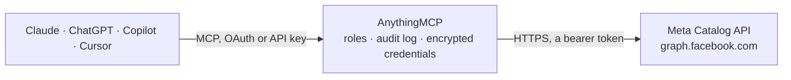

<!-- Generated by scripts/export-github-catalog.mjs in the anythingmcp-website repository. Do not edit by hand. -->

# Meta Catalog MCP connector

Let your AI check and maintain your Meta product catalogs (Commerce Manager): products with prices, stock and review status, product sets, data feeds and upload errors, and catalog diagnostics. The AnythingMCP connector gives Claude, ChatGPT, Microsoft Copilot, Cursor and Gemini 19 MCP tools for Meta Catalog: 15 read and 4 can change data.

**Category:** [E-commerce](../e-commerce.md) · **Tools:** 19 · **Setup guide:** [anythingmcp.com](https://anythingmcp.com/guides/meta-catalog-to-mcp) · [Deutsch](https://anythingmcp.com/de/guides/meta-catalog-to-mcp) · [Italiano](https://anythingmcp.com/it/guides/meta-catalog-to-mcp) · [Español](https://anythingmcp.com/es/guides/meta-catalog-to-mcp) · [日本語](https://anythingmcp.com/ja/guides/meta-catalog-to-mcp) · [Русский](https://anythingmcp.com/ru/guides/meta-catalog-to-mcp) · [中文](https://anythingmcp.com/zh/guides/meta-catalog-to-mcp)

## Start without code

No installation and no terminal: AnythingMCP Cloud runs the Meta Catalog connector for you, operated by helpcode.ai in Frankfurt, Germany.

1. **Click the button above** and create an account or sign in. The Meta Catalog connector opens, ready to install.
2. **Paste the API key or token from your Meta Catalog account.** Every click is in the [step-by-step guide](https://anythingmcp.com/guides/meta-catalog-to-mcp).
3. **Click Install.** AnythingMCP shows the address of your MCP server.
4. **Add that address to your assistant:** [Claude](https://anythingmcp.com/guides/connect-meta-catalog-to-claude) · [ChatGPT](https://anythingmcp.com/guides/connect-meta-catalog-to-chatgpt) · [Microsoft Copilot](https://anythingmcp.com/guides/connect-meta-catalog-to-copilot) · [Cursor](https://anythingmcp.com/guides/connect-meta-catalog-to-cursor) · [Gemini CLI](https://anythingmcp.com/guides/connect-meta-catalog-to-gemini) · [Meta Muse](https://anythingmcp.com/guides/connect-meta-catalog-to-muse).
5. **Ask your first question**, for example: *Show product with retailer_id SKU-FT-492 in catalog 178234567890123: name, price, availability, review_status*

Prefer help with the setup? [Talk to us](https://anythingmcp.com/contact).

## How it works

- **The AI client** speaks MCP (Streamable HTTP) to AnythingMCP and only sees tool names, descriptions and results. It never gets the Meta Catalog credentials.
- **AnythingMCP** checks the client's role, builds the call from the tool definition, adds the credentials (a bearer token), calls Meta Catalog, logs the call and returns the result.
- **Meta Catalog** sees an ordinary API client with the rights of the account the credentials belong to.

## Tools

| Tool | What it does | Access |
|---|---|---|
| [`meta_catalog_check_permissions`](#meta_catalog_check_permissions) | List the permissions granted to the access token, each with permission and status (granted or declined). | read |
| [`meta_catalog_list_businesses`](#meta_catalog_list_businesses) | List the business portfolios the token can reach, with id, name and verification_status. | read |
| [`meta_catalog_list_catalogs`](#meta_catalog_list_catalogs) | List the product catalogs owned by the business in META_CATALOG_BUSINESS_ID, with id, name, product_count, vertical (commerce, hotels, flights,… | read |
| [`meta_catalog_list_client_catalogs`](#meta_catalog_list_client_catalogs) | List the catalogs that other businesses (clients) shared with the business in META_CATALOG_BUSINESS_ID, as an agency or partner sees them, with the roles… | read |
| [`meta_catalog_get_catalog`](#meta_catalog_get_catalog) | Read one product catalog: name, vertical, product_count, feed_count, owning business and its default and fallback images. | read |
| [`meta_catalog_list_products`](#meta_catalog_list_products) | List the products (items) of a catalog with retailer_id, name, price and sale_price (strings with currency, e.g. 19.99 EUR), availability, inventory,… | read |
| [`meta_catalog_get_product`](#meta_catalog_get_product) | Read one catalog product by its Meta id with all details: texts, prices, availability, images, custom labels, GTIN, review_status with… | read |
| [`meta_catalog_list_product_sets`](#meta_catalog_list_product_sets) | List the product sets of a catalog (the groups that Advantage+ catalog ads and shop collections use) with id, name, filter rule and product_count. | read |
| [`meta_catalog_get_product_set`](#meta_catalog_get_product_set) | Read one product set: name, filter rule, product_count, retailer_id and its collection metadata (latest_metadata, live_metadata with cover image,… | read |
| [`meta_catalog_list_product_set_products`](#meta_catalog_list_product_set_products) | List the products that belong to a product set, with the same fields and filter as meta_catalog_list_products. | read |
| [`meta_catalog_list_feeds`](#meta_catalog_list_feeds) | List the data feeds of a catalog with id, name, product_count, the fetch schedule (url, interval, hour), update_schedule, ingestion_source_type… | read |
| [`meta_catalog_list_feed_uploads`](#meta_catalog_list_feed_uploads) | List the upload sessions of a feed, newest first, with start and end time, how the file came in, items detected, persisted, invalid and deleted, and error… | read |
| [`meta_catalog_list_upload_errors`](#meta_catalog_list_upload_errors) | List a sample of the errors and warnings of one feed upload: summary, description, severity (fatal: the item was not ingested; warning: a field was dropped)… | read |
| [`meta_catalog_get_diagnostics`](#meta_catalog_get_diagnostics) | Get the catalog's diagnostics, the issues Commerce Manager shows: grouped by type with severity (MUST_FIX or OPPORTUNITY), title, number_of_affected_items,… | read |
| [`meta_catalog_check_batch_status`](#meta_catalog_check_batch_status) | Check a batch submitted with meta_catalog_batch_update_items: status (finished once processing is done), errors and errors_total_count, warnings and… | read |
| [`meta_catalog_batch_update_items`](#meta_catalog_batch_update_items) | Create, update or delete many catalog items in one call (Catalog Batch API, up to 5000 requests, fewer than 3000 recommended). | write |
| [`meta_catalog_create_product`](#meta_catalog_create_product) | Add one product to a catalog. | write |
| [`meta_catalog_update_product`](#meta_catalog_update_product) | Change fields of one catalog product by its Meta id: price, sale_price, availability, inventory, name, description, image, link or visibility. | write |
| [`meta_catalog_delete_product`](#meta_catalog_delete_product) | Delete one product from its catalog by Meta id. | write |

## Tool reference

Every parameter as the AI client sees it in `tools/list`. Source: [`packages/backend/src/adapters/intl/meta-catalog.json`](../../../packages/backend/src/adapters/intl/meta-catalog.json).

### `meta_catalog_check_permissions`

List the permissions granted to the access token, each with permission and status (granted or declined). This connector needs catalog_management (read and change catalogs) and business_management (list the business's catalogs). Also a quick check that the token works. Read-only.

**Access:** read · **Call:** `GET /me/permissions`

No parameters.

### `meta_catalog_list_businesses`

List the business portfolios the token can reach, with id, name and verification_status. Use it to find META_CATALOG_BUSINESS_ID with a user token; a system user token usually gets an empty list (take the id from Business Settings instead). Needs business_management. The answer has data[] and paging.

**Access:** read · **Call:** `GET /me/businesses`

| Parameter | Type | Required | Description |
|---|---|---|---|
| `fields` | string | no | Comma-separated business fields to return; nested fields use braces, e.g. latest_upload{id,end_time}. Default: id,name,verification_status. |
| `limit` | integer | no | Results per page, up to 100 (default 25). |
| `after` | string | no | Cursor from paging.cursors.after of the previous answer, for the next page. |

### `meta_catalog_list_catalogs`

List the product catalogs owned by the business in META_CATALOG_BUSINESS_ID, with id, name, product_count, vertical (commerce, hotels, flights, destinations, home_listings, vehicles...) and feed_count. Start here to find a catalog_id. The answer has data[] and paging.cursors.after for the next page.

**Access:** read · **Call:** `GET /{{META_CATALOG_BUSINESS_ID}}/owned_product_catalogs`

| Parameter | Type | Required | Description |
|---|---|---|---|
| `fields` | string | no | Comma-separated catalog fields to return; nested fields use braces, e.g. latest_upload{id,end_time}. Default: id,name,product_count,vertical,feed_count,business,is_catalog_segment,is_local_catalog. |
| `limit` | integer | no | Results per page, up to 100 (default 25). |
| `after` | string | no | Cursor from paging.cursors.after of the previous answer, for the next page. |

### `meta_catalog_list_client_catalogs`

List the catalogs that other businesses (clients) shared with the business in META_CATALOG_BUSINESS_ID, as an agency or partner sees them, with the roles the business holds on each (permitted_roles). The answer has data[] and paging.

**Access:** read · **Call:** `GET /{{META_CATALOG_BUSINESS_ID}}/client_product_catalogs`

| Parameter | Type | Required | Description |
|---|---|---|---|
| `fields` | string | no | Comma-separated catalog fields to return; nested fields use braces, e.g. latest_upload{id,end_time}. Default: id,name,product_count,vertical,feed_count,business,is_catalog_segment,is_local_catalog,permitted_roles. |
| `limit` | integer | no | Results per page, up to 100 (default 25). |
| `after` | string | no | Cursor from paging.cursors.after of the previous answer, for the next page. |

### `meta_catalog_get_catalog`

Read one product catalog: name, vertical, product_count, feed_count, owning business and its default and fallback images. Read-only.

**Access:** read · **Call:** `GET /{catalog_id}`

| Parameter | Type | Required | Description |
|---|---|---|---|
| `catalog_id` | string | yes | Catalog id (a long number, as a string) from meta_catalog_list_catalogs. |
| `fields` | string | no | Comma-separated catalog fields to return; nested fields use braces, e.g. latest_upload{id,end_time}. Default: id,name,product_count,vertical,feed_count,business,is_catalog_segment,is_local_catalog,default_image_url,fallback_image_url. |

### `meta_catalog_list_products`

List the products (items) of a catalog with retailer_id, name, price and sale_price (strings with currency, e.g. 19.99 EUR), availability, inventory, review_status (approved, pending, rejected, outdated) and visibility. Filter with a rule such as {"availability":{"eq":"out of stock"}} or {"name":{"i_contains":"shoe"}}, or only items with errors via error_priority. The answer has data[], paging.cursors.after for the next page and, with summary=total_count, summary.total_count.

**Access:** read · **Call:** `GET /{catalog_id}/products`

| Parameter | Type | Required | Description |
|---|---|---|---|
| `catalog_id` | string | yes | Catalog id (a long number, as a string) from meta_catalog_list_catalogs. |
| `fields` | string | no | Comma-separated product fields to return; nested fields use braces, e.g. latest_upload{id,end_time}. Default: id,retailer_id,name,price,sale_price,currency,availability,inventory,condition,brand,review_status,visibility,url,image_url,retailer_product_group_id. |
| `filter` | string | no | Optional JSON filter rule. Operators: eq, neq, lt, lte, gt, gte, contains, i_contains, not_contains, i_not_contains, starts_with, is_any, is_not_any; combine with {"and": [...]} or {"or": [...]}. Examples: {"retailer_id":{"is_any":["sku1","sku2"]}}, {"review_status":{"eq":"rejected"}}. |
| `error_priority` | `HIGH` \| `MEDIUM` \| `LOW` | no | Only items with errors of this priority. HIGH (items that cannot be shown) is the one to fix first. |
| `error_type` | string | no | Optional: only items affected by one issue type, e.g. EMPTY_PRICE, IMAGE_RESOLUTION_LOW, MISSING_CATEGORY, PRICE_OVERRIDE_INVALID (see the products edge reference for the list). |
| `summary` | string | no | Set to total_count to add summary.total_count, the number of matching items. |
| `limit` | integer | no | Results per page, up to 100 (default 25). |
| `after` | string | no | Cursor from paging.cursors.after of the previous answer, for the next page. |

### `meta_catalog_get_product`

Read one catalog product by its Meta id with all details: texts, prices, availability, images, custom labels, GTIN, review_status with review_rejection_reasons, and errors (why it is not shown in ads or shops). Read-only.

**Access:** read · **Call:** `GET /{product_id}`

| Parameter | Type | Required | Description |
|---|---|---|---|
| `product_id` | string | yes | The Meta product item id (the id field from meta_catalog_list_products), not the retailer_id. |
| `fields` | string | no | Comma-separated product fields to return; nested fields use braces, e.g. latest_upload{id,end_time}. Default: id,retailer_id,name,price,sale_price,currency,availability,inventory,condition,brand,review_status,visibility,url,image_url,retailer_product_group_id,description,category,product_type,fb_product_category,additional_image_urls,sale_price_start_date,sale_price_end_date,custom_label_0,custom_label_1,custom_label_2,custom_label_3,custom_label_4,gtin,errors,review_rejection_reasons,product_feed. |

### `meta_catalog_list_product_sets`

List the product sets of a catalog (the groups that Advantage+ catalog ads and shop collections use) with id, name, filter rule and product_count. The answer has data[], paging and summary.total_count.

**Access:** read · **Call:** `GET /{catalog_id}/product_sets`

| Parameter | Type | Required | Description |
|---|---|---|---|
| `catalog_id` | string | yes | Catalog id (a long number, as a string) from meta_catalog_list_catalogs. |
| `fields` | string | no | Comma-separated product set fields to return; nested fields use braces, e.g. latest_upload{id,end_time}. Default: id,name,filter,product_count,retailer_id. |
| `retailer_id` | string | no | Optional: only the set with this retailer_id. |
| `parent_id` | string | no | Optional: only direct children of this product set; 0 returns the root sets. |
| `limit` | integer | no | Results per page, up to 100 (default 25). |
| `after` | string | no | Cursor from paging.cursors.after of the previous answer, for the next page. |

### `meta_catalog_get_product_set`

Read one product set: name, filter rule, product_count, retailer_id and its collection metadata (latest_metadata, live_metadata with cover image, description and review status). Read-only.

**Access:** read · **Call:** `GET /{product_set_id}`

| Parameter | Type | Required | Description |
|---|---|---|---|
| `product_set_id` | string | yes | Product set id from meta_catalog_list_product_sets. |
| `fields` | string | no | Comma-separated product set fields to return; nested fields use braces, e.g. latest_upload{id,end_time}. Default: id,name,filter,product_count,retailer_id,latest_metadata,live_metadata. |

### `meta_catalog_list_product_set_products`

List the products that belong to a product set, with the same fields and filter as meta_catalog_list_products. The answer has data[] and paging.cursors.after for the next page.

**Access:** read · **Call:** `GET /{product_set_id}/products`

| Parameter | Type | Required | Description |
|---|---|---|---|
| `product_set_id` | string | yes | Product set id from meta_catalog_list_product_sets. |
| `fields` | string | no | Comma-separated product fields to return; nested fields use braces, e.g. latest_upload{id,end_time}. Default: id,retailer_id,name,price,sale_price,currency,availability,inventory,condition,brand,review_status,visibility,url,image_url,retailer_product_group_id. |
| `filter` | string | no | Optional JSON filter rule, as in meta_catalog_list_products, e.g. {"availability":{"eq":"in stock"}}. |
| `error_priority` | `HIGH` \| `MEDIUM` \| `LOW` | no | Only items with errors of this priority. HIGH (items that cannot be shown) is the one to fix first. |
| `summary` | string | no | Set to total_count to add summary.total_count, the number of matching items. |
| `limit` | integer | no | Results per page, up to 100 (default 25). |
| `after` | string | no | Cursor from paging.cursors.after of the previous answer, for the next page. |

### `meta_catalog_list_feeds`

List the data feeds of a catalog with id, name, product_count, the fetch schedule (url, interval, hour), update_schedule, ingestion_source_type (PRIMARY_FEED or SUPPLEMENTARY_FEED) and latest_upload. The answer has data[] and paging.

**Access:** read · **Call:** `GET /{catalog_id}/product_feeds`

| Parameter | Type | Required | Description |
|---|---|---|---|
| `catalog_id` | string | yes | Catalog id (a long number, as a string) from meta_catalog_list_catalogs. |
| `fields` | string | no | Comma-separated feed fields to return; nested fields use braces, e.g. latest_upload{id,end_time}. Default: id,name,product_count,schedule,update_schedule,latest_upload,ingestion_source_type,file_name,country,default_currency,created_time. |
| `limit` | integer | no | Results per page, up to 100 (default 25). |
| `after` | string | no | Cursor from paging.cursors.after of the previous answer, for the next page. |

### `meta_catalog_list_feed_uploads`

List the upload sessions of a feed, newest first, with start and end time, how the file came in, items detected, persisted, invalid and deleted, and error and warning counts. Pass an upload id to meta_catalog_list_upload_errors. The answer has data[] and paging.

**Access:** read · **Call:** `GET /{feed_id}/uploads`

| Parameter | Type | Required | Description |
|---|---|---|---|
| `feed_id` | string | yes | Feed id from meta_catalog_list_feeds. |
| `fields` | string | no | Comma-separated upload fields to return; nested fields use braces, e.g. latest_upload{id,end_time}. Default: id,start_time,end_time,input_method,url,num_detected_items,num_persisted_items,num_invalid_items,num_deleted_items,error_count,warning_count. |
| `limit` | integer | no | Results per page, up to 100 (default 25). |
| `after` | string | no | Cursor from paging.cursors.after of the previous answer, for the next page. |

### `meta_catalog_list_upload_errors`

List a sample of the errors and warnings of one feed upload: summary, description, severity (fatal: the item was not ingested; warning: a field was dropped) and samples with row_number and retailer_id. The answer has data[], paging and summary.total_count.

**Access:** read · **Call:** `GET /{upload_id}/errors`

| Parameter | Type | Required | Description |
|---|---|---|---|
| `upload_id` | string | yes | Upload session id from meta_catalog_list_feed_uploads. |
| `error_priority` | `HIGH` \| `MEDIUM` \| `LOW` | no | Optional: HIGH for fatal errors only; MEDIUM or LOW for warnings. |
| `fields` | string | no | Comma-separated error fields to return; nested fields use braces, e.g. latest_upload{id,end_time}. Default: id,summary,description,severity,samples. |
| `limit` | integer | no | Results per page, up to 100 (default 25). |
| `after` | string | no | Cursor from paging.cursors.after of the previous answer, for the next page. |

### `meta_catalog_get_diagnostics`

Get the catalog's diagnostics, the issues Commerce Manager shows: grouped by type with severity (MUST_FIX or OPPORTUNITY), title, number_of_affected_items, details and how to fix them, e.g. missing or invalid attributes, low image quality, policy violations, and Pixel or app issues (EVENT_SOURCE_ISSUES) that hurt Advantage+ catalog ads. The answer has data[] and paging.

**Access:** read · **Call:** `GET /{catalog_id}/diagnostics`

| Parameter | Type | Required | Description |
|---|---|---|---|
| `catalog_id` | string | yes | Catalog id (a long number, as a string) from meta_catalog_list_catalogs. |
| `severities` | string | no | Optional JSON array of severities, e.g. ["MUST_FIX"]. Values: MUST_FIX, OPPORTUNITY. |
| `types` | string | no | Optional JSON array of issue types, e.g. ["ATTRIBUTES_MISSING","IMAGE_QUALITY"]. Values: AR_VISIBILITY_ISSUES, ATTRIBUTES_INVALID, ATTRIBUTES_MISSING, CATEGORY, CHECKOUT, DA_VISIBILITY_ISSUES, EVENT_SOURCE_ISSUES, IMAGE_QUALITY, LOW_QUALITY_TITLE_AND_DESCRIPTION, POLICY_VIOLATION, SHOPS_VISIBILITY_ISSUES. |
| `affected_channels` | string | no | Optional JSON array of channels, e.g. ["da","shops","ig_product_tagging"] (da = Advantage+ catalog ads). |
| `affected_entities` | string | no | Optional JSON array: product_item, product_catalog, product_set, product_event. |

### `meta_catalog_check_batch_status`

Check a batch submitted with meta_catalog_batch_update_items: status (finished once processing is done), errors and errors_total_count, warnings and warnings_total_count and, with load_ids_of_invalid_requests true, the ids of the requests that failed. Call it every few seconds until status is finished. Read-only.

**Access:** read · **Call:** `GET /{catalog_id}/check_batch_request_status`

| Parameter | Type | Required | Description |
|---|---|---|---|
| `catalog_id` | string | yes | Catalog id (a long number, as a string) from meta_catalog_list_catalogs. |
| `handle` | string | yes | The handle returned in handles[] by meta_catalog_batch_update_items. |
| `load_ids_of_invalid_requests` | boolean | no | true to list the ids of the requests that failed (ids_of_invalid_requests). Default false. |
| `error_priority` | `HIGH` \| `MEDIUM` \| `LOW` | no | Optional: only errors of this priority. |

### `meta_catalog_batch_update_items`

Create, update or delete many catalog items in one call (Catalog Batch API, up to 5000 requests, fewer than 3000 recommended). Each request is {"method": "UPDATE", "data": {"id": "<retailer_id>", "price": "19.99 EUR", "availability": "in stock"}}; method CREATE, UPDATE or DELETE, and data uses the feed field names (id = the retailer_id, title, description, link, image_link, price, sale_price, availability, condition, brand), not the names of the single-product tools. The change goes live in ads and shops after processing: state the items and the change and wait for the user's yes. Returns handles[] (check with meta_catalog_check_batch_status) and validation_status with errors per retailer_id.

**Access:** write · **Call:** `POST /{catalog_id}/items_batch`

| Parameter | Type | Required | Description |
|---|---|---|---|
| `catalog_id` | string | yes | Catalog id (a long number, as a string) from meta_catalog_list_catalogs. |
| `requests` | object[] | yes | The requests, each {"method": "CREATE"\|"UPDATE"\|"DELETE", "data": {"id": "<retailer_id>", ...fields}}. Field names follow the feed spec: title (not name), link (not url), image_link (not image_url). Prices are strings with an ISO currency, e.g. "19.99 EUR"; availability is in stock, out of stock, preorder, available for order or discontinued. DELETE needs only data.id. |
| `item_type` | string | no | Type of the items: PRODUCT_ITEM (default, commerce catalogs) or HOTEL, FLIGHT, DESTINATION, HOME_LISTING, VEHICLE, VEHICLE_OFFER for those verticals. |
| `allow_upsert` | boolean | no | true (default): an UPDATE for a retailer_id that does not exist creates the item. false: such updates fail instead. |

### `meta_catalog_create_product`

Add one product to a catalog. Required: retailer_id (your SKU), name, price (an integer in the currency's minor unit, 1999 = 19.99), currency, image_url; add description, url, availability, brand, condition and sale_price as needed. An existing retailer_id is updated instead (allow_upsert). The product can appear in ads and shops after review: confirm the data with the user first. Returns the new product id.

**Access:** write · **Call:** `POST /{catalog_id}/products`

| Parameter | Type | Required | Description |
|---|---|---|---|
| `catalog_id` | string | yes | Catalog id (a long number, as a string) from meta_catalog_list_catalogs. |
| `retailer_id` | string | yes | Your unique id for the item (SKU); the id column of a feed. |
| `name` | string | yes | Product title. |
| `description` | string | no | Product description. |
| `price` | integer | yes | Price as an integer in the currency's minor unit (cents): 1999 = 19.99. |
| `currency` | string | yes | ISO 4217 currency code, e.g. EUR or USD. |
| `sale_price` | integer | no | Optional sale price in the minor unit, like price. |
| `image_url` | string | yes | Public URL of the main product image. |
| `url` | string | no | Product page on your website. |
| `availability` | `in stock` \| `out of stock` \| `preorder` \| `available for order` \| `discontinued` | no | Stock status. Default in stock. |
| `condition` | `new` \| `refurbished` \| `used` | no | Item condition. Default new. |
| `brand` | string | no | Brand name. |
| `inventory` | integer | no | Optional stock quantity. |
| `retailer_product_group_id` | string | no | Optional group id that links variants (sizes, colours) of one product. |

### `meta_catalog_update_product`

Change fields of one catalog product by its Meta id: price, sale_price, availability, inventory, name, description, image, link or visibility. Only the fields you pass change. A product that a feed also supplies is overwritten again at the next feed upload. State the product and the old and new values and wait for the user's yes. Returns {"success": true}.

**Access:** write · **Call:** `POST /{product_id}`

| Parameter | Type | Required | Description |
|---|---|---|---|
| `product_id` | string | yes | The Meta product item id (the id field from meta_catalog_list_products), not the retailer_id. |
| `price` | integer | no | New price in the currency's minor unit: 1999 = 19.99. |
| `currency` | string | no | ISO 4217 currency code, when the price changes currency. |
| `sale_price` | integer | no | New sale price in the minor unit. |
| `availability` | `in stock` \| `out of stock` \| `preorder` \| `available for order` \| `discontinued` | no | New stock status. |
| `inventory` | integer | no | New stock quantity. |
| `name` | string | no | New title. |
| `description` | string | no | New description. |
| `image_url` | string | no | New main image URL. |
| `url` | string | no | New product page URL. |
| `visibility` | `published` \| `staging` | no | published shows the item; staging hides it from ads and shops. |

### `meta_catalog_delete_product`

Delete one product from its catalog by Meta id. Ads and shop listings that show it stop showing it, and it cannot be restored (add it again to recreate it). A feed that still lists the item adds it back at its next upload. Confirm the product (name, retailer_id) with the user first. Returns {"success": true}.

**Access:** write · **Call:** `DELETE /{product_id}`

| Parameter | Type | Required | Description |
|---|---|---|---|
| `product_id` | string | yes | The Meta product item id (the id field from meta_catalog_list_products), not the retailer_id. |

## Run it yourself

AnythingMCP is open source (AGPL-3.0). [Run it with Docker](../../../README.md#run-it-yourself), open **Connectors → Store**, pick **Meta Catalog** and enter `META_CATALOG_ACCESS_TOKEN`, `META_CATALOG_BUSINESS_ID`, then add your MCP server URL to the AI client.

[← E-commerce connectors](../e-commerce.md) · [All categories](../README.md)
