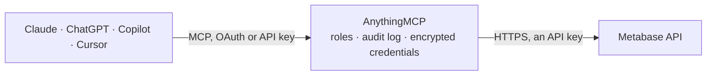

<!-- Generated by scripts/export-github-catalog.mjs in the anythingmcp-website repository. Do not edit by hand. -->

# Metabase MCP connector

Metabase BI: search and run saved questions and dashboard cards, run SQL or MBQL queries, read database, table and field metadata, browse collections, and create or update questions, dashboards and collections. The AnythingMCP connector gives Claude, ChatGPT, Microsoft Copilot, Cursor and Gemini 30 MCP tools for Metabase: 24 read and 6 can change data.

**Category:** [Analytics](../analytics.md) · **Tools:** 30 · **Setup guide:** [anythingmcp.com](https://anythingmcp.com/guides/metabase-to-mcp) · [Deutsch](https://anythingmcp.com/de/guides/metabase-to-mcp) · [Italiano](https://anythingmcp.com/it/guides/metabase-to-mcp) · [Español](https://anythingmcp.com/es/guides/metabase-to-mcp) · [日本語](https://anythingmcp.com/ja/guides/metabase-to-mcp) · [Русский](https://anythingmcp.com/ru/guides/metabase-to-mcp) · [中文](https://anythingmcp.com/zh/guides/metabase-to-mcp)

## Start without code

No installation and no terminal: AnythingMCP Cloud runs the Metabase connector for you, operated by helpcode.ai in Frankfurt, Germany.

1. **Click the button above** and create an account or sign in. The Metabase connector opens, ready to install.
2. **Paste the API key or token from your Metabase account.** Every click is in the [step-by-step guide](https://anythingmcp.com/guides/metabase-to-mcp).
3. **Click Install.** AnythingMCP shows the address of your MCP server.
4. **Add that address to your assistant:** [Claude](https://anythingmcp.com/guides/connect-metabase-to-claude) · [ChatGPT](https://anythingmcp.com/guides/connect-metabase-to-chatgpt) · [Microsoft Copilot](https://anythingmcp.com/guides/connect-metabase-to-copilot) · [Cursor](https://anythingmcp.com/guides/connect-metabase-to-cursor) · [Gemini CLI](https://anythingmcp.com/guides/connect-metabase-to-gemini) · [Meta Muse](https://anythingmcp.com/guides/connect-metabase-to-muse).
5. **Ask your first question**, for example: *Show me invoice INV-2026-047 for customer Nordic Solar AG and its status, amount and due date.*

Prefer help with the setup? [Talk to us](https://anythingmcp.com/contact).

## How it works

- **The AI client** speaks MCP (Streamable HTTP) to AnythingMCP and only sees tool names, descriptions and results. It never gets the Metabase credentials.
- **AnythingMCP** checks the client's role, builds the call from the tool definition, adds the credentials (an API key), calls Metabase, logs the call and returns the result.
- **Metabase** sees an ordinary API client with the rights of the account the credentials belong to.

## Tools

| Tool | What it does | Access |
|---|---|---|
| [`metabase_get_current_user`](#metabase_get_current_user) | The account the API key acts as: id, name, e-mail, whether it is an admin, and its group memberships. | read |
| [`metabase_list_users`](#metabase_list_users) | People in Metabase (admin only): id, name, e-mail, active state, groups, last login. | read |
| [`metabase_list_permission_groups`](#metabase_list_permission_groups) | Permission groups (All Users, Administrators and custom groups) with their member count. | read |
| [`metabase_list_databases`](#metabase_list_databases) | Databases connected to Metabase: id, name, engine (postgres, bigquery-cloud-sdk, snowflake, ...), sync state. | read |
| [`metabase_get_database`](#metabase_get_database) | One database: name, engine, time zone, sync schedule and, with include=tables, its tables. | read |
| [`metabase_get_database_metadata`](#metabase_get_database_metadata) | Full metadata of a database: every table with its fields (id, name, display name, base and semantic type, foreign key target). | read |
| [`metabase_list_database_schemas`](#metabase_list_database_schemas) | Schema names of one database (for example public or analytics), for metabase_list_schema_tables. | read |
| [`metabase_list_schema_tables`](#metabase_list_schema_tables) | Tables of one schema of a database: id, name, display name, description, entity type, row count estimate. | read |
| [`metabase_get_table_metadata`](#metabase_get_table_metadata) | A table with its fields (id, name, display name, base type, semantic type such as type/PK, type/FK, type/Category, foreign key targets), segments and metrics. | read |
| [`metabase_get_field_values`](#metabase_get_field_values) | Distinct values Metabase has cached for a category field (up to 1000), useful for filter values. | read |
| [`metabase_list_cards`](#metabase_list_cards) | Saved questions, models and metrics: id, name, type (question, model, metric), display, collection, description, the query behind it (dataset_query),… | read |
| [`metabase_get_card`](#metabase_get_card) | One saved question, model or metric: name, description, collection, display, the query (dataset_query: native SQL or MBQL), parameters and dashboards it is on. | read |
| [`metabase_run_card`](#metabase_run_card) | Run a saved question (or model) and return its result: data.cols (column names and types), data.rows (rows as arrays), row_count. | read |
| [`metabase_list_dashboards`](#metabase_list_dashboards) | Dashboards: id, name, description, collection, creator and last edit. | read |
| [`metabase_get_dashboard`](#metabase_get_dashboard) | One dashboard with its tabs, filters (parameters) and cards (dashcards): each dashcard has its id, card_id, the card, position and parameter mappings. | read |
| [`metabase_run_dashboard_card`](#metabase_run_dashboard_card) | Run one card of a dashboard with the dashboard's filter values and return its result rows (data.cols, data.rows). | read |
| [`metabase_list_collections`](#metabase_list_collections) | Collections (folders for questions, models and dashboards): id, name, location (path of parent ids), personal owner, archived flag. | read |
| [`metabase_get_collection`](#metabase_get_collection) | One collection: name, description, location, authority level (official), personal owner. | read |
| [`metabase_list_collection_items`](#metabase_list_collection_items) | What a collection contains: questions (card), models (dataset), metrics, dashboards, sub-collections, with id, name, model, description and last edit. | read |
| [`metabase_search`](#metabase_search) | Search Metabase content by name and description: questions (card), models (dataset), metrics, dashboards, collections, tables, databases, segments. | read |
| [`metabase_run_native_query`](#metabase_run_native_query) | Run a SQL (native) query on a connected database without saving it, with the permissions of the API key's group. | read |
| [`metabase_run_query`](#metabase_run_query) | Run any dataset query without saving it: an MBQL query built from table and field ids ({"database": 1, "type": "query", "query": {"source-table": 2,… | read |
| [`metabase_get_recent_items`](#metabase_get_recent_items) | Items the API key's account recently viewed (views) or picked in the data picker (selections): questions, dashboards, tables, collections with id and model. | read |
| [`metabase_get_popular_items`](#metabase_get_popular_items) | The most viewed dashboards, questions and tables of the instance, for "what do people use most". | read |
| [`metabase_create_card`](#metabase_create_card) | Save a new question, model or metric in a collection. | write |
| [`metabase_update_card`](#metabase_update_card) | Change a saved question: name, description, query, chart type and settings, collection, or archive it (archived true moves it to the trash, where it can be… | write |
| [`metabase_create_dashboard`](#metabase_create_dashboard) | Create an empty dashboard in a collection. | write |
| [`metabase_update_dashboard`](#metabase_update_dashboard) | Change a dashboard: name, description, collection, filters, tabs, archive state, or its cards. | write |
| [`metabase_create_collection`](#metabase_create_collection) | Create a collection (folder), optionally inside another one. | write |
| [`metabase_update_collection`](#metabase_update_collection) | Rename a collection, change its description, move it under another parent, or archive it (archived true moves it and its content to the trash; false… | write |

## Tool reference

Every parameter as the AI client sees it in `tools/list`. Source: [`packages/backend/src/adapters/intl/metabase.json`](../../../packages/backend/src/adapters/intl/metabase.json).

### `metabase_get_current_user`

The account the API key acts as: id, name, e-mail, whether it is an admin, and its group memberships. A quick check that the key and address work.

**Access:** read · **Call:** `GET /api/user/current`

No parameters.

### `metabase_list_users`

People in Metabase (admin only): id, name, e-mail, active state, groups, last login. Search by name or e-mail with query.

**Access:** read · **Call:** `GET /api/user`

| Parameter | Type | Required | Description |
|---|---|---|---|
| `query` | string | no | Part of a name or e-mail address. |
| `status` | `active` \| `deactivated` \| `all` | no | active (default), deactivated or all (deactivated and all need an admin key). |
| `group_id` | integer | no | Only members of this permission group (from metabase_list_permission_groups). |
| `limit` | integer | no | Maximum items to return (paging together with offset). |
| `offset` | integer | no | Items to skip, for the next page. |

### `metabase_list_permission_groups`

Permission groups (All Users, Administrators and custom groups) with their member count.

**Access:** read · **Call:** `GET /api/permissions/group`

No parameters.

### `metabase_list_databases`

Databases connected to Metabase: id, name, engine (postgres, bigquery-cloud-sdk, snowflake, ...), sync state. include=tables also lists every table, include=schemas the schema names. Connection details are left out.

**Access:** read · **Call:** `GET /api/database`

| Parameter | Type | Required | Description |
|---|---|---|---|
| `include` | `tables` \| `schemas` | no | tables or schemas to embed them in each database. |
| `saved` | boolean | no | true adds the virtual "Saved Questions" database. |

### `metabase_get_database`

One database: name, engine, time zone, sync schedule and, with include=tables, its tables. Connection details are left out.

**Access:** read · **Call:** `GET /api/database/{database_id}`

| Parameter | Type | Required | Description |
|---|---|---|---|
| `database_id` | integer | yes | Database id from metabase_list_databases. |
| `include` | `tables` \| `tables.fields` | no | tables, or tables.fields to add every column. |

### `metabase_get_database_metadata`

Full metadata of a database: every table with its fields (id, name, display name, base and semantic type, foreign key target). The field and table ids are what MBQL queries use. Large for big databases: prefer metabase_list_schema_tables and metabase_get_table_metadata then.

**Access:** read · **Call:** `GET /api/database/{database_id}/metadata`

| Parameter | Type | Required | Description |
|---|---|---|---|
| `database_id` | integer | yes | Database id from metabase_list_databases. |
| `include_hidden` | boolean | no | true also returns hidden tables and fields. |
| `skip_fields` | boolean | no | true returns the tables without their fields. |

### `metabase_list_database_schemas`

Schema names of one database (for example public or analytics), for metabase_list_schema_tables.

**Access:** read · **Call:** `GET /api/database/{database_id}/schemas`

| Parameter | Type | Required | Description |
|---|---|---|---|
| `database_id` | integer | yes | Database id from metabase_list_databases. |

### `metabase_list_schema_tables`

Tables of one schema of a database: id, name, display name, description, entity type, row count estimate.

**Access:** read · **Call:** `GET /api/database/{database_id}/schema/{schema}`

| Parameter | Type | Required | Description |
|---|---|---|---|
| `database_id` | integer | yes | Database id from metabase_list_databases. |
| `schema` | string | yes | Schema name from metabase_list_database_schemas. |

### `metabase_get_table_metadata`

A table with its fields (id, name, display name, base type, semantic type such as type/PK, type/FK, type/Category, foreign key targets), segments and metrics. Use the field ids in MBQL queries.

**Access:** read · **Call:** `GET /api/table/{table_id}/query_metadata`

| Parameter | Type | Required | Description |
|---|---|---|---|
| `table_id` | integer | yes | Table id from metabase_list_schema_tables or metabase_get_database_metadata. |
| `include_hidden_fields` | boolean | no | true also returns hidden fields. |

### `metabase_get_field_values`

Distinct values Metabase has cached for a category field (up to 1000), useful for filter values.

**Access:** read · **Call:** `GET /api/field/{field_id}/values`

| Parameter | Type | Required | Description |
|---|---|---|---|
| `field_id` | integer | yes | Field id from metabase_get_table_metadata. |

### `metabase_list_cards`

Saved questions, models and metrics: id, name, type (question, model, metric), display, collection, description, the query behind it (dataset_query), creator and last edit. Result metadata is left out.

**Access:** read · **Call:** `GET /api/card`

| Parameter | Type | Required | Description |
|---|---|---|---|
| `f` | `all` \| `mine` \| `bookmarked` \| `archived` \| `using_model` \| `using_segment` \| `table` \| `database` | no | all (default), mine, bookmarked, archived; using_model, using_segment, table or database together with model_id. |
| `model_id` | integer | no | With f=using_model or table or database: the model, table or database id. |

### `metabase_get_card`

One saved question, model or metric: name, description, collection, display, the query (dataset_query: native SQL or MBQL), parameters and dashboards it is on.

**Access:** read · **Call:** `GET /api/card/{card_id}`

| Parameter | Type | Required | Description |
|---|---|---|---|
| `card_id` | integer | yes | Question (card) id from metabase_list_cards or metabase_search. |

### `metabase_run_card`

Run a saved question (or model) and return its result: data.cols (column names and types), data.rows (rows as arrays), row_count. Pass parameters to fill its filters. Returns at most 2,000 rows.

**Access:** read · **Call:** `POST /api/card/{card_id}/query`

| Parameter | Type | Required | Description |
|---|---|---|---|
| `card_id` | integer | yes | Question (card) id from metabase_list_cards or metabase_search. |
| `parameters` | object[] | no | Filter values for the question's parameters, e.g. [{"type": "category", "value": ["CA"], "target": ["variable", ["template-tag", "state"]]}] for a SQL variable, or with "id" and "target" ["dimension", ...] as listed in the card's parameters. |
| `ignore_cache` | boolean | no | true runs the query again instead of using a cached result. |

### `metabase_list_dashboards`

Dashboards: id, name, description, collection, creator and last edit.

**Access:** read · **Call:** `GET /api/dashboard`

| Parameter | Type | Required | Description |
|---|---|---|---|
| `f` | `all` \| `mine` \| `archived` | no | all (default), mine or archived. |

### `metabase_get_dashboard`

One dashboard with its tabs, filters (parameters) and cards (dashcards): each dashcard has its id, card_id, the card, position and parameter mappings. Use dashcard id and card id with metabase_run_dashboard_card.

**Access:** read · **Call:** `GET /api/dashboard/{dashboard_id}`

| Parameter | Type | Required | Description |
|---|---|---|---|
| `dashboard_id` | integer | yes | Dashboard id from metabase_list_dashboards or metabase_search. |

### `metabase_run_dashboard_card`

Run one card of a dashboard with the dashboard's filter values and return its result rows (data.cols, data.rows). At most 2,000 rows.

**Access:** read · **Call:** `POST /api/dashboard/{dashboard_id}/dashcard/{dashcard_id}/card/{card_id}/query`

| Parameter | Type | Required | Description |
|---|---|---|---|
| `dashboard_id` | integer | yes | Dashboard id from metabase_list_dashboards or metabase_search. |
| `dashcard_id` | integer | yes | Dashcard id from metabase_get_dashboard (dashcards[].id). |
| `card_id` | integer | yes | Card id of that dashcard (dashcards[].card_id). |
| `parameters` | object[] | no | Dashboard filter values: [{"id": "<parameter id from the dashboard>", "type": "string/=", "value": ["CA"], "target": <the target from the dashcard parameter_mappings>}]. |

### `metabase_list_collections`

Collections (folders for questions, models and dashboards): id, name, location (path of parent ids), personal owner, archived flag.

**Access:** read · **Call:** `GET /api/collection`

| Parameter | Type | Required | Description |
|---|---|---|---|
| `archived` | boolean | no | true returns archived collections instead. |
| `personal_only` | boolean | no | true returns only personal collections. |
| `exclude_other_user_collections` | boolean | no | true leaves out other people's personal collections (admins see them otherwise). |

### `metabase_get_collection`

One collection: name, description, location, authority level (official), personal owner.

**Access:** read · **Call:** `GET /api/collection/{collection_id}`

| Parameter | Type | Required | Description |
|---|---|---|---|
| `collection_id` | string | yes | Collection id from metabase_list_collections, or root for the top level ("Our analytics"). |

### `metabase_list_collection_items`

What a collection contains: questions (card), models (dataset), metrics, dashboards, sub-collections, with id, name, model, description and last edit. Filter by models and page with limit and offset.

**Access:** read · **Call:** `GET /api/collection/{collection_id}/items`

| Parameter | Type | Required | Description |
|---|---|---|---|
| `collection_id` | string | yes | Collection id from metabase_list_collections, or root for the top level ("Our analytics"). |
| `models` | `card` \| `dataset` \| `metric` \| `dashboard` \| `collection` \| `snippet` \| `pulse` \| `timeline` \| `document`[] | no | Only these item kinds: card, dataset, metric, dashboard, collection, snippet, pulse, timeline, document. |
| `archived` | boolean | no | true lists archived items. |
| `pinned_state` | `all` \| `is_pinned` \| `is_not_pinned` | no | all (default), is_pinned or is_not_pinned. |
| `sort_column` | `name` \| `last_edited_at` \| `last_edited_by` \| `model` | no | name, last_edited_at, last_edited_by or model. |
| `sort_direction` | `asc` \| `desc` | no | asc or desc. |
| `limit` | integer | no | Maximum items to return (paging together with offset). |
| `offset` | integer | no | Items to skip, for the next page. |

### `metabase_search`

Search Metabase content by name and description: questions (card), models (dataset), metrics, dashboards, collections, tables, databases, segments. Returns data[] with model, id, name, collection and score, and total.

**Access:** read · **Call:** `GET /api/search`

| Parameter | Type | Required | Description |
|---|---|---|---|
| `q` | string | no | Search words. |
| `models` | `card` \| `dataset` \| `metric` \| `dashboard` \| `collection` \| `table` \| `database` \| `segment` \| `action` \| `indexed-entity` \| `document`[] | no | Only these kinds: card, dataset, metric, dashboard, collection, table, database, segment, action, indexed-entity, document. |
| `archived` | boolean | no | true searches the trash. |
| `table_db_id` | integer | no | Only tables and questions of this database id. |
| `verified` | boolean | no | true returns only verified items (Pro and Enterprise). |
| `search_native_query` | boolean | no | true also matches the SQL text of native questions. |
| `limit` | integer | no | Maximum items to return (paging together with offset). |
| `offset` | integer | no | Items to skip, for the next page. |

### `metabase_run_native_query`

Run a SQL (native) query on a connected database without saving it, with the permissions of the API key's group. Returns data.cols and data.rows, at most 2,000 rows. Use {{name}} variables with template_tags and parameters for values.

**Access:** read · **Call:** `POST /api/dataset`

| Parameter | Type | Required | Description |
|---|---|---|---|
| `database_id` | integer | yes | Database id from metabase_list_databases. |
| `sql` | string | yes | The SQL statement in the database's own dialect, e.g. SELECT state, count(*) FROM people GROUP BY state ORDER BY 2 DESC LIMIT 20. |
| `template_tags` | object | no | Variables used in the SQL as {{name}}: {"state": {"name": "state", "display-name": "State", "type": "text"}}. |
| `parameters` | object[] | no | Values for the variables: [{"type": "category", "value": "CA", "target": ["variable", ["template-tag", "state"]]}]. |

### `metabase_run_query`

Run any dataset query without saving it: an MBQL query built from table and field ids ({"database": 1, "type": "query", "query": {"source-table": 2, "aggregation": [["count"]], "breakout": [["field", 14, {"temporal-unit": "month"}]]}}) or a native one. Returns data.cols and data.rows, at most 2,000 rows.

**Access:** read · **Call:** `POST /api/dataset`

| Parameter | Type | Required | Description |
|---|---|---|---|
| `dataset_query` | object | yes | The whole query object with database, type (query or native) and query or native, as in a card's dataset_query. |

### `metabase_get_recent_items`

Items the API key's account recently viewed (views) or picked in the data picker (selections): questions, dashboards, tables, collections with id and model.

**Access:** read · **Call:** `GET /api/activity/recents`

| Parameter | Type | Required | Description |
|---|---|---|---|
| `context` | `views` \| `selections` | no | views (default) or selections. |

### `metabase_get_popular_items`

The most viewed dashboards, questions and tables of the instance, for "what do people use most".

**Access:** read · **Call:** `GET /api/activity/popular_items`

No parameters.

### `metabase_create_card`

Save a new question, model or metric in a collection. dataset_query is the query (native SQL or MBQL, as in metabase_run_query); display is the chart type.

**Access:** write · **Call:** `POST /api/card`

| Parameter | Type | Required | Description |
|---|---|---|---|
| `name` | string | yes | Name of the question. |
| `dataset_query` | object | yes | The query: {"database": 1, "type": "native", "native": {"query": "SELECT ..."}} or an MBQL query. |
| `display` | string | no | Chart type: table, scalar, line, bar, row, area, pie, combo, funnel, map, pivot, progress, gauge, waterfall, scatter, smartscalar, object. |
| `visualization_settings` | object | no | Chart settings, e.g. {"graph.dimensions": ["month"], "graph.metrics": ["count"]}. Default {}. |
| `type` | `question` \| `model` \| `metric` | no | question (default), model or metric. |
| `collection_id` | integer | no | Collection to save it in; leave out for the root collection. |
| `description` | string | no | Description shown with the question. |
| `dashboard_id` | integer | no | Save it inside this dashboard instead of a collection (dashboard question). |

### `metabase_update_card`

Change a saved question: name, description, query, chart type and settings, collection, or archive it (archived true moves it to the trash, where it can be restored; false restores it). Only the fields you pass change.

**Access:** write · **Call:** `PUT /api/card/{card_id}`

| Parameter | Type | Required | Description |
|---|---|---|---|
| `card_id` | integer | yes | Question (card) id from metabase_list_cards or metabase_search. |
| `name` | string | no | New name. |
| `description` | string | no | New description. |
| `dataset_query` | object | no | New query object. |
| `display` | string | no | New chart type. |
| `visualization_settings` | object | no | New chart settings (replaces the old ones). |
| `collection_id` | integer | no | Move it to this collection. |
| `archived` | boolean | no | true moves it to the trash, false restores it. |

### `metabase_create_dashboard`

Create an empty dashboard in a collection. Add cards afterwards with metabase_update_dashboard.

**Access:** write · **Call:** `POST /api/dashboard`

| Parameter | Type | Required | Description |
|---|---|---|---|
| `name` | string | yes | Dashboard name. |
| `description` | string | no | Description. |
| `collection_id` | integer | no | Collection to put it in; leave out for the root collection. |
| `parameters` | object[] | no | Dashboard filters: [{"id": "f1", "name": "State", "slug": "state", "type": "string/="}]. |

### `metabase_update_dashboard`

Change a dashboard: name, description, collection, filters, tabs, archive state, or its cards. dashcards REPLACES the whole card list: read metabase_get_dashboard first, keep the existing dashcards (with their ids) and add new ones with a negative id, e.g. {"id": -1, "card_id": 42, "row": 0, "col": 0, "size_x": 12, "size_y": 6}. The grid is 24 columns wide.

**Access:** write · **Call:** `PUT /api/dashboard/{dashboard_id}`

| Parameter | Type | Required | Description |
|---|---|---|---|
| `dashboard_id` | integer | yes | Dashboard id from metabase_list_dashboards or metabase_search. |
| `name` | string | no | New name. |
| `description` | string | no | New description. |
| `collection_id` | integer | no | Move it to this collection. |
| `archived` | boolean | no | true moves it to the trash, false restores it. |
| `parameters` | object[] | no | The full list of dashboard filters. |
| `dashcards` | object[] | no | The full list of dashboard cards (see the description). |
| `tabs` | object[] | no | The full list of tabs: [{"id": 1, "name": "Overview"}], new tabs with a negative id. |

### `metabase_create_collection`

Create a collection (folder), optionally inside another one.

**Access:** write · **Call:** `POST /api/collection`

| Parameter | Type | Required | Description |
|---|---|---|---|
| `name` | string | yes | Collection name. |
| `description` | string | no | Description. |
| `parent_id` | integer | no | Parent collection id; leave out for the root. |

### `metabase_update_collection`

Rename a collection, change its description, move it under another parent, or archive it (archived true moves it and its content to the trash; false restores it).

**Access:** write · **Call:** `PUT /api/collection/{collection_id}`

| Parameter | Type | Required | Description |
|---|---|---|---|
| `collection_id` | integer | yes | Collection id from metabase_list_collections. |
| `name` | string | no | New name. |
| `description` | string | no | New description. |
| `parent_id` | integer | no | New parent collection id. |
| `archived` | boolean | no | true moves it to the trash, false restores it. |

## Run it yourself

AnythingMCP is open source (AGPL-3.0). [Run it with Docker](../../../README.md#run-it-yourself), open **Connectors → Store**, pick **Metabase** and enter `METABASE_URL`, `METABASE_API_KEY`, then add your MCP server URL to the AI client.

[← Analytics connectors](../analytics.md) · [All categories](../README.md)
