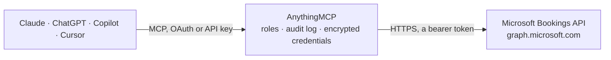

<!-- Generated by scripts/export-github-catalog.mjs in the anythingmcp-website repository. Do not edit by hand. -->

# Microsoft Bookings MCP connector

Drive Microsoft Bookings (Microsoft 365 scheduling product) via the Graph API: businesses, services, staff, appointments, customers. 8 tools, OAuth2 Bearer auth. The AnythingMCP connector gives Claude, ChatGPT, Microsoft Copilot, Cursor and Gemini 8 MCP tools for Microsoft Bookings: 6 read and 2 can change data.

**Category:** [Scheduling](../scheduling.md) · **Tools:** 8 · **Setup guide:** [anythingmcp.com](https://anythingmcp.com/guides/microsoft-bookings-to-mcp) · [Deutsch](https://anythingmcp.com/de/guides/microsoft-bookings-to-mcp) · [Italiano](https://anythingmcp.com/it/guides/microsoft-bookings-to-mcp) · [Español](https://anythingmcp.com/es/guides/microsoft-bookings-to-mcp) · [日本語](https://anythingmcp.com/ja/guides/microsoft-bookings-to-mcp) · [Русский](https://anythingmcp.com/ru/guides/microsoft-bookings-to-mcp) · [中文](https://anythingmcp.com/zh/guides/microsoft-bookings-to-mcp)

## Start without code

No installation and no terminal: AnythingMCP Cloud runs the Microsoft Bookings connector for you, operated by helpcode.ai in Frankfurt, Germany.

1. **Click the button above** and create an account or sign in. The Microsoft Bookings connector opens, ready to install.
2. **Paste the API key or token from your Microsoft Bookings account.** Every click is in the [step-by-step guide](https://anythingmcp.com/guides/microsoft-bookings-to-mcp).
3. **Click Install.** AnythingMCP shows the address of your MCP server.
4. **Add that address to your assistant:** [Claude](https://anythingmcp.com/guides/connect-microsoft-bookings-to-claude) · [ChatGPT](https://anythingmcp.com/guides/connect-microsoft-bookings-to-chatgpt) · [Microsoft Copilot](https://anythingmcp.com/guides/connect-microsoft-bookings-to-copilot) · [Cursor](https://anythingmcp.com/guides/connect-microsoft-bookings-to-cursor) · [Gemini CLI](https://anythingmcp.com/guides/connect-microsoft-bookings-to-gemini) · [Meta Muse](https://anythingmcp.com/guides/connect-microsoft-bookings-to-muse).
5. **Ask your first question**, for example: *On GreenLeaf bookings page appointments@greenleafgmbh.onmicrosoft.com show the booking on 2026-11-10 for customer Marta Klein*

Prefer help with the setup? [Talk to us](https://anythingmcp.com/contact).

## How it works

- **The AI client** speaks MCP (Streamable HTTP) to AnythingMCP and only sees tool names, descriptions and results. It never gets the Microsoft Bookings credentials.
- **AnythingMCP** checks the client's role, builds the call from the tool definition, adds the credentials (a bearer token), calls Microsoft Bookings, logs the call and returns the result.
- **Microsoft Bookings** sees an ordinary API client with the rights of the account the credentials belong to.

## Tools

| Tool | What it does | Access |
|---|---|---|
| [`microsoft_bookings_list_businesses`](#microsoft_bookings_list_businesses) | List all Bookings Businesses (mailbox-style booking pages) on the tenant. | read |
| [`microsoft_bookings_get_business`](#microsoft_bookings_get_business) | Get a Booking Business by ID with its public profile. | read |
| [`microsoft_bookings_list_services`](#microsoft_bookings_list_services) | List services (offerings) of a Booking Business. | read |
| [`microsoft_bookings_list_staff_members`](#microsoft_bookings_list_staff_members) | List staff members of a Booking Business. | read |
| [`microsoft_bookings_list_appointments`](#microsoft_bookings_list_appointments) | List appointments (bookings) in a Booking Business. | read |
| [`microsoft_bookings_get_appointment`](#microsoft_bookings_get_appointment) | Get one appointment by ID. | read |
| [`microsoft_bookings_create_appointment`](#microsoft_bookings_create_appointment) | Create a booked appointment. | write |
| [`microsoft_bookings_cancel_appointment`](#microsoft_bookings_cancel_appointment) | Cancel an appointment. | write |

## Tool reference

Every parameter as the AI client sees it in `tools/list`. Source: [`packages/backend/src/adapters/intl/microsoft-bookings.json`](../../../packages/backend/src/adapters/intl/microsoft-bookings.json).

### `microsoft_bookings_list_businesses`

List all Bookings Businesses (mailbox-style booking pages) on the tenant.

**Access:** read · **Call:** `GET /solutions/bookingBusinesses`

No parameters.

### `microsoft_bookings_get_business`

Get a Booking Business by ID with its public profile.

**Access:** read · **Call:** `GET /solutions/bookingBusinesses/{businessId}`

| Parameter | Type | Required | Description |
|---|---|---|---|
| `businessId` | string | yes | Bookings business ID (Contoso@tenant.onmicrosoft.com). |

### `microsoft_bookings_list_services`

List services (offerings) of a Booking Business. Each service has id, displayName, duration, defaultPrice, staffMemberIds[], smsNotificationsEnabled.

**Access:** read · **Call:** `GET /solutions/bookingBusinesses/{businessId}/services`

| Parameter | Type | Required | Description |
|---|---|---|---|
| `businessId` | string | yes | Business ID. |

### `microsoft_bookings_list_staff_members`

List staff members of a Booking Business.

**Access:** read · **Call:** `GET /solutions/bookingBusinesses/{businessId}/staffMembers`

| Parameter | Type | Required | Description |
|---|---|---|---|
| `businessId` | string | yes | Business ID. |

### `microsoft_bookings_list_appointments`

List appointments (bookings) in a Booking Business.

**Access:** read · **Call:** `GET /solutions/bookingBusinesses/{businessId}/appointments`

| Parameter | Type | Required | Description |
|---|---|---|---|
| `businessId` | string | yes | Business ID. |
| `$top` | integer | no | Max results per page. |
| `$filter` | string | no | OData $filter, e.g. 'start/dateTime ge 2025-01-01T00:00:00Z'. |

### `microsoft_bookings_get_appointment`

Get one appointment by ID.

**Access:** read · **Call:** `GET /solutions/bookingBusinesses/{businessId}/appointments/{appointmentId}`

| Parameter | Type | Required | Description |
|---|---|---|---|
| `businessId` | string | yes | Business ID. |
| `appointmentId` | string | yes | Appointment ID. |

### `microsoft_bookings_create_appointment`

Create a booked appointment. Required: serviceId + start + end + customers.

**Access:** write · **Call:** `POST /solutions/bookingBusinesses/{businessId}/appointments`

| Parameter | Type | Required | Description |
|---|---|---|---|
| `businessId` | string | yes | Business ID. |
| `appointment` | object | yes | {serviceId, start:{dateTime:'2025-01-01T15:00:00', timeZone:'Pacific Standard Time'}, end:{...}, customers:[{customerId? OR name+emailAddress}], staffMemberIds?:[], serviceLocation?:{...}, customerNotes?, smsNotificationsEnabled?:bool, isLocationOnline?:bool}. |

### `microsoft_bookings_cancel_appointment`

Cancel an appointment. Optional cancellationMessage.

**Access:** write · **Call:** `POST /solutions/bookingBusinesses/{businessId}/appointments/{appointmentId}/cancel`

| Parameter | Type | Required | Description |
|---|---|---|---|
| `businessId` | string | yes | Business ID. |
| `appointmentId` | string | yes | Appointment ID. |
| `cancellationMessage` | string | no | Message sent to the customer. |

## Run it yourself

AnythingMCP is open source (AGPL-3.0). [Run it with Docker](../../../README.md#run-it-yourself), open **Connectors → Store**, pick **Microsoft Bookings** and enter `MICROSOFT_GRAPH_ACCESS_TOKEN`, then add your MCP server URL to the AI client.

[← Scheduling connectors](../scheduling.md) · [All categories](../README.md)
