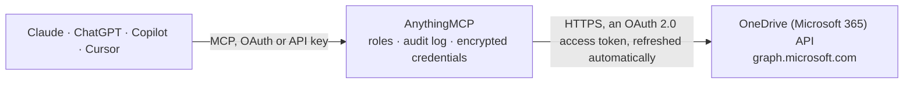

<!-- Generated by scripts/export-github-catalog.mjs in the anythingmcp-website repository. Do not edit by hand. -->

# OneDrive (Microsoft 365) MCP connector

Let your AI work in OneDrive: browse and search files and folders, see details and who has access, create folders, upload and update text files, copy, rename and move. The AnythingMCP connector gives Claude, ChatGPT, Microsoft Copilot, Cursor and Gemini 19 MCP tools for OneDrive (Microsoft 365): 10 read and 9 can change data.

**Category:** [File Storage](../storage.md) · **Tools:** 19 · **Setup guide:** [anythingmcp.com](https://anythingmcp.com/guides/microsoft-onedrive-to-mcp) · [Deutsch](https://anythingmcp.com/de/guides/microsoft-onedrive-to-mcp) · [Italiano](https://anythingmcp.com/it/guides/microsoft-onedrive-to-mcp) · [Español](https://anythingmcp.com/es/guides/microsoft-onedrive-to-mcp) · [日本語](https://anythingmcp.com/ja/guides/microsoft-onedrive-to-mcp) · [Русский](https://anythingmcp.com/ru/guides/microsoft-onedrive-to-mcp) · [中文](https://anythingmcp.com/zh/guides/microsoft-onedrive-to-mcp)

## Start without code

No installation and no terminal: AnythingMCP Cloud runs the OneDrive (Microsoft 365) connector for you, operated by helpcode.ai in Frankfurt, Germany.

1. **Click the button above** and create an account or sign in. The OneDrive (Microsoft 365) connector opens, ready to install.
2. **Sign in with your OneDrive (Microsoft 365) account** when AnythingMCP asks. The first time, an admin creates a small app in the OneDrive (Microsoft 365) developer console. Every click is in the [step-by-step guide](https://anythingmcp.com/guides/microsoft-onedrive-to-mcp).
3. **Click Install.** AnythingMCP shows the address of your MCP server.
4. **Add that address to your assistant:** [Claude](https://anythingmcp.com/guides/connect-microsoft-onedrive-to-claude) · [ChatGPT](https://anythingmcp.com/guides/connect-microsoft-onedrive-to-chatgpt) · [Microsoft Copilot](https://anythingmcp.com/guides/connect-microsoft-onedrive-to-copilot) · [Cursor](https://anythingmcp.com/guides/connect-microsoft-onedrive-to-cursor) · [Gemini CLI](https://anythingmcp.com/guides/connect-microsoft-onedrive-to-gemini) · [Meta Muse](https://anythingmcp.com/guides/connect-microsoft-onedrive-to-muse).
5. **Ask your first question**, for example: *Find the invoice PDF INV-2026-0423_NordicFurnishings.pdf in OneDrive and tell me where it is.*

Prefer help with the setup? [Talk to us](https://anythingmcp.com/contact).

## How it works

- **The AI client** speaks MCP (Streamable HTTP) to AnythingMCP and only sees tool names, descriptions and results. It never gets the OneDrive (Microsoft 365) credentials.
- **AnythingMCP** checks the client's role, builds the call from the tool definition, adds the credentials (an OAuth 2.0 access token, refreshed automatically), calls OneDrive (Microsoft 365), logs the call and returns the result.
- **OneDrive (Microsoft 365)** sees an ordinary API client with the rights of the account the credentials belong to.

## Tools

| Tool | What it does | Access |
|---|---|---|
| [`onedrive_get_drive`](#onedrive_get_drive) | Get the signed-in user's OneDrive: drive id, type (personal, business), owner, storage quota (total, used, remaining, deleted, state) and webUrl. | read |
| [`onedrive_list_root`](#onedrive_list_root) | List the files and folders at the top of the user's OneDrive: id, name, size, dates, who changed it last, folder child count or file mimeType, and webUrl. | read |
| [`onedrive_list_folder`](#onedrive_list_folder) | List the files and folders inside one folder, addressed by its id. | read |
| [`onedrive_list_folder_by_path`](#onedrive_list_folder_by_path) | List the files and folders inside a folder addressed by its path from the top of the OneDrive, e.g. "Documents/Reports". | read |
| [`onedrive_get_item`](#onedrive_get_item) | Get one file's or folder's metadata by id: name, size, dates, creator and last modifier, parent folder (parentReference with driveId, id and path), file… | read |
| [`onedrive_get_item_by_path`](#onedrive_get_item_by_path) | Get one file's or folder's metadata by its path from the top of the OneDrive, e.g. "Documents/Budget 2026.xlsx". | read |
| [`onedrive_get_shared_item`](#onedrive_get_shared_item) | Get the metadata of an item in another drive, typically a file someone shared with the user: pass remoteItem.parentReference.driveId and remoteItem.id from… | read |
| [`onedrive_search`](#onedrive_search) | Search the user's own OneDrive for files and folders whose name, metadata or content matches the text. | read |
| [`onedrive_search_shared`](#onedrive_search_shared) | Search the user's OneDrive and the files other people shared with the user. | read |
| [`onedrive_create_folder`](#onedrive_create_folder) | Create a folder inside a parent folder (default: the top of the OneDrive). | write |
| [`onedrive_upload_text_file`](#onedrive_upload_text_file) | Create a new text file (.txt, .md, .csv, .json, .html, .xml...) with the given content in a folder, in one call, up to about 4 MB. | write |
| [`onedrive_replace_file_content`](#onedrive_replace_file_content) | Overwrite the content of an existing text file with new text (up to about 4 MB). | write |
| [`onedrive_copy_item`](#onedrive_copy_item) | Copy a file or folder (with its contents) into a folder, optionally under a new name. | write |
| [`onedrive_rename_item`](#onedrive_rename_item) | Rename a file or folder in place. | write |
| [`onedrive_move_item`](#onedrive_move_item) | Move a file or folder into another folder of the same OneDrive, optionally renaming it on the way. | write |
| [`onedrive_delete_item`](#onedrive_delete_item) | Delete a file or folder (a folder with its contents). | write |
| [`onedrive_list_permissions`](#onedrive_list_permissions) | List who has access to a file or folder: each permission's id, roles (read, write, owner), the people or groups granted (grantedToV2,… | read |
| [`onedrive_create_sharing_link`](#onedrive_create_sharing_link) | Create a sharing link for a file or folder: type "view" or "edit", scope "anonymous" (anyone with the link, if the organisation allows it), "organization"… | write |
| [`onedrive_invite`](#onedrive_invite) | Give people access to a file or folder by email address, with role "read" or "write", and optionally send them an invitation email with a message. | write |

## Tool reference

Every parameter as the AI client sees it in `tools/list`. Source: [`packages/backend/src/adapters/intl/microsoft-onedrive.json`](../../../packages/backend/src/adapters/intl/microsoft-onedrive.json).

### `onedrive_get_drive`

Get the signed-in user's OneDrive: drive id, type (personal, business), owner, storage quota (total, used, remaining, deleted, state) and webUrl. The drive id is needed by onedrive_copy_item and by the Microsoft Excel connector.

**Access:** read · **Call:** `GET /me/drive`

No parameters.

### `onedrive_list_root`

List the files and folders at the top of the user's OneDrive: id, name, size, dates, who changed it last, folder child count or file mimeType, and webUrl. Paginate with skip_token.

**Access:** read · **Call:** `GET /me/drive/root/children`

| Parameter | Type | Required | Description |
|---|---|---|---|
| `top` | integer | no | Items per page (Graph's default is 200 for folders and lists). |
| `orderby` | string | no | Sort order, e.g. "name", "lastModifiedDateTime desc" or "size desc". OneDrive for work or school sorts only by some properties and answers 400 for others. |
| `skip_token` | string | no | To fetch the next page, pass the $skiptoken (or skipToken) value from the @odata.nextLink of the previous response, with the same other arguments. |

### `onedrive_list_folder`

List the files and folders inside one folder, addressed by its id. Returns the same fields as onedrive_list_root. Paginate with skip_token.

**Access:** read · **Call:** `GET /me/drive/items/{item_id}/children`

| Parameter | Type | Required | Description |
|---|---|---|---|
| `item_id` | string | yes | Id of the folder, from a list or search result (or "root"). |
| `top` | integer | no | Items per page (Graph's default is 200 for folders and lists). |
| `orderby` | string | no | Sort order, e.g. "name", "lastModifiedDateTime desc" or "size desc". OneDrive for work or school sorts only by some properties and answers 400 for others. |
| `skip_token` | string | no | To fetch the next page, pass the $skiptoken (or skipToken) value from the @odata.nextLink of the previous response, with the same other arguments. |

### `onedrive_list_folder_by_path`

List the files and folders inside a folder addressed by its path from the top of the OneDrive, e.g. "Documents/Reports". Returns the same fields as onedrive_list_root. Paginate with skip_token.

**Access:** read · **Call:** `GET /me/drive/root:/{path}:/children`

| Parameter | Type | Required | Description |
|---|---|---|---|
| `path` | string | yes | Path relative to the top of the OneDrive, without a leading slash, e.g. "Documents/Reports 2026" or "Documents/notes.txt". Names containing #, % or ? cannot be addressed by path: use the id tools. |
| `top` | integer | no | Items per page (Graph's default is 200 for folders and lists). |
| `orderby` | string | no | Sort order, e.g. "name", "lastModifiedDateTime desc" or "size desc". OneDrive for work or school sorts only by some properties and answers 400 for others. |
| `skip_token` | string | no | To fetch the next page, pass the $skiptoken (or skipToken) value from the @odata.nextLink of the previous response, with the same other arguments. |

### `onedrive_get_item`

Get one file's or folder's metadata by id: name, size, dates, creator and last modifier, parent folder (parentReference with driveId, id and path), file mimeType and hashes or folder child count, sharing state and webUrl. Does not return the content.

**Access:** read · **Call:** `GET /me/drive/items/{item_id}`

| Parameter | Type | Required | Description |
|---|---|---|---|
| `item_id` | string | yes | Item id from a list or search result (onedrive_list_root, onedrive_list_folder, onedrive_search...). Work or school ids look like 01BYE5RZ6QN3ZWBTUFOFD3GSPGOHDJD36K, personal ones like D4648F06C91D9D3D!54927. |

### `onedrive_get_item_by_path`

Get one file's or folder's metadata by its path from the top of the OneDrive, e.g. "Documents/Budget 2026.xlsx". Returns the same fields as onedrive_get_item, including the id the other tools need.

**Access:** read · **Call:** `GET /me/drive/root:/{path}`

| Parameter | Type | Required | Description |
|---|---|---|---|
| `path` | string | yes | Path relative to the top of the OneDrive, without a leading slash, e.g. "Documents/Reports 2026" or "Documents/notes.txt". Names containing #, % or ? cannot be addressed by path: use the id tools. |

### `onedrive_get_shared_item`

Get the metadata of an item in another drive, typically a file someone shared with the user: pass remoteItem.parentReference.driveId and remoteItem.id from onedrive_search_shared. Needs Files.Read.All or Files.ReadWrite.All in the connector's scopes.

**Access:** read · **Call:** `GET /drives/{drive_id}/items/{item_id}`

| Parameter | Type | Required | Description |
|---|---|---|---|
| `drive_id` | string | yes | The drive the item lives in (remoteItem.parentReference.driveId), e.g. b!s8RqPCGh0ESQS2EYnKM0IKS3lM7GxjdAviiob7oc5pXv_0LiL-62Qq3IXyrXnEop. |
| `item_id` | string | yes | The item's id in that drive (remoteItem.id). |

### `onedrive_search`

Search the user's own OneDrive for files and folders whose name, metadata or content matches the text. Returns id, name, size, dates, parentReference and webUrl per hit. Paginate with skip_token.

**Access:** read · **Call:** `GET /me/drive/root/search(q='{query}')`

| Parameter | Type | Required | Description |
|---|---|---|---|
| `query` | string | yes | Search text, matched against file names, metadata and content, e.g. "budget 2026". Write a single quote as two (''), e.g. "O''Brien". |
| `top` | integer | no | Items per page (Graph's default is 200 for folders and lists). |
| `skip_token` | string | no | To fetch the next page, pass the $skiptoken (or skipToken) value from the @odata.nextLink of the previous response, with the same other arguments. |

### `onedrive_search_shared`

Search the user's OneDrive and the files other people shared with the user. Hits stored elsewhere carry remoteItem (with parentReference.driveId and id): open them with onedrive_get_shared_item. Finding shared files needs Files.Read.All or Files.ReadWrite.All in the scopes. Paginate with skip_token.

**Access:** read · **Call:** `GET /me/drive/search(q='{query}')`

| Parameter | Type | Required | Description |
|---|---|---|---|
| `query` | string | yes | Search text, matched against file names, metadata and content, e.g. "budget 2026". Write a single quote as two (''), e.g. "O''Brien". |
| `top` | integer | no | Items per page (Graph's default is 200 for folders and lists). |
| `skip_token` | string | no | To fetch the next page, pass the $skiptoken (or skipToken) value from the @odata.nextLink of the previous response, with the same other arguments. |

### `onedrive_create_folder`

Create a folder inside a parent folder (default: the top of the OneDrive). Returns the new folder's id, name, parentReference and webUrl. With conflict_behavior "fail" (default) Graph answers 409 when the name exists.

**Access:** write · **Call:** `POST /me/drive/items/{parent_id}/children`

| Parameter | Type | Required | Description |
|---|---|---|---|
| `name` | string | yes | Folder name. Not allowed: " * : < > ? / \ \|. |
| `parent_id` | string | no | Id of the folder: from a list or search result, or "root" for the top of the OneDrive. |
| `conflict_behavior` | `fail` \| `rename` | no | What to do when an item with that name already exists: "fail" (default) or "rename" (Graph appends a number). |

### `onedrive_upload_text_file`

Create a new text file (.txt, .md, .csv, .json, .html, .xml...) with the given content in a folder, in one call, up to about 4 MB. Returns the new file's id, name, size and webUrl. With conflict_behavior "fail" (default) an existing file of that name is left alone and Graph answers 409.

**Access:** write · **Call:** `PUT /me/drive/items/{parent_id}:/{file_name}:/content`

| Parameter | Type | Required | Description |
|---|---|---|---|
| `file_name` | string | yes | File name with extension, e.g. "Meeting notes.md", "export.csv". The extension decides the file type. Not allowed: " * : < > ? / \ \|. |
| `content` | string | yes | The full text content (UTF-8), not empty, at most about 4 MB. |
| `parent_id` | string | no | Id of the folder: from a list or search result, or "root" for the top of the OneDrive. |
| `conflict_behavior` | `fail` \| `rename` | no | What to do when an item with that name already exists: "fail" (default) or "rename" (Graph appends a number). |

### `onedrive_replace_file_content`

Overwrite the content of an existing text file with new text (up to about 4 MB). OneDrive keeps the previous content in the file's version history. Returns the file's id, name, size and webUrl. Only for text files: binary files would be replaced with text.

**Access:** write · **Call:** `PUT /me/drive/items/{item_id}/content`

| Parameter | Type | Required | Description |
|---|---|---|---|
| `item_id` | string | yes | Item id from a list or search result (onedrive_list_root, onedrive_list_folder, onedrive_search...). Work or school ids look like 01BYE5RZ6QN3ZWBTUFOFD3GSPGOHDJD36K, personal ones like D4648F06C91D9D3D!54927. |
| `content` | string | yes | The full text content (UTF-8), not empty, at most about 4 MB. |

### `onedrive_copy_item`

Copy a file or folder (with its contents) into a folder, optionally under a new name. Runs asynchronously: Graph accepts the request with an empty answer and the copy appears shortly after; check with onedrive_list_folder. Needs the target drive id (onedrive_get_drive) and folder id.

**Access:** write · **Call:** `POST /me/drive/items/{item_id}/copy`

| Parameter | Type | Required | Description |
|---|---|---|---|
| `item_id` | string | yes | Item id from a list or search result (onedrive_list_root, onedrive_list_folder, onedrive_search...). Work or school ids look like 01BYE5RZ6QN3ZWBTUFOFD3GSPGOHDJD36K, personal ones like D4648F06C91D9D3D!54927. |
| `destination_drive_id` | string | yes | Drive id of the target folder: the id from onedrive_get_drive for the user's own OneDrive. |
| `destination_folder_id` | string | yes | Id of the target folder, from a list result or onedrive_get_item_by_path. For the top folder, use the real id that onedrive_get_item returns for item_id "root". |
| `name` | string | no | Name of the copy (default: the original's name). |
| `conflict_behavior` | `fail` \| `rename` | no | When the name exists in the target: "fail" (default) or "rename". Personal OneDrive ignores it. |

### `onedrive_rename_item`

Rename a file or folder in place. Keep the extension for files. Returns the item's id, name, parentReference and webUrl.

**Access:** write · **Call:** `PATCH /me/drive/items/{item_id}`

| Parameter | Type | Required | Description |
|---|---|---|---|
| `item_id` | string | yes | Item id from a list or search result (onedrive_list_root, onedrive_list_folder, onedrive_search...). Work or school ids look like 01BYE5RZ6QN3ZWBTUFOFD3GSPGOHDJD36K, personal ones like D4648F06C91D9D3D!54927. |
| `name` | string | yes | New name. Not allowed: " * : < > ? / \ \|. |

### `onedrive_move_item`

Move a file or folder into another folder of the same OneDrive, optionally renaming it on the way. Returns the item's id, name, new parentReference and webUrl.

**Access:** write · **Call:** `PATCH /me/drive/items/{item_id}`

| Parameter | Type | Required | Description |
|---|---|---|---|
| `item_id` | string | yes | Item id from a list or search result (onedrive_list_root, onedrive_list_folder, onedrive_search...). Work or school ids look like 01BYE5RZ6QN3ZWBTUFOFD3GSPGOHDJD36K, personal ones like D4648F06C91D9D3D!54927. |
| `new_parent_id` | string | yes | Id of the target folder (a list or search result, or onedrive_get_item_by_path). |
| `name` | string | no | Optional new name. |

### `onedrive_delete_item`

Delete a file or folder (a folder with its contents). It goes to the OneDrive recycle bin and can be restored from there by the user. Installed switched off.

**Access:** write · **Call:** `DELETE /me/drive/items/{item_id}`

| Parameter | Type | Required | Description |
|---|---|---|---|
| `item_id` | string | yes | Item id from a list or search result (onedrive_list_root, onedrive_list_folder, onedrive_search...). Work or school ids look like 01BYE5RZ6QN3ZWBTUFOFD3GSPGOHDJD36K, personal ones like D4648F06C91D9D3D!54927. |

### `onedrive_list_permissions`

List who has access to a file or folder: each permission's id, roles (read, write, owner), the people or groups granted (grantedToV2, grantedToIdentitiesV2), sharing links (link.type, link.scope, link.webUrl), inheritance and expiry.

**Access:** read · **Call:** `GET /me/drive/items/{item_id}/permissions`

| Parameter | Type | Required | Description |
|---|---|---|---|
| `item_id` | string | yes | Item id from a list or search result (onedrive_list_root, onedrive_list_folder, onedrive_search...). Work or school ids look like 01BYE5RZ6QN3ZWBTUFOFD3GSPGOHDJD36K, personal ones like D4648F06C91D9D3D!54927. |

### `onedrive_create_sharing_link`

Create a sharing link for a file or folder: type "view" or "edit", scope "anonymous" (anyone with the link, if the organisation allows it), "organization" (people in the organisation) or "users" (only people already given access). Returns the link with its webUrl. Installed switched off: a link gives other people access to the user's files.

**Access:** write · **Call:** `POST /me/drive/items/{item_id}/createLink`

| Parameter | Type | Required | Description |
|---|---|---|---|
| `item_id` | string | yes | Item id from a list or search result (onedrive_list_root, onedrive_list_folder, onedrive_search...). Work or school ids look like 01BYE5RZ6QN3ZWBTUFOFD3GSPGOHDJD36K, personal ones like D4648F06C91D9D3D!54927. |
| `type` | `view` \| `edit` | yes | Link type. |
| `scope` | `anonymous` \| `organization` \| `users` | no | Who the link works for. Personal OneDrive supports only anonymous. |
| `expiration_date_time` | string | no | Optional ISO 8601 expiry, e.g. 2026-12-31T23:00:00Z (where the organisation allows expiring links). |
| `password` | string | no | Optional password for an anonymous link (personal OneDrive and where the organisation allows it). |

### `onedrive_invite`

Give people access to a file or folder by email address, with role "read" or "write", and optionally send them an invitation email with a message. Returns the permissions created. Installed switched off: inviting gives other people access to the user's files.

**Access:** write · **Call:** `POST /me/drive/items/{item_id}/invite`

| Parameter | Type | Required | Description |
|---|---|---|---|
| `item_id` | string | yes | Item id from a list or search result (onedrive_list_root, onedrive_list_folder, onedrive_search...). Work or school ids look like 01BYE5RZ6QN3ZWBTUFOFD3GSPGOHDJD36K, personal ones like D4648F06C91D9D3D!54927. |
| `recipients` | object[] | yes | People to invite, e.g. [{"email": "ana@example.com"}]. |
| `roles` | `read` \| `write`[] | yes | ["read"] or ["write"]. |
| `send_invitation` | boolean | no | true to email the people (default true in Graph); false to grant access silently (work or school only). |
| `require_sign_in` | boolean | no | true (recommended) so the recipients must sign in to open the item. |
| `message` | string | no | Optional message in the invitation email. |
| `expiration_date_time` | string | no | Optional ISO 8601 time when the access ends. |

## Run it yourself

AnythingMCP is open source (AGPL-3.0). [Run it with Docker](../../../README.md#run-it-yourself), open **Connectors → Store**, pick **OneDrive (Microsoft 365)** and enter `MICROSOFT_CLIENT_ID`, `MICROSOFT_CLIENT_SECRET`, `MICROSOFT_TENANT_ID`, then add your MCP server URL to the AI client.

[← File Storage connectors](../storage.md) · [All categories](../README.md)
