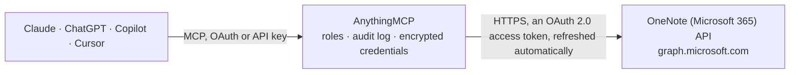

<!-- Generated by scripts/export-github-catalog.mjs in the anythingmcp-website repository. Do not edit by hand. -->

# OneNote (Microsoft 365) MCP connector

Let your AI work in OneNote: browse notebooks, sections and pages, read pages, create notebooks, sections and pages, and add notes to existing pages. The AnythingMCP connector gives Claude, ChatGPT, Microsoft Copilot, Cursor and Gemini 16 MCP tools for OneNote (Microsoft 365): 10 read and 6 can change data.

**Category:** [Productivity](../productivity.md) · **Tools:** 16 · **Setup guide:** [anythingmcp.com](https://anythingmcp.com/guides/microsoft-onenote-to-mcp) · [Deutsch](https://anythingmcp.com/de/guides/microsoft-onenote-to-mcp) · [Italiano](https://anythingmcp.com/it/guides/microsoft-onenote-to-mcp) · [Español](https://anythingmcp.com/es/guides/microsoft-onenote-to-mcp) · [日本語](https://anythingmcp.com/ja/guides/microsoft-onenote-to-mcp) · [Русский](https://anythingmcp.com/ru/guides/microsoft-onenote-to-mcp) · [中文](https://anythingmcp.com/zh/guides/microsoft-onenote-to-mcp)

## Start without code

No installation and no terminal: AnythingMCP Cloud runs the OneNote (Microsoft 365) connector for you, operated by helpcode.ai in Frankfurt, Germany.

1. **Click the button above** and create an account or sign in. The OneNote (Microsoft 365) connector opens, ready to install.
2. **Sign in with your OneNote (Microsoft 365) account** when AnythingMCP asks. The first time, an admin creates a small app in the OneNote (Microsoft 365) developer console. Every click is in the [step-by-step guide](https://anythingmcp.com/guides/microsoft-onenote-to-mcp).
3. **Click Install.** AnythingMCP shows the address of your MCP server.
4. **Add that address to your assistant:** [Claude](https://anythingmcp.com/guides/connect-microsoft-onenote-to-claude) · [ChatGPT](https://anythingmcp.com/guides/connect-microsoft-onenote-to-chatgpt) · [Microsoft Copilot](https://anythingmcp.com/guides/connect-microsoft-onenote-to-copilot) · [Cursor](https://anythingmcp.com/guides/connect-microsoft-onenote-to-cursor) · [Gemini CLI](https://anythingmcp.com/guides/connect-microsoft-onenote-to-gemini) · [Meta Muse](https://anythingmcp.com/guides/connect-microsoft-onenote-to-muse).
5. **Ask your first question**, for example: *Where is the OneNote page for invoice INV-2026-078 for customer 'Laurel & Pine GmbH' in our Finance notebook?*

Prefer help with the setup? [Talk to us](https://anythingmcp.com/contact).

## How it works

- **The AI client** speaks MCP (Streamable HTTP) to AnythingMCP and only sees tool names, descriptions and results. It never gets the OneNote (Microsoft 365) credentials.
- **AnythingMCP** checks the client's role, builds the call from the tool definition, adds the credentials (an OAuth 2.0 access token, refreshed automatically), calls OneNote (Microsoft 365), logs the call and returns the result.
- **OneNote (Microsoft 365)** sees an ordinary API client with the rights of the account the credentials belong to.

## Tools

| Tool | What it does | Access |
|---|---|---|
| [`microsoft_onenote_list_notebooks`](#microsoft_onenote_list_notebooks) | List the OneNote notebooks the user can open: id, displayName, isDefault, isShared, userRole (Owner, Contributor, Reader), dates and links (oneNoteWebUrl… | read |
| [`microsoft_onenote_list_sections`](#microsoft_onenote_list_sections) | List all sections in all of the user's notebooks, including sections inside section groups. | read |
| [`microsoft_onenote_list_notebook_sections`](#microsoft_onenote_list_notebook_sections) | List the sections directly inside one notebook (not those inside its section groups; see microsoft_onenote_list_notebook_section_groups). | read |
| [`microsoft_onenote_list_section_groups`](#microsoft_onenote_list_section_groups) | List all section groups (folders of sections) in the user's notebooks, including nested ones. | read |
| [`microsoft_onenote_list_notebook_section_groups`](#microsoft_onenote_list_notebook_section_groups) | List the section groups directly inside one notebook: id, displayName, dates and links. | read |
| [`microsoft_onenote_list_section_group_sections`](#microsoft_onenote_list_section_group_sections) | List the sections directly inside one section group: id, displayName, isDefault, dates and links. | read |
| [`microsoft_onenote_list_pages`](#microsoft_onenote_list_pages) | List pages across all of the user's notebooks, most recently changed first: id, title, createdDateTime, lastModifiedDateTime, links (oneNoteWebUrl) and… | read |
| [`microsoft_onenote_list_section_pages`](#microsoft_onenote_list_section_pages) | List the pages of one section: id, title, dates, links. | read |
| [`microsoft_onenote_get_page`](#microsoft_onenote_get_page) | Get one page's metadata: title, dates, links, contentUrl, and the parentSection and parentNotebook it belongs to. | read |
| [`microsoft_onenote_get_page_content`](#microsoft_onenote_get_page_content) | Read a page: OneNote returns the page as HTML (title in <title>, text in 
, <li>, <table> elements inside absolutely positioned 
s; images as … | read |
| [`microsoft_onenote_create_notebook`](#microsoft_onenote_create_notebook) | Create a new notebook in the user's OneDrive. | write |
| [`microsoft_onenote_create_section`](#microsoft_onenote_create_section) | Create a section in a notebook. | write |
| [`microsoft_onenote_create_page`](#microsoft_onenote_create_page) | Create a page in a section from a title and HTML content. | write |
| [`microsoft_onenote_append_to_page`](#microsoft_onenote_append_to_page) | Add HTML at the end of a page (inside its first div), e.g. "
Follow-up: call Anna on Friday
". | write |
| [`microsoft_onenote_update_page`](#microsoft_onenote_update_page) | Change a page with a list of commands, each {target, action, position?, content}. | write |
| [`microsoft_onenote_delete_page`](#microsoft_onenote_delete_page) | Delete a page. | write |

## Tool reference

Every parameter as the AI client sees it in `tools/list`. Source: [`packages/backend/src/adapters/intl/microsoft-onenote.json`](../../../packages/backend/src/adapters/intl/microsoft-onenote.json).

### `microsoft_onenote_list_notebooks`

List the OneNote notebooks the user can open: id, displayName, isDefault, isShared, userRole (Owner, Contributor, Reader), dates and links (oneNoteWebUrl opens the notebook in the browser). Sorted by name. Start here to find a notebook id.

**Access:** read · **Call:** `GET /me/onenote/notebooks`

| Parameter | Type | Required | Description |
|---|---|---|---|
| `filter` | string | no | OData filter, e.g. "contains(tolower(displayName),'project')" or "lastModifiedDateTime ge 2026-01-01". Property names are case-sensitive; compare text with tolower(). |
| `orderby` | string | no | Sort order, e.g. "displayName" or "lastModifiedDateTime desc". |
| `top` | integer | no | How many to return (default 20, at most 100). |
| `skip` | integer | no | How many to skip, for the next page: the $skip value from @odata.nextLink. |

### `microsoft_onenote_list_sections`

List all sections in all of the user's notebooks, including sections inside section groups. Each has id, displayName, isDefault, dates, links, and its parentNotebook and parentSectionGroup (id, displayName). Use filter to narrow, e.g. by name.

**Access:** read · **Call:** `GET /me/onenote/sections`

| Parameter | Type | Required | Description |
|---|---|---|---|
| `filter` | string | no | OData filter, e.g. "contains(tolower(displayName),'project')" or "lastModifiedDateTime ge 2026-01-01". Property names are case-sensitive; compare text with tolower(). |
| `orderby` | string | no | Sort order, e.g. "displayName" or "lastModifiedDateTime desc". |
| `top` | integer | no | How many to return (default 20, at most 100). |
| `skip` | integer | no | How many to skip, for the next page: the $skip value from @odata.nextLink. |

### `microsoft_onenote_list_notebook_sections`

List the sections directly inside one notebook (not those inside its section groups; see microsoft_onenote_list_notebook_section_groups). Returns id, displayName, isDefault, dates and links.

**Access:** read · **Call:** `GET /me/onenote/notebooks/{notebook_id}/sections`

| Parameter | Type | Required | Description |
|---|---|---|---|
| `notebook_id` | string | yes | Notebook id from microsoft_onenote_list_notebooks, e.g. 1-10143016-70dc-4449-b92a-3015225f800d. |
| `filter` | string | no | OData filter, e.g. "contains(tolower(displayName),'project')" or "lastModifiedDateTime ge 2026-01-01". Property names are case-sensitive; compare text with tolower(). |
| `orderby` | string | no | Sort order, e.g. "displayName" or "lastModifiedDateTime desc". |
| `top` | integer | no | How many to return (default 20, at most 100). |
| `skip` | integer | no | How many to skip, for the next page: the $skip value from @odata.nextLink. |

### `microsoft_onenote_list_section_groups`

List all section groups (folders of sections) in the user's notebooks, including nested ones. Each has id, displayName, parentNotebook and parentSectionGroup.

**Access:** read · **Call:** `GET /me/onenote/sectionGroups`

| Parameter | Type | Required | Description |
|---|---|---|---|
| `filter` | string | no | OData filter, e.g. "contains(tolower(displayName),'project')" or "lastModifiedDateTime ge 2026-01-01". Property names are case-sensitive; compare text with tolower(). |
| `orderby` | string | no | Sort order, e.g. "displayName" or "lastModifiedDateTime desc". |
| `top` | integer | no | How many to return (default 20, at most 100). |
| `skip` | integer | no | How many to skip, for the next page: the $skip value from @odata.nextLink. |

### `microsoft_onenote_list_notebook_section_groups`

List the section groups directly inside one notebook: id, displayName, dates and links. Their sections come from microsoft_onenote_list_section_group_sections.

**Access:** read · **Call:** `GET /me/onenote/notebooks/{notebook_id}/sectionGroups`

| Parameter | Type | Required | Description |
|---|---|---|---|
| `notebook_id` | string | yes | Notebook id from microsoft_onenote_list_notebooks, e.g. 1-10143016-70dc-4449-b92a-3015225f800d. |
| `filter` | string | no | OData filter, e.g. "contains(tolower(displayName),'project')" or "lastModifiedDateTime ge 2026-01-01". Property names are case-sensitive; compare text with tolower(). |
| `orderby` | string | no | Sort order, e.g. "displayName" or "lastModifiedDateTime desc". |
| `top` | integer | no | How many to return (default 20, at most 100). |
| `skip` | integer | no | How many to skip, for the next page: the $skip value from @odata.nextLink. |

### `microsoft_onenote_list_section_group_sections`

List the sections directly inside one section group: id, displayName, isDefault, dates and links.

**Access:** read · **Call:** `GET /me/onenote/sectionGroups/{section_group_id}/sections`

| Parameter | Type | Required | Description |
|---|---|---|---|
| `section_group_id` | string | yes | Section group id from microsoft_onenote_list_section_groups. |
| `filter` | string | no | OData filter, e.g. "contains(tolower(displayName),'project')" or "lastModifiedDateTime ge 2026-01-01". Property names are case-sensitive; compare text with tolower(). |
| `orderby` | string | no | Sort order, e.g. "displayName" or "lastModifiedDateTime desc". |
| `top` | integer | no | How many to return (default 20, at most 100). |
| `skip` | integer | no | How many to skip, for the next page: the $skip value from @odata.nextLink. |

### `microsoft_onenote_list_pages`

List pages across all of the user's notebooks, most recently changed first: id, title, createdDateTime, lastModifiedDateTime, links (oneNoteWebUrl) and parentSection. Search page titles with filter "contains(tolower(title),'word')". Page text is not searchable here; read it with microsoft_onenote_get_page_content. When the user has very many OneNote items this call can fail (error 10008); list the pages of one section with microsoft_onenote_list_section_pages instead.

**Access:** read · **Call:** `GET /me/onenote/pages`

| Parameter | Type | Required | Description |
|---|---|---|---|
| `filter` | string | no | OData filter on page properties, e.g. "contains(tolower(title),'meeting')" to search titles, "lastModifiedDateTime ge 2026-09-01", or "parentNotebook/id eq '<notebook id>'". Property names are case-sensitive; compare text with tolower(). |
| `orderby` | string | no | Sort order, e.g. "title" or "createdDateTime desc". Default: lastModifiedDateTime desc (most recently changed first). |
| `top` | integer | no | How many to return (default 20, at most 100). |
| `skip` | integer | no | How many to skip, for the next page: the $skip value from @odata.nextLink. |

### `microsoft_onenote_list_section_pages`

List the pages of one section: id, title, dates, links. With page_level true each page also carries level (indentation, 0 for top-level pages) and order (position in the section).

**Access:** read · **Call:** `GET /me/onenote/sections/{section_id}/pages`

| Parameter | Type | Required | Description |
|---|---|---|---|
| `section_id` | string | yes | Section id from microsoft_onenote_list_sections or microsoft_onenote_list_notebook_sections. |
| `filter` | string | no | OData filter on page properties, e.g. "contains(tolower(title),'meeting')" to search titles, "lastModifiedDateTime ge 2026-09-01", or "parentNotebook/id eq '<notebook id>'". Property names are case-sensitive; compare text with tolower(). |
| `orderby` | string | no | Sort order, e.g. "title" or "createdDateTime desc". Default: lastModifiedDateTime desc (most recently changed first). |
| `top` | integer | no | How many to return (default 20, at most 100). |
| `skip` | integer | no | How many to skip, for the next page: the $skip value from @odata.nextLink. |
| `page_level` | boolean | no | Also return each page's level and order within the section. |

### `microsoft_onenote_get_page`

Get one page's metadata: title, dates, links, contentUrl, and the parentSection and parentNotebook it belongs to. For the text, use microsoft_onenote_get_page_content.

**Access:** read · **Call:** `GET /me/onenote/pages/{page_id}`

| Parameter | Type | Required | Description |
|---|---|---|---|
| `page_id` | string | yes | Page id from microsoft_onenote_list_pages or microsoft_onenote_list_section_pages. |

### `microsoft_onenote_get_page_content`

Read a page: OneNote returns the page as HTML (title in <title>, text in 
, <li>, <table> elements inside absolutely positioned 
s; images as  links to Graph that need the user's sign-in to open). Answers larger than about 200 KB are cut off with a note. Set include_ids to true before editing with microsoft_onenote_update_page: every element then carries the generated id that update commands target.

**Access:** read · **Call:** `GET /me/onenote/pages/{page_id}/content`

| Parameter | Type | Required | Description |
|---|---|---|---|
| `page_id` | string | yes | Page id from microsoft_onenote_list_pages or microsoft_onenote_list_section_pages. |
| `include_ids` | boolean | no | Add the generated id of every element (needed to target paragraphs, lists and tables with microsoft_onenote_update_page). |

### `microsoft_onenote_create_notebook`

Create a new notebook in the user's OneDrive. Returns the notebook with id and links. Confirm with the user before calling.

**Access:** write · **Call:** `POST /me/onenote/notebooks`

| Parameter | Type | Required | Description |
|---|---|---|---|
| `display_name` | string | yes | Notebook name, unique among the user's notebooks, at most 128 characters, without ? * / : < > \| ' ". |

### `microsoft_onenote_create_section`

Create a section in a notebook. Returns the section with id, which microsoft_onenote_create_page needs. Confirm with the user before calling.

**Access:** write · **Call:** `POST /me/onenote/notebooks/{notebook_id}/sections`

| Parameter | Type | Required | Description |
|---|---|---|---|
| `notebook_id` | string | yes | Notebook id from microsoft_onenote_list_notebooks, e.g. 1-10143016-70dc-4449-b92a-3015225f800d. |
| `display_name` | string | yes | Section name, unique in the notebook, at most 50 characters, without ? * \ / : < > \| & # ' " % ~. |

### `microsoft_onenote_create_page`

Create a page in a section from a title and HTML content. Use simple HTML: 
, <h1>-<h6>, <b>, <i>, <ul>/<ol>/<li>, <table>, <a href>,  (a public image URL), and 
 for a checkbox. Returns the new page with id and links (oneNoteWebUrl). A new page takes a few seconds before OneNote accepts changes to it: an append or update that answers 404 right after creation succeeds when retried a little later. Confirm with the user before calling.

**Access:** write · **Call:** `POST /me/onenote/sections/{section_id}/pages`

| Parameter | Type | Required | Description |
|---|---|---|---|
| `section_id` | string | yes | Section id from microsoft_onenote_list_sections or microsoft_onenote_list_notebook_sections. |
| `title` | string | yes | Page title, plain text. Write & as &amp; and < as &lt;. |
| `body_html` | string | yes | The page content as HTML elements (what goes inside <body>), e.g. "
Agenda
<ul><li>Budget</li></ul>". Must be well-formed: close every tag, write & as &amp;. |

### `microsoft_onenote_append_to_page`

Add HTML at the end of a page (inside its first div), e.g. "
Follow-up: call Anna on Friday
". The simplest way to add notes to an existing page. OneNote answers with no content when it worked. Right after microsoft_onenote_create_page OneNote can answer 404 for a few seconds; wait briefly and retry. Confirm with the user before calling.

**Access:** write · **Call:** `PATCH /me/onenote/pages/{page_id}/content`

| Parameter | Type | Required | Description |
|---|---|---|---|
| `page_id` | string | yes | Page id from microsoft_onenote_list_pages or microsoft_onenote_list_section_pages. |
| `html` | string | yes | Well-formed HTML to append, e.g. "
New paragraph
" or "<ul><li>Item</li></ul>". |

### `microsoft_onenote_update_page`

Change a page with a list of commands, each {target, action, position?, content}. target: "title" (only action replace, content = new title text), "body" (the first div; append or prepend), "#data-id" (an id you set with data-id when writing), or a generated id from microsoft_onenote_get_page_content with include_ids true, e.g. "p:{33f8a242-...}{40}" (without #). action: append (as last child, or first with position before; for body, div, ol, ul), prepend, insert (as sibling, position after or before), replace (needs the generated id, except for title). Generated ids change after an update, so read the page again before the next one. OneNote answers with no content when it worked. Right after microsoft_onenote_create_page OneNote can answer 404 for a few seconds; wait briefly and retry. Confirm with the user before calling.

**Access:** write · **Call:** `PATCH /me/onenote/pages/{page_id}/content`

| Parameter | Type | Required | Description |
|---|---|---|---|
| `page_id` | string | yes | Page id from microsoft_onenote_list_pages or microsoft_onenote_list_section_pages. |
| `commands` | object[] | yes | The changes, applied in order, e.g. [{"target":"title","action":"replace","content":"Q4 planning"},{"target":"p:{33f8a242-7c33-4bb2-90c5-8425a68cc5bf}{40}","action":"replace","content":"
Updated text
"}]. |

### `microsoft_onenote_delete_page`

Delete a page. This connector cannot undo it. Installed switched off. Confirm with the user before calling.

**Access:** write · **Call:** `DELETE /me/onenote/pages/{page_id}`

| Parameter | Type | Required | Description |
|---|---|---|---|
| `page_id` | string | yes | Page id from microsoft_onenote_list_pages or microsoft_onenote_list_section_pages. |

## Run it yourself

AnythingMCP is open source (AGPL-3.0). [Run it with Docker](../../../README.md#run-it-yourself), open **Connectors → Store**, pick **OneNote (Microsoft 365)** and enter `MICROSOFT_CLIENT_ID`, `MICROSOFT_CLIENT_SECRET`, `MICROSOFT_TENANT_ID`, then add your MCP server URL to the AI client.

[← Productivity connectors](../productivity.md) · [All categories](../README.md)
