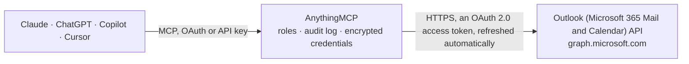

<!-- Generated by scripts/export-github-catalog.mjs in the anythingmcp-website repository. Do not edit by hand. -->

# Outlook (Microsoft 365 Mail and Calendar) MCP connector

Let your AI work in Outlook: search and read email, file messages in folders, draft, send and reply, check the calendar, create and move meetings, and find free time with colleagues. The AnythingMCP connector gives Claude, ChatGPT, Microsoft Copilot, Cursor and Gemini 19 MCP tools for Outlook (Microsoft 365 Mail and Calendar): 11 read and 8 can change data.

**Category:** [Email](../email.md) · **Tools:** 19 · **Setup guide:** [anythingmcp.com](https://anythingmcp.com/guides/microsoft-outlook-to-mcp) · [Deutsch](https://anythingmcp.com/de/guides/microsoft-outlook-to-mcp) · [Italiano](https://anythingmcp.com/it/guides/microsoft-outlook-to-mcp) · [Español](https://anythingmcp.com/es/guides/microsoft-outlook-to-mcp) · [日本語](https://anythingmcp.com/ja/guides/microsoft-outlook-to-mcp) · [Русский](https://anythingmcp.com/ru/guides/microsoft-outlook-to-mcp) · [中文](https://anythingmcp.com/zh/guides/microsoft-outlook-to-mcp)

## Start without code

No installation and no terminal: AnythingMCP Cloud runs the Outlook (Microsoft 365 Mail and Calendar) connector for you, operated by helpcode.ai in Frankfurt, Germany.

1. **Click the button above** and create an account or sign in. The Outlook (Microsoft 365 Mail and Calendar) connector opens, ready to install.
2. **Sign in with your Outlook (Microsoft 365 Mail and Calendar) account** when AnythingMCP asks. The first time, an admin creates a small app in the Outlook (Microsoft 365 Mail and Calendar) developer console. Every click is in the [step-by-step guide](https://anythingmcp.com/guides/microsoft-outlook-to-mcp).
3. **Click Install.** AnythingMCP shows the address of your MCP server.
4. **Add that address to your assistant:** [Claude](https://anythingmcp.com/guides/connect-microsoft-outlook-to-claude) · [ChatGPT](https://anythingmcp.com/guides/connect-microsoft-outlook-to-chatgpt) · [Microsoft Copilot](https://anythingmcp.com/guides/connect-microsoft-outlook-to-copilot) · [Cursor](https://anythingmcp.com/guides/connect-microsoft-outlook-to-cursor) · [Gemini CLI](https://anythingmcp.com/guides/connect-microsoft-outlook-to-gemini) · [Meta Muse](https://anythingmcp.com/guides/connect-microsoft-outlook-to-muse).
5. **Ask your first question**, for example: *Do we have the signed contract email from Berg & Sohn GmbH for PO 2026-114?*

Prefer help with the setup? [Talk to us](https://anythingmcp.com/contact).

## How it works

- **The AI client** speaks MCP (Streamable HTTP) to AnythingMCP and only sees tool names, descriptions and results. It never gets the Outlook (Microsoft 365 Mail and Calendar) credentials.
- **AnythingMCP** checks the client's role, builds the call from the tool definition, adds the credentials (an OAuth 2.0 access token, refreshed automatically), calls Outlook (Microsoft 365 Mail and Calendar), logs the call and returns the result.
- **Outlook (Microsoft 365 Mail and Calendar)** sees an ordinary API client with the rights of the account the credentials belong to.

## Tools

| Tool | What it does | Access |
|---|---|---|
| [`outlook_get_me`](#outlook_get_me) | Return the signed-in Microsoft 365 or Outlook.com user: id, display name, email address (mail) and user principal name. | read |
| [`outlook_list_mail_folders`](#outlook_list_mail_folders) | List the top-level mail folders of the mailbox (Inbox, Sent Items, Drafts, Archive and the user's own folders) with id, displayName, parentFolderId,… | read |
| [`outlook_list_child_folders`](#outlook_list_child_folders) | List the subfolders of one mail folder, with the same fields as outlook_list_mail_folders. | read |
| [`outlook_list_messages`](#outlook_list_messages) | List the messages of one mail folder, newest first unless orderby says otherwise. | read |
| [`outlook_search_messages`](#outlook_search_messages) | Search or filter messages across the whole mailbox, all folders included (Deleted Items too). | read |
| [`outlook_get_message`](#outlook_get_message) | Get one message in full: subject, sender, all recipients, dates, flags, conversationId, internetMessageId, attachments flag and the body as plain text (HTML… | read |
| [`outlook_create_draft`](#outlook_create_draft) | Create a draft message in the Drafts folder without sending it. | write |
| [`outlook_send_draft`](#outlook_send_draft) | Send an existing draft (from outlook_create_draft or one written in Outlook). | write |
| [`outlook_send_mail`](#outlook_send_mail) | Compose and send a new email in one step, from the signed-in mailbox. | write |
| [`outlook_reply_to_message`](#outlook_reply_to_message) | Reply to the sender of a message (or to its Reply-To addresses) and send the reply at once, quoting the original below the comment. | write |
| [`outlook_reply_all_to_message`](#outlook_reply_all_to_message) | Reply to the sender and every other recipient of a message and send the reply at once, quoting the original below the comment. | write |
| [`outlook_move_message`](#outlook_move_message) | Move a message to another mail folder (for example to archive it or file it in a project folder). | write |
| [`outlook_list_calendars`](#outlook_list_calendars) | List the user's calendars with id, name, color, owner, whether it is the default calendar and whether the user can edit it. | read |
| [`outlook_list_events`](#outlook_list_events) | List the events of the default calendar that fall within a time range, with recurring meetings expanded into their single occurrences. | read |
| [`outlook_list_calendar_events`](#outlook_list_calendar_events) | List the events of one specific calendar (a shared, secondary or team calendar) within a time range, with recurring meetings expanded. | read |
| [`outlook_get_event`](#outlook_get_event) | Get one calendar event in full: subject, body (HTML), start and end, location, organizer, attendees with their responses, recurrence, online meeting details… | read |
| [`outlook_create_event`](#outlook_create_event) | Create an event in the user's default calendar. | write |
| [`outlook_update_event`](#outlook_update_event) | Change an existing event: only the fields given are changed, the others stay as they are. | write |
| [`outlook_get_free_busy`](#outlook_get_free_busy) | Get free/busy availability of up to several people, rooms or distribution lists in the same organisation for a time window, to find a slot for a meeting. | read |

## Tool reference

Every parameter as the AI client sees it in `tools/list`. Source: [`packages/backend/src/adapters/intl/microsoft-outlook.json`](../../../packages/backend/src/adapters/intl/microsoft-outlook.json).

### `outlook_get_me`

Return the signed-in Microsoft 365 or Outlook.com user: id, display name, email address (mail) and user principal name. Use it to confirm which mailbox the connector reads and sends from.

**Access:** read · **Call:** `GET /me`

No parameters.

### `outlook_list_mail_folders`

List the top-level mail folders of the mailbox (Inbox, Sent Items, Drafts, Archive and the user's own folders) with id, displayName, parentFolderId, childFolderCount, unreadItemCount and totalItemCount. Folder ids are needed to list messages of a user folder or to move a message there.

**Access:** read · **Call:** `GET /me/mailFolders`

| Parameter | Type | Required | Description |
|---|---|---|---|
| `top` | integer | no | Folders per page (Outlook's default is 10). |
| `skip` | integer | no | Number of items to skip. To fetch the next page, pass the $skip value of the @odata.nextLink in the previous response, with the same other arguments. |
| `include_hidden` | boolean | no | true to include hidden folders as well. |

### `outlook_list_child_folders`

List the subfolders of one mail folder, with the same fields as outlook_list_mail_folders. Use it for folders whose childFolderCount is above 0, e.g. project folders under the Inbox.

**Access:** read · **Call:** `GET /me/mailFolders/{folder_id}/childFolders`

| Parameter | Type | Required | Description |
|---|---|---|---|
| `folder_id` | string | yes | Parent folder id from outlook_list_mail_folders, or a well-known name such as inbox. |
| `top` | integer | no | Folders per page (Outlook's default is 10). |
| `skip` | integer | no | Number of items to skip. To fetch the next page, pass the $skip value of the @odata.nextLink in the previous response, with the same other arguments. |

### `outlook_list_messages`

List the messages of one mail folder, newest first unless orderby says otherwise. Each message comes with id, subject, from, recipients, received and sent time, read and draft state, attachments flag, importance, flag, a short bodyPreview, conversationId and webLink; the full body is returned by outlook_get_message. Supports an OData filter (e.g. isRead eq false) or a keyword search inside the folder.

**Access:** read · **Call:** `GET /me/mailFolders/{folder_id}/messages`

| Parameter | Type | Required | Description |
|---|---|---|---|
| `folder_id` | string | yes | Folder id from outlook_list_mail_folders, or a well-known name: inbox, drafts, sentitems, deleteditems, archive, junkemail. |
| `filter` | string | no | OData $filter, e.g. "isRead eq false", "receivedDateTime ge 2026-10-01T00:00:00Z", "from/emailAddress/address eq 'ana@example.com'", "hasAttachments eq true". Properties used in orderby must also appear in the filter, first and in the same order. |
| `search` | string | no | Keyword search; the double quotes are part of the value, e.g. "invoice" or "from:ana@example.com subject:offer" (quotes included). Cannot be combined with filter or orderby; returns at most 1000 results sorted by sent date. |
| `orderby` | string | no | OData $orderby, e.g. "receivedDateTime desc". |
| `top` | integer | no | Messages per page, 1 to 1000 (Outlook's default is 10). |
| `skip` | integer | no | Number of items to skip. To fetch the next page, pass the $skip value of the @odata.nextLink in the previous response, with the same other arguments. |

### `outlook_search_messages`

Search or filter messages across the whole mailbox, all folders included (Deleted Items too). Returns the same summary fields as outlook_list_messages. Use search for keywords and KQL properties (from:, to:, subject:, body:, attachment:, received:, hasAttachments:true), or filter for exact OData conditions.

**Access:** read · **Call:** `GET /me/messages`

| Parameter | Type | Required | Description |
|---|---|---|---|
| `search` | string | no | Keyword search; the double quotes are part of the value, e.g. "quarterly report" or "from:ana@example.com" (quotes included). Without a property it matches from, subject and body. Cannot be combined with filter or orderby; at most 1000 results, newest first. |
| `filter` | string | no | OData $filter, e.g. "receivedDateTime ge 2026-10-01T00:00:00Z and isRead eq false". |
| `orderby` | string | no | OData $orderby, e.g. "receivedDateTime desc" (only together with filter, or alone). |
| `top` | integer | no | Messages per page, 1 to 1000 (Outlook's default is 10). |
| `skip` | integer | no | Number of items to skip. To fetch the next page, pass the $skip value of the @odata.nextLink in the previous response, with the same other arguments. |

### `outlook_get_message`

Get one message in full: subject, sender, all recipients, dates, flags, conversationId, internetMessageId, attachments flag and the body as plain text (HTML is converted by Outlook). Use the id from outlook_list_messages or outlook_search_messages.

**Access:** read · **Call:** `GET /me/messages/{message_id}`

| Parameter | Type | Required | Description |
|---|---|---|---|
| `message_id` | string | yes | Message id. |

### `outlook_create_draft`

Create a draft message in the Drafts folder without sending it. Returns the draft with its id; send it later with outlook_send_draft, or leave it for the user to review in Outlook.

**Access:** write · **Call:** `POST /me/messages`

| Parameter | Type | Required | Description |
|---|---|---|---|
| `subject` | string | yes | Subject line. |
| `body` | object | yes | Body: {"contentType": "Text" or "HTML", "content": "..."}. |
| `to_recipients` | object[] | no | To recipients, each {"emailAddress": {"address": "ana@example.com", "name": "Ana"}}. |
| `cc_recipients` | object[] | no | Cc recipients, same shape as to_recipients. |
| `bcc_recipients` | object[] | no | Bcc recipients, same shape as to_recipients. |
| `importance` | `low` \| `normal` \| `high` | no | Importance (default normal). |

### `outlook_send_draft`

Send an existing draft (from outlook_create_draft or one written in Outlook). The message moves to Sent Items; the draft id is no longer valid afterwards. Outlook answers 202 with an empty body.

**Access:** write · **Call:** `POST /me/messages/{message_id}/send`

| Parameter | Type | Required | Description |
|---|---|---|---|
| `message_id` | string | yes | Id of the draft to send. |

### `outlook_send_mail`

Compose and send a new email in one step, from the signed-in mailbox. A copy is kept in Sent Items unless save_to_sent_items is false. Outlook answers 202 with an empty body; to review a message before it goes out, use outlook_create_draft instead.

**Access:** write · **Call:** `POST /me/sendMail`

| Parameter | Type | Required | Description |
|---|---|---|---|
| `subject` | string | yes | Subject line. |
| `body` | object | yes | Body: {"contentType": "Text" or "HTML", "content": "..."}. |
| `to_recipients` | object[] | yes | To recipients, each {"emailAddress": {"address": "ana@example.com", "name": "Ana"}}. |
| `cc_recipients` | object[] | no | Cc recipients, same shape as to_recipients. |
| `bcc_recipients` | object[] | no | Bcc recipients, same shape as to_recipients. |
| `importance` | `low` \| `normal` \| `high` | no | Importance (default normal). |
| `save_to_sent_items` | boolean | no | false to send without keeping a copy in Sent Items (default true). |

### `outlook_reply_to_message`

Reply to the sender of a message (or to its Reply-To addresses) and send the reply at once, quoting the original below the comment. The reply is saved in Sent Items; Outlook answers 202 with an empty body.

**Access:** write · **Call:** `POST /me/messages/{message_id}/reply`

| Parameter | Type | Required | Description |
|---|---|---|---|
| `message_id` | string | yes | Id of the message being answered. |
| `comment` | string | yes | The reply text, placed above the quoted original. |

### `outlook_reply_all_to_message`

Reply to the sender and every other recipient of a message and send the reply at once, quoting the original below the comment. The reply is saved in Sent Items; Outlook answers 202 with an empty body.

**Access:** write · **Call:** `POST /me/messages/{message_id}/replyAll`

| Parameter | Type | Required | Description |
|---|---|---|---|
| `message_id` | string | yes | Id of the message being answered. |
| `comment` | string | yes | The reply text, placed above the quoted original. |

### `outlook_move_message`

Move a message to another mail folder (for example to archive it or file it in a project folder). Returns the moved message, which has a new id in its new folder.

**Access:** write · **Call:** `POST /me/messages/{message_id}/move`

| Parameter | Type | Required | Description |
|---|---|---|---|
| `message_id` | string | yes | Id of the message to move. |
| `destination_id` | string | yes | Target folder id from outlook_list_mail_folders, or a well-known name: inbox, archive, deleteditems, junkemail, drafts. |

### `outlook_list_calendars`

List the user's calendars with id, name, color, owner, whether it is the default calendar and whether the user can edit it. Calendar ids are needed by outlook_list_calendar_events.

**Access:** read · **Call:** `GET /me/calendars`

No parameters.

### `outlook_list_events`

List the events of the default calendar that fall within a time range, with recurring meetings expanded into their single occurrences. Each event comes with id, subject, start, end, all-day flag, location, organizer, attendees and their responses, show-as status, online meeting link, bodyPreview and webLink, sorted by start time.

**Access:** read · **Call:** `GET /me/calendarView`

| Parameter | Type | Required | Description |
|---|---|---|---|
| `start_date_time` | string | yes | Start of the range, ISO 8601 with offset, e.g. 2026-10-08T00:00:00+02:00 (without an offset it is read as UTC). |
| `end_date_time` | string | yes | End of the range, ISO 8601 with offset, e.g. 2026-10-15T00:00:00+02:00. |
| `timezone` | string | no | Time zone for the start and end times in the response, e.g. 'Europe/Berlin' or 'W. Europe Standard Time'. Without it, Outlook returns UTC. |
| `top` | integer | no | Events per page (Outlook's default is 10). |
| `skip` | integer | no | Number of items to skip. To fetch the next page, pass the $skip value of the @odata.nextLink in the previous response, with the same other arguments. |

### `outlook_list_calendar_events`

List the events of one specific calendar (a shared, secondary or team calendar) within a time range, with recurring meetings expanded. Same fields and ordering as outlook_list_events, which covers the default calendar.

**Access:** read · **Call:** `GET /me/calendars/{calendar_id}/calendarView`

| Parameter | Type | Required | Description |
|---|---|---|---|
| `calendar_id` | string | yes | Calendar id from outlook_list_calendars. |
| `start_date_time` | string | yes | Start of the range, ISO 8601 with offset, e.g. 2026-10-08T00:00:00+02:00. |
| `end_date_time` | string | yes | End of the range, ISO 8601 with offset, e.g. 2026-10-15T00:00:00+02:00. |
| `timezone` | string | no | Time zone for the start and end times in the response, e.g. 'Europe/Berlin' or 'W. Europe Standard Time'. Without it, Outlook returns UTC. |
| `top` | integer | no | Events per page (Outlook's default is 10). |
| `skip` | integer | no | Number of items to skip. To fetch the next page, pass the $skip value of the @odata.nextLink in the previous response, with the same other arguments. |

### `outlook_get_event`

Get one calendar event in full: subject, body (HTML), start and end, location, organizer, attendees with their responses, recurrence, online meeting details and the user's own response.

**Access:** read · **Call:** `GET /me/events/{event_id}`

| Parameter | Type | Required | Description |
|---|---|---|---|
| `event_id` | string | yes | Event id from outlook_list_events or outlook_list_calendar_events. |
| `timezone` | string | no | Time zone for the start and end times in the response, e.g. 'Europe/Berlin' or 'W. Europe Standard Time'. Without it, Outlook returns UTC. |

### `outlook_create_event`

Create an event in the user's default calendar. With attendees, Outlook sends them a meeting invitation; with is_online_meeting true on a work or school account, a Teams link is added. Returns the event with its id.

**Access:** write · **Call:** `POST /me/events`

| Parameter | Type | Required | Description |
|---|---|---|---|
| `subject` | string | yes | Title of the event. |
| `start` | object | yes | Start: {"dateTime": "2026-10-08T14:00:00", "timeZone": "Europe/Berlin"}. |
| `end` | object | yes | End: {"dateTime": "2026-10-08T15:00:00", "timeZone": "Europe/Berlin"}. |
| `body` | object | no | Description: {"contentType": "Text" or "HTML", "content": "..."}. |
| `location` | object | no | Where the event takes place: {"displayName": "Room 4.12"}. |
| `attendees` | object[] | no | Attendees, each {"emailAddress": {"address": "ana@example.com", "name": "Ana"}, "type": "required"}. type is required, optional or resource. Outlook sends each attendee an invitation. |
| `is_all_day` | boolean | no | true for an all-day event; start and end must then be midnight, in the same time zone. |
| `is_online_meeting` | boolean | no | true to attach an online meeting (Teams) link. |
| `show_as` | `free` \| `tentative` \| `busy` \| `oof` \| `workingElsewhere` | no | How the time shows in free/busy (default busy). |
| `reminder_minutes_before_start` | integer | no | Reminder, in minutes before the start. |

### `outlook_update_event`

Change an existing event: only the fields given are changed, the others stay as they are. When the user organises the meeting, attendees receive an update; attendees passed here replace the whole attendee list. Returns the updated event.

**Access:** write · **Call:** `PATCH /me/events/{event_id}`

| Parameter | Type | Required | Description |
|---|---|---|---|
| `event_id` | string | yes | Id of the event to change. |
| `subject` | string | no | New title. |
| `start` | object | no | New start: {"dateTime": "2026-10-08T14:00:00", "timeZone": "Europe/Berlin"}. |
| `end` | object | no | New end: {"dateTime": "2026-10-08T15:00:00", "timeZone": "Europe/Berlin"}. |
| `body` | object | no | New description: {"contentType": "Text" or "HTML", "content": "..."}. |
| `location` | object | no | Where the event takes place: {"displayName": "Room 4.12"}. |
| `attendees` | object[] | no | Attendees, each {"emailAddress": {"address": "ana@example.com", "name": "Ana"}, "type": "required"}. type is required, optional or resource. Outlook sends each attendee an invitation. |
| `is_all_day` | boolean | no | true for an all-day event. |
| `is_online_meeting` | boolean | no | true to attach an online meeting (Teams) link. |
| `show_as` | `free` \| `tentative` \| `busy` \| `oof` \| `workingElsewhere` | no | How the time shows in free/busy. |
| `reminder_minutes_before_start` | integer | no | Reminder, in minutes before the start. |

### `outlook_get_free_busy`

Get free/busy availability of up to several people, rooms or distribution lists in the same organisation for a time window, to find a slot for a meeting. Returns per address an availabilityView string (one digit per interval: 0 free, 1 tentative, 2 busy, 3 out of office, 4 working elsewhere), the busy items and the working hours. Work or school accounts only.

**Access:** read · **Call:** `POST /me/calendar/getSchedule`

| Parameter | Type | Required | Description |
|---|---|---|---|
| `schedules` | string[] | yes | Email addresses of the people, rooms or lists to check; include the user's own address to compare with their calendar. |
| `start_time` | object | yes | Start of the window: {"dateTime": "2026-10-08T08:00:00", "timeZone": "Europe/Berlin"}. |
| `end_time` | object | yes | End of the window: {"dateTime": "2026-10-08T18:00:00", "timeZone": "Europe/Berlin"}. |
| `interval_minutes` | integer | no | Length of each availabilityView slot in minutes, 5 to 1440 (default 30). |
| `timezone` | string | no | Time zone for the start and end times in the response, e.g. 'Europe/Berlin' or 'W. Europe Standard Time'. Without it, Outlook returns UTC. |

## Run it yourself

AnythingMCP is open source (AGPL-3.0). [Run it with Docker](../../../README.md#run-it-yourself), open **Connectors → Store**, pick **Outlook (Microsoft 365 Mail and Calendar)** and enter `MICROSOFT_CLIENT_ID`, `MICROSOFT_CLIENT_SECRET`, `MICROSOFT_TENANT_ID`, then add your MCP server URL to the AI client.

[← Email connectors](../email.md) · [All categories](../README.md)
