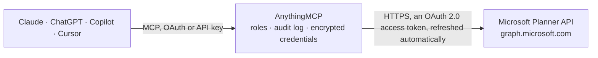

<!-- Generated by scripts/export-github-catalog.mjs in the anythingmcp-website repository. Do not edit by hand. -->

# Microsoft Planner MCP connector

Let your AI work with Microsoft Planner: see your tasks across plans, browse team plans and buckets, create and assign tasks, update progress, due dates and checklists. The AnythingMCP connector gives Claude, ChatGPT, Microsoft Copilot, Cursor and Gemini 17 MCP tools for Microsoft Planner: 12 read and 5 can change data.

**Category:** [Productivity](../productivity.md) · **Tools:** 17 · **Setup guide:** [anythingmcp.com](https://anythingmcp.com/guides/microsoft-planner-to-mcp) · [Deutsch](https://anythingmcp.com/de/guides/microsoft-planner-to-mcp) · [Italiano](https://anythingmcp.com/it/guides/microsoft-planner-to-mcp) · [Español](https://anythingmcp.com/es/guides/microsoft-planner-to-mcp) · [日本語](https://anythingmcp.com/ja/guides/microsoft-planner-to-mcp) · [Русский](https://anythingmcp.com/ru/guides/microsoft-planner-to-mcp) · [中文](https://anythingmcp.com/zh/guides/microsoft-planner-to-mcp)

## Start without code

No installation and no terminal: AnythingMCP Cloud runs the Microsoft Planner connector for you, operated by helpcode.ai in Frankfurt, Germany.

1. **Click the button above** and create an account or sign in. The Microsoft Planner connector opens, ready to install.
2. **Sign in with your Microsoft Planner account** when AnythingMCP asks. The first time, an admin creates a small app in the Microsoft Planner developer console. Every click is in the [step-by-step guide](https://anythingmcp.com/guides/microsoft-planner-to-mcp).
3. **Click Install.** AnythingMCP shows the address of your MCP server.
4. **Add that address to your assistant:** [Claude](https://anythingmcp.com/guides/connect-microsoft-planner-to-claude) · [ChatGPT](https://anythingmcp.com/guides/connect-microsoft-planner-to-chatgpt) · [Microsoft Copilot](https://anythingmcp.com/guides/connect-microsoft-planner-to-copilot) · [Cursor](https://anythingmcp.com/guides/connect-microsoft-planner-to-cursor) · [Gemini CLI](https://anythingmcp.com/guides/connect-microsoft-planner-to-gemini) · [Meta Muse](https://anythingmcp.com/guides/connect-microsoft-planner-to-muse).
5. **Ask your first question**, for example: *Where is the task for PO 2026-045 Site survey in the Renewables plan? I need its status and due date.*

Prefer help with the setup? [Talk to us](https://anythingmcp.com/contact).

## How it works

- **The AI client** speaks MCP (Streamable HTTP) to AnythingMCP and only sees tool names, descriptions and results. It never gets the Microsoft Planner credentials.
- **AnythingMCP** checks the client's role, builds the call from the tool definition, adds the credentials (an OAuth 2.0 access token, refreshed automatically), calls Microsoft Planner, logs the call and returns the result.
- **Microsoft Planner** sees an ordinary API client with the rights of the account the credentials belong to.

## Tools

| Tool | What it does | Access |
|---|---|---|
| [`microsoft_planner_get_me`](#microsoft_planner_get_me) | Get the signed-in user's id, displayName, mail and userPrincipalName. | read |
| [`microsoft_planner_list_my_tasks`](#microsoft_planner_list_my_tasks) | List the Planner tasks assigned to the signed-in user, across all plans: id, title, planId, bucketId, percentComplete (0, 50, 100), priority, dueDateTime,… | read |
| [`microsoft_planner_list_my_plans`](#microsoft_planner_list_my_plans) | List the plans shared with the signed-in user: id, title, owner (the group id), container, createdDateTime. | read |
| [`microsoft_planner_list_my_groups`](#microsoft_planner_list_my_groups) | List the groups the signed-in user is a direct member of: id, displayName, groupTypes (Unified for Microsoft 365 groups, which can own plans), mail. | read |
| [`microsoft_planner_list_group_plans`](#microsoft_planner_list_group_plans) | List the plans owned by a Microsoft 365 group (a team's plans live in its group): id, title, createdDateTime. | read |
| [`microsoft_planner_get_plan`](#microsoft_planner_get_plan) | Get one plan: id, title, owner, container, createdBy, createdDateTime, @odata.etag. | read |
| [`microsoft_planner_get_plan_details`](#microsoft_planner_get_plan_details) | Get a plan's details: categoryDescriptions (the label names behind category1 ... | read |
| [`microsoft_planner_list_buckets`](#microsoft_planner_list_buckets) | List a plan's buckets (the board columns, e.g. To do, Doing, Done): id, name, planId, orderHint. | read |
| [`microsoft_planner_list_plan_tasks`](#microsoft_planner_list_plan_tasks) | List all tasks of a plan: id, title, bucketId, percentComplete, priority, dueDateTime, assignments, appliedCategories, @odata.etag. | read |
| [`microsoft_planner_list_bucket_tasks`](#microsoft_planner_list_bucket_tasks) | List the tasks in one bucket, with the same fields as microsoft_planner_list_plan_tasks. | read |
| [`microsoft_planner_get_task`](#microsoft_planner_get_task) | Get one task with its current @odata.etag, which microsoft_planner_update_task needs. | read |
| [`microsoft_planner_get_task_details`](#microsoft_planner_get_task_details) | Get a task's details: description (the notes), checklist (items keyed by id, each with title and isChecked), references (attached links) and the details'… | read |
| [`microsoft_planner_create_task`](#microsoft_planner_create_task) | Create a task in a plan and bucket, with assignees, dates, priority and labels. | write |
| [`microsoft_planner_update_task`](#microsoft_planner_update_task) | Change a task: only the fields you pass are changed. | write |
| [`microsoft_planner_update_task_details`](#microsoft_planner_update_task_details) | Change a task's description, checklist or links. | write |
| [`microsoft_planner_create_bucket`](#microsoft_planner_create_bucket) | Create a bucket (board column) in a plan. | write |
| [`microsoft_planner_delete_task`](#microsoft_planner_delete_task) | Delete a task for everyone in the plan. | write |

## Tool reference

Every parameter as the AI client sees it in `tools/list`. Source: [`packages/backend/src/adapters/intl/microsoft-planner.json`](../../../packages/backend/src/adapters/intl/microsoft-planner.json).

### `microsoft_planner_get_me`

Get the signed-in user's id, displayName, mail and userPrincipalName. The id is what assignments use to give a task to the user.

**Access:** read · **Call:** `GET /me`

No parameters.

### `microsoft_planner_list_my_tasks`

List the Planner tasks assigned to the signed-in user, across all plans: id, title, planId, bucketId, percentComplete (0, 50, 100), priority, dueDateTime, startDateTime, assignments, appliedCategories and @odata.etag. Start here for "what are my tasks".

**Access:** read · **Call:** `GET /me/planner/tasks`

No parameters.

### `microsoft_planner_list_my_plans`

List the plans shared with the signed-in user: id, title, owner (the group id), container, createdDateTime. Plans of groups the user belongs to that are missing here can be found with microsoft_planner_list_my_groups and microsoft_planner_list_group_plans.

**Access:** read · **Call:** `GET /me/planner/plans`

No parameters.

### `microsoft_planner_list_my_groups`

List the groups the signed-in user is a direct member of: id, displayName, groupTypes (Unified for Microsoft 365 groups, which can own plans), mail. Directory roles appear too, with @odata.type #microsoft.graph.directoryRole; ignore them. Paginate with skip_token.

**Access:** read · **Call:** `GET /me/memberOf`

| Parameter | Type | Required | Description |
|---|---|---|---|
| `skip_token` | string | no | To fetch the next page, pass the $skiptoken value from @odata.nextLink of the previous answer. |

### `microsoft_planner_list_group_plans`

List the plans owned by a Microsoft 365 group (a team's plans live in its group): id, title, createdDateTime.

**Access:** read · **Call:** `GET /groups/{group_id}/planner/plans`

| Parameter | Type | Required | Description |
|---|---|---|---|
| `group_id` | string | yes | Microsoft 365 group id (a GUID) from microsoft_planner_list_my_groups. |

### `microsoft_planner_get_plan`

Get one plan: id, title, owner, container, createdBy, createdDateTime, @odata.etag.

**Access:** read · **Call:** `GET /planner/plans/{plan_id}`

| Parameter | Type | Required | Description |
|---|---|---|---|
| `plan_id` | string | yes | Plan id (28 characters) from microsoft_planner_list_my_plans, microsoft_planner_list_group_plans or a task's planId. |

### `microsoft_planner_get_plan_details`

Get a plan's details: categoryDescriptions (the label names behind category1 ... category25) and sharedWith (user ids the plan is shared with).

**Access:** read · **Call:** `GET /planner/plans/{plan_id}/details`

| Parameter | Type | Required | Description |
|---|---|---|---|
| `plan_id` | string | yes | Plan id (28 characters) from microsoft_planner_list_my_plans, microsoft_planner_list_group_plans or a task's planId. |

### `microsoft_planner_list_buckets`

List a plan's buckets (the board columns, e.g. To do, Doing, Done): id, name, planId, orderHint.

**Access:** read · **Call:** `GET /planner/plans/{plan_id}/buckets`

| Parameter | Type | Required | Description |
|---|---|---|---|
| `plan_id` | string | yes | Plan id (28 characters) from microsoft_planner_list_my_plans, microsoft_planner_list_group_plans or a task's planId. |

### `microsoft_planner_list_plan_tasks`

List all tasks of a plan: id, title, bucketId, percentComplete, priority, dueDateTime, assignments, appliedCategories, @odata.etag. Completed tasks are included (percentComplete 100).

**Access:** read · **Call:** `GET /planner/plans/{plan_id}/tasks`

| Parameter | Type | Required | Description |
|---|---|---|---|
| `plan_id` | string | yes | Plan id (28 characters) from microsoft_planner_list_my_plans, microsoft_planner_list_group_plans or a task's planId. |

### `microsoft_planner_list_bucket_tasks`

List the tasks in one bucket, with the same fields as microsoft_planner_list_plan_tasks.

**Access:** read · **Call:** `GET /planner/buckets/{bucket_id}/tasks`

| Parameter | Type | Required | Description |
|---|---|---|---|
| `bucket_id` | string | yes | Bucket id (28 characters) from microsoft_planner_list_buckets or a task's bucketId. |

### `microsoft_planner_get_task`

Get one task with its current @odata.etag, which microsoft_planner_update_task needs. Fields: title, planId, bucketId, percentComplete, priority, startDateTime, dueDateTime, completedDateTime, assignments, appliedCategories, hasDescription, checklistItemCount.

**Access:** read · **Call:** `GET /planner/tasks/{task_id}`

| Parameter | Type | Required | Description |
|---|---|---|---|
| `task_id` | string | yes | Task id (28 characters) from microsoft_planner_list_my_tasks, microsoft_planner_list_plan_tasks or microsoft_planner_list_bucket_tasks. |

### `microsoft_planner_get_task_details`

Get a task's details: description (the notes), checklist (items keyed by id, each with title and isChecked), references (attached links) and the details' own @odata.etag, which microsoft_planner_update_task_details needs.

**Access:** read · **Call:** `GET /planner/tasks/{task_id}/details`

| Parameter | Type | Required | Description |
|---|---|---|---|
| `task_id` | string | yes | Task id (28 characters) from microsoft_planner_list_my_tasks, microsoft_planner_list_plan_tasks or microsoft_planner_list_bucket_tasks. |

### `microsoft_planner_create_task`

Create a task in a plan and bucket, with assignees, dates, priority and labels. Returns the task with its id and @odata.etag. Add a description or checklist afterwards with microsoft_planner_update_task_details. Confirm with the user before calling.

**Access:** write · **Call:** `POST /planner/tasks`

| Parameter | Type | Required | Description |
|---|---|---|---|
| `plan_id` | string | yes | Plan id (28 characters) from microsoft_planner_list_my_plans, microsoft_planner_list_group_plans or a task's planId. |
| `title` | string | yes | Task title. |
| `bucket_id` | string | no | Bucket (column) for the task, from microsoft_planner_list_buckets. Pass one so the task lands in the intended column. |
| `assignments` | object | no | Who does the task, keyed by Microsoft Entra user id: {"<user id>": {"@odata.type": "#microsoft.graph.plannerAssignment", "orderHint": " !"}}. The signed-in user's id comes from microsoft_planner_get_me; other people's ids from the assignments of existing tasks. In an update, {"<user id>": null} removes that person. |
| `due_date_time` | string | no | Due date and time in UTC, ISO 8601, e.g. 2026-10-31T16:00:00Z. |
| `start_date_time` | string | no | Start date and time in UTC, ISO 8601, e.g. 2026-10-20T08:00:00Z. |
| `priority` | integer | no | 0-10, lower is more urgent. Planner shows 1 as Urgent, 3 Important, 5 Medium, 9 Low. |
| `percent_complete` | integer | no | Progress: 0 not started, 50 in progress, 100 completed. |
| `applied_categories` | object | no | Labels to set or clear, e.g. {"category1": true, "category3": false}. category1 to category25; their names per plan come from microsoft_planner_get_plan_details (categoryDescriptions). |

### `microsoft_planner_update_task`

Change a task: only the fields you pass are changed. Complete it with percent_complete 100, move it to another bucket with bucket_id, (un)assign people with assignments. Needs the task's current etag from microsoft_planner_get_task; returns the updated task with its new @odata.etag. Confirm with the user before calling.

**Access:** write · **Call:** `PATCH /planner/tasks/{task_id}`

| Parameter | Type | Required | Description |
|---|---|---|---|
| `task_id` | string | yes | Task id (28 characters) from microsoft_planner_list_my_tasks, microsoft_planner_list_plan_tasks or microsoft_planner_list_bucket_tasks. |
| `etag` | string | yes | The task's current @odata.etag, exactly as microsoft_planner_get_task (or a task list) returned it, e.g. W/"JzEtVGFzayAgQEBAQEBAQEBAQEBAQEBAWCc=". Planner refuses the change (409 or 412) when the task changed since; read it again then. |
| `title` | string | no | New title. |
| `bucket_id` | string | no | Move the task to this bucket of the same plan. |
| `assignments` | object | no | Who does the task, keyed by Microsoft Entra user id: {"<user id>": {"@odata.type": "#microsoft.graph.plannerAssignment", "orderHint": " !"}}. The signed-in user's id comes from microsoft_planner_get_me; other people's ids from the assignments of existing tasks. In an update, {"<user id>": null} removes that person. |
| `due_date_time` | string | no | Due date and time in UTC, ISO 8601, e.g. 2026-10-31T16:00:00Z. |
| `start_date_time` | string | no | Start date and time in UTC, ISO 8601, e.g. 2026-10-20T08:00:00Z. |
| `priority` | integer | no | 0-10, lower is more urgent. Planner shows 1 as Urgent, 3 Important, 5 Medium, 9 Low. |
| `percent_complete` | integer | no | Progress: 0 not started, 50 in progress, 100 completed. |
| `applied_categories` | object | no | Labels to set or clear, e.g. {"category1": true, "category3": false}. category1 to category25; their names per plan come from microsoft_planner_get_plan_details (categoryDescriptions). |

### `microsoft_planner_update_task_details`

Change a task's description, checklist or links. Needs the details' current etag from microsoft_planner_get_task_details (not the task's etag); returns the updated details. A checklist item is added with a new GUID as key: {"<new guid>": {"@odata.type": "microsoft.graph.plannerChecklistItem", "title": "Draft", "isChecked": false}}; tick one with {"<its id>": {"@odata.type": "microsoft.graph.plannerChecklistItem", "isChecked": true}}; remove one with {"<its id>": null}. Confirm with the user before calling.

**Access:** write · **Call:** `PATCH /planner/tasks/{task_id}/details`

| Parameter | Type | Required | Description |
|---|---|---|---|
| `task_id` | string | yes | Task id (28 characters) from microsoft_planner_list_my_tasks, microsoft_planner_list_plan_tasks or microsoft_planner_list_bucket_tasks. |
| `etag` | string | yes | The details' current @odata.etag from microsoft_planner_get_task_details. Planner refuses the change (409 or 412) when they changed since; read them again then. |
| `description` | string | no | New description (plain text, replaces the old one). |
| `checklist` | object | no | Checklist changes keyed by item id (a GUID); see the tool description. Items not named stay as they are. |
| `references` | object | no | Links keyed by the URL with % . : # @ encoded (https://contoso.com/a.docx becomes https%3A//contoso%2Ecom/a%2Edocx): {"<encoded url>": {"@odata.type": "microsoft.graph.plannerExternalReference", "alias": "Spec", "type": "Word"}}; null removes a link. |
| `preview_type` | `automatic` \| `noPreview` \| `checklist` \| `description` \| `reference` | no | What the board card shows: automatic, noPreview, checklist, description or reference. |

### `microsoft_planner_create_bucket`

Create a bucket (board column) in a plan. Returns the bucket with its id. Confirm with the user before calling.

**Access:** write · **Call:** `POST /planner/buckets`

| Parameter | Type | Required | Description |
|---|---|---|---|
| `plan_id` | string | yes | Plan id (28 characters) from microsoft_planner_list_my_plans, microsoft_planner_list_group_plans or a task's planId. |
| `name` | string | yes | Bucket name, e.g. "Waiting for customer". |

### `microsoft_planner_delete_task`

Delete a task for everyone in the plan. Needs the task's current etag. This connector cannot undo it. Installed switched off. Confirm with the user before calling.

**Access:** write · **Call:** `DELETE /planner/tasks/{task_id}`

| Parameter | Type | Required | Description |
|---|---|---|---|
| `task_id` | string | yes | Task id (28 characters) from microsoft_planner_list_my_tasks, microsoft_planner_list_plan_tasks or microsoft_planner_list_bucket_tasks. |
| `etag` | string | yes | The task's current @odata.etag, exactly as microsoft_planner_get_task (or a task list) returned it, e.g. W/"JzEtVGFzayAgQEBAQEBAQEBAQEBAQEBAWCc=". Planner refuses the change (409 or 412) when the task changed since; read it again then. |

## Run it yourself

AnythingMCP is open source (AGPL-3.0). [Run it with Docker](../../../README.md#run-it-yourself), open **Connectors → Store**, pick **Microsoft Planner** and enter `MICROSOFT_CLIENT_ID`, `MICROSOFT_CLIENT_SECRET`, `MICROSOFT_TENANT_ID`, then add your MCP server URL to the AI client.

[← Productivity connectors](../productivity.md) · [All categories](../README.md)
