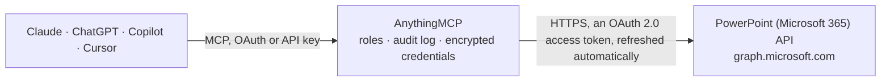

<!-- Generated by scripts/export-github-catalog.mjs in the anythingmcp-website repository. Do not edit by hand. -->

# PowerPoint (Microsoft 365) MCP connector

Let your AI work with PowerPoint presentations in OneDrive and SharePoint: find decks, read their details and version history, see a slide thumbnail, download them or get them as PDF, create new … The AnythingMCP connector gives Claude, ChatGPT, Microsoft Copilot, Cursor and Gemini 21 MCP tools for PowerPoint (Microsoft 365): 13 read and 8 can change data.

**Category:** [Productivity](../productivity.md) · **Tools:** 21 · **Setup guide:** [anythingmcp.com](https://anythingmcp.com/guides/microsoft-powerpoint-to-mcp) · [Deutsch](https://anythingmcp.com/de/guides/microsoft-powerpoint-to-mcp) · [Italiano](https://anythingmcp.com/it/guides/microsoft-powerpoint-to-mcp) · [Español](https://anythingmcp.com/es/guides/microsoft-powerpoint-to-mcp) · [日本語](https://anythingmcp.com/ja/guides/microsoft-powerpoint-to-mcp) · [Русский](https://anythingmcp.com/ru/guides/microsoft-powerpoint-to-mcp) · [中文](https://anythingmcp.com/zh/guides/microsoft-powerpoint-to-mcp)

## Start without code

No installation and no terminal: AnythingMCP Cloud runs the PowerPoint (Microsoft 365) connector for you, operated by helpcode.ai in Frankfurt, Germany.

1. **Click the button above** and create an account or sign in. The PowerPoint (Microsoft 365) connector opens, ready to install.
2. **Sign in with your PowerPoint (Microsoft 365) account** when AnythingMCP asks. The first time, an admin creates a small app in the PowerPoint (Microsoft 365) developer console. Every click is in the [step-by-step guide](https://anythingmcp.com/guides/microsoft-powerpoint-to-mcp).
3. **Click Install.** AnythingMCP shows the address of your MCP server.
4. **Add that address to your assistant:** [Claude](https://anythingmcp.com/guides/connect-microsoft-powerpoint-to-claude) · [ChatGPT](https://anythingmcp.com/guides/connect-microsoft-powerpoint-to-chatgpt) · [Microsoft Copilot](https://anythingmcp.com/guides/connect-microsoft-powerpoint-to-copilot) · [Cursor](https://anythingmcp.com/guides/connect-microsoft-powerpoint-to-cursor) · [Gemini CLI](https://anythingmcp.com/guides/connect-microsoft-powerpoint-to-gemini) · [Meta Muse](https://anythingmcp.com/guides/connect-microsoft-powerpoint-to-muse).
5. **Ask your first question**, for example: *Where is the invoicing deck Documents/Finance/Invoice Run 2026-10.pptx in my OneDrive and who last modified it?*

Prefer help with the setup? [Talk to us](https://anythingmcp.com/contact).

## How it works

- **The AI client** speaks MCP (Streamable HTTP) to AnythingMCP and only sees tool names, descriptions and results. It never gets the PowerPoint (Microsoft 365) credentials.
- **AnythingMCP** checks the client's role, builds the call from the tool definition, adds the credentials (an OAuth 2.0 access token, refreshed automatically), calls PowerPoint (Microsoft 365), logs the call and returns the result.
- **PowerPoint (Microsoft 365)** sees an ordinary API client with the rights of the account the credentials belong to.

## Tools

| Tool | What it does | Access |
|---|---|---|
| [`microsoft_powerpoint_get_my_drive`](#microsoft_powerpoint_get_my_drive) | Get the signed-in user's OneDrive: drive id (the drive_id for presentations stored there), type (personal or business), owner, storage quota and webUrl. | read |
| [`microsoft_powerpoint_search_my_presentations`](#microsoft_powerpoint_search_my_presentations) | Search the user's own OneDrive by name, metadata and content, e.g. "offer 2026". | read |
| [`microsoft_powerpoint_find_presentations`](#microsoft_powerpoint_find_presentations) | Find PowerPoint presentations everywhere the user has access (their OneDrive, SharePoint sites, Teams files, files shared with them) with Microsoft Search. | read |
| [`microsoft_powerpoint_list_folder`](#microsoft_powerpoint_list_folder) | List the files and folders inside a folder of a drive (item_id "root" for its top level), to browse to a presentation. | read |
| [`microsoft_powerpoint_get_presentation`](#microsoft_powerpoint_get_presentation) | Get a presentation's details: name, size, created and last modified (when and by whom), folder (parentReference), mimeType and hashes, sharing state,… | read |
| [`microsoft_powerpoint_get_presentation_by_path`](#microsoft_powerpoint_get_presentation_by_path) | Get a presentation in the user's own OneDrive by its path, e.g. "Documents/Sales/Pitch 2026.pptx". | read |
| [`microsoft_powerpoint_download_presentation`](#microsoft_powerpoint_download_presentation) | Download the presentation file itself (.pptx), as it is stored. | read |
| [`microsoft_powerpoint_convert_to_pdf`](#microsoft_powerpoint_convert_to_pdf) | Get the presentation converted to PDF by Microsoft 365 (works for .pptx, .ppt, .ppsx, .pps and .odp files), attached to the result as a PDF file up to 10 MB… | read |
| [`microsoft_powerpoint_list_thumbnails`](#microsoft_powerpoint_list_thumbnails) | List the thumbnail images Microsoft 365 made of the presentation's first slide: sizes small, medium and large with width, height and a short-lived url. | read |
| [`microsoft_powerpoint_get_thumbnail`](#microsoft_powerpoint_get_thumbnail) | Get a picture of the presentation's first slide, returned as an image the AI can look at. | read |
| [`microsoft_powerpoint_list_versions`](#microsoft_powerpoint_list_versions) | List the presentation's version history: each version's id (e.g. "4.0"), when and by whom it was saved, and size, newest first. | read |
| [`microsoft_powerpoint_download_version`](#microsoft_powerpoint_download_version) | Download an earlier version of the presentation as an attached file (up to 10 MB), e.g. to compare it with the current one. | read |
| [`microsoft_powerpoint_list_permissions`](#microsoft_powerpoint_list_permissions) | List who has access to the presentation: each permission's id, roles (read, write, owner), the people or groups granted (grantedToV2,… | read |
| [`microsoft_powerpoint_copy_presentation`](#microsoft_powerpoint_copy_presentation) | Create a new presentation as a copy of an existing one, typically a template (e.g. "Templates/Company deck.pptx"), in a target folder under a new name. | write |
| [`microsoft_powerpoint_rename_presentation`](#microsoft_powerpoint_rename_presentation) | Rename a presentation in place. | write |
| [`microsoft_powerpoint_move_presentation`](#microsoft_powerpoint_move_presentation) | Move a presentation into another folder of the same drive, optionally renaming it on the way. | write |
| [`microsoft_powerpoint_restore_version`](#microsoft_powerpoint_restore_version) | Make an earlier version the current content of the presentation. | write |
| [`microsoft_powerpoint_check_out`](#microsoft_powerpoint_check_out) | Check out a presentation in a SharePoint library that requires check-out, so that only the user can change it until it is checked in. | write |
| [`microsoft_powerpoint_check_in`](#microsoft_powerpoint_check_in) | Check a checked-out presentation back in, with a comment that is stored with the new version, so other people see the changes and can edit it again. | write |
| [`microsoft_powerpoint_create_sharing_link`](#microsoft_powerpoint_create_sharing_link) | Create a sharing link for the presentation: type "view" or "edit", scope "anonymous" (anyone with the link, if the organisation allows it), "organization"… | write |
| [`microsoft_powerpoint_delete_presentation`](#microsoft_powerpoint_delete_presentation) | Delete a presentation. | write |

## Tool reference

Every parameter as the AI client sees it in `tools/list`. Source: [`packages/backend/src/adapters/intl/microsoft-powerpoint.json`](../../../packages/backend/src/adapters/intl/microsoft-powerpoint.json).

### `microsoft_powerpoint_get_my_drive`

Get the signed-in user's OneDrive: drive id (the drive_id for presentations stored there), type (personal or business), owner, storage quota and webUrl. A cheap check that the connector works.

**Access:** read · **Call:** `GET /me/drive`

No parameters.

### `microsoft_powerpoint_search_my_presentations`

Search the user's own OneDrive by name, metadata and content, e.g. "offer 2026". Graph returns every file type that matches: keep the hits whose name ends in .pptx (or whose file.mimeType is the PowerPoint type). Returns id, name, size, dates, parentReference.driveId (the drive_id the other tools need) and webUrl. Paginate with skip_token.

**Access:** read · **Call:** `GET /me/drive/root/search(q='{query}')`

| Parameter | Type | Required | Description |
|---|---|---|---|
| `query` | string | yes | Search text, e.g. "offer 2026". Write a single quote as two (''), e.g. "O''Brien". |
| `top` | integer | no | Items per page (default 200). |
| `skip_token` | string | no | To fetch the next page, pass the $skiptoken (or skipToken) value from the @odata.nextLink of the previous response, with the same other arguments. |

### `microsoft_powerpoint_find_presentations`

Find PowerPoint presentations everywhere the user has access (their OneDrive, SharePoint sites, Teams files, files shared with them) with Microsoft Search. The query is restricted to PowerPoint files. Supports KQL, e.g. "budget", "author:\"Ana Diaz\"", "*" for all. Returns hitsContainers[0].hits with summary and resource (id, name, webUrl, parentReference.driveId, lastModifiedDateTime). Work or school accounts only; needs Files.Read.All or Files.ReadWrite.All in the scopes. Page with from and size.

**Access:** read · **Call:** `POST /search/query`

| Parameter | Type | Required | Description |
|---|---|---|---|
| `query` | string | yes | Search words or KQL, e.g. "quarterly review", "author:\"Ana Diaz\"", or "*" for all PowerPoint presentations. |
| `from` | integer | no | 0-based offset of the first hit, for the next page (from + size of the previous call). |
| `size` | integer | no | Hits per page, 1 to 500 (default 25). |

### `microsoft_powerpoint_list_folder`

List the files and folders inside a folder of a drive (item_id "root" for its top level), to browse to a presentation. Returns id, name, size, dates, file or folder facet, parentReference and webUrl. Paginate with skip_token.

**Access:** read · **Call:** `GET /drives/{drive_id}/items/{item_id}/children`

| Parameter | Type | Required | Description |
|---|---|---|---|
| `drive_id` | string | yes | Drive id: the id from microsoft_powerpoint_get_my_drive for the user's own OneDrive, or parentReference.driveId of an item in a SharePoint library. |
| `item_id` | string | yes | Id of the folder, from a list or search result, or "root" for the top of the drive. |
| `top` | integer | no | Items per page (default 200). |
| `skip_token` | string | no | To fetch the next page, pass the $skiptoken (or skipToken) value from the @odata.nextLink of the previous response, with the same other arguments. |

### `microsoft_powerpoint_get_presentation`

Get a presentation's details: name, size, created and last modified (when and by whom), folder (parentReference), mimeType and hashes, sharing state, check-out state (publication), eTag and webUrl, the link that opens it in PowerPoint for the web. Does not return the content.

**Access:** read · **Call:** `GET /drives/{drive_id}/items/{item_id}`

| Parameter | Type | Required | Description |
|---|---|---|---|
| `drive_id` | string | yes | Drive id of the presentation: parentReference.driveId from a search or list result, or the id from microsoft_powerpoint_get_my_drive for the user's own OneDrive, e.g. b!s8RqPCGh0ESQS2EYnKM0IKS3lM7GxjdAviiob7oc5pXv_0LiL-62Qq3IXyrXnEop. |
| `item_id` | string | yes | Item id of the presentation in that drive, from a search or list result. Work or school ids look like 01BYE5RZ6QN3ZWBTUFOFD3GSPGOHDJD36K, personal ones like D4648F06C91D9D3D!54927. |

### `microsoft_powerpoint_get_presentation_by_path`

Get a presentation in the user's own OneDrive by its path, e.g. "Documents/Sales/Pitch 2026.pptx". Returns the same details as microsoft_powerpoint_get_presentation, including id and parentReference.driveId for the other tools.

**Access:** read · **Call:** `GET /me/drive/root:/{path}`

| Parameter | Type | Required | Description |
|---|---|---|---|
| `path` | string | yes | Path from the top of the OneDrive without a leading slash, e.g. "Documents/Sales/Pitch 2026.pptx". Names containing #, % or ? cannot be addressed by path: use microsoft_powerpoint_search_my_presentations. |

### `microsoft_powerpoint_download_presentation`

Download the presentation file itself (.pptx), as it is stored. It is handed over as an attached file, not as text, up to 10 MB. To read the text, prefer microsoft_powerpoint_convert_to_pdf.

**Access:** read · **Call:** `GET /drives/{drive_id}/items/{item_id}/content`

| Parameter | Type | Required | Description |
|---|---|---|---|
| `drive_id` | string | yes | Drive id of the presentation: parentReference.driveId from a search or list result, or the id from microsoft_powerpoint_get_my_drive for the user's own OneDrive, e.g. b!s8RqPCGh0ESQS2EYnKM0IKS3lM7GxjdAviiob7oc5pXv_0LiL-62Qq3IXyrXnEop. |
| `item_id` | string | yes | Item id of the presentation in that drive, from a search or list result. Work or school ids look like 01BYE5RZ6QN3ZWBTUFOFD3GSPGOHDJD36K, personal ones like D4648F06C91D9D3D!54927. |

### `microsoft_powerpoint_convert_to_pdf`

Get the presentation converted to PDF by Microsoft 365 (works for .pptx, .ppt, .ppsx, .pps and .odp files), attached to the result as a PDF file up to 10 MB that the AI can read. Converting a large file can take some seconds. The stored file is not changed.

**Access:** read · **Call:** `GET /drives/{drive_id}/items/{item_id}/content`

| Parameter | Type | Required | Description |
|---|---|---|---|
| `drive_id` | string | yes | Drive id of the presentation: parentReference.driveId from a search or list result, or the id from microsoft_powerpoint_get_my_drive for the user's own OneDrive, e.g. b!s8RqPCGh0ESQS2EYnKM0IKS3lM7GxjdAviiob7oc5pXv_0LiL-62Qq3IXyrXnEop. |
| `item_id` | string | yes | Item id of the presentation in that drive, from a search or list result. Work or school ids look like 01BYE5RZ6QN3ZWBTUFOFD3GSPGOHDJD36K, personal ones like D4648F06C91D9D3D!54927. |

### `microsoft_powerpoint_list_thumbnails`

List the thumbnail images Microsoft 365 made of the presentation's first slide: sizes small, medium and large with width, height and a short-lived url. Use microsoft_powerpoint_get_thumbnail to see one.

**Access:** read · **Call:** `GET /drives/{drive_id}/items/{item_id}/thumbnails`

| Parameter | Type | Required | Description |
|---|---|---|---|
| `drive_id` | string | yes | Drive id of the presentation: parentReference.driveId from a search or list result, or the id from microsoft_powerpoint_get_my_drive for the user's own OneDrive, e.g. b!s8RqPCGh0ESQS2EYnKM0IKS3lM7GxjdAviiob7oc5pXv_0LiL-62Qq3IXyrXnEop. |
| `item_id` | string | yes | Item id of the presentation in that drive, from a search or list result. Work or school ids look like 01BYE5RZ6QN3ZWBTUFOFD3GSPGOHDJD36K, personal ones like D4648F06C91D9D3D!54927. |

### `microsoft_powerpoint_get_thumbnail`

Get a picture of the presentation's first slide, returned as an image the AI can look at. size: small (96 px wide), medium (176 px), large (800 px), or a custom size such as c1600x900 (fits within 1600 x 900).

**Access:** read · **Call:** `GET /drives/{drive_id}/items/{item_id}/thumbnails/0/{size}/content`

| Parameter | Type | Required | Description |
|---|---|---|---|
| `drive_id` | string | yes | Drive id of the presentation: parentReference.driveId from a search or list result, or the id from microsoft_powerpoint_get_my_drive for the user's own OneDrive, e.g. b!s8RqPCGh0ESQS2EYnKM0IKS3lM7GxjdAviiob7oc5pXv_0LiL-62Qq3IXyrXnEop. |
| `item_id` | string | yes | Item id of the presentation in that drive, from a search or list result. Work or school ids look like 01BYE5RZ6QN3ZWBTUFOFD3GSPGOHDJD36K, personal ones like D4648F06C91D9D3D!54927. |
| `size` | string | yes | small, medium, large, or a custom bounding box cWIDTHxHEIGHT, e.g. c1600x900. |

### `microsoft_powerpoint_list_versions`

List the presentation's version history: each version's id (e.g. "4.0"), when and by whom it was saved, and size, newest first. Download one with microsoft_powerpoint_download_version or bring it back with microsoft_powerpoint_restore_version.

**Access:** read · **Call:** `GET /drives/{drive_id}/items/{item_id}/versions`

| Parameter | Type | Required | Description |
|---|---|---|---|
| `drive_id` | string | yes | Drive id of the presentation: parentReference.driveId from a search or list result, or the id from microsoft_powerpoint_get_my_drive for the user's own OneDrive, e.g. b!s8RqPCGh0ESQS2EYnKM0IKS3lM7GxjdAviiob7oc5pXv_0LiL-62Qq3IXyrXnEop. |
| `item_id` | string | yes | Item id of the presentation in that drive, from a search or list result. Work or school ids look like 01BYE5RZ6QN3ZWBTUFOFD3GSPGOHDJD36K, personal ones like D4648F06C91D9D3D!54927. |

### `microsoft_powerpoint_download_version`

Download an earlier version of the presentation as an attached file (up to 10 MB), e.g. to compare it with the current one. The current file is not changed.

**Access:** read · **Call:** `GET /drives/{drive_id}/items/{item_id}/versions/{version_id}/content`

| Parameter | Type | Required | Description |
|---|---|---|---|
| `drive_id` | string | yes | Drive id of the presentation: parentReference.driveId from a search or list result, or the id from microsoft_powerpoint_get_my_drive for the user's own OneDrive, e.g. b!s8RqPCGh0ESQS2EYnKM0IKS3lM7GxjdAviiob7oc5pXv_0LiL-62Qq3IXyrXnEop. |
| `item_id` | string | yes | Item id of the presentation in that drive, from a search or list result. Work or school ids look like 01BYE5RZ6QN3ZWBTUFOFD3GSPGOHDJD36K, personal ones like D4648F06C91D9D3D!54927. |
| `version_id` | string | yes | Version id from microsoft_powerpoint_list_versions, e.g. "3.0" on work or school accounts. |

### `microsoft_powerpoint_list_permissions`

List who has access to the presentation: each permission's id, roles (read, write, owner), the people or groups granted (grantedToV2, grantedToIdentitiesV2), sharing links (link.type, link.scope, link.webUrl), inheritance and expiry.

**Access:** read · **Call:** `GET /drives/{drive_id}/items/{item_id}/permissions`

| Parameter | Type | Required | Description |
|---|---|---|---|
| `drive_id` | string | yes | Drive id of the presentation: parentReference.driveId from a search or list result, or the id from microsoft_powerpoint_get_my_drive for the user's own OneDrive, e.g. b!s8RqPCGh0ESQS2EYnKM0IKS3lM7GxjdAviiob7oc5pXv_0LiL-62Qq3IXyrXnEop. |
| `item_id` | string | yes | Item id of the presentation in that drive, from a search or list result. Work or school ids look like 01BYE5RZ6QN3ZWBTUFOFD3GSPGOHDJD36K, personal ones like D4648F06C91D9D3D!54927. |

### `microsoft_powerpoint_copy_presentation`

Create a new presentation as a copy of an existing one, typically a template (e.g. "Templates/Company deck.pptx"), in a target folder under a new name. Runs asynchronously: Graph answers 202 with no body and the copy appears shortly after; find it with microsoft_powerpoint_list_folder. Needs the target drive id and folder id.

**Access:** write · **Call:** `POST /drives/{drive_id}/items/{item_id}/copy`

| Parameter | Type | Required | Description |
|---|---|---|---|
| `drive_id` | string | yes | Drive id of the presentation (or template) to copy. |
| `item_id` | string | yes | Item id of the presentation (or template) to copy. |
| `destination_drive_id` | string | yes | Drive id of the target folder: the id from microsoft_powerpoint_get_my_drive for the user's own OneDrive. |
| `destination_folder_id` | string | yes | Id of the target folder, from microsoft_powerpoint_list_folder or a search result. For the top folder use the real id that microsoft_powerpoint_list_folder results carry in parentReference.id, not "root". |
| `name` | string | yes | Name of the new presentation, with extension, e.g. "Pitch Rossi 2026.pptx" (default: the original's name). |
| `conflict_behavior` | `fail` \| `rename` | no | When the name exists in the target: "fail" (default) or "rename" (Graph appends a number). Personal OneDrive ignores it. |

### `microsoft_powerpoint_rename_presentation`

Rename a presentation in place. Keep the extension (.pptx). Returns the item's id, name, parentReference and webUrl.

**Access:** write · **Call:** `PATCH /drives/{drive_id}/items/{item_id}`

| Parameter | Type | Required | Description |
|---|---|---|---|
| `drive_id` | string | yes | Drive id of the presentation: parentReference.driveId from a search or list result, or the id from microsoft_powerpoint_get_my_drive for the user's own OneDrive, e.g. b!s8RqPCGh0ESQS2EYnKM0IKS3lM7GxjdAviiob7oc5pXv_0LiL-62Qq3IXyrXnEop. |
| `item_id` | string | yes | Item id of the presentation in that drive, from a search or list result. Work or school ids look like 01BYE5RZ6QN3ZWBTUFOFD3GSPGOHDJD36K, personal ones like D4648F06C91D9D3D!54927. |
| `name` | string | yes | New name with extension, e.g. "Pitch Rossi 2026.pptx". Not allowed: " * : < > ? / \ \|. |

### `microsoft_powerpoint_move_presentation`

Move a presentation into another folder of the same drive, optionally renaming it on the way. Returns the item's id, name, new parentReference and webUrl.

**Access:** write · **Call:** `PATCH /drives/{drive_id}/items/{item_id}`

| Parameter | Type | Required | Description |
|---|---|---|---|
| `drive_id` | string | yes | Drive id of the presentation: parentReference.driveId from a search or list result, or the id from microsoft_powerpoint_get_my_drive for the user's own OneDrive, e.g. b!s8RqPCGh0ESQS2EYnKM0IKS3lM7GxjdAviiob7oc5pXv_0LiL-62Qq3IXyrXnEop. |
| `item_id` | string | yes | Item id of the presentation in that drive, from a search or list result. Work or school ids look like 01BYE5RZ6QN3ZWBTUFOFD3GSPGOHDJD36K, personal ones like D4648F06C91D9D3D!54927. |
| `new_parent_id` | string | yes | Id of the target folder in the same drive, from microsoft_powerpoint_list_folder or a search result. |
| `name` | string | no | Optional new name, with extension. |

### `microsoft_powerpoint_restore_version`

Make an earlier version the current content of the presentation. The content it replaces stays in the version history as a version of its own, so this can be undone by restoring that one. OneDrive for work or school and SharePoint only.

**Access:** write · **Call:** `POST /drives/{drive_id}/items/{item_id}/versions/{version_id}/restoreVersion`

| Parameter | Type | Required | Description |
|---|---|---|---|
| `drive_id` | string | yes | Drive id of the presentation: parentReference.driveId from a search or list result, or the id from microsoft_powerpoint_get_my_drive for the user's own OneDrive, e.g. b!s8RqPCGh0ESQS2EYnKM0IKS3lM7GxjdAviiob7oc5pXv_0LiL-62Qq3IXyrXnEop. |
| `item_id` | string | yes | Item id of the presentation in that drive, from a search or list result. Work or school ids look like 01BYE5RZ6QN3ZWBTUFOFD3GSPGOHDJD36K, personal ones like D4648F06C91D9D3D!54927. |
| `version_id` | string | yes | Version id from microsoft_powerpoint_list_versions, e.g. "3.0" on work or school accounts. |

### `microsoft_powerpoint_check_out`

Check out a presentation in a SharePoint library that requires check-out, so that only the user can change it until it is checked in. Answers 204 with no body.

**Access:** write · **Call:** `POST /drives/{drive_id}/items/{item_id}/checkout`

| Parameter | Type | Required | Description |
|---|---|---|---|
| `drive_id` | string | yes | Drive id of the presentation: parentReference.driveId from a search or list result, or the id from microsoft_powerpoint_get_my_drive for the user's own OneDrive, e.g. b!s8RqPCGh0ESQS2EYnKM0IKS3lM7GxjdAviiob7oc5pXv_0LiL-62Qq3IXyrXnEop. |
| `item_id` | string | yes | Item id of the presentation in that drive, from a search or list result. Work or school ids look like 01BYE5RZ6QN3ZWBTUFOFD3GSPGOHDJD36K, personal ones like D4648F06C91D9D3D!54927. |

### `microsoft_powerpoint_check_in`

Check a checked-out presentation back in, with a comment that is stored with the new version, so other people see the changes and can edit it again. Answers 204 with no body.

**Access:** write · **Call:** `POST /drives/{drive_id}/items/{item_id}/checkin`

| Parameter | Type | Required | Description |
|---|---|---|---|
| `drive_id` | string | yes | Drive id of the presentation: parentReference.driveId from a search or list result, or the id from microsoft_powerpoint_get_my_drive for the user's own OneDrive, e.g. b!s8RqPCGh0ESQS2EYnKM0IKS3lM7GxjdAviiob7oc5pXv_0LiL-62Qq3IXyrXnEop. |
| `item_id` | string | yes | Item id of the presentation in that drive, from a search or list result. Work or school ids look like 01BYE5RZ6QN3ZWBTUFOFD3GSPGOHDJD36K, personal ones like D4648F06C91D9D3D!54927. |
| `comment` | string | yes | Check-in comment stored with the version, e.g. "Prices updated". |
| `check_in_as` | `published` | no | "published" to publish a major version where the library uses minor versions; leave out otherwise. |

### `microsoft_powerpoint_create_sharing_link`

Create a sharing link for the presentation: type "view" or "edit", scope "anonymous" (anyone with the link, if the organisation allows it), "organization" (people in the organisation) or "users" (only people already given access). Returns the link with its webUrl. Installed switched off: a link gives other people access to the file.

**Access:** write · **Call:** `POST /drives/{drive_id}/items/{item_id}/createLink`

| Parameter | Type | Required | Description |
|---|---|---|---|
| `drive_id` | string | yes | Drive id of the presentation: parentReference.driveId from a search or list result, or the id from microsoft_powerpoint_get_my_drive for the user's own OneDrive, e.g. b!s8RqPCGh0ESQS2EYnKM0IKS3lM7GxjdAviiob7oc5pXv_0LiL-62Qq3IXyrXnEop. |
| `item_id` | string | yes | Item id of the presentation in that drive, from a search or list result. Work or school ids look like 01BYE5RZ6QN3ZWBTUFOFD3GSPGOHDJD36K, personal ones like D4648F06C91D9D3D!54927. |
| `type` | `view` \| `edit` | yes | Link type. |
| `scope` | `anonymous` \| `organization` \| `users` | no | Who the link works for. Personal OneDrive supports only anonymous. |
| `expiration_date_time` | string | no | Optional ISO 8601 expiry, e.g. 2026-12-31T23:00:00Z (where the organisation allows expiring links). |

### `microsoft_powerpoint_delete_presentation`

Delete a presentation. It goes to the recycle bin of the OneDrive or SharePoint site, where the user can restore it. Installed switched off.

**Access:** write · **Call:** `DELETE /drives/{drive_id}/items/{item_id}`

| Parameter | Type | Required | Description |
|---|---|---|---|
| `drive_id` | string | yes | Drive id of the presentation: parentReference.driveId from a search or list result, or the id from microsoft_powerpoint_get_my_drive for the user's own OneDrive, e.g. b!s8RqPCGh0ESQS2EYnKM0IKS3lM7GxjdAviiob7oc5pXv_0LiL-62Qq3IXyrXnEop. |
| `item_id` | string | yes | Item id of the presentation in that drive, from a search or list result. Work or school ids look like 01BYE5RZ6QN3ZWBTUFOFD3GSPGOHDJD36K, personal ones like D4648F06C91D9D3D!54927. |

## Run it yourself

AnythingMCP is open source (AGPL-3.0). [Run it with Docker](../../../README.md#run-it-yourself), open **Connectors → Store**, pick **PowerPoint (Microsoft 365)** and enter `MICROSOFT_CLIENT_ID`, `MICROSOFT_CLIENT_SECRET`, `MICROSOFT_TENANT_ID`, then add your MCP server URL to the AI client.

[← Productivity connectors](../productivity.md) · [All categories](../README.md)
