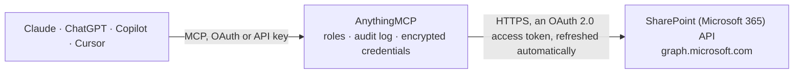

<!-- Generated by scripts/export-github-catalog.mjs in the anythingmcp-website repository. Do not edit by hand. -->

# SharePoint (Microsoft 365) MCP connector

Let your AI work in SharePoint: find sites, browse and search document libraries, see file details and who has access, read, create and update list items, create lists, folders and text files, read … The AnythingMCP connector gives Claude, ChatGPT, Microsoft Copilot, Cursor and Gemini 29 MCP tools for SharePoint (Microsoft 365): 18 read and 11 can change data.

**Category:** [File Storage](../storage.md) · **Tools:** 29 · **Setup guide:** [anythingmcp.com](https://anythingmcp.com/guides/microsoft-sharepoint-to-mcp) · [Deutsch](https://anythingmcp.com/de/guides/microsoft-sharepoint-to-mcp) · [Italiano](https://anythingmcp.com/it/guides/microsoft-sharepoint-to-mcp) · [Español](https://anythingmcp.com/es/guides/microsoft-sharepoint-to-mcp) · [日本語](https://anythingmcp.com/ja/guides/microsoft-sharepoint-to-mcp) · [Русский](https://anythingmcp.com/ru/guides/microsoft-sharepoint-to-mcp) · [中文](https://anythingmcp.com/zh/guides/microsoft-sharepoint-to-mcp)

## Start without code

No installation and no terminal: AnythingMCP Cloud runs the SharePoint (Microsoft 365) connector for you, operated by helpcode.ai in Frankfurt, Germany.

1. **Click the button above** and create an account or sign in. The SharePoint (Microsoft 365) connector opens, ready to install.
2. **Sign in with your SharePoint (Microsoft 365) account** when AnythingMCP asks. The first time, an admin creates a small app in the SharePoint (Microsoft 365) developer console. Every click is in the [step-by-step guide](https://anythingmcp.com/guides/microsoft-sharepoint-to-mcp).
3. **Click Install.** AnythingMCP shows the address of your MCP server.
4. **Add that address to your assistant:** [Claude](https://anythingmcp.com/guides/connect-microsoft-sharepoint-to-claude) · [ChatGPT](https://anythingmcp.com/guides/connect-microsoft-sharepoint-to-chatgpt) · [Microsoft Copilot](https://anythingmcp.com/guides/connect-microsoft-sharepoint-to-copilot) · [Cursor](https://anythingmcp.com/guides/connect-microsoft-sharepoint-to-cursor) · [Gemini CLI](https://anythingmcp.com/guides/connect-microsoft-sharepoint-to-gemini) · [Meta Muse](https://anythingmcp.com/guides/connect-microsoft-sharepoint-to-muse).
5. **Ask your first question**, for example: *Where is invoice INV-2026-089 from client Nordal AG stored in SharePoint Documents?*

Prefer help with the setup? [Talk to us](https://anythingmcp.com/contact).

## How it works

- **The AI client** speaks MCP (Streamable HTTP) to AnythingMCP and only sees tool names, descriptions and results. It never gets the SharePoint (Microsoft 365) credentials.
- **AnythingMCP** checks the client's role, builds the call from the tool definition, adds the credentials (an OAuth 2.0 access token, refreshed automatically), calls SharePoint (Microsoft 365), logs the call and returns the result.
- **SharePoint (Microsoft 365)** sees an ordinary API client with the rights of the account the credentials belong to.

## Tools

| Tool | What it does | Access |
|---|---|---|
| [`sharepoint_get_root_site`](#sharepoint_get_root_site) | Get the organisation's root SharePoint site (e.g. https://contoso.sharepoint.com): its id, name, displayName, webUrl and hostname (siteCollection.hostname). | read |
| [`sharepoint_search_sites`](#sharepoint_search_sites) | Find SharePoint sites the user can open by keyword in their name or description, e.g. "marketing". | read |
| [`sharepoint_get_site_by_path`](#sharepoint_get_site_by_path) | Get a site from its address: hostname plus server-relative path, as in https://contoso.sharepoint.com/sites/Marketing → hostname "contoso.sharepoint.com",… | read |
| [`sharepoint_get_site`](#sharepoint_get_site) | Get one site by id: name, displayName, description, webUrl, dates and hostname. | read |
| [`sharepoint_list_subsites`](#sharepoint_list_subsites) | List the subsites of a site: id, name, displayName, webUrl. | read |
| [`sharepoint_list_drives`](#sharepoint_list_drives) | List the document libraries (drives) of a site, e.g. "Documents" (Shared Documents) and other libraries: id, name, description, driveType, webUrl and quota. | read |
| [`sharepoint_list_drive_root`](#sharepoint_list_drive_root) | List the files and folders at the top level of a document library: id, name, size, dates, last modifier, file mimeType or folder child count, webUrl. | read |
| [`sharepoint_list_folder`](#sharepoint_list_folder) | List the files and folders inside one folder of a document library. | read |
| [`sharepoint_search_drive`](#sharepoint_search_drive) | Search one document library for files and folders whose name, metadata or content matches the text. | read |
| [`sharepoint_get_drive_item`](#sharepoint_get_drive_item) | Get one file's or folder's metadata in a document library: name, size, dates, creator and last modifier, parentReference, file mimeType or folder child… | read |
| [`sharepoint_search`](#sharepoint_search) | Search everything the user can see across SharePoint and OneDrive with Microsoft Search: files (driveItem), list items (listItem), lists (list), sites… | read |
| [`sharepoint_list_lists`](#sharepoint_list_lists) | List the lists and libraries of a site: id, name, displayName, description, list.template (genericList, documentLibrary, events...), list.hidden, webUrl and… | read |
| [`sharepoint_list_columns`](#sharepoint_list_columns) | List the columns of a list with their internal name (the key used in fields), displayName, type (text, number, dateTime, choice with its choices, lookup,… | read |
| [`sharepoint_list_items`](#sharepoint_list_items) | List the items of a list with their column values (fields), id, dates, creator and last modifier, webUrl. | read |
| [`sharepoint_get_list_item`](#sharepoint_get_list_item) | Get one list item with all its column values (fields), id, dates, creator, last modifier and webUrl. | read |
| [`sharepoint_create_list_item`](#sharepoint_create_list_item) | Create an item in a list. | write |
| [`sharepoint_update_list_item`](#sharepoint_update_list_item) | Change column values of a list item; columns not named keep their values. | write |
| [`sharepoint_delete_list_item`](#sharepoint_delete_list_item) | Delete a list item. | write |
| [`sharepoint_create_list`](#sharepoint_create_list) | Create a new list in a site, optionally with columns, e.g. columns [{"name": "Status", "text": {}}, {"name": "Amount", "number": {}}, {"name": "DueDate",… | write |
| [`sharepoint_create_folder`](#sharepoint_create_folder) | Create a folder in a document library, inside a parent folder (default: the library's top level). | write |
| [`sharepoint_upload_text_file`](#sharepoint_upload_text_file) | Create a new text file (.txt, .md, .csv, .json, .html, .xml...) with the given content in a folder of a document library, up to about 4 MB. | write |
| [`sharepoint_rename_drive_item`](#sharepoint_rename_drive_item) | Rename a file or folder in a document library in place. | write |
| [`sharepoint_move_drive_item`](#sharepoint_move_drive_item) | Move a file or folder to another folder of the same document library, optionally renaming it on the way. | write |
| [`sharepoint_delete_drive_item`](#sharepoint_delete_drive_item) | Delete a file or folder (with its contents) from a document library. | write |
| [`sharepoint_list_permissions`](#sharepoint_list_permissions) | List who has access to a file or folder in a document library: roles, people and groups (grantedToV2), sharing links (link.type, link.scope, link.webUrl),… | read |
| [`sharepoint_create_sharing_link`](#sharepoint_create_sharing_link) | Create a sharing link for a file or folder in a document library: type "view" or "edit", scope "anonymous", "organization" or "users". | write |
| [`sharepoint_invite`](#sharepoint_invite) | Give people access to a file or folder in a document library by email address, with role "read" or "write", optionally emailing them. | write |
| [`sharepoint_list_pages`](#sharepoint_list_pages) | List the modern pages of a site: id, name, title, webUrl, pageLayout, publishing state, dates and author. | read |
| [`sharepoint_get_page`](#sharepoint_get_page) | Read one modern page with its content: title, description and canvasLayout (sections, columns and web parts; text web parts carry innerHtml). | read |

## Tool reference

Every parameter as the AI client sees it in `tools/list`. Source: [`packages/backend/src/adapters/intl/microsoft-sharepoint.json`](../../../packages/backend/src/adapters/intl/microsoft-sharepoint.json).

### `sharepoint_get_root_site`

Get the organisation's root SharePoint site (e.g. https://contoso.sharepoint.com): its id, name, displayName, webUrl and hostname (siteCollection.hostname). A cheap check that SharePoint is reachable; the hostname is what sharepoint_get_site_by_path needs.

**Access:** read · **Call:** `GET /sites/root`

No parameters.

### `sharepoint_search_sites`

Find SharePoint sites the user can open by keyword in their name or description, e.g. "marketing". "*" lists all sites the user can reach. Returns id, name, displayName, webUrl and description. Paginate with skip_token.

**Access:** read · **Call:** `GET /sites`

| Parameter | Type | Required | Description |
|---|---|---|---|
| `query` | string | yes | Keyword, e.g. "finance", or "*" for all sites. |
| `top` | integer | no | Items per page (Graph's default is 200 for folders and lists). |
| `skip_token` | string | no | To fetch the next page, pass the $skiptoken (or skipToken) value from the @odata.nextLink of the previous response, with the same other arguments. |

### `sharepoint_get_site_by_path`

Get a site from its address: hostname plus server-relative path, as in https://contoso.sharepoint.com/sites/Marketing → hostname "contoso.sharepoint.com", site_path "sites/Marketing". Returns the site id the other tools need.

**Access:** read · **Call:** `GET /sites/{hostname}:/{site_path}`

| Parameter | Type | Required | Description |
|---|---|---|---|
| `hostname` | string | yes | SharePoint hostname, e.g. contoso.sharepoint.com (sharepoint_get_root_site → siteCollection.hostname). |
| `site_path` | string | yes | Server-relative path of the site without a leading slash, e.g. "sites/Marketing" or "teams/Project-X". |

### `sharepoint_get_site`

Get one site by id: name, displayName, description, webUrl, dates and hostname.

**Access:** read · **Call:** `GET /sites/{site_id}`

| Parameter | Type | Required | Description |
|---|---|---|---|
| `site_id` | string | yes | Site id from sharepoint_search_sites, sharepoint_get_site_by_path or sharepoint_get_root_site, e.g. contoso.sharepoint.com,2C712604-1370-44E7-A1F5-426573FDA80A,2D2244C3-251A-49EA-93A8-39E1C3A060FE. |

### `sharepoint_list_subsites`

List the subsites of a site: id, name, displayName, webUrl. Paginate with skip_token.

**Access:** read · **Call:** `GET /sites/{site_id}/sites`

| Parameter | Type | Required | Description |
|---|---|---|---|
| `site_id` | string | yes | Site id from sharepoint_search_sites, sharepoint_get_site_by_path or sharepoint_get_root_site, e.g. contoso.sharepoint.com,2C712604-1370-44E7-A1F5-426573FDA80A,2D2244C3-251A-49EA-93A8-39E1C3A060FE. |
| `skip_token` | string | no | To fetch the next page, pass the $skiptoken (or skipToken) value from the @odata.nextLink of the previous response, with the same other arguments. |

### `sharepoint_list_drives`

List the document libraries (drives) of a site, e.g. "Documents" (Shared Documents) and other libraries: id, name, description, driveType, webUrl and quota. The drive id is what the file tools need.

**Access:** read · **Call:** `GET /sites/{site_id}/drives`

| Parameter | Type | Required | Description |
|---|---|---|---|
| `site_id` | string | yes | Site id from sharepoint_search_sites, sharepoint_get_site_by_path or sharepoint_get_root_site, e.g. contoso.sharepoint.com,2C712604-1370-44E7-A1F5-426573FDA80A,2D2244C3-251A-49EA-93A8-39E1C3A060FE. |

### `sharepoint_list_drive_root`

List the files and folders at the top level of a document library: id, name, size, dates, last modifier, file mimeType or folder child count, webUrl. Paginate with skip_token.

**Access:** read · **Call:** `GET /drives/{drive_id}/root/children`

| Parameter | Type | Required | Description |
|---|---|---|---|
| `drive_id` | string | yes | Document library (drive) id from sharepoint_list_drives, e.g. b!s8RqPCGh0ESQS2EYnKM0IKS3lM7GxjdAviiob7oc5pXv_0LiL-62Qq3IXyrXnEop. |
| `top` | integer | no | Items per page (Graph's default is 200 for folders and lists). |
| `orderby` | string | no | Sort order, e.g. "name", "lastModifiedDateTime desc" or "size desc". OneDrive for work or school sorts only by some properties and answers 400 for others. |
| `skip_token` | string | no | To fetch the next page, pass the $skiptoken (or skipToken) value from the @odata.nextLink of the previous response, with the same other arguments. |

### `sharepoint_list_folder`

List the files and folders inside one folder of a document library. Returns the same fields as sharepoint_list_drive_root. Paginate with skip_token.

**Access:** read · **Call:** `GET /drives/{drive_id}/items/{item_id}/children`

| Parameter | Type | Required | Description |
|---|---|---|---|
| `drive_id` | string | yes | Document library (drive) id from sharepoint_list_drives, e.g. b!s8RqPCGh0ESQS2EYnKM0IKS3lM7GxjdAviiob7oc5pXv_0LiL-62Qq3IXyrXnEop. |
| `item_id` | string | yes | Id of the folder in that library. |
| `top` | integer | no | Items per page (Graph's default is 200 for folders and lists). |
| `orderby` | string | no | Sort order, e.g. "name", "lastModifiedDateTime desc" or "size desc". OneDrive for work or school sorts only by some properties and answers 400 for others. |
| `skip_token` | string | no | To fetch the next page, pass the $skiptoken (or skipToken) value from the @odata.nextLink of the previous response, with the same other arguments. |

### `sharepoint_search_drive`

Search one document library for files and folders whose name, metadata or content matches the text. Returns id, name, size, dates, parentReference and webUrl per hit. Paginate with skip_token.

**Access:** read · **Call:** `GET /drives/{drive_id}/root/search(q='{query}')`

| Parameter | Type | Required | Description |
|---|---|---|---|
| `drive_id` | string | yes | Document library (drive) id from sharepoint_list_drives, e.g. b!s8RqPCGh0ESQS2EYnKM0IKS3lM7GxjdAviiob7oc5pXv_0LiL-62Qq3IXyrXnEop. |
| `query` | string | yes | Search text, matched against file names, metadata and content, e.g. "budget 2026". Write a single quote as two (''), e.g. "O''Brien". |
| `top` | integer | no | Items per page (Graph's default is 200 for folders and lists). |
| `skip_token` | string | no | To fetch the next page, pass the $skiptoken (or skipToken) value from the @odata.nextLink of the previous response, with the same other arguments. |

### `sharepoint_get_drive_item`

Get one file's or folder's metadata in a document library: name, size, dates, creator and last modifier, parentReference, file mimeType or folder child count, webUrl. Does not return the content.

**Access:** read · **Call:** `GET /drives/{drive_id}/items/{item_id}`

| Parameter | Type | Required | Description |
|---|---|---|---|
| `drive_id` | string | yes | Document library (drive) id from sharepoint_list_drives, e.g. b!s8RqPCGh0ESQS2EYnKM0IKS3lM7GxjdAviiob7oc5pXv_0LiL-62Qq3IXyrXnEop. |
| `item_id` | string | yes | Item id from a list or search result in that library (sharepoint_list_drive_root, sharepoint_list_folder, sharepoint_search_drive). Work or school ids look like 01BYE5RZ6QN3ZWBTUFOFD3GSPGOHDJD36K, personal ones like D4648F06C91D9D3D!54927. |

### `sharepoint_search`

Search everything the user can see across SharePoint and OneDrive with Microsoft Search: files (driveItem), list items (listItem), lists (list), sites (site) or libraries (drive). Supports KQL, e.g. "budget filetype:xlsx", "author:\"Ana Diaz\"", "path:\"https://contoso.sharepoint.com/sites/Finance\"". Returns hitsContainers with hits (summary, resource with id, name, webUrl, parentReference). Page with from and size.

**Access:** read · **Call:** `POST /search/query`

| Parameter | Type | Required | Description |
|---|---|---|---|
| `query` | string | yes | Search text or KQL, e.g. "quarterly report filetype:docx". |
| `entity_type` | `driveItem` \| `listItem` \| `list` \| `site` \| `drive` | no | What to search for (default driveItem: files and folders). |
| `from` | integer | no | 0-based offset of the first hit, for the next page (from + size of the previous call). |
| `size` | integer | no | Hits per page, 1 to 500 (default 25). |

### `sharepoint_list_lists`

List the lists and libraries of a site: id, name, displayName, description, list.template (genericList, documentLibrary, events...), list.hidden, webUrl and dates. Paginate with skip_token.

**Access:** read · **Call:** `GET /sites/{site_id}/lists`

| Parameter | Type | Required | Description |
|---|---|---|---|
| `site_id` | string | yes | Site id from sharepoint_search_sites, sharepoint_get_site_by_path or sharepoint_get_root_site, e.g. contoso.sharepoint.com,2C712604-1370-44E7-A1F5-426573FDA80A,2D2244C3-251A-49EA-93A8-39E1C3A060FE. |
| `skip_token` | string | no | To fetch the next page, pass the $skiptoken (or skipToken) value from the @odata.nextLink of the previous response, with the same other arguments. |

### `sharepoint_list_columns`

List the columns of a list with their internal name (the key used in fields), displayName, type (text, number, dateTime, choice with its choices, lookup, personOrGroup...), required and readOnly flags. Call it before reading, filtering or writing list items.

**Access:** read · **Call:** `GET /sites/{site_id}/lists/{list_id}/columns`

| Parameter | Type | Required | Description |
|---|---|---|---|
| `site_id` | string | yes | Site id from sharepoint_search_sites, sharepoint_get_site_by_path or sharepoint_get_root_site, e.g. contoso.sharepoint.com,2C712604-1370-44E7-A1F5-426573FDA80A,2D2244C3-251A-49EA-93A8-39E1C3A060FE. |
| `list_id` | string | yes | List id (a GUID) or the list's display name, from sharepoint_list_lists. |

### `sharepoint_list_items`

List the items of a list with their column values (fields), id, dates, creator and last modifier, webUrl. Filter on columns with OData, e.g. "fields/Status eq 'Open'"; limit the columns with expand, e.g. "fields(select=Title,Status,DueDate)". Paginate with skip_token.

**Access:** read · **Call:** `GET /sites/{site_id}/lists/{list_id}/items`

| Parameter | Type | Required | Description |
|---|---|---|---|
| `site_id` | string | yes | Site id from sharepoint_search_sites, sharepoint_get_site_by_path or sharepoint_get_root_site, e.g. contoso.sharepoint.com,2C712604-1370-44E7-A1F5-426573FDA80A,2D2244C3-251A-49EA-93A8-39E1C3A060FE. |
| `list_id` | string | yes | List id (a GUID) or the list's display name, from sharepoint_list_lists. |
| `filter` | string | no | OData filter on columns, prefixed with fields/, e.g. "fields/Status eq 'Open'" or "fields/Modified ge '2026-10-01'". Filtering on a column that is not indexed works on lists up to 5,000 items. |
| `expand` | string | no | "fields" (default) returns every column; "fields(select=Title,Status,DueDate)" only the named columns (internal names). |
| `orderby` | string | no | Sort, e.g. "fields/Modified desc" (indexed columns only on large lists). |
| `top` | integer | no | Items per page (Graph's default is 200 for folders and lists). |
| `skip_token` | string | no | To fetch the next page, pass the $skiptoken (or skipToken) value from the @odata.nextLink of the previous response, with the same other arguments. |

### `sharepoint_get_list_item`

Get one list item with all its column values (fields), id, dates, creator, last modifier and webUrl.

**Access:** read · **Call:** `GET /sites/{site_id}/lists/{list_id}/items/{item_id}`

| Parameter | Type | Required | Description |
|---|---|---|---|
| `site_id` | string | yes | Site id from sharepoint_search_sites, sharepoint_get_site_by_path or sharepoint_get_root_site, e.g. contoso.sharepoint.com,2C712604-1370-44E7-A1F5-426573FDA80A,2D2244C3-251A-49EA-93A8-39E1C3A060FE. |
| `list_id` | string | yes | List id (a GUID) or the list's display name, from sharepoint_list_lists. |
| `item_id` | string | yes | List item id, a number as text, e.g. "12" (the id field of sharepoint_list_items). |

### `sharepoint_create_list_item`

Create an item in a list. fields maps internal column names (sharepoint_list_columns) to values, e.g. {"Title": "Order 4711", "Status": "Open", "DueDate": "2026-11-01T00:00:00Z", "Amount": 120.5}. Returns the new item with its id and fields.

**Access:** write · **Call:** `POST /sites/{site_id}/lists/{list_id}/items`

| Parameter | Type | Required | Description |
|---|---|---|---|
| `site_id` | string | yes | Site id from sharepoint_search_sites, sharepoint_get_site_by_path or sharepoint_get_root_site, e.g. contoso.sharepoint.com,2C712604-1370-44E7-A1F5-426573FDA80A,2D2244C3-251A-49EA-93A8-39E1C3A060FE. |
| `list_id` | string | yes | List id (a GUID) or the list's display name, from sharepoint_list_lists. |
| `fields` | object | yes | Column values by internal name. Lookup and person columns take <Name>LookupId with the id, e.g. {"AssignedToLookupId": "11"}. |

### `sharepoint_update_list_item`

Change column values of a list item; columns not named keep their values. fields maps internal column names to new values, e.g. {"Status": "Done"}. Returns the item's updated fields.

**Access:** write · **Call:** `PATCH /sites/{site_id}/lists/{list_id}/items/{item_id}/fields`

| Parameter | Type | Required | Description |
|---|---|---|---|
| `site_id` | string | yes | Site id from sharepoint_search_sites, sharepoint_get_site_by_path or sharepoint_get_root_site, e.g. contoso.sharepoint.com,2C712604-1370-44E7-A1F5-426573FDA80A,2D2244C3-251A-49EA-93A8-39E1C3A060FE. |
| `list_id` | string | yes | List id (a GUID) or the list's display name, from sharepoint_list_lists. |
| `item_id` | string | yes | List item id, a number as text, e.g. "12" (the id field of sharepoint_list_items). |
| `fields` | object | yes | Column values to set, by internal name, e.g. {"Status": "Done", "Amount": 99}. |

### `sharepoint_delete_list_item`

Delete a list item. It goes to the site's recycle bin. Installed switched off.

**Access:** write · **Call:** `DELETE /sites/{site_id}/lists/{list_id}/items/{item_id}`

| Parameter | Type | Required | Description |
|---|---|---|---|
| `site_id` | string | yes | Site id from sharepoint_search_sites, sharepoint_get_site_by_path or sharepoint_get_root_site, e.g. contoso.sharepoint.com,2C712604-1370-44E7-A1F5-426573FDA80A,2D2244C3-251A-49EA-93A8-39E1C3A060FE. |
| `list_id` | string | yes | List id (a GUID) or the list's display name, from sharepoint_list_lists. |
| `item_id` | string | yes | List item id, a number as text, e.g. "12" (the id field of sharepoint_list_items). |

### `sharepoint_create_list`

Create a new list in a site, optionally with columns, e.g. columns [{"name": "Status", "text": {}}, {"name": "Amount", "number": {}}, {"name": "DueDate", "dateTime": {}}]. Every list has a Title column. Returns the list with its id.

**Access:** write · **Call:** `POST /sites/{site_id}/lists`

| Parameter | Type | Required | Description |
|---|---|---|---|
| `site_id` | string | yes | Site id from sharepoint_search_sites, sharepoint_get_site_by_path or sharepoint_get_root_site, e.g. contoso.sharepoint.com,2C712604-1370-44E7-A1F5-426573FDA80A,2D2244C3-251A-49EA-93A8-39E1C3A060FE. |
| `display_name` | string | yes | Name of the list. |
| `description` | string | no | Optional description. |
| `columns` | object[] | no | Optional column definitions in Graph's columnDefinition format: {"name": "Status", "choice": {"choices": ["Open", "Done"]}}, {"name": "Amount", "number": {}}, {"name": "Notes", "text": {"allowMultipleLines": true}}. |
| `template` | `genericList` \| `documentLibrary` \| `events` \| `tasks` \| `contacts` \| `links` \| `announcements` \| `issueTracking` | no | List template (default genericList). |

### `sharepoint_create_folder`

Create a folder in a document library, inside a parent folder (default: the library's top level). Returns the new folder's id, name, parentReference and webUrl.

**Access:** write · **Call:** `POST /drives/{drive_id}/items/{parent_id}/children`

| Parameter | Type | Required | Description |
|---|---|---|---|
| `drive_id` | string | yes | Document library (drive) id from sharepoint_list_drives, e.g. b!s8RqPCGh0ESQS2EYnKM0IKS3lM7GxjdAviiob7oc5pXv_0LiL-62Qq3IXyrXnEop. |
| `name` | string | yes | Folder name. Not allowed: " * : < > ? / \ \|. |
| `parent_id` | string | no | Id of the folder in that library, or "root" for its top level. |
| `conflict_behavior` | `fail` \| `rename` | no | What to do when an item with that name already exists: "fail" (default) or "rename" (Graph appends a number). |

### `sharepoint_upload_text_file`

Create a new text file (.txt, .md, .csv, .json, .html, .xml...) with the given content in a folder of a document library, up to about 4 MB. Returns the new file's id, name, size and webUrl. With conflict_behavior "fail" (default) an existing file of that name is left alone and Graph answers 409.

**Access:** write · **Call:** `PUT /drives/{drive_id}/items/{parent_id}:/{file_name}:/content`

| Parameter | Type | Required | Description |
|---|---|---|---|
| `drive_id` | string | yes | Document library (drive) id from sharepoint_list_drives, e.g. b!s8RqPCGh0ESQS2EYnKM0IKS3lM7GxjdAviiob7oc5pXv_0LiL-62Qq3IXyrXnEop. |
| `file_name` | string | yes | File name with extension, e.g. "Meeting notes.md", "export.csv". The extension decides the file type. Not allowed: " * : < > ? / \ \|. |
| `content` | string | yes | The full text content (UTF-8), not empty, at most about 4 MB. |
| `parent_id` | string | no | Id of the folder in that library, or "root" for its top level. |
| `conflict_behavior` | `fail` \| `rename` | no | What to do when an item with that name already exists: "fail" (default) or "rename" (Graph appends a number). |

### `sharepoint_rename_drive_item`

Rename a file or folder in a document library in place. Keep the extension for files. Returns the item's id, name, parentReference and webUrl.

**Access:** write · **Call:** `PATCH /drives/{drive_id}/items/{item_id}`

| Parameter | Type | Required | Description |
|---|---|---|---|
| `drive_id` | string | yes | Document library (drive) id from sharepoint_list_drives, e.g. b!s8RqPCGh0ESQS2EYnKM0IKS3lM7GxjdAviiob7oc5pXv_0LiL-62Qq3IXyrXnEop. |
| `item_id` | string | yes | Item id from a list or search result in that library (sharepoint_list_drive_root, sharepoint_list_folder, sharepoint_search_drive). Work or school ids look like 01BYE5RZ6QN3ZWBTUFOFD3GSPGOHDJD36K, personal ones like D4648F06C91D9D3D!54927. |
| `name` | string | yes | New name. Not allowed: " * : < > ? / \ \|. |

### `sharepoint_move_drive_item`

Move a file or folder to another folder of the same document library, optionally renaming it on the way. Returns the item's id, name, new parentReference and webUrl.

**Access:** write · **Call:** `PATCH /drives/{drive_id}/items/{item_id}`

| Parameter | Type | Required | Description |
|---|---|---|---|
| `drive_id` | string | yes | Document library (drive) id from sharepoint_list_drives, e.g. b!s8RqPCGh0ESQS2EYnKM0IKS3lM7GxjdAviiob7oc5pXv_0LiL-62Qq3IXyrXnEop. |
| `item_id` | string | yes | Item id from a list or search result in that library (sharepoint_list_drive_root, sharepoint_list_folder, sharepoint_search_drive). Work or school ids look like 01BYE5RZ6QN3ZWBTUFOFD3GSPGOHDJD36K, personal ones like D4648F06C91D9D3D!54927. |
| `new_parent_id` | string | yes | Id of the target folder in the same library. |
| `name` | string | no | Optional new name. |

### `sharepoint_delete_drive_item`

Delete a file or folder (with its contents) from a document library. It goes to the site's recycle bin. Installed switched off.

**Access:** write · **Call:** `DELETE /drives/{drive_id}/items/{item_id}`

| Parameter | Type | Required | Description |
|---|---|---|---|
| `drive_id` | string | yes | Document library (drive) id from sharepoint_list_drives, e.g. b!s8RqPCGh0ESQS2EYnKM0IKS3lM7GxjdAviiob7oc5pXv_0LiL-62Qq3IXyrXnEop. |
| `item_id` | string | yes | Item id from a list or search result in that library (sharepoint_list_drive_root, sharepoint_list_folder, sharepoint_search_drive). Work or school ids look like 01BYE5RZ6QN3ZWBTUFOFD3GSPGOHDJD36K, personal ones like D4648F06C91D9D3D!54927. |

### `sharepoint_list_permissions`

List who has access to a file or folder in a document library: roles, people and groups (grantedToV2), sharing links (link.type, link.scope, link.webUrl), inheritance and expiry.

**Access:** read · **Call:** `GET /drives/{drive_id}/items/{item_id}/permissions`

| Parameter | Type | Required | Description |
|---|---|---|---|
| `drive_id` | string | yes | Document library (drive) id from sharepoint_list_drives, e.g. b!s8RqPCGh0ESQS2EYnKM0IKS3lM7GxjdAviiob7oc5pXv_0LiL-62Qq3IXyrXnEop. |
| `item_id` | string | yes | Item id from a list or search result in that library (sharepoint_list_drive_root, sharepoint_list_folder, sharepoint_search_drive). Work or school ids look like 01BYE5RZ6QN3ZWBTUFOFD3GSPGOHDJD36K, personal ones like D4648F06C91D9D3D!54927. |

### `sharepoint_create_sharing_link`

Create a sharing link for a file or folder in a document library: type "view" or "edit", scope "anonymous", "organization" or "users". Returns the link with its webUrl. Installed switched off: a link gives other people access.

**Access:** write · **Call:** `POST /drives/{drive_id}/items/{item_id}/createLink`

| Parameter | Type | Required | Description |
|---|---|---|---|
| `drive_id` | string | yes | Document library (drive) id from sharepoint_list_drives, e.g. b!s8RqPCGh0ESQS2EYnKM0IKS3lM7GxjdAviiob7oc5pXv_0LiL-62Qq3IXyrXnEop. |
| `item_id` | string | yes | Item id from a list or search result in that library (sharepoint_list_drive_root, sharepoint_list_folder, sharepoint_search_drive). Work or school ids look like 01BYE5RZ6QN3ZWBTUFOFD3GSPGOHDJD36K, personal ones like D4648F06C91D9D3D!54927. |
| `type` | `view` \| `edit` | yes | Link type. |
| `scope` | `anonymous` \| `organization` \| `users` | no | Who the link works for (the organisation's sharing settings decide what is allowed). |
| `expiration_date_time` | string | no | Optional ISO 8601 expiry, e.g. 2026-12-31T23:00:00Z. |

### `sharepoint_invite`

Give people access to a file or folder in a document library by email address, with role "read" or "write", optionally emailing them. Returns the permissions created. Installed switched off: inviting gives other people access.

**Access:** write · **Call:** `POST /drives/{drive_id}/items/{item_id}/invite`

| Parameter | Type | Required | Description |
|---|---|---|---|
| `drive_id` | string | yes | Document library (drive) id from sharepoint_list_drives, e.g. b!s8RqPCGh0ESQS2EYnKM0IKS3lM7GxjdAviiob7oc5pXv_0LiL-62Qq3IXyrXnEop. |
| `item_id` | string | yes | Item id from a list or search result in that library (sharepoint_list_drive_root, sharepoint_list_folder, sharepoint_search_drive). Work or school ids look like 01BYE5RZ6QN3ZWBTUFOFD3GSPGOHDJD36K, personal ones like D4648F06C91D9D3D!54927. |
| `recipients` | object[] | yes | People to invite, e.g. [{"email": "ana@example.com"}]. |
| `roles` | `read` \| `write`[] | yes | ["read"] or ["write"]. |
| `send_invitation` | boolean | no | true to email the people; false to grant access silently. |
| `require_sign_in` | boolean | no | true (recommended) so the recipients must sign in. |
| `message` | string | no | Optional message in the invitation email. |

### `sharepoint_list_pages`

List the modern pages of a site: id, name, title, webUrl, pageLayout, publishing state, dates and author. Paginate with skip_token.

**Access:** read · **Call:** `GET /sites/{site_id}/pages/microsoft.graph.sitePage`

| Parameter | Type | Required | Description |
|---|---|---|---|
| `site_id` | string | yes | Site id from sharepoint_search_sites, sharepoint_get_site_by_path or sharepoint_get_root_site, e.g. contoso.sharepoint.com,2C712604-1370-44E7-A1F5-426573FDA80A,2D2244C3-251A-49EA-93A8-39E1C3A060FE. |
| `top` | integer | no | Items per page (Graph's default is 200 for folders and lists). |
| `skip_token` | string | no | To fetch the next page, pass the $skiptoken (or skipToken) value from the @odata.nextLink of the previous response, with the same other arguments. |

### `sharepoint_get_page`

Read one modern page with its content: title, description and canvasLayout (sections, columns and web parts; text web parts carry innerHtml). Output over 200 KB is cut and marked _truncated.

**Access:** read · **Call:** `GET /sites/{site_id}/pages/{page_id}/microsoft.graph.sitePage`

| Parameter | Type | Required | Description |
|---|---|---|---|
| `site_id` | string | yes | Site id from sharepoint_search_sites, sharepoint_get_site_by_path or sharepoint_get_root_site, e.g. contoso.sharepoint.com,2C712604-1370-44E7-A1F5-426573FDA80A,2D2244C3-251A-49EA-93A8-39E1C3A060FE. |
| `page_id` | string | yes | Page id (a GUID) from sharepoint_list_pages. |

## Run it yourself

AnythingMCP is open source (AGPL-3.0). [Run it with Docker](../../../README.md#run-it-yourself), open **Connectors → Store**, pick **SharePoint (Microsoft 365)** and enter `MICROSOFT_CLIENT_ID`, `MICROSOFT_CLIENT_SECRET`, `MICROSOFT_TENANT_ID`, then add your MCP server URL to the AI client.

[← File Storage connectors](../storage.md) · [All categories](../README.md)
