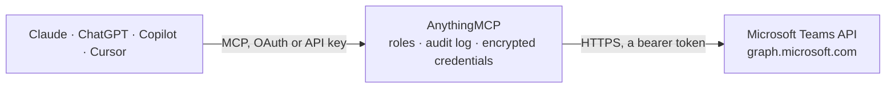

<!-- Generated by scripts/export-github-catalog.mjs in the anythingmcp-website repository. Do not edit by hand. -->

# Microsoft Teams MCP connector

Drive Microsoft Teams (chat + collaboration) via the Graph API: teams, channels, messages, members. 9 tools, OAuth2 Bearer auth (Microsoft Graph). The AnythingMCP connector gives Claude, ChatGPT, Microsoft Copilot, Cursor and Gemini 9 MCP tools for Microsoft Teams: 7 read and 2 can change data.

**Category:** [Messaging](../messaging.md) · **Tools:** 9 · **Setup guide:** [anythingmcp.com](https://anythingmcp.com/guides/microsoft-teams-to-mcp) · [Deutsch](https://anythingmcp.com/de/guides/microsoft-teams-to-mcp) · [Italiano](https://anythingmcp.com/it/guides/microsoft-teams-to-mcp) · [Español](https://anythingmcp.com/es/guides/microsoft-teams-to-mcp) · [日本語](https://anythingmcp.com/ja/guides/microsoft-teams-to-mcp) · [Русский](https://anythingmcp.com/ru/guides/microsoft-teams-to-mcp) · [中文](https://anythingmcp.com/zh/guides/microsoft-teams-to-mcp)

## Start without code

No installation and no terminal: AnythingMCP Cloud runs the Microsoft Teams connector for you, operated by helpcode.ai in Frankfurt, Germany.

1. **Click the button above** and create an account or sign in. The Microsoft Teams connector opens, ready to install.
2. **Paste the API key or token from your Microsoft Teams account.** Every click is in the [step-by-step guide](https://anythingmcp.com/guides/microsoft-teams-to-mcp).
3. **Click Install.** AnythingMCP shows the address of your MCP server.
4. **Add that address to your assistant:** [Claude](https://anythingmcp.com/guides/connect-microsoft-teams-to-claude) · [ChatGPT](https://anythingmcp.com/guides/connect-microsoft-teams-to-chatgpt) · [Microsoft Copilot](https://anythingmcp.com/guides/connect-microsoft-teams-to-copilot) · [Cursor](https://anythingmcp.com/guides/connect-microsoft-teams-to-cursor) · [Gemini CLI](https://anythingmcp.com/guides/connect-microsoft-teams-to-gemini) · [Meta Muse](https://anythingmcp.com/guides/connect-microsoft-teams-to-muse).
5. **Ask your first question**, for example: *Who posted the message about invoice INV-2026-044 in the Finance Ops channel last week?*

Prefer help with the setup? [Talk to us](https://anythingmcp.com/contact).

## How it works

- **The AI client** speaks MCP (Streamable HTTP) to AnythingMCP and only sees tool names, descriptions and results. It never gets the Microsoft Teams credentials.
- **AnythingMCP** checks the client's role, builds the call from the tool definition, adds the credentials (a bearer token), calls Microsoft Teams, logs the call and returns the result.
- **Microsoft Teams** sees an ordinary API client with the rights of the account the credentials belong to.

## Tools

| Tool | What it does | Access |
|---|---|---|
| [`microsoft_teams_list_joined_teams`](#microsoft_teams_list_joined_teams) | List teams the authenticated user is a member of (for delegated auth) — returns id, displayName, description, internalId. | read |
| [`microsoft_teams_get_team`](#microsoft_teams_get_team) | Get a team by ID. | read |
| [`microsoft_teams_list_channels`](#microsoft_teams_list_channels) | List channels in a team. | read |
| [`microsoft_teams_get_channel`](#microsoft_teams_get_channel) | Get a channel by ID. | read |
| [`microsoft_teams_list_channel_messages`](#microsoft_teams_list_channel_messages) | List recent messages in a channel. | read |
| [`microsoft_teams_send_channel_message`](#microsoft_teams_send_channel_message) | Send a message to a channel. | write |
| [`microsoft_teams_reply_to_message`](#microsoft_teams_reply_to_message) | Post a reply in a thread on a channel message. | write |
| [`microsoft_teams_list_channel_members`](#microsoft_teams_list_channel_members) | List members of a channel. | read |
| [`microsoft_teams_list_team_members`](#microsoft_teams_list_team_members) | List members of a team. | read |

## Tool reference

Every parameter as the AI client sees it in `tools/list`. Source: [`packages/backend/src/adapters/intl/microsoft-teams.json`](../../../packages/backend/src/adapters/intl/microsoft-teams.json).

### `microsoft_teams_list_joined_teams`

List teams the authenticated user is a member of (for delegated auth) — returns id, displayName, description, internalId.

**Access:** read · **Call:** `GET /me/joinedTeams`

No parameters.

### `microsoft_teams_get_team`

Get a team by ID.

**Access:** read · **Call:** `GET /teams/{teamId}`

| Parameter | Type | Required | Description |
|---|---|---|---|
| `teamId` | string | yes | Team ID (GUID). |

### `microsoft_teams_list_channels`

List channels in a team. Each channel has id, displayName, description, membershipType (standard/private/shared).

**Access:** read · **Call:** `GET /teams/{teamId}/channels`

| Parameter | Type | Required | Description |
|---|---|---|---|
| `teamId` | string | yes | Team ID. |

### `microsoft_teams_get_channel`

Get a channel by ID.

**Access:** read · **Call:** `GET /teams/{teamId}/channels/{channelId}`

| Parameter | Type | Required | Description |
|---|---|---|---|
| `teamId` | string | yes | Team ID. |
| `channelId` | string | yes | Channel ID. |

### `microsoft_teams_list_channel_messages`

List recent messages in a channel.

**Access:** read · **Call:** `GET /teams/{teamId}/channels/{channelId}/messages`

| Parameter | Type | Required | Description |
|---|---|---|---|
| `teamId` | string | yes | Team ID. |
| `channelId` | string | yes | Channel ID. |
| `$top` | integer | no | Max per page (default 20, max 50). |

### `microsoft_teams_send_channel_message`

Send a message to a channel. body.contentType 'text' (plain) or 'html'. Mentions array required for @-mentions to fire notifications.

**Access:** write · **Call:** `POST /teams/{teamId}/channels/{channelId}/messages`

| Parameter | Type | Required | Description |
|---|---|---|---|
| `teamId` | string | yes | Team ID. |
| `channelId` | string | yes | Channel ID. |
| `body` | object | yes | {contentType:'text'\|'html', content:'Hello team!'}. |
| `subject` | string | no | Optional message subject (shown in announcement channels). |
| `importance` | string | no | normal, high, urgent. |
| `mentions` | any[] | no | [{id:0, mentionText:'Jane Doe', mentioned:{user:{id:'azure-ad-user-id', displayName:'Jane Doe', userIdentityType:'aadUser'}}}]. |

### `microsoft_teams_reply_to_message`

Post a reply in a thread on a channel message.

**Access:** write · **Call:** `POST /teams/{teamId}/channels/{channelId}/messages/{messageId}/replies`

| Parameter | Type | Required | Description |
|---|---|---|---|
| `teamId` | string | yes | Team ID. |
| `channelId` | string | yes | Channel ID. |
| `messageId` | string | yes | Parent message ID. |
| `body` | object | yes | {contentType, content}. |

### `microsoft_teams_list_channel_members`

List members of a channel.

**Access:** read · **Call:** `GET /teams/{teamId}/channels/{channelId}/members`

| Parameter | Type | Required | Description |
|---|---|---|---|
| `teamId` | string | yes | Team ID. |
| `channelId` | string | yes | Channel ID. |

### `microsoft_teams_list_team_members`

List members of a team. Each member has id, displayName, email, roles[].

**Access:** read · **Call:** `GET /teams/{teamId}/members`

| Parameter | Type | Required | Description |
|---|---|---|---|
| `teamId` | string | yes | Team ID. |

## Run it yourself

AnythingMCP is open source (AGPL-3.0). [Run it with Docker](../../../README.md#run-it-yourself), open **Connectors → Store**, pick **Microsoft Teams** and enter `MICROSOFT_GRAPH_ACCESS_TOKEN`, then add your MCP server URL to the AI client.

[← Messaging connectors](../messaging.md) · [All categories](../README.md)
