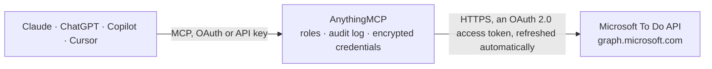

<!-- Generated by scripts/export-github-catalog.mjs in the anythingmcp-website repository. Do not edit by hand. -->

# Microsoft To Do MCP connector

Let your AI manage Microsoft To Do: list your task lists and open tasks, create tasks with due dates, reminders and notes, tick them off, and add checklist steps and links. The AnythingMCP connector gives Claude, ChatGPT, Microsoft Copilot, Cursor and Gemini 15 MCP tools for Microsoft To Do: 5 read and 10 can change data.

**Category:** [Productivity](../productivity.md) · **Tools:** 15 · **Setup guide:** [anythingmcp.com](https://anythingmcp.com/guides/microsoft-todo-to-mcp) · [Deutsch](https://anythingmcp.com/de/guides/microsoft-todo-to-mcp) · [Italiano](https://anythingmcp.com/it/guides/microsoft-todo-to-mcp) · [Español](https://anythingmcp.com/es/guides/microsoft-todo-to-mcp) · [日本語](https://anythingmcp.com/ja/guides/microsoft-todo-to-mcp) · [Русский](https://anythingmcp.com/ru/guides/microsoft-todo-to-mcp) · [中文](https://anythingmcp.com/zh/guides/microsoft-todo-to-mcp)

## Start without code

No installation and no terminal: AnythingMCP Cloud runs the Microsoft To Do connector for you, operated by helpcode.ai in Frankfurt, Germany.

1. **Click the button above** and create an account or sign in. The Microsoft To Do connector opens, ready to install.
2. **Sign in with your Microsoft To Do account** when AnythingMCP asks. The first time, an admin creates a small app in the Microsoft To Do developer console. Every click is in the [step-by-step guide](https://anythingmcp.com/guides/microsoft-todo-to-mcp).
3. **Click Install.** AnythingMCP shows the address of your MCP server.
4. **Add that address to your assistant:** [Claude](https://anythingmcp.com/guides/connect-microsoft-todo-to-claude) · [ChatGPT](https://anythingmcp.com/guides/connect-microsoft-todo-to-chatgpt) · [Microsoft Copilot](https://anythingmcp.com/guides/connect-microsoft-todo-to-copilot) · [Cursor](https://anythingmcp.com/guides/connect-microsoft-todo-to-cursor) · [Gemini CLI](https://anythingmcp.com/guides/connect-microsoft-todo-to-gemini) · [Meta Muse](https://anythingmcp.com/guides/connect-microsoft-todo-to-muse).
5. **Ask your first question**, for example: *Show me the open task for order INV-2026-117 from Bergström GmbH in my Sales list.*

Prefer help with the setup? [Talk to us](https://anythingmcp.com/contact).

## How it works

- **The AI client** speaks MCP (Streamable HTTP) to AnythingMCP and only sees tool names, descriptions and results. It never gets the Microsoft To Do credentials.
- **AnythingMCP** checks the client's role, builds the call from the tool definition, adds the credentials (an OAuth 2.0 access token, refreshed automatically), calls Microsoft To Do, logs the call and returns the result.
- **Microsoft To Do** sees an ordinary API client with the rights of the account the credentials belong to.

## Tools

| Tool | What it does | Access |
|---|---|---|
| [`microsoft_todo_list_lists`](#microsoft_todo_list_lists) | List the user's Microsoft To Do task lists: id, displayName, isOwner, isShared and wellknownListName (defaultList is the standard "Tasks" list,… | read |
| [`microsoft_todo_create_list`](#microsoft_todo_create_list) | Create a new task list. | write |
| [`microsoft_todo_rename_list`](#microsoft_todo_rename_list) | Rename a task list the user made. | write |
| [`microsoft_todo_delete_list`](#microsoft_todo_delete_list) | Delete a task list with all its tasks. | write |
| [`microsoft_todo_list_tasks`](#microsoft_todo_list_tasks) | List the tasks in a list: id, title, status, importance, dueDateTime, reminderDateTime, completedDateTime, categories, body (the note), checklist and linked… | read |
| [`microsoft_todo_get_task`](#microsoft_todo_get_task) | Get one task with all its fields, including the body (note), recurrence and linked resources. | read |
| [`microsoft_todo_create_task`](#microsoft_todo_create_task) | Create a task in a list with a title and, optionally, a note, due date, reminder, importance, status and categories. | write |
| [`microsoft_todo_update_task`](#microsoft_todo_update_task) | Change a task: only the fields you pass are changed (title, note, due date, reminder, importance, status, categories). | write |
| [`microsoft_todo_complete_task`](#microsoft_todo_complete_task) | Mark a task as completed (status completed; To Do records completedDateTime). | write |
| [`microsoft_todo_delete_task`](#microsoft_todo_delete_task) | Delete a task. | write |
| [`microsoft_todo_list_checklist_items`](#microsoft_todo_list_checklist_items) | List a task's checklist items (steps): id, displayName, isChecked, createdDateTime, checkedDateTime. | read |
| [`microsoft_todo_add_checklist_item`](#microsoft_todo_add_checklist_item) | Add a step to a task's checklist. | write |
| [`microsoft_todo_update_checklist_item`](#microsoft_todo_update_checklist_item) | Tick, untick or rename a checklist step. | write |
| [`microsoft_todo_list_linked_resources`](#microsoft_todo_list_linked_resources) | List the links attached to a task (linked resources): id, webUrl, displayName, applicationName, externalId. | read |
| [`microsoft_todo_add_linked_resource`](#microsoft_todo_add_linked_resource) | Attach a link to a task, e.g. the ticket, document or web page the task is about. | write |

## Tool reference

Every parameter as the AI client sees it in `tools/list`. Source: [`packages/backend/src/adapters/intl/microsoft-todo.json`](../../../packages/backend/src/adapters/intl/microsoft-todo.json).

### `microsoft_todo_list_lists`

List the user's Microsoft To Do task lists: id, displayName, isOwner, isShared and wellknownListName (defaultList is the standard "Tasks" list, flaggedEmails holds flagged Outlook mails, none for lists the user made). Start here to find a list id.

**Access:** read · **Call:** `GET /me/todo/lists`

No parameters.

### `microsoft_todo_create_list`

Create a new task list. Returns the list with its id. Confirm with the user before calling.

**Access:** write · **Call:** `POST /me/todo/lists`

| Parameter | Type | Required | Description |
|---|---|---|---|
| `display_name` | string | yes | Name of the list. |

### `microsoft_todo_rename_list`

Rename a task list the user made. The built-in lists (wellknownListName defaultList or flaggedEmails) cannot be renamed. Confirm with the user before calling.

**Access:** write · **Call:** `PATCH /me/todo/lists/{list_id}`

| Parameter | Type | Required | Description |
|---|---|---|---|
| `list_id` | string | yes | Task list id from microsoft_todo_list_lists. |
| `display_name` | string | yes | New name. |

### `microsoft_todo_delete_list`

Delete a task list with all its tasks. This connector cannot undo it. Installed switched off. Confirm with the user before calling.

**Access:** write · **Call:** `DELETE /me/todo/lists/{list_id}`

| Parameter | Type | Required | Description |
|---|---|---|---|
| `list_id` | string | yes | Task list id from microsoft_todo_list_lists. |

### `microsoft_todo_list_tasks`

List the tasks in a list: id, title, status, importance, dueDateTime, reminderDateTime, completedDateTime, categories, body (the note), checklist and linked resources flags, dates. Open tasks only: filter "status ne 'completed'". Paginate with skip.

**Access:** read · **Call:** `GET /me/todo/lists/{list_id}/tasks`

| Parameter | Type | Required | Description |
|---|---|---|---|
| `list_id` | string | yes | Task list id from microsoft_todo_list_lists. |
| `filter` | string | no | OData filter, e.g. "status ne 'completed'", "importance eq 'high'", "status eq 'completed'". |
| `orderby` | string | no | Sort order, e.g. "createdDateTime desc" or "importance desc". |
| `top` | integer | no | How many tasks to return per page. |
| `skip` | integer | no | How many to skip, for the next page: the $skip value from @odata.nextLink. |

### `microsoft_todo_get_task`

Get one task with all its fields, including the body (note), recurrence and linked resources.

**Access:** read · **Call:** `GET /me/todo/lists/{list_id}/tasks/{task_id}`

| Parameter | Type | Required | Description |
|---|---|---|---|
| `list_id` | string | yes | Task list id from microsoft_todo_list_lists. |
| `task_id` | string | yes | Task id from microsoft_todo_list_tasks. |

### `microsoft_todo_create_task`

Create a task in a list with a title and, optionally, a note, due date, reminder, importance, status and categories. Returns the new task with its id. Confirm with the user before calling.

**Access:** write · **Call:** `POST /me/todo/lists/{list_id}/tasks`

| Parameter | Type | Required | Description |
|---|---|---|---|
| `list_id` | string | yes | Task list id from microsoft_todo_list_lists. |
| `title` | string | yes | What the task is, e.g. "Send the Q4 report to Anna". |
| `body` | object | no | Task note as {"content": "Bring the signed contract", "contentType": "text"} (contentType text or html). |
| `importance` | `low` \| `normal` \| `high` | no | low, normal or high. |
| `status` | `notStarted` \| `inProgress` \| `completed` \| `waitingOnOthers` \| `deferred` | no | notStarted, inProgress, completed, waitingOnOthers or deferred. |
| `due` | object | no | Due date. To Do keeps only the day; use T00:00:00 as {"dateTime": "2026-10-20T09:00:00", "timeZone": "Europe/Berlin"}. dateTime has no offset; timeZone is a Windows ("W. Europe Standard Time") or IANA name, or "UTC". |
| `start` | object | no | Start date as {"dateTime": "2026-10-20T09:00:00", "timeZone": "Europe/Berlin"}. dateTime has no offset; timeZone is a Windows ("W. Europe Standard Time") or IANA name, or "UTC". |
| `reminder` | object | no | Reminder time; also set is_reminder_on true as {"dateTime": "2026-10-20T09:00:00", "timeZone": "Europe/Berlin"}. dateTime has no offset; timeZone is a Windows ("W. Europe Standard Time") or IANA name, or "UTC". |
| `is_reminder_on` | boolean | no | Whether the reminder is on. |
| `categories` | string[] | no | Category names, each the name of one of the user's Outlook categories (e.g. "Red category"). |

### `microsoft_todo_update_task`

Change a task: only the fields you pass are changed (title, note, due date, reminder, importance, status, categories). To tick a task off, use microsoft_todo_complete_task. Returns the updated task. Confirm with the user before calling.

**Access:** write · **Call:** `PATCH /me/todo/lists/{list_id}/tasks/{task_id}`

| Parameter | Type | Required | Description |
|---|---|---|---|
| `list_id` | string | yes | Task list id from microsoft_todo_list_lists. |
| `task_id` | string | yes | Task id from microsoft_todo_list_tasks. |
| `title` | string | no | New title. |
| `body` | object | no | Task note as {"content": "Bring the signed contract", "contentType": "text"} (contentType text or html). |
| `importance` | `low` \| `normal` \| `high` | no | low, normal or high. |
| `status` | `notStarted` \| `inProgress` \| `completed` \| `waitingOnOthers` \| `deferred` | no | notStarted, inProgress, completed, waitingOnOthers or deferred. |
| `due` | object | no | Due date. To Do keeps only the day; use T00:00:00 as {"dateTime": "2026-10-20T09:00:00", "timeZone": "Europe/Berlin"}. dateTime has no offset; timeZone is a Windows ("W. Europe Standard Time") or IANA name, or "UTC". |
| `start` | object | no | Start date as {"dateTime": "2026-10-20T09:00:00", "timeZone": "Europe/Berlin"}. dateTime has no offset; timeZone is a Windows ("W. Europe Standard Time") or IANA name, or "UTC". |
| `reminder` | object | no | Reminder time; also set is_reminder_on true as {"dateTime": "2026-10-20T09:00:00", "timeZone": "Europe/Berlin"}. dateTime has no offset; timeZone is a Windows ("W. Europe Standard Time") or IANA name, or "UTC". |
| `is_reminder_on` | boolean | no | Whether the reminder is on. |
| `categories` | string[] | no | Category names, each the name of one of the user's Outlook categories (e.g. "Red category"). |

### `microsoft_todo_complete_task`

Mark a task as completed (status completed; To Do records completedDateTime). Reopen it with microsoft_todo_update_task and status notStarted. Confirm with the user before calling.

**Access:** write · **Call:** `PATCH /me/todo/lists/{list_id}/tasks/{task_id}`

| Parameter | Type | Required | Description |
|---|---|---|---|
| `list_id` | string | yes | Task list id from microsoft_todo_list_lists. |
| `task_id` | string | yes | Task id from microsoft_todo_list_tasks. |

### `microsoft_todo_delete_task`

Delete a task. This connector cannot undo it. Installed switched off. Confirm with the user before calling.

**Access:** write · **Call:** `DELETE /me/todo/lists/{list_id}/tasks/{task_id}`

| Parameter | Type | Required | Description |
|---|---|---|---|
| `list_id` | string | yes | Task list id from microsoft_todo_list_lists. |
| `task_id` | string | yes | Task id from microsoft_todo_list_tasks. |

### `microsoft_todo_list_checklist_items`

List a task's checklist items (steps): id, displayName, isChecked, createdDateTime, checkedDateTime.

**Access:** read · **Call:** `GET /me/todo/lists/{list_id}/tasks/{task_id}/checklistItems`

| Parameter | Type | Required | Description |
|---|---|---|---|
| `list_id` | string | yes | Task list id from microsoft_todo_list_lists. |
| `task_id` | string | yes | Task id from microsoft_todo_list_tasks. |

### `microsoft_todo_add_checklist_item`

Add a step to a task's checklist. Returns the item with its id. Confirm with the user before calling.

**Access:** write · **Call:** `POST /me/todo/lists/{list_id}/tasks/{task_id}/checklistItems`

| Parameter | Type | Required | Description |
|---|---|---|---|
| `list_id` | string | yes | Task list id from microsoft_todo_list_lists. |
| `task_id` | string | yes | Task id from microsoft_todo_list_tasks. |
| `display_name` | string | yes | Text of the step. |
| `is_checked` | boolean | no | Add it already ticked. |

### `microsoft_todo_update_checklist_item`

Tick, untick or rename a checklist step. Confirm with the user before calling.

**Access:** write · **Call:** `PATCH /me/todo/lists/{list_id}/tasks/{task_id}/checklistItems/{checklist_item_id}`

| Parameter | Type | Required | Description |
|---|---|---|---|
| `list_id` | string | yes | Task list id from microsoft_todo_list_lists. |
| `task_id` | string | yes | Task id from microsoft_todo_list_tasks. |
| `checklist_item_id` | string | yes | Checklist item id from microsoft_todo_list_checklist_items. |
| `display_name` | string | no | New text of the step. |
| `is_checked` | boolean | no | true to tick the step, false to untick it. |

### `microsoft_todo_list_linked_resources`

List the links attached to a task (linked resources): id, webUrl, displayName, applicationName, externalId. A task made from a flagged Outlook mail links back to that mail.

**Access:** read · **Call:** `GET /me/todo/lists/{list_id}/tasks/{task_id}/linkedResources`

| Parameter | Type | Required | Description |
|---|---|---|---|
| `list_id` | string | yes | Task list id from microsoft_todo_list_lists. |
| `task_id` | string | yes | Task id from microsoft_todo_list_tasks. |

### `microsoft_todo_add_linked_resource`

Attach a link to a task, e.g. the ticket, document or web page the task is about. To Do shows it on the task with the given name. Confirm with the user before calling.

**Access:** write · **Call:** `POST /me/todo/lists/{list_id}/tasks/{task_id}/linkedResources`

| Parameter | Type | Required | Description |
|---|---|---|---|
| `list_id` | string | yes | Task list id from microsoft_todo_list_lists. |
| `task_id` | string | yes | Task id from microsoft_todo_list_tasks. |
| `web_url` | string | yes | The link, e.g. https://example.atlassian.net/browse/OPS-42. |
| `display_name` | string | no | Title shown for the link, e.g. "OPS-42 Printer setup". |
| `application_name` | string | yes | Name of the app the link belongs to, e.g. "Jira". |
| `external_id` | string | no | The item's id in that app, e.g. OPS-42. |

## Run it yourself

AnythingMCP is open source (AGPL-3.0). [Run it with Docker](../../../README.md#run-it-yourself), open **Connectors → Store**, pick **Microsoft To Do** and enter `MICROSOFT_CLIENT_ID`, `MICROSOFT_CLIENT_SECRET`, `MICROSOFT_TENANT_ID`, then add your MCP server URL to the AI client.

[← Productivity connectors](../productivity.md) · [All categories](../README.md)
