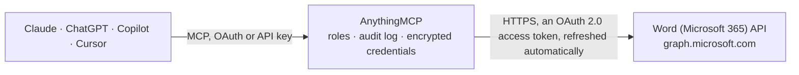

<!-- Generated by scripts/export-github-catalog.mjs in the anythingmcp-website repository. Do not edit by hand. -->

# Word (Microsoft 365) MCP connector

Let your AI work with Word documents in OneDrive and SharePoint: find documents, read their details and version history, download them or get them as PDF, create new documents from a template, … The AnythingMCP connector gives Claude, ChatGPT, Microsoft Copilot, Cursor and Gemini 19 MCP tools for Word (Microsoft 365): 11 read and 8 can change data.

**Category:** [Productivity](../productivity.md) · **Tools:** 19 · **Setup guide:** [anythingmcp.com](https://anythingmcp.com/guides/microsoft-word-to-mcp) · [Deutsch](https://anythingmcp.com/de/guides/microsoft-word-to-mcp) · [Italiano](https://anythingmcp.com/it/guides/microsoft-word-to-mcp) · [Español](https://anythingmcp.com/es/guides/microsoft-word-to-mcp) · [日本語](https://anythingmcp.com/ja/guides/microsoft-word-to-mcp) · [Русский](https://anythingmcp.com/ru/guides/microsoft-word-to-mcp) · [中文](https://anythingmcp.com/zh/guides/microsoft-word-to-mcp)

## Start without code

No installation and no terminal: AnythingMCP Cloud runs the Word (Microsoft 365) connector for you, operated by helpcode.ai in Frankfurt, Germany.

1. **Click the button above** and create an account or sign in. The Word (Microsoft 365) connector opens, ready to install.
2. **Sign in with your Word (Microsoft 365) account** when AnythingMCP asks. The first time, an admin creates a small app in the Word (Microsoft 365) developer console. Every click is in the [step-by-step guide](https://anythingmcp.com/guides/microsoft-word-to-mcp).
3. **Click Install.** AnythingMCP shows the address of your MCP server.
4. **Add that address to your assistant:** [Claude](https://anythingmcp.com/guides/connect-microsoft-word-to-claude) · [ChatGPT](https://anythingmcp.com/guides/connect-microsoft-word-to-chatgpt) · [Microsoft Copilot](https://anythingmcp.com/guides/connect-microsoft-word-to-copilot) · [Cursor](https://anythingmcp.com/guides/connect-microsoft-word-to-cursor) · [Gemini CLI](https://anythingmcp.com/guides/connect-microsoft-word-to-gemini) · [Meta Muse](https://anythingmcp.com/guides/connect-microsoft-word-to-muse).
5. **Ask your first question**, for example: *Where is the invoice file INV-2026-0412.docx in my OneDrive and when was it last modified?*

Prefer help with the setup? [Talk to us](https://anythingmcp.com/contact).

## How it works

- **The AI client** speaks MCP (Streamable HTTP) to AnythingMCP and only sees tool names, descriptions and results. It never gets the Word (Microsoft 365) credentials.
- **AnythingMCP** checks the client's role, builds the call from the tool definition, adds the credentials (an OAuth 2.0 access token, refreshed automatically), calls Word (Microsoft 365), logs the call and returns the result.
- **Word (Microsoft 365)** sees an ordinary API client with the rights of the account the credentials belong to.

## Tools

| Tool | What it does | Access |
|---|---|---|
| [`microsoft_word_get_my_drive`](#microsoft_word_get_my_drive) | Get the signed-in user's OneDrive: drive id (the drive_id for documents stored there), type (personal or business), owner, storage quota and webUrl. | read |
| [`microsoft_word_search_my_documents`](#microsoft_word_search_my_documents) | Search the user's own OneDrive by name, metadata and content, e.g. "offer 2026". | read |
| [`microsoft_word_find_documents`](#microsoft_word_find_documents) | Find Word documents everywhere the user has access (their OneDrive, SharePoint sites, Teams files, files shared with them) with Microsoft Search. | read |
| [`microsoft_word_list_folder`](#microsoft_word_list_folder) | List the files and folders inside a folder of a drive (item_id "root" for its top level), to browse to a document. | read |
| [`microsoft_word_get_document`](#microsoft_word_get_document) | Get a document's details: name, size, created and last modified (when and by whom), folder (parentReference), mimeType and hashes, sharing state, check-out… | read |
| [`microsoft_word_get_document_by_path`](#microsoft_word_get_document_by_path) | Get a document in the user's own OneDrive by its path, e.g. "Documents/Contracts/Offer 2026.docx". | read |
| [`microsoft_word_download_document`](#microsoft_word_download_document) | Download the document file itself (.docx), as it is stored. | read |
| [`microsoft_word_convert_to_pdf`](#microsoft_word_convert_to_pdf) | Get the document converted to PDF by Microsoft 365 (works for .docx, .docm, .doc, .dotx, .odt and .rtf files), attached to the result as a PDF file up to 10… | read |
| [`microsoft_word_list_versions`](#microsoft_word_list_versions) | List the document's version history: each version's id (e.g. "4.0"), when and by whom it was saved, and size, newest first. | read |
| [`microsoft_word_download_version`](#microsoft_word_download_version) | Download an earlier version of the document as an attached file (up to 10 MB), e.g. to compare it with the current one. | read |
| [`microsoft_word_list_permissions`](#microsoft_word_list_permissions) | List who has access to the document: each permission's id, roles (read, write, owner), the people or groups granted (grantedToV2, grantedToIdentitiesV2),… | read |
| [`microsoft_word_copy_document`](#microsoft_word_copy_document) | Create a new document as a copy of an existing one, typically a template (e.g. "Templates/Offer template.docx"), in a target folder under a new name. | write |
| [`microsoft_word_rename_document`](#microsoft_word_rename_document) | Rename a document in place. | write |
| [`microsoft_word_move_document`](#microsoft_word_move_document) | Move a document into another folder of the same drive, optionally renaming it on the way. | write |
| [`microsoft_word_restore_version`](#microsoft_word_restore_version) | Make an earlier version the current content of the document. | write |
| [`microsoft_word_check_out`](#microsoft_word_check_out) | Check out a document in a SharePoint library that requires check-out, so that only the user can change it until it is checked in. | write |
| [`microsoft_word_check_in`](#microsoft_word_check_in) | Check a checked-out document back in, with a comment that is stored with the new version, so other people see the changes and can edit it again. | write |
| [`microsoft_word_create_sharing_link`](#microsoft_word_create_sharing_link) | Create a sharing link for the document: type "view" or "edit", scope "anonymous" (anyone with the link, if the organisation allows it), "organization"… | write |
| [`microsoft_word_delete_document`](#microsoft_word_delete_document) | Delete a document. | write |

## Tool reference

Every parameter as the AI client sees it in `tools/list`. Source: [`packages/backend/src/adapters/intl/microsoft-word.json`](../../../packages/backend/src/adapters/intl/microsoft-word.json).

### `microsoft_word_get_my_drive`

Get the signed-in user's OneDrive: drive id (the drive_id for documents stored there), type (personal or business), owner, storage quota and webUrl. A cheap check that the connector works.

**Access:** read · **Call:** `GET /me/drive`

No parameters.

### `microsoft_word_search_my_documents`

Search the user's own OneDrive by name, metadata and content, e.g. "offer 2026". Graph returns every file type that matches: keep the hits whose name ends in .docx (or whose file.mimeType is the Word type). Returns id, name, size, dates, parentReference.driveId (the drive_id the other tools need) and webUrl. Paginate with skip_token.

**Access:** read · **Call:** `GET /me/drive/root/search(q='{query}')`

| Parameter | Type | Required | Description |
|---|---|---|---|
| `query` | string | yes | Search text, e.g. "offer 2026". Write a single quote as two (''), e.g. "O''Brien". |
| `top` | integer | no | Items per page (default 200). |
| `skip_token` | string | no | To fetch the next page, pass the $skiptoken (or skipToken) value from the @odata.nextLink of the previous response, with the same other arguments. |

### `microsoft_word_find_documents`

Find Word documents everywhere the user has access (their OneDrive, SharePoint sites, Teams files, files shared with them) with Microsoft Search. The query is restricted to Word files. Supports KQL, e.g. "budget", "author:\"Ana Diaz\"", "*" for all. Returns hitsContainers[0].hits with summary and resource (id, name, webUrl, parentReference.driveId, lastModifiedDateTime). Work or school accounts only; needs Files.Read.All or Files.ReadWrite.All in the scopes. Page with from and size.

**Access:** read · **Call:** `POST /search/query`

| Parameter | Type | Required | Description |
|---|---|---|---|
| `query` | string | yes | Search words or KQL, e.g. "quarterly review", "author:\"Ana Diaz\"", or "*" for all Word documents. |
| `from` | integer | no | 0-based offset of the first hit, for the next page (from + size of the previous call). |
| `size` | integer | no | Hits per page, 1 to 500 (default 25). |

### `microsoft_word_list_folder`

List the files and folders inside a folder of a drive (item_id "root" for its top level), to browse to a document. Returns id, name, size, dates, file or folder facet, parentReference and webUrl. Paginate with skip_token.

**Access:** read · **Call:** `GET /drives/{drive_id}/items/{item_id}/children`

| Parameter | Type | Required | Description |
|---|---|---|---|
| `drive_id` | string | yes | Drive id: the id from microsoft_word_get_my_drive for the user's own OneDrive, or parentReference.driveId of an item in a SharePoint library. |
| `item_id` | string | yes | Id of the folder, from a list or search result, or "root" for the top of the drive. |
| `top` | integer | no | Items per page (default 200). |
| `skip_token` | string | no | To fetch the next page, pass the $skiptoken (or skipToken) value from the @odata.nextLink of the previous response, with the same other arguments. |

### `microsoft_word_get_document`

Get a document's details: name, size, created and last modified (when and by whom), folder (parentReference), mimeType and hashes, sharing state, check-out state (publication), eTag and webUrl, the link that opens it in Word for the web. Does not return the content.

**Access:** read · **Call:** `GET /drives/{drive_id}/items/{item_id}`

| Parameter | Type | Required | Description |
|---|---|---|---|
| `drive_id` | string | yes | Drive id of the document: parentReference.driveId from a search or list result, or the id from microsoft_word_get_my_drive for the user's own OneDrive, e.g. b!s8RqPCGh0ESQS2EYnKM0IKS3lM7GxjdAviiob7oc5pXv_0LiL-62Qq3IXyrXnEop. |
| `item_id` | string | yes | Item id of the document in that drive, from a search or list result. Work or school ids look like 01BYE5RZ6QN3ZWBTUFOFD3GSPGOHDJD36K, personal ones like D4648F06C91D9D3D!54927. |

### `microsoft_word_get_document_by_path`

Get a document in the user's own OneDrive by its path, e.g. "Documents/Contracts/Offer 2026.docx". Returns the same details as microsoft_word_get_document, including id and parentReference.driveId for the other tools.

**Access:** read · **Call:** `GET /me/drive/root:/{path}`

| Parameter | Type | Required | Description |
|---|---|---|---|
| `path` | string | yes | Path from the top of the OneDrive without a leading slash, e.g. "Documents/Contracts/Offer 2026.docx". Names containing #, % or ? cannot be addressed by path: use microsoft_word_search_my_documents. |

### `microsoft_word_download_document`

Download the document file itself (.docx), as it is stored. It is handed over as an attached file, not as text, up to 10 MB. To read the text, prefer microsoft_word_convert_to_pdf.

**Access:** read · **Call:** `GET /drives/{drive_id}/items/{item_id}/content`

| Parameter | Type | Required | Description |
|---|---|---|---|
| `drive_id` | string | yes | Drive id of the document: parentReference.driveId from a search or list result, or the id from microsoft_word_get_my_drive for the user's own OneDrive, e.g. b!s8RqPCGh0ESQS2EYnKM0IKS3lM7GxjdAviiob7oc5pXv_0LiL-62Qq3IXyrXnEop. |
| `item_id` | string | yes | Item id of the document in that drive, from a search or list result. Work or school ids look like 01BYE5RZ6QN3ZWBTUFOFD3GSPGOHDJD36K, personal ones like D4648F06C91D9D3D!54927. |

### `microsoft_word_convert_to_pdf`

Get the document converted to PDF by Microsoft 365 (works for .docx, .docm, .doc, .dotx, .odt and .rtf files), attached to the result as a PDF file up to 10 MB that the AI can read. Converting a large file can take some seconds. The stored file is not changed.

**Access:** read · **Call:** `GET /drives/{drive_id}/items/{item_id}/content`

| Parameter | Type | Required | Description |
|---|---|---|---|
| `drive_id` | string | yes | Drive id of the document: parentReference.driveId from a search or list result, or the id from microsoft_word_get_my_drive for the user's own OneDrive, e.g. b!s8RqPCGh0ESQS2EYnKM0IKS3lM7GxjdAviiob7oc5pXv_0LiL-62Qq3IXyrXnEop. |
| `item_id` | string | yes | Item id of the document in that drive, from a search or list result. Work or school ids look like 01BYE5RZ6QN3ZWBTUFOFD3GSPGOHDJD36K, personal ones like D4648F06C91D9D3D!54927. |

### `microsoft_word_list_versions`

List the document's version history: each version's id (e.g. "4.0"), when and by whom it was saved, and size, newest first. Download one with microsoft_word_download_version or bring it back with microsoft_word_restore_version.

**Access:** read · **Call:** `GET /drives/{drive_id}/items/{item_id}/versions`

| Parameter | Type | Required | Description |
|---|---|---|---|
| `drive_id` | string | yes | Drive id of the document: parentReference.driveId from a search or list result, or the id from microsoft_word_get_my_drive for the user's own OneDrive, e.g. b!s8RqPCGh0ESQS2EYnKM0IKS3lM7GxjdAviiob7oc5pXv_0LiL-62Qq3IXyrXnEop. |
| `item_id` | string | yes | Item id of the document in that drive, from a search or list result. Work or school ids look like 01BYE5RZ6QN3ZWBTUFOFD3GSPGOHDJD36K, personal ones like D4648F06C91D9D3D!54927. |

### `microsoft_word_download_version`

Download an earlier version of the document as an attached file (up to 10 MB), e.g. to compare it with the current one. The current file is not changed.

**Access:** read · **Call:** `GET /drives/{drive_id}/items/{item_id}/versions/{version_id}/content`

| Parameter | Type | Required | Description |
|---|---|---|---|
| `drive_id` | string | yes | Drive id of the document: parentReference.driveId from a search or list result, or the id from microsoft_word_get_my_drive for the user's own OneDrive, e.g. b!s8RqPCGh0ESQS2EYnKM0IKS3lM7GxjdAviiob7oc5pXv_0LiL-62Qq3IXyrXnEop. |
| `item_id` | string | yes | Item id of the document in that drive, from a search or list result. Work or school ids look like 01BYE5RZ6QN3ZWBTUFOFD3GSPGOHDJD36K, personal ones like D4648F06C91D9D3D!54927. |
| `version_id` | string | yes | Version id from microsoft_word_list_versions, e.g. "3.0" on work or school accounts. |

### `microsoft_word_list_permissions`

List who has access to the document: each permission's id, roles (read, write, owner), the people or groups granted (grantedToV2, grantedToIdentitiesV2), sharing links (link.type, link.scope, link.webUrl), inheritance and expiry.

**Access:** read · **Call:** `GET /drives/{drive_id}/items/{item_id}/permissions`

| Parameter | Type | Required | Description |
|---|---|---|---|
| `drive_id` | string | yes | Drive id of the document: parentReference.driveId from a search or list result, or the id from microsoft_word_get_my_drive for the user's own OneDrive, e.g. b!s8RqPCGh0ESQS2EYnKM0IKS3lM7GxjdAviiob7oc5pXv_0LiL-62Qq3IXyrXnEop. |
| `item_id` | string | yes | Item id of the document in that drive, from a search or list result. Work or school ids look like 01BYE5RZ6QN3ZWBTUFOFD3GSPGOHDJD36K, personal ones like D4648F06C91D9D3D!54927. |

### `microsoft_word_copy_document`

Create a new document as a copy of an existing one, typically a template (e.g. "Templates/Offer template.docx"), in a target folder under a new name. Runs asynchronously: Graph answers 202 with no body and the copy appears shortly after; find it with microsoft_word_list_folder. Needs the target drive id and folder id.

**Access:** write · **Call:** `POST /drives/{drive_id}/items/{item_id}/copy`

| Parameter | Type | Required | Description |
|---|---|---|---|
| `drive_id` | string | yes | Drive id of the document (or template) to copy. |
| `item_id` | string | yes | Item id of the document (or template) to copy. |
| `destination_drive_id` | string | yes | Drive id of the target folder: the id from microsoft_word_get_my_drive for the user's own OneDrive. |
| `destination_folder_id` | string | yes | Id of the target folder, from microsoft_word_list_folder or a search result. For the top folder use the real id that microsoft_word_list_folder results carry in parentReference.id, not "root". |
| `name` | string | yes | Name of the new document, with extension, e.g. "Offer Rossi 2026.docx" (default: the original's name). |
| `conflict_behavior` | `fail` \| `rename` | no | When the name exists in the target: "fail" (default) or "rename" (Graph appends a number). Personal OneDrive ignores it. |

### `microsoft_word_rename_document`

Rename a document in place. Keep the extension (.docx). Returns the item's id, name, parentReference and webUrl.

**Access:** write · **Call:** `PATCH /drives/{drive_id}/items/{item_id}`

| Parameter | Type | Required | Description |
|---|---|---|---|
| `drive_id` | string | yes | Drive id of the document: parentReference.driveId from a search or list result, or the id from microsoft_word_get_my_drive for the user's own OneDrive, e.g. b!s8RqPCGh0ESQS2EYnKM0IKS3lM7GxjdAviiob7oc5pXv_0LiL-62Qq3IXyrXnEop. |
| `item_id` | string | yes | Item id of the document in that drive, from a search or list result. Work or school ids look like 01BYE5RZ6QN3ZWBTUFOFD3GSPGOHDJD36K, personal ones like D4648F06C91D9D3D!54927. |
| `name` | string | yes | New name with extension, e.g. "Offer Rossi 2026.docx". Not allowed: " * : < > ? / \ \|. |

### `microsoft_word_move_document`

Move a document into another folder of the same drive, optionally renaming it on the way. Returns the item's id, name, new parentReference and webUrl.

**Access:** write · **Call:** `PATCH /drives/{drive_id}/items/{item_id}`

| Parameter | Type | Required | Description |
|---|---|---|---|
| `drive_id` | string | yes | Drive id of the document: parentReference.driveId from a search or list result, or the id from microsoft_word_get_my_drive for the user's own OneDrive, e.g. b!s8RqPCGh0ESQS2EYnKM0IKS3lM7GxjdAviiob7oc5pXv_0LiL-62Qq3IXyrXnEop. |
| `item_id` | string | yes | Item id of the document in that drive, from a search or list result. Work or school ids look like 01BYE5RZ6QN3ZWBTUFOFD3GSPGOHDJD36K, personal ones like D4648F06C91D9D3D!54927. |
| `new_parent_id` | string | yes | Id of the target folder in the same drive, from microsoft_word_list_folder or a search result. |
| `name` | string | no | Optional new name, with extension. |

### `microsoft_word_restore_version`

Make an earlier version the current content of the document. The content it replaces stays in the version history as a version of its own, so this can be undone by restoring that one. OneDrive for work or school and SharePoint only.

**Access:** write · **Call:** `POST /drives/{drive_id}/items/{item_id}/versions/{version_id}/restoreVersion`

| Parameter | Type | Required | Description |
|---|---|---|---|
| `drive_id` | string | yes | Drive id of the document: parentReference.driveId from a search or list result, or the id from microsoft_word_get_my_drive for the user's own OneDrive, e.g. b!s8RqPCGh0ESQS2EYnKM0IKS3lM7GxjdAviiob7oc5pXv_0LiL-62Qq3IXyrXnEop. |
| `item_id` | string | yes | Item id of the document in that drive, from a search or list result. Work or school ids look like 01BYE5RZ6QN3ZWBTUFOFD3GSPGOHDJD36K, personal ones like D4648F06C91D9D3D!54927. |
| `version_id` | string | yes | Version id from microsoft_word_list_versions, e.g. "3.0" on work or school accounts. |

### `microsoft_word_check_out`

Check out a document in a SharePoint library that requires check-out, so that only the user can change it until it is checked in. Answers 204 with no body.

**Access:** write · **Call:** `POST /drives/{drive_id}/items/{item_id}/checkout`

| Parameter | Type | Required | Description |
|---|---|---|---|
| `drive_id` | string | yes | Drive id of the document: parentReference.driveId from a search or list result, or the id from microsoft_word_get_my_drive for the user's own OneDrive, e.g. b!s8RqPCGh0ESQS2EYnKM0IKS3lM7GxjdAviiob7oc5pXv_0LiL-62Qq3IXyrXnEop. |
| `item_id` | string | yes | Item id of the document in that drive, from a search or list result. Work or school ids look like 01BYE5RZ6QN3ZWBTUFOFD3GSPGOHDJD36K, personal ones like D4648F06C91D9D3D!54927. |

### `microsoft_word_check_in`

Check a checked-out document back in, with a comment that is stored with the new version, so other people see the changes and can edit it again. Answers 204 with no body.

**Access:** write · **Call:** `POST /drives/{drive_id}/items/{item_id}/checkin`

| Parameter | Type | Required | Description |
|---|---|---|---|
| `drive_id` | string | yes | Drive id of the document: parentReference.driveId from a search or list result, or the id from microsoft_word_get_my_drive for the user's own OneDrive, e.g. b!s8RqPCGh0ESQS2EYnKM0IKS3lM7GxjdAviiob7oc5pXv_0LiL-62Qq3IXyrXnEop. |
| `item_id` | string | yes | Item id of the document in that drive, from a search or list result. Work or school ids look like 01BYE5RZ6QN3ZWBTUFOFD3GSPGOHDJD36K, personal ones like D4648F06C91D9D3D!54927. |
| `comment` | string | yes | Check-in comment stored with the version, e.g. "Prices updated". |
| `check_in_as` | `published` | no | "published" to publish a major version where the library uses minor versions; leave out otherwise. |

### `microsoft_word_create_sharing_link`

Create a sharing link for the document: type "view" or "edit", scope "anonymous" (anyone with the link, if the organisation allows it), "organization" (people in the organisation) or "users" (only people already given access). Returns the link with its webUrl. Installed switched off: a link gives other people access to the file.

**Access:** write · **Call:** `POST /drives/{drive_id}/items/{item_id}/createLink`

| Parameter | Type | Required | Description |
|---|---|---|---|
| `drive_id` | string | yes | Drive id of the document: parentReference.driveId from a search or list result, or the id from microsoft_word_get_my_drive for the user's own OneDrive, e.g. b!s8RqPCGh0ESQS2EYnKM0IKS3lM7GxjdAviiob7oc5pXv_0LiL-62Qq3IXyrXnEop. |
| `item_id` | string | yes | Item id of the document in that drive, from a search or list result. Work or school ids look like 01BYE5RZ6QN3ZWBTUFOFD3GSPGOHDJD36K, personal ones like D4648F06C91D9D3D!54927. |
| `type` | `view` \| `edit` | yes | Link type. |
| `scope` | `anonymous` \| `organization` \| `users` | no | Who the link works for. Personal OneDrive supports only anonymous. |
| `expiration_date_time` | string | no | Optional ISO 8601 expiry, e.g. 2026-12-31T23:00:00Z (where the organisation allows expiring links). |

### `microsoft_word_delete_document`

Delete a document. It goes to the recycle bin of the OneDrive or SharePoint site, where the user can restore it. Installed switched off.

**Access:** write · **Call:** `DELETE /drives/{drive_id}/items/{item_id}`

| Parameter | Type | Required | Description |
|---|---|---|---|
| `drive_id` | string | yes | Drive id of the document: parentReference.driveId from a search or list result, or the id from microsoft_word_get_my_drive for the user's own OneDrive, e.g. b!s8RqPCGh0ESQS2EYnKM0IKS3lM7GxjdAviiob7oc5pXv_0LiL-62Qq3IXyrXnEop. |
| `item_id` | string | yes | Item id of the document in that drive, from a search or list result. Work or school ids look like 01BYE5RZ6QN3ZWBTUFOFD3GSPGOHDJD36K, personal ones like D4648F06C91D9D3D!54927. |

## Run it yourself

AnythingMCP is open source (AGPL-3.0). [Run it with Docker](../../../README.md#run-it-yourself), open **Connectors → Store**, pick **Word (Microsoft 365)** and enter `MICROSOFT_CLIENT_ID`, `MICROSOFT_CLIENT_SECRET`, `MICROSOFT_TENANT_ID`, then add your MCP server URL to the AI client.

[← Productivity connectors](../productivity.md) · [All categories](../README.md)
