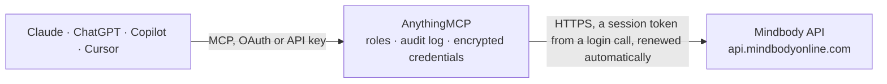

<!-- Generated by scripts/export-github-catalog.mjs in the anythingmcp-website repository. Do not edit by hand. -->

# Mindbody MCP connector

Studio and gym management in Mindbody: locations, programs, classes and schedules, rosters and waiting lists, appointments and free slots, enrollments, clients with passes, memberships, contracts and … The AnythingMCP connector gives Claude, ChatGPT, Microsoft Copilot, Cursor and Gemini 46 MCP tools for Mindbody: 35 read and 11 can change data.

**Category:** [Scheduling](../scheduling.md) · **Tools:** 46 · **Setup guide:** [anythingmcp.com](https://anythingmcp.com/guides/mindbody-to-mcp) · [Deutsch](https://anythingmcp.com/de/guides/mindbody-to-mcp) · [Italiano](https://anythingmcp.com/it/guides/mindbody-to-mcp) · [Español](https://anythingmcp.com/es/guides/mindbody-to-mcp) · [日本語](https://anythingmcp.com/ja/guides/mindbody-to-mcp) · [Русский](https://anythingmcp.com/ru/guides/mindbody-to-mcp) · [中文](https://anythingmcp.com/zh/guides/mindbody-to-mcp)

## Start without code

No installation and no terminal: AnythingMCP Cloud runs the Mindbody connector for you, operated by helpcode.ai in Frankfurt, Germany.

1. **Click the button above** and create an account or sign in. The Mindbody connector opens, ready to install.
2. **Paste the API key or token from your Mindbody account.** Every click is in the [step-by-step guide](https://anythingmcp.com/guides/mindbody-to-mcp).
3. **Click Install.** AnythingMCP shows the address of your MCP server.
4. **Add that address to your assistant:** [Claude](https://anythingmcp.com/guides/connect-mindbody-to-claude) · [ChatGPT](https://anythingmcp.com/guides/connect-mindbody-to-chatgpt) · [Microsoft Copilot](https://anythingmcp.com/guides/connect-mindbody-to-copilot) · [Cursor](https://anythingmcp.com/guides/connect-mindbody-to-cursor) · [Gemini CLI](https://anythingmcp.com/guides/connect-mindbody-to-gemini) · [Meta Muse](https://anythingmcp.com/guides/connect-mindbody-to-muse).
5. **Ask your first question**, for example: *Show upcoming bookings for client Emily Rivera for 2026-11-01 to 2026-11-07*

Prefer help with the setup? [Talk to us](https://anythingmcp.com/contact).

## How it works

- **The AI client** speaks MCP (Streamable HTTP) to AnythingMCP and only sees tool names, descriptions and results. It never gets the Mindbody credentials.
- **AnythingMCP** checks the client's role, builds the call from the tool definition, adds the credentials (a session token from a login call, renewed automatically), calls Mindbody, logs the call and returns the result.
- **Mindbody** sees an ordinary API client with the rights of the account the credentials belong to.

## Tools

| Tool | What it does | Access |
|---|---|---|
| [`mindbody_get_sites`](#mindbody_get_sites) | Site (business) details the credentials can reach: name, description, contact, logo, currency, time zone, and whether online booking and other features are on. | read |
| [`mindbody_get_locations`](#mindbody_get_locations) | Locations (studios, gyms, branches) of the site with id, name, address, phone, coordinates, tax rates and amenities. | read |
| [`mindbody_get_programs`](#mindbody_get_programs) | Programs (service categories) of the site with id, name and schedule type (Class, Enrollment, Appointment, Resource, Media, Arrival). | read |
| [`mindbody_get_session_types`](#mindbody_get_session_types) | Session types (bookable kinds of class or appointment, for example 60 minute massage) with id, name, program, default duration and whether they can be… | read |
| [`mindbody_get_resources`](#mindbody_get_resources) | Resources (rooms, equipment) that classes and appointments use, with location, program and schedule types. | read |
| [`mindbody_get_classes`](#mindbody_get_classes) | Scheduled classes (single occurrences) in a period with id, class description (name), start and end time, location, staff (teacher), capacity, booked and… | read |
| [`mindbody_get_class_descriptions`](#mindbody_get_class_descriptions) | Class descriptions (the class types such as Vinyasa Yoga or Spin 45) with id, name, description, program, session type, level and category. | read |
| [`mindbody_get_class_schedules`](#mindbody_get_class_schedules) | Class schedules (the recurring pattern behind classes and enrollments): days of the week, start and end time, start and end date, location, staff and class… | read |
| [`mindbody_get_class_visits`](#mindbody_get_class_visits) | The roster of one class: the clients booked into it, with visit id, client id, signed-in state, late cancel and the pricing option used. | read |
| [`mindbody_get_waitlist_entries`](#mindbody_get_waitlist_entries) | Waiting list entries of classes with entry id, class, client and the date the client joined. | read |
| [`mindbody_get_staff_appointments`](#mindbody_get_staff_appointments) | Booked appointments in a period with id, status (Booked, Confirmed, Arrived, Completed, NoShow, LateCanceled), start and end time, client, staff, session… | read |
| [`mindbody_get_bookable_items`](#mindbody_get_bookable_items) | Free appointment slots: for given session types, the staff, location, start and end times that can be booked in a period. | read |
| [`mindbody_get_available_dates`](#mindbody_get_available_dates) | Days on which a session type can be booked as an appointment in a period, optionally for one location and staff member. | read |
| [`mindbody_get_schedule_items`](#mindbody_get_schedule_items) | Staff schedule items in a period: appointments, availabilities and unavailabilities per staff member, for a calendar view. | read |
| [`mindbody_get_enrollments`](#mindbody_get_enrollments) | Enrollments (workshops, courses and series booked as a whole) with schedule, dates, location, staff, capacity and booking window. | read |
| [`mindbody_get_clients`](#mindbody_get_clients) | Find clients by name, email or id: client id, unique id, name, email, phone, birth date, status (Active, Inactive, ...), membership icon, home location and… | read |
| [`mindbody_get_client_complete_info`](#mindbody_get_client_complete_info) | Everything about one client in one call: profile, active pricing options (client services), contracts, memberships and arrival programs. | read |
| [`mindbody_get_client_visits`](#mindbody_get_client_visits) | Visits of a client (classes and appointments attended or booked) in a period, with date, class or appointment, staff, signed-in state, late cancel and the… | read |
| [`mindbody_get_client_schedule`](#mindbody_get_client_schedule) | Upcoming and past bookings of a client (classes, enrollments, appointments) in a period, optionally with waitlist entries. | read |
| [`mindbody_get_client_services`](#mindbody_get_client_services) | Pricing options a client bought (class packs, passes, intro offers) with remaining visits, activation and expiration dates and the programs they pay for. | read |
| [`mindbody_get_active_client_memberships`](#mindbody_get_active_client_memberships) | Active memberships of a client with name, start and end date, remaining count and the programs they cover. | read |
| [`mindbody_get_client_contracts`](#mindbody_get_client_contracts) | Contracts (autopay agreements) of a client with name, start and end date, autopay schedule, amounts, status and whether it is suspended or terminated. | read |
| [`mindbody_get_client_purchases`](#mindbody_get_client_purchases) | Purchases of a client (sale items with description, amount, tax, payment and date) in a period. | read |
| [`mindbody_get_client_account_balances`](#mindbody_get_client_account_balances) | Account balances of clients (positive is credit, negative is money owed). | read |
| [`mindbody_get_contact_logs`](#mindbody_get_contact_logs) | Contact logs of a client (calls, emails, follow-ups) with type, text, assigned staff, follow-up date and whether it is complete. | read |
| [`mindbody_get_client_duplicates`](#mindbody_get_client_duplicates) | Clients that match a first name, last name and email, to check for an existing profile before mindbody_add_client. | read |
| [`mindbody_get_required_client_fields`](#mindbody_get_required_client_fields) | Which client fields the site requires when creating a client (for example email, phone, birth date, address). | read |
| [`mindbody_get_sales`](#mindbody_get_sales) | Sales in a period with sale id, date, client, location, purchased items (description, amount, discount, tax) and payments. | read |
| [`mindbody_get_services`](#mindbody_get_services) | Pricing options for sale (class packs, drop-ins, intro offers) with id, name, price, online price, tax, count, expiration and the program they belong to. | read |
| [`mindbody_get_contracts`](#mindbody_get_contracts) | Contracts (memberships with autopay) that a location sells, with name, description, first payment, recurring amount and schedule. | read |
| [`mindbody_get_packages`](#mindbody_get_packages) | Packages (bundles of services and products) for sale, with contents and price. | read |
| [`mindbody_get_products`](#mindbody_get_products) | Retail products with barcode id, name, price, online price, tax, category and color and size variants. | read |
| [`mindbody_get_transactions`](#mindbody_get_transactions) | Card and payment transactions in a period with transaction id, sale, client, location, amount, status and settlement. | read |
| [`mindbody_get_staff`](#mindbody_get_staff) | Staff members with id, name, email, phone, bio, image, whether they teach classes or appointments and their availabilities. | read |
| [`mindbody_get_staff_session_types`](#mindbody_get_staff_session_types) | Session types a staff member can perform, with duration and online booking settings. | read |
| [`mindbody_add_client_to_class`](#mindbody_add_client_to_class) | Book a client into a class. | write |
| [`mindbody_remove_client_from_class`](#mindbody_remove_client_from_class) | Cancel a client's booking in a class. | write |
| [`mindbody_remove_from_waitlist`](#mindbody_remove_from_waitlist) | Remove clients from class waiting lists by waiting list entry id, for example when they no longer want a spot. | write |
| [`mindbody_add_appointment`](#mindbody_add_appointment) | Book an appointment for a client with a staff member at a location and time. | write |
| [`mindbody_update_appointment`](#mindbody_update_appointment) | Change an appointment (time, staff, session type, notes) or its state with execute: confirm, unconfirm, arrive, unarrive, cancel, latecancel or complete. | write |
| [`mindbody_add_client`](#mindbody_add_client) | Create a client profile. | write |
| [`mindbody_update_client`](#mindbody_update_client) | Update a client profile. | write |
| [`mindbody_add_arrival`](#mindbody_add_arrival) | Check a client in at a location (arrival without a class or appointment), using an arrival pricing option. | write |
| [`mindbody_add_contact_log`](#mindbody_add_contact_log) | Add a contact log to a client: a note about a call, email or visit, optionally assigned to staff with a follow-up date. | write |
| [`mindbody_add_client_to_enrollment`](#mindbody_add_client_to_enrollment) | Enroll a client in an enrollment (workshop or course series), from a date onward or for the open dates. | write |
| [`mindbody_cancel_single_class`](#mindbody_cancel_single_class) | Cancel one class occurrence for everyone booked, optionally emailing clients and staff. | write |

## Tool reference

Every parameter as the AI client sees it in `tools/list`. Source: [`packages/backend/src/adapters/intl/mindbody.json`](../../../packages/backend/src/adapters/intl/mindbody.json).

### `mindbody_get_sites`

Site (business) details the credentials can reach: name, description, contact, logo, currency, time zone, and whether online booking and other features are on.

**Access:** read · **Call:** `GET /public/v6/site/sites`

| Parameter | Type | Required | Description |
|---|---|---|---|
| `site_ids` | integer[] | no | Only these site ids. |
| `include_lead_channels` | boolean | no | Include lead channels. |
| `include_per_staff_pricing` | boolean | no | Include whether per-staff pricing is on. |
| `limit` | integer | no | Results per page, default 100, at most 200. |
| `offset` | integer | no | Results to skip, default 0. Next page: offset + limit. |

### `mindbody_get_locations`

Locations (studios, gyms, branches) of the site with id, name, address, phone, coordinates, tax rates and amenities. The location id filters classes, appointments and sales.

**Access:** read · **Call:** `GET /public/v6/site/locations`

| Parameter | Type | Required | Description |
|---|---|---|---|
| `limit` | integer | no | Results per page, default 100, at most 200. |
| `offset` | integer | no | Results to skip, default 0. Next page: offset + limit. |

### `mindbody_get_programs`

Programs (service categories) of the site with id, name and schedule type (Class, Enrollment, Appointment, Resource, Media, Arrival). Program ids filter classes, services and session types.

**Access:** read · **Call:** `GET /public/v6/site/programs`

| Parameter | Type | Required | Description |
|---|---|---|---|
| `schedule_type` | `All` \| `Class` \| `Enrollment` \| `Appointment` \| `Resource` \| `Media` \| `Arrival` | no | Only programs of this schedule type. |
| `online_only` | boolean | no | Only programs shown online. |
| `program_ids` | integer[] | no | Only these program ids. |
| `limit` | integer | no | Results per page, default 100, at most 200. |
| `offset` | integer | no | Results to skip, default 0. Next page: offset + limit. |

### `mindbody_get_session_types`

Session types (bookable kinds of class or appointment, for example 60 minute massage) with id, name, program, default duration and whether they can be booked online.

**Access:** read · **Call:** `GET /public/v6/site/sessiontypes`

| Parameter | Type | Required | Description |
|---|---|---|---|
| `program_ids` | integer[] | no | Only session types of these programs. |
| `online_only` | boolean | no | Only session types bookable online. |
| `limit` | integer | no | Results per page, default 100, at most 200. |
| `offset` | integer | no | Results to skip, default 0. Next page: offset + limit. |

### `mindbody_get_resources`

Resources (rooms, equipment) that classes and appointments use, with location, program and schedule types.

**Access:** read · **Call:** `GET /public/v6/site/resources`

| Parameter | Type | Required | Description |
|---|---|---|---|
| `location_ids` | integer[] | no | Only these locations. |
| `program_ids` | integer[] | no | Only these programs. |
| `resource_ids` | integer[] | no | Only these resources. |
| `schedule_types` | string[] | no | Only these schedule types: All, Class, Enrollment, Appointment, Resource, Media, Arrival. |
| `include_inactive` | boolean | no | Include inactive resources. |
| `limit` | integer | no | Results per page, default 100, at most 200. |
| `offset` | integer | no | Results to skip, default 0. Next page: offset + limit. |

### `mindbody_get_classes`

Scheduled classes (single occurrences) in a period with id, class description (name), start and end time, location, staff (teacher), capacity, booked and waitlist counts, whether it is canceled or substituted and the booking window. Default period is today.

**Access:** read · **Call:** `GET /public/v6/class/classes`

| Parameter | Type | Required | Description |
|---|---|---|---|
| `start_date_time` | string | no | Start of the period. Date and time, ISO 8601 (2026-11-20 or 2026-11-20T18:00:00), in the site's time zone. |
| `end_date_time` | string | no | End of the period. Date and time, ISO 8601 (2026-11-20 or 2026-11-20T18:00:00), in the site's time zone. |
| `class_ids` | integer[] | no | Only these class ids. |
| `class_description_ids` | integer[] | no | Only these class descriptions. |
| `class_schedule_ids` | integer[] | no | Only these class schedules. |
| `location_ids` | integer[] | no | Only these locations. |
| `program_ids` | integer[] | no | Only these programs. |
| `session_type_ids` | integer[] | no | Only these session types. |
| `staff_ids` | integer[] | no | Only classes taught by these staff members. |
| `semester_ids` | integer[] | no | Only these semesters. |
| `client_id` | string | no | Client id: also tells whether this client is booked and can book. |
| `unique_client_id` | integer | no | Unique client id, instead of client_id. |
| `hide_canceled_classes` | boolean | no | Leave out canceled classes. |
| `scheduling_window` | boolean | no | Leave out classes outside their booking window. |
| `last_modified_date` | string | no | Only classes changed on or after this date. Date and time, ISO 8601 (2026-11-20 or 2026-11-20T18:00:00), in the site's time zone. |
| `limit` | integer | no | Results per page, default 100, at most 200. |
| `offset` | integer | no | Results to skip, default 0. Next page: offset + limit. |

### `mindbody_get_class_descriptions`

Class descriptions (the class types such as Vinyasa Yoga or Spin 45) with id, name, description, program, session type, level and category.

**Access:** read · **Call:** `GET /public/v6/class/classdescriptions`

| Parameter | Type | Required | Description |
|---|---|---|---|
| `class_description_id` | integer | no | Only this class description. |
| `program_ids` | integer[] | no | Only these programs. |
| `location_id` | integer | no | Only descriptions of classes at this location. |
| `staff_id` | integer | no | Only descriptions of classes taught by this staff member. |
| `start_class_date_time` | string | no | Only descriptions of classes on or after this time. Date and time, ISO 8601 (2026-11-20 or 2026-11-20T18:00:00), in the site's time zone. |
| `end_class_date_time` | string | no | Only descriptions of classes before this time. Date and time, ISO 8601 (2026-11-20 or 2026-11-20T18:00:00), in the site's time zone. |
| `include_inactive` | boolean | no | Include inactive descriptions (default true). |
| `limit` | integer | no | Results per page, default 100, at most 200. |
| `offset` | integer | no | Results to skip, default 0. Next page: offset + limit. |

### `mindbody_get_class_schedules`

Class schedules (the recurring pattern behind classes and enrollments): days of the week, start and end time, start and end date, location, staff and class description.

**Access:** read · **Call:** `GET /public/v6/class/classschedules`

| Parameter | Type | Required | Description |
|---|---|---|---|
| `class_schedule_ids` | integer[] | no | Only these schedules. |
| `location_ids` | integer[] | no | Only these locations. |
| `program_ids` | integer[] | no | Only these programs. |
| `session_type_ids` | integer[] | no | Only these session types. |
| `staff_ids` | integer[] | no | Only these staff members. |
| `start_date` | string | no | Schedules active on or after this day (default today). Date and time, ISO 8601 (2026-11-20 or 2026-11-20T18:00:00), in the site's time zone. |
| `end_date` | string | no | Schedules active on or before this day. Date and time, ISO 8601 (2026-11-20 or 2026-11-20T18:00:00), in the site's time zone. |
| `limit` | integer | no | Results per page, default 100, at most 200. |
| `offset` | integer | no | Results to skip, default 0. Next page: offset + limit. |

### `mindbody_get_class_visits`

The roster of one class: the clients booked into it, with visit id, client id, signed-in state, late cancel and the pricing option used.

**Access:** read · **Call:** `GET /public/v6/class/classvisits`

| Parameter | Type | Required | Description |
|---|---|---|---|
| `class_id` | integer | yes | Class id, from mindbody_get_classes. |
| `last_modified_date` | string | no | Only visits changed on or after this date. Date and time, ISO 8601 (2026-11-20 or 2026-11-20T18:00:00), in the site's time zone. |
| `use_site_settings_staff_name` | boolean | no | Use the staff display name from the site settings. |

### `mindbody_get_waitlist_entries`

Waiting list entries of classes with entry id, class, client and the date the client joined. Give class_ids, class_schedule_ids, client_ids or waitlist_entry_ids.

**Access:** read · **Call:** `GET /public/v6/class/waitlistentries`

| Parameter | Type | Required | Description |
|---|---|---|---|
| `class_ids` | integer[] | no | Only these classes. |
| `class_schedule_ids` | integer[] | no | Only these class schedules. |
| `client_ids` | string[] | no | Only these clients. |
| `waitlist_entry_ids` | integer[] | no | Only these entries. |
| `hide_past_entries` | boolean | no | Hide entries of past classes. |
| `limit` | integer | no | Results per page, default 100, at most 200. |
| `offset` | integer | no | Results to skip, default 0. Next page: offset + limit. |

### `mindbody_get_staff_appointments`

Booked appointments in a period with id, status (Booked, Confirmed, Arrived, Completed, NoShow, LateCanceled), start and end time, client, staff, session type, location and notes. Default is today.

**Access:** read · **Call:** `GET /public/v6/appointment/staffappointments`

| Parameter | Type | Required | Description |
|---|---|---|---|
| `start_date` | string | no | Start of the period (default today). Date and time, ISO 8601 (2026-11-20 or 2026-11-20T18:00:00), in the site's time zone. |
| `end_date` | string | no | End of the period. Date and time, ISO 8601 (2026-11-20 or 2026-11-20T18:00:00), in the site's time zone. |
| `staff_ids` | integer[] | no | Only these staff members. |
| `location_ids` | integer[] | no | Only these locations. |
| `client_id` | string | no | Only appointments of this client. |
| `appointment_ids` | integer[] | no | Only these appointments. |
| `use_site_settings_staff_name` | boolean | no | Use the staff display name from the site settings. |
| `limit` | integer | no | Results per page, default 100, at most 200. |
| `offset` | integer | no | Results to skip, default 0. Next page: offset + limit. |

### `mindbody_get_bookable_items`

Free appointment slots: for given session types, the staff, location, start and end times that can be booked in a period. Use it before mindbody_add_appointment.

**Access:** read · **Call:** `GET /public/v6/appointment/bookableitems`

| Parameter | Type | Required | Description |
|---|---|---|---|
| `session_type_ids` | integer[] | yes | Session types to find slots for, from mindbody_get_session_types. |
| `start_date` | string | no | Start of the period (default today). Date and time, ISO 8601 (2026-11-20 or 2026-11-20T18:00:00), in the site's time zone. |
| `end_date` | string | no | End of the period. Date and time, ISO 8601 (2026-11-20 or 2026-11-20T18:00:00), in the site's time zone. |
| `location_ids` | integer[] | no | Only these locations. |
| `staff_ids` | integer[] | no | Only these staff members. |
| `appointment_id` | integer | no | Leave out this appointment (when rescheduling it). |
| `ignore_default_session_length` | boolean | no | Also return slots shorter or longer than the default session length. |
| `include_resource_availability` | boolean | no | Include resource availability. |
| `limit` | integer | no | Results per page, default 100, at most 200. |
| `offset` | integer | no | Results to skip, default 0. Next page: offset + limit. |

### `mindbody_get_available_dates`

Days on which a session type can be booked as an appointment in a period, optionally for one location and staff member.

**Access:** read · **Call:** `GET /public/v6/appointment/availabledates`

| Parameter | Type | Required | Description |
|---|---|---|---|
| `session_type_id` | integer | yes | Session type id. |
| `start_date` | string | no | Start of the period (default today). Date and time, ISO 8601 (2026-11-20 or 2026-11-20T18:00:00), in the site's time zone. |
| `end_date` | string | no | End of the period. Date and time, ISO 8601 (2026-11-20 or 2026-11-20T18:00:00), in the site's time zone. |
| `location_id` | integer | no | Only this location. |
| `staff_id` | integer | no | Only this staff member. |

### `mindbody_get_schedule_items`

Staff schedule items in a period: appointments, availabilities and unavailabilities per staff member, for a calendar view.

**Access:** read · **Call:** `GET /public/v6/appointment/scheduleitems`

| Parameter | Type | Required | Description |
|---|---|---|---|
| `start_date` | string | no | Start of the period (default today). Date and time, ISO 8601 (2026-11-20 or 2026-11-20T18:00:00), in the site's time zone. |
| `end_date` | string | no | End of the period. Date and time, ISO 8601 (2026-11-20 or 2026-11-20T18:00:00), in the site's time zone. |
| `staff_ids` | integer[] | no | Only these staff members. |
| `location_ids` | integer[] | no | Only these locations. |
| `ignore_prep_finish_times` | boolean | no | Leave out preparation and finish times. |
| `limit` | integer | no | Results per page, default 100, at most 200. |
| `offset` | integer | no | Results to skip, default 0. Next page: offset + limit. |

### `mindbody_get_enrollments`

Enrollments (workshops, courses and series booked as a whole) with schedule, dates, location, staff, capacity and booking window.

**Access:** read · **Call:** `GET /public/v6/enrollment/enrollments`

| Parameter | Type | Required | Description |
|---|---|---|---|
| `class_schedule_ids` | integer[] | no | Only these schedules. |
| `location_ids` | integer[] | no | Only these locations. |
| `program_ids` | integer[] | no | Only these programs. |
| `session_type_ids` | integer[] | no | Only these session types. |
| `staff_ids` | integer[] | no | Only these staff members. |
| `start_date` | string | no | Enrollments active on or after this day (default today). Date and time, ISO 8601 (2026-11-20 or 2026-11-20T18:00:00), in the site's time zone. |
| `end_date` | string | no | Enrollments active on or before this day. Date and time, ISO 8601 (2026-11-20 or 2026-11-20T18:00:00), in the site's time zone. |
| `limit` | integer | no | Results per page, default 100, at most 200. |
| `offset` | integer | no | Results to skip, default 0. Next page: offset + limit. |

### `mindbody_get_clients`

Find clients by name, email or id: client id, unique id, name, email, phone, birth date, status (Active, Inactive, ...), membership icon, home location and creation date. Needs the staff login.

**Access:** read · **Call:** `GET /public/v6/client/clients`

| Parameter | Type | Required | Description |
|---|---|---|---|
| `search_text` | string | no | Text in first name, last name or email. |
| `client_ids` | string[] | no | Only these client ids. |
| `unique_ids` | integer[] | no | Only these unique ids (not with client_ids or search_text). |
| `include_inactive` | boolean | no | Include inactive clients. |
| `is_prospect` | boolean | no | true for prospects only. |
| `last_modified_date` | string | no | Only clients changed on or after this date. Date and time, ISO 8601 (2026-11-20 or 2026-11-20T18:00:00), in the site's time zone. |
| `limit` | integer | no | Results per page, default 100, at most 200. |
| `offset` | integer | no | Results to skip, default 0. Next page: offset + limit. |

### `mindbody_get_client_complete_info`

Everything about one client in one call: profile, active pricing options (client services), contracts, memberships and arrival programs.

**Access:** read · **Call:** `GET /public/v6/client/clientcompleteinfo`

| Parameter | Type | Required | Description |
|---|---|---|---|
| `client_id` | string | yes | Client id, from mindbody_get_clients. |
| `show_active_only` | boolean | no | Only active pricing options. |
| `start_date` | string | no | Pricing options bought on or after this date. Date and time, ISO 8601 (2026-11-20 or 2026-11-20T18:00:00), in the site's time zone. |
| `end_date` | string | no | Pricing options bought on or before this date. Date and time, ISO 8601 (2026-11-20 or 2026-11-20T18:00:00), in the site's time zone. |
| `required_client_data` | string[] | no | Limit the sections returned, for example Services, Contracts, Memberships, ArrivalPrograms. |
| `cross_regional_lookup` | boolean | no | Also look at the client's other sites of the organization. |

### `mindbody_get_client_visits`

Visits of a client (classes and appointments attended or booked) in a period, with date, class or appointment, staff, signed-in state, late cancel and the pricing option used.

**Access:** read · **Call:** `GET /public/v6/client/clientvisits`

| Parameter | Type | Required | Description |
|---|---|---|---|
| `client_id` | string | no | Client id. |
| `unique_client_id` | integer | no | Unique client id, instead of client_id. |
| `start_date` | string | no | Start of the period. Date and time, ISO 8601 (2026-11-20 or 2026-11-20T18:00:00), in the site's time zone. |
| `end_date` | string | no | End of the period (default today). Date and time, ISO 8601 (2026-11-20 or 2026-11-20T18:00:00), in the site's time zone. |
| `unpaids_only` | boolean | no | Only visits not paid for. |
| `order` | `asc` \| `desc` | no | asc or desc (newest first). |
| `cross_regional_lookup` | boolean | no | Include the client's other sites. |
| `limit` | integer | no | Results per page, default 100, at most 200. |
| `offset` | integer | no | Results to skip, default 0. Next page: offset + limit. |

### `mindbody_get_client_schedule`

Upcoming and past bookings of a client (classes, enrollments, appointments) in a period, optionally with waitlist entries.

**Access:** read · **Call:** `GET /public/v6/client/clientschedule`

| Parameter | Type | Required | Description |
|---|---|---|---|
| `client_id` | string | no | Client id. |
| `unique_client_id` | integer | no | Unique client id, instead of client_id. |
| `start_date` | string | no | Start of the period. Date and time, ISO 8601 (2026-11-20 or 2026-11-20T18:00:00), in the site's time zone. |
| `end_date` | string | no | End of the period. Date and time, ISO 8601 (2026-11-20 or 2026-11-20T18:00:00), in the site's time zone. |
| `include_waitlist_entries` | boolean | no | Include waitlist entries. |
| `cross_regional_lookup` | boolean | no | Include the client's other sites. |
| `limit` | integer | no | Results per page, default 100, at most 200. |
| `offset` | integer | no | Results to skip, default 0. Next page: offset + limit. |

### `mindbody_get_client_services`

Pricing options a client bought (class packs, passes, intro offers) with remaining visits, activation and expiration dates and the programs they pay for. Filter by class_id or session_type_id to see which pass can pay for a booking.

**Access:** read · **Call:** `GET /public/v6/client/clientservices`

| Parameter | Type | Required | Description |
|---|---|---|---|
| `client_id` | string | no | Client id. |
| `client_ids` | string[] | no | Several client ids. |
| `class_id` | integer | no | Only pricing options that can pay for this class. |
| `session_type_id` | integer | no | Only pricing options that pay for this session type. |
| `program_ids` | integer[] | no | Only these programs. |
| `location_ids` | integer[] | no | Only usable at these locations. |
| `show_active_only` | boolean | no | Only active pricing options. |
| `start_date` | string | no | Bought on or after this date. Date and time, ISO 8601 (2026-11-20 or 2026-11-20T18:00:00), in the site's time zone. |
| `end_date` | string | no | Bought on or before this date. Date and time, ISO 8601 (2026-11-20 or 2026-11-20T18:00:00), in the site's time zone. |
| `cross_regional_lookup` | boolean | no | Include the client's other sites. |
| `limit` | integer | no | Results per page, default 100, at most 200. |
| `offset` | integer | no | Results to skip, default 0. Next page: offset + limit. |

### `mindbody_get_active_client_memberships`

Active memberships of a client with name, start and end date, remaining count and the programs they cover.

**Access:** read · **Call:** `GET /public/v6/client/activeclientmemberships`

| Parameter | Type | Required | Description |
|---|---|---|---|
| `client_id` | string | yes | Client id. |
| `location_id` | integer | no | Only memberships usable at this location. |
| `cross_regional_lookup` | boolean | no | Include the client's other sites. |
| `limit` | integer | no | Results per page, default 100, at most 200. |
| `offset` | integer | no | Results to skip, default 0. Next page: offset + limit. |

### `mindbody_get_client_contracts`

Contracts (autopay agreements) of a client with name, start and end date, autopay schedule, amounts, status and whether it is suspended or terminated.

**Access:** read · **Call:** `GET /public/v6/client/clientcontracts`

| Parameter | Type | Required | Description |
|---|---|---|---|
| `client_id` | string | yes | Client id. |
| `cross_regional_lookup` | boolean | no | Include the client's other sites. |
| `limit` | integer | no | Results per page, default 100, at most 200. |
| `offset` | integer | no | Results to skip, default 0. Next page: offset + limit. |

### `mindbody_get_client_purchases`

Purchases of a client (sale items with description, amount, tax, payment and date) in a period.

**Access:** read · **Call:** `GET /public/v6/client/clientpurchases`

| Parameter | Type | Required | Description |
|---|---|---|---|
| `client_id` | string | yes | Client id. |
| `start_date` | string | no | Start of the period. Date and time, ISO 8601 (2026-11-20 or 2026-11-20T18:00:00), in the site's time zone. |
| `end_date` | string | no | End of the period (default end of today). Date and time, ISO 8601 (2026-11-20 or 2026-11-20T18:00:00), in the site's time zone. |
| `sale_id` | integer | no | Only this sale. |
| `limit` | integer | no | Results per page, default 100, at most 200. |
| `offset` | integer | no | Results to skip, default 0. Next page: offset + limit. |

### `mindbody_get_client_account_balances`

Account balances of clients (positive is credit, negative is money owed).

**Access:** read · **Call:** `GET /public/v6/client/clientaccountbalances`

| Parameter | Type | Required | Description |
|---|---|---|---|
| `client_ids` | string[] | yes | Client ids. |
| `balance_date` | string | no | Balance on this date (default today). Date and time, ISO 8601 (2026-11-20 or 2026-11-20T18:00:00), in the site's time zone. |
| `class_id` | integer | no | Balance for the event of this class. |
| `limit` | integer | no | Results per page, default 100, at most 200. |
| `offset` | integer | no | Results to skip, default 0. Next page: offset + limit. |

### `mindbody_get_contact_logs`

Contact logs of a client (calls, emails, follow-ups) with type, text, assigned staff, follow-up date and whether it is complete.

**Access:** read · **Call:** `GET /public/v6/client/contactlogs`

| Parameter | Type | Required | Description |
|---|---|---|---|
| `client_id` | string | yes | Client id. |
| `start_date` | string | no | Created on or after this date. Date and time, ISO 8601 (2026-11-20 or 2026-11-20T18:00:00), in the site's time zone. |
| `end_date` | string | no | Created before this date. Date and time, ISO 8601 (2026-11-20 or 2026-11-20T18:00:00), in the site's time zone. |
| `staff_ids` | integer[] | no | Only logs assigned to these staff members. |
| `type_ids` | integer[] | no | Only these contact log types. |
| `subtype_ids` | integer[] | no | Only these subtypes. |
| `show_system_generated` | boolean | no | Include system-generated logs. |
| `limit` | integer | no | Results per page, default 100, at most 200. |
| `offset` | integer | no | Results to skip, default 0. Next page: offset + limit. |

### `mindbody_get_client_duplicates`

Clients that match a first name, last name and email, to check for an existing profile before mindbody_add_client.

**Access:** read · **Call:** `GET /public/v6/client/clientduplicates`

| Parameter | Type | Required | Description |
|---|---|---|---|
| `first_name` | string | no | First name. |
| `last_name` | string | no | Last name. |
| `email` | string | no | Email. |
| `limit` | integer | no | Results per page, default 100, at most 200. |
| `offset` | integer | no | Results to skip, default 0. Next page: offset + limit. |

### `mindbody_get_required_client_fields`

Which client fields the site requires when creating a client (for example email, phone, birth date, address).

**Access:** read · **Call:** `GET /public/v6/client/requiredclientfields`

No parameters.

### `mindbody_get_sales`

Sales in a period with sale id, date, client, location, purchased items (description, amount, discount, tax) and payments.

**Access:** read · **Call:** `GET /public/v6/sale/sales`

| Parameter | Type | Required | Description |
|---|---|---|---|
| `start_sale_date_time` | string | no | Sales after this time. Date and time, ISO 8601 (2026-11-20 or 2026-11-20T18:00:00), in the site's time zone. |
| `end_sale_date_time` | string | no | Sales before this time. Date and time, ISO 8601 (2026-11-20 or 2026-11-20T18:00:00), in the site's time zone. |
| `sale_id` | integer | no | Only this sale. |
| `payment_method_id` | integer | no | Only sales paid with this payment method. |
| `limit` | integer | no | Results per page, default 100, at most 200. |
| `offset` | integer | no | Results to skip, default 0. Next page: offset + limit. |

### `mindbody_get_services`

Pricing options for sale (class packs, drop-ins, intro offers) with id, name, price, online price, tax, count, expiration and the program they belong to.

**Access:** read · **Call:** `GET /public/v6/sale/services`

| Parameter | Type | Required | Description |
|---|---|---|---|
| `program_ids` | integer[] | no | Only these programs. |
| `session_type_ids` | integer[] | no | Only these session types. |
| `service_ids` | string[] | no | Only these pricing option ids. |
| `class_id` | integer | no | Only options that pay for this class. |
| `class_schedule_id` | integer | no | Only options for this class schedule. |
| `location_id` | integer | no | Compute tax for this location. |
| `staff_id` | integer | no | Use the pricing of this staff member. |
| `sell_online` | boolean | no | Only options sold online. |
| `include_discontinued` | boolean | no | Include discontinued options. |
| `hide_related_programs` | boolean | no | Leave out options of related programs. |
| `limit` | integer | no | Results per page, default 100, at most 200. |
| `offset` | integer | no | Results to skip, default 0. Next page: offset + limit. |

### `mindbody_get_contracts`

Contracts (memberships with autopay) that a location sells, with name, description, first payment, recurring amount and schedule.

**Access:** read · **Call:** `GET /public/v6/sale/contracts`

| Parameter | Type | Required | Description |
|---|---|---|---|
| `location_id` | integer | yes | Location id. |
| `contract_ids` | integer[] | no | Only these contracts. |
| `sold_online` | boolean | no | Only contracts sold online. |
| `promo_code` | string | no | Promo code to apply. |
| `limit` | integer | no | Results per page, default 100, at most 200. |
| `offset` | integer | no | Results to skip, default 0. Next page: offset + limit. |

### `mindbody_get_packages`

Packages (bundles of services and products) for sale, with contents and price.

**Access:** read · **Call:** `GET /public/v6/sale/packages`

| Parameter | Type | Required | Description |
|---|---|---|---|
| `package_ids` | integer[] | no | Only these packages. |
| `location_id` | integer | no | Compute tax for this location. |
| `sell_online` | boolean | no | Only packages sold online. |
| `limit` | integer | no | Results per page, default 100, at most 200. |
| `offset` | integer | no | Results to skip, default 0. Next page: offset + limit. |

### `mindbody_get_products`

Retail products with barcode id, name, price, online price, tax, category and color and size variants.

**Access:** read · **Call:** `GET /public/v6/sale/products`

| Parameter | Type | Required | Description |
|---|---|---|---|
| `search_text` | string | no | Search term. |
| `product_ids` | string[] | no | Only these product barcode ids. |
| `category_ids` | integer[] | no | Only these revenue categories. |
| `sub_category_ids` | integer[] | no | Only these subcategories. |
| `location_id` | integer | no | Compute tax for this location. |
| `sell_online` | boolean | no | Only products sold online. |
| `limit` | integer | no | Results per page, default 100, at most 200. |
| `offset` | integer | no | Results to skip, default 0. Next page: offset + limit. |

### `mindbody_get_transactions`

Card and payment transactions in a period with transaction id, sale, client, location, amount, status and settlement.

**Access:** read · **Call:** `GET /public/v6/sale/transactions`

| Parameter | Type | Required | Description |
|---|---|---|---|
| `transaction_start_date_time` | string | no | After this time (default today). Date and time, ISO 8601 (2026-11-20 or 2026-11-20T18:00:00), in the site's time zone. |
| `transaction_end_date_time` | string | no | Before this time (default today). Date and time, ISO 8601 (2026-11-20 or 2026-11-20T18:00:00), in the site's time zone. |
| `sale_id` | integer | no | Only this sale. |
| `transaction_id` | integer | no | Only this transaction. |
| `client_id` | integer | no | Only this client. |
| `location_id` | integer | no | Only this location. |
| `status` | string | no | Only this status. |
| `limit` | integer | no | Results per page, default 100, at most 200. |
| `offset` | integer | no | Results to skip, default 0. Next page: offset + limit. |

### `mindbody_get_staff`

Staff members with id, name, email, phone, bio, image, whether they teach classes or appointments and their availabilities. Filter by location, session type and time to find who is free.

**Access:** read · **Call:** `GET /public/v6/staff/staff`

| Parameter | Type | Required | Description |
|---|---|---|---|
| `staff_ids` | integer[] | no | Only these staff members. |
| `filters` | string[] | no | Filters: StaffViewable, AppointmentInstructor, ClassInstructor, Male, Female. |
| `location_id` | integer | no | Only staff available at this location (with session_type_id). |
| `session_type_id` | integer | no | Only staff available for this session type (with start_date_time). |
| `start_date_time` | string | no | Only staff available at this time. Date and time, ISO 8601 (2026-11-20 or 2026-11-20T18:00:00), in the site's time zone. |
| `limit` | integer | no | Results per page, default 100, at most 200. |
| `offset` | integer | no | Results to skip, default 0. Next page: offset + limit. |

### `mindbody_get_staff_session_types`

Session types a staff member can perform, with duration and online booking settings.

**Access:** read · **Call:** `GET /public/v6/staff/sessiontypes`

| Parameter | Type | Required | Description |
|---|---|---|---|
| `staff_id` | integer | yes | Staff id. |
| `program_ids` | integer[] | no | Only these programs. |
| `online_only` | boolean | no | Only types bookable online. |
| `limit` | integer | no | Results per page, default 100, at most 200. |
| `offset` | integer | no | Results to skip, default 0. Next page: offset + limit. |

### `mindbody_add_client_to_class`

Book a client into a class. With waitlist true the client joins the waiting list when the class is full. Mindbody uses a fitting pricing option of the client unless client_service_id is given; require_payment false books without one.

**Access:** write · **Call:** `POST /public/v6/class/addclienttoclass`

| Parameter | Type | Required | Description |
|---|---|---|---|
| `client_id` | string | yes | Client id. |
| `class_id` | integer | yes | Class id, from mindbody_get_classes. |
| `waitlist` | boolean | no | Add to the waiting list if the class is full. |
| `require_payment` | boolean | no | false to book without a pricing option (the visit stays unpaid). |
| `client_service_id` | integer | no | Pricing option of the client to pay with, from mindbody_get_client_services. |
| `send_email` | boolean | no | Send the client the confirmation email set up in Mindbody. |
| `test` | boolean | no | true to validate the request without saving anything (Mindbody test mode). |

### `mindbody_remove_client_from_class`

Cancel a client's booking in a class. late_cancel true records it as a late cancel, which can use up a visit or charge a fee under the site's policy.

**Access:** write · **Call:** `POST /public/v6/class/removeclientfromclass`

| Parameter | Type | Required | Description |
|---|---|---|---|
| `class_id` | integer | yes | Class id. |
| `client_id` | string | yes | Client id. |
| `late_cancel` | boolean | no | Record a late cancel. |
| `send_email` | boolean | no | Send the client the confirmation email set up in Mindbody. |
| `test` | boolean | no | true to validate the request without saving anything (Mindbody test mode). |

### `mindbody_remove_from_waitlist`

Remove clients from class waiting lists by waiting list entry id, for example when they no longer want a spot.

**Access:** write · **Call:** `POST /public/v6/class/removefromwaitlist`

| Parameter | Type | Required | Description |
|---|---|---|---|
| `waitlist_entry_ids` | integer[] | yes | Waiting list entry ids, from mindbody_get_waitlist_entries. |

### `mindbody_add_appointment`

Book an appointment for a client with a staff member at a location and time. Find a free slot with mindbody_get_bookable_items first.

**Access:** write · **Call:** `POST /public/v6/appointment/addappointment`

| Parameter | Type | Required | Description |
|---|---|---|---|
| `client_id` | string | yes | Client id. |
| `location_id` | integer | yes | Location id. |
| `session_type_id` | integer | yes | Session type id. |
| `staff_id` | integer | yes | Staff id. |
| `start_date_time` | string | yes | Start. Date and time, ISO 8601 (2026-11-20 or 2026-11-20T18:00:00), in the site's time zone. |
| `end_date_time` | string | no | End; default start plus the session length. Date and time, ISO 8601 (2026-11-20 or 2026-11-20T18:00:00), in the site's time zone. |
| `duration` | integer | no | Length in minutes, instead of end_date_time. |
| `notes` | string | no | Appointment notes. |
| `staff_requested` | boolean | no | The client asked for this staff member. |
| `apply_payment` | boolean | no | Pay with a fitting pricing option of the client (default true). |
| `send_email` | boolean | no | Send the client the confirmation email set up in Mindbody. |
| `test` | boolean | no | true to validate the request without saving anything (Mindbody test mode). |

### `mindbody_update_appointment`

Change an appointment (time, staff, session type, notes) or its state with execute: confirm, unconfirm, arrive, unarrive, cancel, latecancel or complete.

**Access:** write · **Call:** `POST /public/v6/appointment/updateappointment`

| Parameter | Type | Required | Description |
|---|---|---|---|
| `appointment_id` | integer | yes | Appointment id, from mindbody_get_staff_appointments. |
| `start_date_time` | string | no | New start. Date and time, ISO 8601 (2026-11-20 or 2026-11-20T18:00:00), in the site's time zone. |
| `end_date_time` | string | no | New end. Date and time, ISO 8601 (2026-11-20 or 2026-11-20T18:00:00), in the site's time zone. |
| `staff_id` | integer | no | New staff member. |
| `session_type_id` | integer | no | New session type. |
| `notes` | string | no | New notes. |
| `execute` | `confirm` \| `unconfirm` \| `arrive` \| `unarrive` \| `cancel` \| `latecancel` \| `complete` | no | State change. |
| `send_email` | boolean | no | Send the client the confirmation email set up in Mindbody. |
| `test` | boolean | no | true to validate the request without saving anything (Mindbody test mode). |

### `mindbody_add_client`

Create a client profile. Check mindbody_get_client_duplicates first and mindbody_get_required_client_fields for the fields the site requires.

**Access:** write · **Call:** `POST /public/v6/client/addclient`

| Parameter | Type | Required | Description |
|---|---|---|---|
| `first_name` | string | yes | First name. |
| `last_name` | string | yes | Last name. |
| `email` | string | no | Email. |
| `mobile_phone` | string | no | Mobile phone. |
| `birth_date` | string | no | Birth date, YYYY-MM-DD. |
| `gender` | string | no | Gender as configured in the site (for example Female, Male). |
| `address_line1` | string | no | Street address. |
| `city` | string | no | City. |
| `state` | string | no | State or region code. |
| `postal_code` | string | no | Postal code. |
| `country` | string | no | Country code, for example US or DE. |
| `home_location` | object | no | Home location: {"Id": 1}. |
| `is_prospect` | boolean | no | Mark as prospect (lead). |
| `referred_by` | string | no | Referral source. |
| `notes` | string | no | Notes on the client. |
| `send_account_emails` | boolean | no | Client receives account emails. |
| `send_promotional_emails` | boolean | no | Client agreed to promotional emails. |
| `test` | boolean | no | true to validate the request without saving anything (Mindbody test mode). |

### `mindbody_update_client`

Update a client profile. client holds the client id and only the fields to change, for example {"Id": "100000123", "Email": "new@example.com", "MobilePhone": "..."}.

**Access:** write · **Call:** `POST /public/v6/client/updateclient`

| Parameter | Type | Required | Description |
|---|---|---|---|
| `client` | object | yes | Client fields in Mindbody names: Id (required), FirstName, LastName, Email, MobilePhone, BirthDate, AddressLine1, City, PostalCode, Country, Notes, Status, ... |
| `cross_regional_update` | boolean | no | Also update the client on the organization's other sites (default true). |
| `test` | boolean | no | true to validate the request without saving anything (Mindbody test mode). |

### `mindbody_add_arrival`

Check a client in at a location (arrival without a class or appointment), using an arrival pricing option.

**Access:** write · **Call:** `POST /public/v6/client/addarrival`

| Parameter | Type | Required | Description |
|---|---|---|---|
| `client_id` | string | yes | Client id. |
| `location_id` | integer | yes | Location id. |
| `arrival_type_id` | integer | no | Arrival program id to use. |
| `test` | boolean | no | true to validate the request without saving anything (Mindbody test mode). |

### `mindbody_add_contact_log`

Add a contact log to a client: a note about a call, email or visit, optionally assigned to staff with a follow-up date.

**Access:** write · **Call:** `POST /public/v6/client/addcontactlog`

| Parameter | Type | Required | Description |
|---|---|---|---|
| `client_id` | string | yes | Client id. |
| `contact_method` | string | yes | How the contact happened or should happen, for example Email, Phone, InPerson, Text. |
| `text` | string | no | Log text. |
| `assigned_to_staff_id` | integer | no | Staff member responsible for the follow-up. |
| `followup_by_date` | string | no | Follow-up date. Date and time, ISO 8601 (2026-11-20 or 2026-11-20T18:00:00), in the site's time zone. |
| `contact_name` | string | no | Name of the person contacted. |
| `is_complete` | boolean | no | The contact is done. |
| `types` | object[] | no | Contact log types: [{"Id": 1, "SubTypes": [2]}]. |
| `test` | boolean | no | true to validate the request without saving anything (Mindbody test mode). |

### `mindbody_add_client_to_enrollment`

Enroll a client in an enrollment (workshop or course series), from a date onward or for the open dates.

**Access:** write · **Call:** `POST /public/v6/enrollment/addclienttoenrollment`

| Parameter | Type | Required | Description |
|---|---|---|---|
| `client_id` | string | yes | Client id. |
| `class_schedule_id` | integer | yes | Enrollment (class schedule) id, from mindbody_get_enrollments. |
| `enroll_date_forward` | string | no | Enroll in sessions from this date on. Date and time, ISO 8601 (2026-11-20 or 2026-11-20T18:00:00), in the site's time zone. |
| `enroll_open` | string[] | no | Enroll on these open dates only. |
| `waitlist` | boolean | no | Join the waiting list if full. |
| `send_email` | boolean | no | Send the client the confirmation email set up in Mindbody. |
| `test` | boolean | no | true to validate the request without saving anything (Mindbody test mode). |

### `mindbody_cancel_single_class`

Cancel one class occurrence for everyone booked, optionally emailing clients and staff. Bookings are removed and cannot be restored by the API.

**Access:** write · **Call:** `POST /public/v6/class/cancelsingleclass`

| Parameter | Type | Required | Description |
|---|---|---|---|
| `class_id` | integer | yes | Class id. |
| `hide_cancel` | boolean | no | Hide the canceled class from the schedule. |
| `send_client_email` | boolean | no | Email the booked clients. |
| `send_staff_email` | boolean | no | Email the teacher. |

## Run it yourself

AnythingMCP is open source (AGPL-3.0). [Run it with Docker](../../../README.md#run-it-yourself), open **Connectors → Store**, pick **Mindbody** and enter `MINDBODY_API_KEY`, `MINDBODY_SITE_ID`, `MINDBODY_USERNAME`, `MINDBODY_PASSWORD`, then add your MCP server URL to the AI client.

[← Scheduling connectors](../scheduling.md) · [All categories](../README.md)
