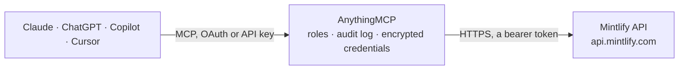

<!-- Generated by scripts/export-github-catalog.mjs in the anythingmcp-website repository. Do not edit by hand. -->

# Mintlify MCP connector

Trigger Mintlify documentation updates, query analytics, and manage assistant queries via the Mintlify API. 5 tools, Bearer-token auth. The AnythingMCP connector gives Claude, ChatGPT, Microsoft Copilot, Cursor and Gemini 5 MCP tools for Mintlify: 4 read and 1 can change data.

**Category:** [Publishing](../publishing.md) · **Tools:** 5 · **Setup guide:** [anythingmcp.com](https://anythingmcp.com/guides/mintlify-to-mcp) · [Deutsch](https://anythingmcp.com/de/guides/mintlify-to-mcp) · [Italiano](https://anythingmcp.com/it/guides/mintlify-to-mcp) · [Español](https://anythingmcp.com/es/guides/mintlify-to-mcp) · [日本語](https://anythingmcp.com/ja/guides/mintlify-to-mcp) · [Русский](https://anythingmcp.com/ru/guides/mintlify-to-mcp) · [中文](https://anythingmcp.com/zh/guides/mintlify-to-mcp)

## Start without code

No installation and no terminal: AnythingMCP Cloud runs the Mintlify connector for you, operated by helpcode.ai in Frankfurt, Germany.

1. **Click the button above** and create an account or sign in. The Mintlify connector opens, ready to install.
2. **Paste the API key or token from your Mintlify account.** Every click is in the [step-by-step guide](https://anythingmcp.com/guides/mintlify-to-mcp).
3. **Click Install.** AnythingMCP shows the address of your MCP server.
4. **Add that address to your assistant:** [Claude](https://anythingmcp.com/guides/connect-mintlify-to-claude) · [ChatGPT](https://anythingmcp.com/guides/connect-mintlify-to-chatgpt) · [Microsoft Copilot](https://anythingmcp.com/guides/connect-mintlify-to-copilot) · [Cursor](https://anythingmcp.com/guides/connect-mintlify-to-cursor) · [Gemini CLI](https://anythingmcp.com/guides/connect-mintlify-to-gemini) · [Meta Muse](https://anythingmcp.com/guides/connect-mintlify-to-muse).
5. **Ask your first question**, for example: *Find assistant conversations between 2026-10-12 and 2026-10-12 mentioning "billing API"*

Prefer help with the setup? [Talk to us](https://anythingmcp.com/contact).

## How it works

- **The AI client** speaks MCP (Streamable HTTP) to AnythingMCP and only sees tool names, descriptions and results. It never gets the Mintlify credentials.
- **AnythingMCP** checks the client's role, builds the call from the tool definition, adds the credentials (a bearer token), calls Mintlify, logs the call and returns the result.
- **Mintlify** sees an ordinary API client with the rights of the account the credentials belong to.

## Tools

| Tool | What it does | Access |
|---|---|---|
| [`mintlify_trigger_update`](#mintlify_trigger_update) | Trigger a re-deploy of the documentation site (forces Mintlify to pull from the connected git repo and re-build). | write |
| [`mintlify_get_project_info`](#mintlify_get_project_info) | Get project metadata: name, repo, deployment status, custom domain. | read |
| [`mintlify_list_assistant_conversations`](#mintlify_list_assistant_conversations) | List user conversations with the Mintlify AI assistant on your docs site. | read |
| [`mintlify_list_search_queries`](#mintlify_list_search_queries) | List user search queries on the docs site (analytics). | read |
| [`mintlify_get_analytics`](#mintlify_get_analytics) | Retrieve site analytics aggregations (pageviews, unique visitors, top pages) for a date range. | read |

## Tool reference

Every parameter as the AI client sees it in `tools/list`. Source: [`packages/backend/src/adapters/intl/mintlify.json`](../../../packages/backend/src/adapters/intl/mintlify.json).

### `mintlify_trigger_update`

Trigger a re-deploy of the documentation site (forces Mintlify to pull from the connected git repo and re-build). Use after a content change pipeline.

**Access:** write · **Call:** `POST /project/update`

No parameters.

### `mintlify_get_project_info`

Get project metadata: name, repo, deployment status, custom domain.

**Access:** read · **Call:** `GET /project`

No parameters.

### `mintlify_list_assistant_conversations`

List user conversations with the Mintlify AI assistant on your docs site. Returns query text, timestamp, helpful flag.

**Access:** read · **Call:** `GET /assistant/conversations`

| Parameter | Type | Required | Description |
|---|---|---|---|
| `limit` | integer | no | Max per page. |
| `page` | integer | no | Page number. |
| `start_date` | string | no | ISO 8601. |
| `end_date` | string | no | ISO 8601. |

### `mintlify_list_search_queries`

List user search queries on the docs site (analytics). Useful to identify missing or confusing content.

**Access:** read · **Call:** `GET /search/queries`

| Parameter | Type | Required | Description |
|---|---|---|---|
| `limit` | integer | no | Max per page. |
| `page` | integer | no | Page number. |
| `start_date` | string | no | ISO 8601. |
| `end_date` | string | no | ISO 8601. |

### `mintlify_get_analytics`

Retrieve site analytics aggregations (pageviews, unique visitors, top pages) for a date range.

**Access:** read · **Call:** `GET /analytics`

| Parameter | Type | Required | Description |
|---|---|---|---|
| `start_date` | string | yes | ISO 8601 start. |
| `end_date` | string | yes | ISO 8601 end. |
| `granularity` | string | no | hour, day, week, month. |

## Run it yourself

AnythingMCP is open source (AGPL-3.0). [Run it with Docker](../../../README.md#run-it-yourself), open **Connectors → Store**, pick **Mintlify** and enter `MINTLIFY_API_KEY`, then add your MCP server URL to the AI client.

[← Publishing connectors](../publishing.md) · [All categories](../README.md)
