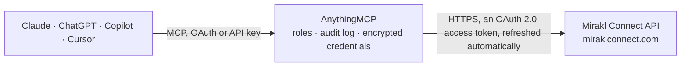

<!-- Generated by scripts/export-github-catalog.mjs in the anythingmcp-website repository. Do not edit by hand. -->

# Mirakl Connect MCP connector

Mirakl Connect for sellers: orders from every connected marketplace and sales channel in one place, returns, order documents, customer conversations, and the Connect catalog with prices and stock. The AnythingMCP connector gives Claude, ChatGPT, Microsoft Copilot, Cursor and Gemini 11 MCP tools for Mirakl Connect: 8 read and 3 can change data.

**Category:** [E-commerce](../e-commerce.md) · **Tools:** 11 · **Setup guide:** [anythingmcp.com](https://anythingmcp.com/guides/mirakl-connect-to-mcp) · [Deutsch](https://anythingmcp.com/de/guides/mirakl-connect-to-mcp) · [Italiano](https://anythingmcp.com/it/guides/mirakl-connect-to-mcp) · [Español](https://anythingmcp.com/es/guides/mirakl-connect-to-mcp) · [日本語](https://anythingmcp.com/ja/guides/mirakl-connect-to-mcp) · [Русский](https://anythingmcp.com/ru/guides/mirakl-connect-to-mcp) · [中文](https://anythingmcp.com/zh/guides/mirakl-connect-to-mcp)

## Start without code

No installation and no terminal: AnythingMCP Cloud runs the Mirakl Connect connector for you, operated by helpcode.ai in Frankfurt, Germany.

1. **Click the button above** and create an account or sign in. The Mirakl Connect connector opens, ready to install.
2. **Sign in with your Mirakl Connect account** when AnythingMCP asks. The first time, an admin creates a small app in the Mirakl Connect developer console. Every click is in the [step-by-step guide](https://anythingmcp.com/guides/mirakl-connect-to-mcp).
3. **Click Install.** AnythingMCP shows the address of your MCP server.
4. **Add that address to your assistant:** [Claude](https://anythingmcp.com/guides/connect-mirakl-connect-to-claude) · [ChatGPT](https://anythingmcp.com/guides/connect-mirakl-connect-to-chatgpt) · [Microsoft Copilot](https://anythingmcp.com/guides/connect-mirakl-connect-to-copilot) · [Cursor](https://anythingmcp.com/guides/connect-mirakl-connect-to-cursor) · [Gemini CLI](https://anythingmcp.com/guides/connect-mirakl-connect-to-gemini) · [Meta Muse](https://anythingmcp.com/guides/connect-mirakl-connect-to-muse).
5. **Ask your first question**, for example: *Show me order MC-CONN-2026-0915-03 from Mirakl Connect — I need status, channel order id and billing total.*

Prefer help with the setup? [Talk to us](https://anythingmcp.com/contact).

## How it works

- **The AI client** speaks MCP (Streamable HTTP) to AnythingMCP and only sees tool names, descriptions and results. It never gets the Mirakl Connect credentials.
- **AnythingMCP** checks the client's role, builds the call from the tool definition, adds the credentials (an OAuth 2.0 access token, refreshed automatically), calls Mirakl Connect, logs the call and returns the result.
- **Mirakl Connect** sees an ordinary API client with the rights of the account the credentials belong to.

## Tools

| Tool | What it does | Access |
|---|---|---|
| [`mirakl_connect_list_orders`](#mirakl_connect_list_orders) | List orders from every sales channel connected to Mirakl Connect, most recently updated first: Connect order id, channel order id, status, origin… | read |
| [`mirakl_connect_get_order`](#mirakl_connect_get_order) | Get one order by its Mirakl Connect order id (the id field of mirakl_connect_list_orders, not the channel's order number): status, channel, order lines with… | read |
| [`mirakl_connect_list_products`](#mirakl_connect_list_products) | List the products of your Mirakl Connect catalog, sorted by product id: id, titles, brand, category, GTINs, images, standard and discount prices, stock… | read |
| [`mirakl_connect_list_returns`](#mirakl_connect_list_returns) | List returns updated since a time, across channels: return id, channel return id, order id, channel (origin), status (REQUEST_INITIATED, REQUEST_DECLINED,… | read |
| [`mirakl_connect_list_order_documents`](#mirakl_connect_list_order_documents) | List the documents of orders (customer invoices, delivery slips, return labels, channel-specific documents) with order id, name, type, size and date. | read |
| [`mirakl_connect_list_conversations`](#mirakl_connect_list_conversations) | List customer conversations about orders, most recently updated first: id, linked order (entity), channel (origin), topic, participants, created and updated… | read |
| [`mirakl_connect_get_conversation`](#mirakl_connect_get_conversation) | Read the messages of one conversation, newest first, with their author, text, attachments and dates. | read |
| [`mirakl_connect_get_action_status`](#mirakl_connect_get_action_status) | Check the result of an asynchronous order action (shipment, cancellation, acceptance): status and any errors from the sales channel. | read |
| [`mirakl_connect_ship_order`](#mirakl_connect_ship_order) | Ship items of one order in one package with the same tracking: Mirakl Connect marks the lines shipped and passes carrier and tracking to the sales channel,… | write |
| [`mirakl_connect_cancel_order_lines`](#mirakl_connect_cancel_order_lines) | Cancel all or part of order lines: Connect cancels them on the sales channel and the customer is refunded and notified there. | write |
| [`mirakl_connect_accept_order_lines`](#mirakl_connect_accept_order_lines) | Accept or refuse order lines in AWAITING_ACCEPTANCE; Connect passes the decision to the sales channel. | write |

## Tool reference

Every parameter as the AI client sees it in `tools/list`. Source: [`packages/backend/src/adapters/intl/mirakl-connect.json`](../../../packages/backend/src/adapters/intl/mirakl-connect.json).

### `mirakl_connect_list_orders`

List orders from every sales channel connected to Mirakl Connect, most recently updated first: Connect order id, channel order id, status, origin (channel_id, channel_name, store), order lines with product, quantity, price, taxes and line status, shipping and billing info, fulfillment type. Without updated_from or order_ids, Mirakl returns the last 30 days. Page with page_token = next_page_token until it is missing.

**Access:** read · **Call:** `GET /v2/orders`

| Parameter | Type | Required | Description |
|---|---|---|---|
| `statuses` | `AWAITING_FRAUD_CHECK` \| `AWAITING_ACCEPTANCE` \| `AWAITING_PAYMENT` \| `AWAITING_SHIPMENT` \| `SHIPPED` \| `DELIVERED` \| `CLOSED`[] | no | Only orders in these statuses. |
| `updated_from` | string | no | Only orders last updated in Mirakl Connect at or after this time, ISO 8601 with a zone, e.g. 2026-10-01T00:00:00Z. |
| `fulfillment_type` | `FULFILLED_BY_SELLER` \| `FULFILLED_BY_PARTNER` | no | FULFILLED_BY_SELLER for orders you ship, FULFILLED_BY_PARTNER for orders the channel or a partner ships. |
| `order_ids` | string[] | no | Only these Connect order ids. |
| `limit` | integer | no | Orders per page, default 10, maximum 100. |
| `page_token` | string | no | next_page_token from the previous answer, for the next page. Leave empty for the first page. |

### `mirakl_connect_get_order`

Get one order by its Mirakl Connect order id (the id field of mirakl_connect_list_orders, not the channel's order number): status, channel, order lines with their ids and statuses, shipping and billing info. The order is data[0] of the answer.

**Access:** read · **Call:** `GET /v2/orders`

| Parameter | Type | Required | Description |
|---|---|---|---|
| `order_id` | string | yes | Mirakl Connect order id. |

### `mirakl_connect_list_products`

List the products of your Mirakl Connect catalog, sorted by product id: id, titles, brand, category, GTINs, images, standard and discount prices, stock quantities (quantities, partner_quantities) and attributes. This is where Connect keeps offers and stock for all channels. Page with page_token = next_page_token.

**Access:** read · **Call:** `GET /products`

| Parameter | Type | Required | Description |
|---|---|---|---|
| `limit` | integer | no | Products per page, default and maximum 1000. Use a small value such as 50 unless you need the whole catalog. |
| `page_token` | string | no | next_page_token from the previous answer, for the next page. Leave empty for the first page. |

### `mirakl_connect_list_returns`

List returns updated since a time, across channels: return id, channel return id, order id, channel (origin), status (REQUEST_INITIATED, REQUEST_DECLINED, OPENED, RECEIVED, CLOSED), return lines, method, RMA id, label URL, tracking and rejection reason. Page with page_token = next_page_token.

**Access:** read · **Call:** `GET /v2/orders/returns`

| Parameter | Type | Required | Description |
|---|---|---|---|
| `updated_from` | string | yes | Only returns last updated in Mirakl Connect at or after this time, ISO 8601 with a zone, e.g. 2026-10-01T00:00:00Z. |
| `statuses` | `REQUEST_INITIATED` \| `REQUEST_DECLINED` \| `OPENED` \| `RECEIVED` \| `CLOSED`[] | no | Only returns in these statuses. |
| `order_ids` | string[] | no | Only returns of these Connect order ids. |
| `limit` | integer | no | Returns per page, default 10, maximum 100. |
| `page_token` | string | no | next_page_token from the previous answer, for the next page. Leave empty for the first page. |

### `mirakl_connect_list_order_documents`

List the documents of orders (customer invoices, delivery slips, return labels, channel-specific documents) with order id, name, type, size and date. Give order_ids or updated_from.

**Access:** read · **Call:** `GET /v2/orders/documents`

| Parameter | Type | Required | Description |
|---|---|---|---|
| `order_ids` | string[] | no | Only documents of these Connect order ids. Required when updated_from is empty. |
| `updated_from` | string | no | Only documents last updated in Mirakl Connect at or after this time, ISO 8601 with a zone, e.g. 2026-10-01T00:00:00Z. |
| `types` | `RETURN_LABEL` \| `CUSTOMER_INVOICE` \| `DELIVERY_SLIP` \| `SHIPMENT_DELIVERY_SLIP` \| `CHANNEL_SPECIFIC`[] | no | Only these document types. |
| `channel_types` | string[] | no | Channel-specific document types, only with the type CHANNEL_SPECIFIC. |
| `limit` | integer | no | Documents per page, default 50, maximum 100. |
| `page_token` | string | no | next_page_token from the previous answer, for the next page. Leave empty for the first page. |

### `mirakl_connect_list_conversations`

List customer conversations about orders, most recently updated first: id, linked order (entity), channel (origin), topic, participants, created and updated time. Give updated_from or conversation_ids. Page with page_token = next_page_token.

**Access:** read · **Call:** `GET /conversations`

| Parameter | Type | Required | Description |
|---|---|---|---|
| `updated_from` | string | no | Only conversations last updated in Mirakl Connect at or after this time, ISO 8601 with a zone, e.g. 2026-10-01T00:00:00Z. |
| `conversation_ids` | string[] | no | Only these conversation ids. Required when updated_from is empty. |
| `entity_type` | `ORDER` | no | Type of the linked entity, with entity_ids. |
| `entity_ids` | string[] | no | Only conversations about these Connect order ids, with entity_type ORDER. |
| `limit` | integer | no | Conversations per page, default 50, maximum 100. |
| `page_token` | string | no | next_page_token from the previous answer, for the next page. Leave empty for the first page. |

### `mirakl_connect_get_conversation`

Read the messages of one conversation, newest first, with their author, text, attachments and dates.

**Access:** read · **Call:** `GET /conversations/{conversation_id}`

| Parameter | Type | Required | Description |
|---|---|---|---|
| `conversation_id` | string | yes | Conversation id from mirakl_connect_list_conversations. |
| `message_after` | string | no | Only messages created after this time, ISO 8601 with a zone. |

### `mirakl_connect_get_action_status`

Check the result of an asynchronous order action (shipment, cancellation, acceptance): status and any errors from the sales channel. The action_id comes from the answer of the write tool.

**Access:** read · **Call:** `GET /v2/orders/actions/{action_id}`

| Parameter | Type | Required | Description |
|---|---|---|---|
| `action_id` | string | yes | action_id returned by mirakl_connect_ship_order, mirakl_connect_cancel_order_lines or mirakl_connect_accept_order_lines. |

### `mirakl_connect_ship_order`

Ship items of one order in one package with the same tracking: Mirakl Connect marks the lines shipped and passes carrier and tracking to the sales channel, which usually notifies the customer. Asynchronous: returns an action_id to check with mirakl_connect_get_action_status. Switched off by default.

**Access:** write · **Call:** `POST /v2/orders/{order_id}/shipments`

| Parameter | Type | Required | Description |
|---|---|---|---|
| `order_id` | string | yes | Mirakl Connect order id. |
| `items` | object[] | yes | Lines to ship: [{"order_line_id": "...", "quantity": 1}] (order_line_id from the order's order_lines[].id; id is the seller product id, an alternative where the channel uses it). |
| `carrier` | string | no | Carrier name, e.g. DHL Express, UPS, DPD. |
| `tracking_number` | string | no | Carrier tracking number. |
| `tracking_url` | string | no | Tracking page URL. |
| `return_tracking_number` | string | no | Return tracking number, only for channels that require it at shipment. |
| `warehouse_id` | string | no | Warehouse the items ship from, where the channel needs it. |

### `mirakl_connect_cancel_order_lines`

Cancel all or part of order lines: Connect cancels them on the sales channel and the customer is refunded and notified there. Cannot be undone. Asynchronous: returns an action_id. Switched off by default.

**Access:** write · **Call:** `POST /v2/orders/{order_id}/cancel`

| Parameter | Type | Required | Description |
|---|---|---|---|
| `order_id` | string | yes | Mirakl Connect order id. |
| `cancelations` | object[] | yes | One entry per line: {"order_line_id": "...", "quantity": 1, "reason": "OUT_OF_STOCK", "price": {"amount": 19.99, "currency": "EUR"}, "shipping_price": {"amount": 0, "currency": "EUR"}}; optional taxes and shipping_taxes as [{"code": "...", "amount": {...}}]. Prices exclude taxes. reason: CUSTOMER_CANCELATION, OUT_OF_STOCK, RETURN, ITEM_NOT_RECEIVED, AGREEMENT, DEFECT, UNABLE_TO_DELIVER. |

### `mirakl_connect_accept_order_lines`

Accept or refuse order lines in AWAITING_ACCEPTANCE; Connect passes the decision to the sales channel. Refusing cancels the line for the customer and cannot be undone. Asynchronous: returns an action_id. Switched off by default.

**Access:** write · **Call:** `PUT /v2/orders/{order_id}/accept`

| Parameter | Type | Required | Description |
|---|---|---|---|
| `order_id` | string | yes | Mirakl Connect order id. |
| `order_lines` | object[] | yes | Every line to decide: [{"id": "<order line id>", "accepted": true}]. |

## Run it yourself

AnythingMCP is open source (AGPL-3.0). [Run it with Docker](../../../README.md#run-it-yourself), open **Connectors → Store**, pick **Mirakl Connect** and enter `MIRAKL_CONNECT_CLIENT_ID`, `MIRAKL_CONNECT_CLIENT_SECRET`, then add your MCP server URL to the AI client.

[← E-commerce connectors](../e-commerce.md) · [All categories](../README.md)
