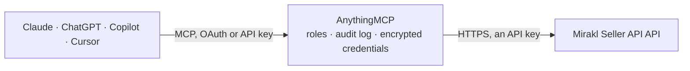

<!-- Generated by scripts/export-github-catalog.mjs in the anythingmcp-website repository. Do not edit by hand. -->

# Mirakl Seller API MCP connector

Run your shop on any Mirakl-powered marketplace (Leroy Merlin, Conforama, BUT, home24, Maisons du Monde, Vente-unique, ePrice, Decathlon, Carrefour and many more) from an AI agent: orders, … The AnythingMCP connector gives Claude, ChatGPT, Microsoft Copilot, Cursor and Gemini 35 MCP tools for Mirakl Seller API: 24 read and 11 can change data.

**Category:** [E-commerce](../e-commerce.md) · **Tools:** 35 · **Setup guide:** [anythingmcp.com](https://anythingmcp.com/guides/mirakl-to-mcp) · [Deutsch](https://anythingmcp.com/de/guides/mirakl-to-mcp) · [Italiano](https://anythingmcp.com/it/guides/mirakl-to-mcp) · [Español](https://anythingmcp.com/es/guides/mirakl-to-mcp) · [日本語](https://anythingmcp.com/ja/guides/mirakl-to-mcp) · [Русский](https://anythingmcp.com/ru/guides/mirakl-to-mcp) · [中文](https://anythingmcp.com/zh/guides/mirakl-to-mcp)

## Start without code

No installation and no terminal: AnythingMCP Cloud runs the Mirakl Seller API connector for you, operated by helpcode.ai in Frankfurt, Germany.

1. **Click the button above** and create an account or sign in. The Mirakl Seller API connector opens, ready to install.
2. **Paste the API key or token from your Mirakl Seller API account.** Every click is in the [step-by-step guide](https://anythingmcp.com/guides/mirakl-to-mcp).
3. **Click Install.** AnythingMCP shows the address of your MCP server.
4. **Add that address to your assistant:** [Claude](https://anythingmcp.com/guides/connect-mirakl-to-claude) · [ChatGPT](https://anythingmcp.com/guides/connect-mirakl-to-chatgpt) · [Microsoft Copilot](https://anythingmcp.com/guides/connect-mirakl-to-copilot) · [Cursor](https://anythingmcp.com/guides/connect-mirakl-to-cursor) · [Gemini CLI](https://anythingmcp.com/guides/connect-mirakl-to-gemini) · [Meta Muse](https://anythingmcp.com/guides/connect-mirakl-to-muse).
5. **Ask your first question**, for example: *What's the status and total for order ORD-2026-0421 from Mirakl, and which lines are waiting?*

Prefer help with the setup? [Talk to us](https://anythingmcp.com/contact).

## How it works

- **The AI client** speaks MCP (Streamable HTTP) to AnythingMCP and only sees tool names, descriptions and results. It never gets the Mirakl Seller API credentials.
- **AnythingMCP** checks the client's role, builds the call from the tool definition, adds the credentials (an API key), calls Mirakl Seller API, logs the call and returns the result.
- **Mirakl Seller API** sees an ordinary API client with the rights of the account the credentials belong to.

## Tools

| Tool | What it does | Access |
|---|---|---|
| [`mirakl_get_account`](#mirakl_get_account) | Read the shop behind the API key on this marketplace (A01): shop id and name, state, channels, currency, grade and approval rate, contact and shipping settings. | read |
| [`mirakl_list_orders`](#mirakl_list_orders) | List orders (OR11) with their lines, customer, shipping address, prices, state and incidents. | read |
| [`mirakl_list_offers`](#mirakl_list_offers) | List the shop's offers (OF21): SKU, product, price and discount, all channel prices, quantity in stock, condition, lead time and whether the offer is active… | read |
| [`mirakl_get_offer`](#mirakl_get_offer) | Read one offer in full by its Mirakl offer id (OF22): every price field, discount, quantity, condition, logistic class, lead time and custom fields. | read |
| [`mirakl_list_offer_conditions`](#mirakl_list_offer_conditions) | List the offer conditions (OF61) the marketplace accepts, e.g. new or used, with the code to put in state_code when updating offers. | read |
| [`mirakl_list_offer_imports`](#mirakl_list_offer_imports) | List offer imports and updates (OF04), from files and from mirakl_update_offers: status (WAITING, RUNNING, COMPLETE, FAILED), lines read, in success and in… | read |
| [`mirakl_get_offer_import`](#mirakl_get_offer_import) | Read the status of one offer import or offer update (OF02) by its import_id, as returned by mirakl_update_offers or mirakl_import_offers: status, lines in… | read |
| [`mirakl_list_product_imports`](#mirakl_list_product_imports) | List product imports (P51) with their status (WAITING, RUNNING, SENT, COMPLETE, FAILED, CANCELLED), the transformation counts and the integration result… | read |
| [`mirakl_get_product_import`](#mirakl_get_product_import) | Read the status of one product import (P42) by its import_id: import status, reason, transformation counts and the integration details (synchronized,… | read |
| [`mirakl_get_products`](#mirakl_get_products) | Look up products in the marketplace catalog by their identifiers (P31), e.g. EAN, and get the marketplace product SKU, title and category. | read |
| [`mirakl_list_product_offers`](#mirakl_list_product_offers) | List the offers of every shop for given products (P11), sorted by best price, to compare your price with the competition. | read |
| [`mirakl_list_threads`](#mirakl_list_threads) | List message threads (M11) with customers and the operator: topic, linked order or offer, participants, last message date and since when a shop reply is needed. | read |
| [`mirakl_get_thread`](#mirakl_get_thread) | Read one message thread (M10) with all its messages, senders, recipients, attachments and the linked order or offer. | read |
| [`mirakl_list_returns`](#mirakl_list_returns) | List return requests (RT11) with their state, return lines, reason, RMA, tracking and the linked order. | read |
| [`mirakl_list_reasons`](#mirakl_list_reasons) | List the marketplace's reason codes (RE01): incident, cancellation, refund and message reasons, with their labels and whether the shop may use them. | read |
| [`mirakl_list_carriers`](#mirakl_list_carriers) | List the carriers the marketplace knows (SH21) with their code, label and tracking URL. | read |
| [`mirakl_list_invoices`](#mirakl_list_invoices) | List the operator's accounting documents for the shop (IV01): invoices and credit notes with period, totals with and without tax, commission details,… | read |
| [`mirakl_list_transactions`](#mirakl_list_transactions) | List the shop's transaction lines (TL02): order amounts, shipping, commissions, refunds, manual credits and payouts, with amount, type, payment state,… | read |
| [`mirakl_list_document_requests`](#mirakl_list_document_requests) | List accounting document requests (DR11), used on marketplaces with Enhanced Seller Invoicing: invoices and credit notes the operator or the shop issues,… | read |
| [`mirakl_list_order_documents`](#mirakl_list_order_documents) | List the documents attached to one or more orders (OR72): delivery notes, shipping labels, customer invoices and other files, with id, file name, type code… | read |
| [`mirakl_list_channels`](#mirakl_list_channels) | List the marketplace's sales channels (CH11), usually one per country site, with code and label. | read |
| [`mirakl_list_shipping_zones`](#mirakl_list_shipping_zones) | List the active shipping zones of the marketplace (SH11) with code and label, e.g. mainland France or Corsica. | read |
| [`mirakl_list_shipping_methods`](#mirakl_list_shipping_methods) | List the active shipping methods of the marketplace (SH12), e.g. standard, express or pick-up, with code, label, whether a tracking number is mandatory and… | read |
| [`mirakl_list_logistic_classes`](#mirakl_list_logistic_classes) | List the marketplace's logistic classes (SH31), the size or weight bands that decide shipping prices, with code and label. | read |
| [`mirakl_accept_order`](#mirakl_accept_order) | Accept or refuse the lines of an order waiting for acceptance (OR21). | write |
| [`mirakl_update_tracking`](#mirakl_update_tracking) | Set the carrier and tracking number of an order (OR23). | write |
| [`mirakl_ship_order`](#mirakl_ship_order) | Confirm that an order in SHIPPING has been shipped (OR24); it moves to SHIPPED and the customer is notified. | write |
| [`mirakl_update_offers`](#mirakl_update_offers) | Create or update offers, including price and stock (OF24). | write |
| [`mirakl_reply_thread`](#mirakl_reply_thread) | Reply in a message thread (M12) to the customer or the operator. | write |
| [`mirakl_create_order_thread`](#mirakl_create_order_thread) | Start a new message thread on an order (OR43) with the customer, the operator or both. | write |
| [`mirakl_resolve_incident`](#mirakl_resolve_incident) | Mark the open incident on one order line as resolved (OR64), once the customer's problem is solved. | write |
| [`mirakl_accept_return`](#mirakl_accept_return) | Accept or refuse a return request in WAITING_ACCEPTANCE (RT21). | write |
| [`mirakl_receive_return`](#mirakl_receive_return) | Confirm that the goods of an accepted return arrived at your warehouse (RT25). | write |
| [`mirakl_import_products`](#mirakl_import_products) | Send a product file to the marketplace (P41) to create or enrich products in its catalog. | write |
| [`mirakl_import_offers`](#mirakl_import_offers) | Import an offer file (OF01) to create, update or delete offers in bulk. | write |

## Tool reference

Every parameter as the AI client sees it in `tools/list`. Source: [`packages/backend/src/adapters/intl/mirakl.json`](../../../packages/backend/src/adapters/intl/mirakl.json).

### `mirakl_get_account`

Read the shop behind the API key on this marketplace (A01): shop id and name, state, channels, currency, grade and approval rate, contact and shipping settings. The quickest check that MIRAKL_URL and the key belong together. Mirakl recommends calling it about once a day.

**Access:** read · **Call:** `GET /account`

No parameters.

### `mirakl_list_orders`

List orders (OR11) with their lines, customer, shipping address, prices, state and incidents. Filter by state (e.g. WAITING_ACCEPTANCE for orders to accept, SHIPPING for orders to ship), by creation or update date, by order id or channel. Pages with max (at most 100) and offset.

**Access:** read · **Call:** `GET /orders`

| Parameter | Type | Required | Description |
|---|---|---|---|
| `order_state_codes` | string | no | Comma-separated order states: STAGING, WAITING_ACCEPTANCE, WAITING_DEBIT, WAITING_DEBIT_PAYMENT, SHIPPING, SHIPPED, TO_COLLECT, RECEIVED, CLOSED, REFUSED, CANCELED. |
| `order_ids` | string | no | Comma-separated order ids (e.g. 1234567-A), up to 100. |
| `start_date` | string | no | Orders created at or after this time, ISO 8601 (e.g. 2026-10-01T00:00:00Z). |
| `end_date` | string | no | Orders created before this time, ISO 8601. |
| `start_update_date` | string | no | Orders updated at or after this time, ISO 8601. Best filter for polling changes. |
| `end_update_date` | string | no | Orders updated before this time, ISO 8601. |
| `has_incident` | boolean | no | true: only orders with an open incident; false: only orders without one. |
| `customer_debited` | boolean | no | true: only orders the customer has paid. |
| `channel_codes` | string | no | Comma-separated sales channel codes (country sites of the marketplace). |
| `order_references_for_seller` | string | no | Comma-separated order references you set for yourself. |
| `max` | integer | no | Orders per page, 1 to 100. |
| `offset` | integer | no | Number of orders to skip, for paging. |
| `order` | `asc` \| `desc` | no | Sort direction by creation date (default asc). desc lists the newest first. |

### `mirakl_list_offers`

List the shop's offers (OF21): SKU, product, price and discount, all channel prices, quantity in stock, condition, lead time and whether the offer is active (with the inactivity reasons). Filter by sku or product. Pages with max (at most 100) and offset.

**Access:** read · **Call:** `GET /offers`

| Parameter | Type | Required | Description |
|---|---|---|---|
| `sku` | string | no | Your offer SKU (shop_sku). |
| `product_id` | string | no | The marketplace's product SKU. |
| `offer_state_codes` | string | no | Comma-separated offer condition codes (see mirakl_list_offer_conditions). |
| `pricing_channel_code` | string | no | Channel whose prices should be returned as the applicable price. |
| `max` | integer | no | Offers per page, 1 to 100. |
| `offset` | integer | no | Number of offers to skip, for paging. |
| `sort` | `totalPrice` \| `price` \| `productTitle` | no | Sort field (default totalPrice). |
| `order` | `asc` \| `desc` | no | Sort direction (default asc). |

### `mirakl_get_offer`

Read one offer in full by its Mirakl offer id (OF22): every price field, discount, quantity, condition, logistic class, lead time and custom fields. Read it before mirakl_update_offers, which needs the complete offer.

**Access:** read · **Call:** `GET /offers/{offer_id}`

| Parameter | Type | Required | Description |
|---|---|---|---|
| `offer_id` | integer | yes | Mirakl offer id (offer_id in mirakl_list_offers), not your SKU. |

### `mirakl_list_offer_conditions`

List the offer conditions (OF61) the marketplace accepts, e.g. new or used, with the code to put in state_code when updating offers.

**Access:** read · **Call:** `GET /offers/states`

No parameters.

### `mirakl_list_offer_imports`

List offer imports and updates (OF04), from files and from mirakl_update_offers: status (WAITING, RUNNING, COMPLETE, FAILED), lines read, in success and in error, offers inserted, updated and deleted. Newest first. Pass next_page_token back as page_token for more.

**Access:** read · **Call:** `GET /offers/imports`

| Parameter | Type | Required | Description |
|---|---|---|---|
| `status` | `WAITING_SYNCHRONIZATION_PRODUCT` \| `WAITING` \| `RUNNING` \| `COMPLETE` \| `FAILED` | no | Only imports in this status. |
| `mode` | `NORMAL` \| `REPLACE` | no | Only imports in this mode. |
| `start_date` | string | no | Imports created at or after this time, ISO 8601. |
| `end_date` | string | no | Imports created before this time, ISO 8601. |
| `limit` | integer | no | Imports per page, 1 to 100 (default 10). |
| `page_token` | string | no | next_page_token from the previous page. All other filters are then ignored. |

### `mirakl_get_offer_import`

Read the status of one offer import or offer update (OF02) by its import_id, as returned by mirakl_update_offers or mirakl_import_offers: status, lines in success and in error, offers inserted, updated and deleted, and whether an error report exists.

**Access:** read · **Call:** `GET /offers/imports/{import_id}`

| Parameter | Type | Required | Description |
|---|---|---|---|
| `import_id` | integer | yes | The import_id returned by mirakl_update_offers or mirakl_import_offers. |

### `mirakl_list_product_imports`

List product imports (P51) with their status (WAITING, RUNNING, SENT, COMPLETE, FAILED, CANCELLED), the transformation counts and the integration result (products synchronized, rejected, invalid). Pages with max and offset.

**Access:** read · **Call:** `GET /products/imports`

| Parameter | Type | Required | Description |
|---|---|---|---|
| `status` | `CANCELLED` \| `WAITING` \| `RUNNING` \| `SENT` \| `COMPLETE` \| `FAILED` | no | Only imports in this status. |
| `last_request_date` | string | no | Only imports that changed since this time, ISO 8601. Without it Mirakl returns every product import. |
| `max` | integer | no | Imports per page, 1 to 100. |
| `offset` | integer | no | Number of imports to skip, for paging. |
| `order` | `asc` \| `desc` | no | Sort direction by creation date (default asc). desc lists the newest first. |

### `mirakl_get_product_import`

Read the status of one product import (P42) by its import_id: import status, reason, transformation counts and the integration details (synchronized, rejected, invalid, wrong identifiers).

**Access:** read · **Call:** `GET /products/imports/{import_id}`

| Parameter | Type | Required | Description |
|---|---|---|---|
| `import_id` | integer | yes | The import_id returned by mirakl_import_products. |

### `mirakl_get_products`

Look up products in the marketplace catalog by their identifiers (P31), e.g. EAN, and get the marketplace product SKU, title and category. Up to 100 products per call.

**Access:** read · **Call:** `GET /products`

| Parameter | Type | Required | Description |
|---|---|---|---|
| `product_references` | string | yes | Comma-separated <type>\|<value> pairs, e.g. EAN\|3276000000000,EAN\|4000000000000. The types are the operator's product references (EAN, UPC...); SKU and SHOP_SKU are not accepted. |

### `mirakl_list_product_offers`

List the offers of every shop for given products (P11), sorted by best price, to compare your price with the competition. Give product_ids or product_references (up to 100). Mirakl allows about 5 calls a minute.

**Access:** read · **Call:** `GET /products/offers`

| Parameter | Type | Required | Description |
|---|---|---|---|
| `product_ids` | string | no | Comma-separated marketplace product SKUs. |
| `product_references` | string | no | Comma-separated <type>\|<value> pairs, e.g. EAN\|3276000000000. |
| `all_offers` | boolean | no | true to include inactive offers (default: active offers only). |
| `channel_codes` | string | no | Comma-separated channel codes: only offers sold on these channels. |
| `max` | integer | no | Products per page, 1 to 100. |
| `offset` | integer | no | Number of products to skip, for paging. |

### `mirakl_list_threads`

List message threads (M11) with customers and the operator: topic, linked order or offer, participants, last message date and since when a shop reply is needed. Filter with entity_type and entity_id for one order. Pass next_page_token back as page_token for more.

**Access:** read · **Call:** `GET /inbox/threads`

| Parameter | Type | Required | Description |
|---|---|---|---|
| `entity_type` | `MMP_ORDER` \| `MMP_OFFER` \| `MPS_ORDER` \| `MPS_SERVICE` \| `SELLER_OPERATOR` | no | Only threads on this kind of entity: MMP_ORDER (orders), MMP_OFFER (offers), SELLER_OPERATOR (with the operator). |
| `entity_id` | string | no | Comma-separated entity ids, e.g. order ids. Needs entity_type. |
| `updated_since` | string | no | Only threads changed at or after this time, ISO 8601. |
| `with_messages` | boolean | no | true to include the messages (the last 100 of each thread). |
| `limit` | integer | no | Threads per page, 1 to 100 (default 50). |
| `page_token` | string | no | next_page_token from the previous page. All other filters are then ignored. |

### `mirakl_get_thread`

Read one message thread (M10) with all its messages, senders, recipients, attachments and the linked order or offer.

**Access:** read · **Call:** `GET /inbox/threads/{thread_id}`

| Parameter | Type | Required | Description |
|---|---|---|---|
| `thread_id` | string | yes | Thread id (a UUID) from mirakl_list_threads. |

### `mirakl_list_returns`

List return requests (RT11) with their state, return lines, reason, RMA, tracking and the linked order. Filter by state, order or date. Pass next_page_token back as page_token for more.

**Access:** read · **Call:** `GET /returns`

| Parameter | Type | Required | Description |
|---|---|---|---|
| `return_state` | string | no | Only returns in this state: WAITING_ACCEPTANCE, IN_PROGRESS, REFUSED, RECEIVED, NO_RECEPTION, CLOSED or CANCELED. |
| `order_commercial_id` | string | no | Only returns of this order (commercial id). |
| `return_creation_date_from` | string | no | Returns created after this time, ISO 8601. |
| `return_creation_date_to` | string | no | Returns created before this time, ISO 8601. |
| `return_last_updated_from` | string | no | Returns updated after this time, ISO 8601. |
| `limit` | integer | no | Returns per page, 1 to 100 (default 10). |
| `page_token` | string | no | next_page_token from the previous page. All other filters are then ignored. |

### `mirakl_list_reasons`

List the marketplace's reason codes (RE01): incident, cancellation, refund and message reasons, with their labels and whether the shop may use them. Use a code as the topic of a message thread.

**Access:** read · **Call:** `GET /reasons`

| Parameter | Type | Required | Description |
|---|---|---|---|
| `locale` | string | no | Language of the labels, e.g. fr_FR. Only a locale active on this marketplace works (others answer 400); leave empty for the default. |

### `mirakl_list_carriers`

List the carriers the marketplace knows (SH21) with their code, label and tracking URL. Use the code as carrier_code in mirakl_update_tracking.

**Access:** read · **Call:** `GET /shipping/carriers`

No parameters.

### `mirakl_list_invoices`

List the operator's accounting documents for the shop (IV01): invoices and credit notes with period, totals with and without tax, commission details, payment state and due date. Pages with max and offset.

**Access:** read · **Call:** `GET /invoices`

| Parameter | Type | Required | Description |
|---|---|---|---|
| `start_date` | string | no | Documents created at or after this time, ISO 8601. |
| `end_date` | string | no | Documents created before this time, ISO 8601. |
| `type` | `ALL` \| `AUTO_INVOICE` \| `MANUAL_INVOICE` \| `MANUAL_CREDIT` | no | Document type. Mirakl's default is AUTO_INVOICE (the regular billing-cycle invoices); ALL includes manual invoices and credits. |
| `payment_status` | `PENDING` \| `PAID` \| `FAILED` | no | Only documents in this payment state. |
| `max` | integer | no | Documents per page, 1 to 100. |
| `offset` | integer | no | Number of documents to skip, for paging. |

### `mirakl_list_transactions`

List the shop's transaction lines (TL02): order amounts, shipping, commissions, refunds, manual credits and payouts, with amount, type, payment state, balance and the accounting document they belong to. Filter by date, type or order. Pass next_page_token back as page_token for more.

**Access:** read · **Call:** `GET /sellerpayment/transactions_logs`

| Parameter | Type | Required | Description |
|---|---|---|---|
| `date_created_from` | string | no | Lines created at or after this time, ISO 8601. |
| `date_created_to` | string | no | Lines created before this time, ISO 8601. |
| `transaction_date_from` | string | no | Lines whose transaction date is at or after this time, ISO 8601. |
| `transaction_date_to` | string | no | Lines whose transaction date is before this time, ISO 8601. |
| `last_updated_from` | string | no | Lines updated at or after this time, ISO 8601. |
| `transaction_type` | string | no | Only this transaction type, e.g. ORDER_AMOUNT, ORDER_SHIPPING_AMOUNT, COMMISSION_FEE, REFUND_ORDER_AMOUNT, PAYMENT. |
| `payment_state` | string | no | Only lines in this payment state: PENDING, PAYABLE, PAID, NOT_APPLICABLE or RESERVE. |
| `order_id` | string | no | Only lines of this order. |
| `accounting_document_number` | string | no | Only lines of this accounting document (invoice number). |
| `limit` | integer | no | Lines per page, 1 to 2000. |
| `page_token` | string | no | next_page_token from the previous page. All other filters are then ignored. |

### `mirakl_list_document_requests`

List accounting document requests (DR11), used on marketplaces with Enhanced Seller Invoicing: invoices and credit notes the operator or the shop issues, with state, type, issuer, document number, amounts and payment state. Filter by date, state, type or document number. Pass next_page_token back as page_token for more.

**Access:** read · **Call:** `GET /document-request/requests`

| Parameter | Type | Required | Description |
|---|---|---|---|
| `state` | `STAGING` \| `TO_PROCESS` \| `ISSUED` \| `CANCELED` | no | Only requests in this state. TO_PROCESS are documents the shop still has to issue. |
| `type` | `INVOICE` \| `CREDIT_NOTE` | no | Only invoices or only credit notes. |
| `issuer_type` | `OPERATOR` \| `SHOP` | no | Only documents issued by the operator, or by the shop. |
| `document_number` | string | no | Only the request with this accounting document number. |
| `date_created_from` | string | no | Requests created after this time, ISO 8601. |
| `date_created_to` | string | no | Requests created before this time, ISO 8601. |
| `issue_date_from` | string | no | Requests issued after this time, ISO 8601. |
| `issue_date_to` | string | no | Requests issued before this time, ISO 8601. |
| `payment_state` | `PAID` \| `PENDING` | no | Only paid or pending documents (purchase order and fee requests only). |
| `limit` | integer | no | Requests per page. |
| `page_token` | string | no | next_page_token from the previous page. All other filters are then ignored. |

### `mirakl_list_order_documents`

List the documents attached to one or more orders (OR72): delivery notes, shipping labels, customer invoices and other files, with id, file name, type code and upload date. Download links are not part of this tool; open the file in the back office.

**Access:** read · **Call:** `GET /orders/documents`

| Parameter | Type | Required | Description |
|---|---|---|---|
| `order_ids` | string | yes | Comma-separated order ids, e.g. 1234567-A,1234568-A. |

### `mirakl_list_channels`

List the marketplace's sales channels (CH11), usually one per country site, with code and label. Use the codes as channel_codes in mirakl_list_orders and mirakl_list_product_offers. Changes rarely: call it once, not on every question.

**Access:** read · **Call:** `GET /channels`

No parameters.

### `mirakl_list_shipping_zones`

List the active shipping zones of the marketplace (SH11) with code and label, e.g. mainland France or Corsica. Changes rarely: call it once, not on every question.

**Access:** read · **Call:** `GET /shipping/zones`

No parameters.

### `mirakl_list_shipping_methods`

List the active shipping methods of the marketplace (SH12), e.g. standard, express or pick-up, with code, label, whether a tracking number is mandatory and whether it is click and collect. The code appears as shipping_type_code on orders. Changes rarely: call it once, not on every question.

**Access:** read · **Call:** `GET /shipping/types`

No parameters.

### `mirakl_list_logistic_classes`

List the marketplace's logistic classes (SH31), the size or weight bands that decide shipping prices, with code and label. Use the code as logistic_class in mirakl_update_offers. Changes rarely: call it once, not on every question.

**Access:** read · **Call:** `GET /shipping/logistic_classes`

No parameters.

### `mirakl_accept_order`

Accept or refuse the lines of an order waiting for acceptance (OR21). Every line of the order must be listed. Refusing a line cancels it for good. Acts on the live marketplace: name the order and the decision per line and get a yes from the user first.

**Access:** write · **Call:** `PUT /orders/{order_id}/accept`

| Parameter | Type | Required | Description |
|---|---|---|---|
| `order_id` | string | yes | Order id, e.g. 1234567-A. |
| `order_lines` | object[] | yes | One entry per order line: {"id": "<order_line_id>", "accepted": true}. Use accepted false only when the user explicitly wants to refuse that line. |

### `mirakl_update_tracking`

Set the carrier and tracking number of an order (OR23). Give carrier_code from mirakl_list_carriers, or carrier_name with carrier_url for a carrier the marketplace does not know. Acts on the live marketplace and is shown to the customer: name the order and the tracking data and get a yes from the user first.

**Access:** write · **Call:** `PUT /orders/{order_id}/tracking`

| Parameter | Type | Required | Description |
|---|---|---|---|
| `order_id` | string | yes | Order id, e.g. 1234567-A. |
| `tracking_number` | string | no | The carrier's tracking number. |
| `carrier_code` | string | no | Carrier code from mirakl_list_carriers. |
| `carrier_name` | string | no | Carrier name, for a carrier that is not in mirakl_list_carriers. |
| `carrier_url` | string | no | Full tracking URL, for a carrier that is not in mirakl_list_carriers. |
| `carrier_standard_code` | string | no | Standard carrier code, when the marketplace uses them. |

### `mirakl_ship_order`

Confirm that an order in SHIPPING has been shipped (OR24); it moves to SHIPPED and the customer is notified. Set the tracking first with mirakl_update_tracking. Cannot be undone: name the order and get a yes from the user first.

**Access:** write · **Call:** `PUT /orders/{order_id}/ship`

| Parameter | Type | Required | Description |
|---|---|---|---|
| `order_id` | string | yes | Order id, e.g. 1234567-A. |

### `mirakl_update_offers`

Create or update offers, including price and stock (OF24). Replaces each offer completely: every field left out is reset (a missing quantity becomes 0), so read the offer first and send it back whole with only the intended change. Returns an import_id to check with mirakl_get_offer_import. Acts on the live marketplace: list each SKU with the old and new values and get a yes from the user first.

**Access:** write · **Call:** `POST /offers`

| Parameter | Type | Required | Description |
|---|---|---|---|
| `offers` | object[] | yes | Offers to create or update. Each needs shop_sku, state_code and price; product_id and product_id_type are required when the offer is new. Send every field the offer has (quantity, leadtime_to_ship, logistic_class, description, discount, all_prices, min_quantity_alert, available_started, available_ended, offer_additional_fields...), otherwise it is reset. Leave update_delete empty or set it to update. |

### `mirakl_reply_thread`

Reply in a message thread (M12) to the customer or the operator. The message is delivered at once and cannot be taken back: show the user the text and the recipients and get a yes from the user first.

**Access:** write · **Call:** `POST /inbox/threads/{thread_id}/message`

| Parameter | Type | Required | Description |
|---|---|---|---|
| `thread_id` | string | yes | Thread id from mirakl_list_threads. |
| `body` | string | yes | Message text (up to 50,000 characters). |
| `to` | object[] | yes | Recipients, e.g. [{"type": "CUSTOMER"}] or [{"type": "OPERATOR"}]. type is CUSTOMER, OPERATOR or SHOP; add id only to pick one participant of the thread. |
| `topic` | object | no | Optional new topic: {"type": "FREE_TEXT", "value": "..."} or {"type": "REASON_CODE", "value": "<code from mirakl_list_reasons>"}. |

### `mirakl_create_order_thread`

Start a new message thread on an order (OR43) with the customer, the operator or both. The message is delivered at once: show the user the text, topic and recipients and get a yes from the user first.

**Access:** write · **Call:** `POST /orders/{order_id}/threads`

| Parameter | Type | Required | Description |
|---|---|---|---|
| `order_id` | string | yes | Order id, e.g. 1234567-A. |
| `body` | string | yes | Message text (up to 50,000 characters). |
| `to` | `CUSTOMER` \| `OPERATOR`[] | yes | Recipients: CUSTOMER, OPERATOR or both. |
| `topic_type` | `FREE_TEXT` \| `REASON_CODE` | no | FREE_TEXT for your own subject, REASON_CODE for a code from mirakl_list_reasons. |
| `topic_value` | string | yes | The subject text, or the reason code. |

### `mirakl_resolve_incident`

Mark the open incident on one order line as resolved (OR64), once the customer's problem is solved. reason_code must be an INCIDENT_CLOSE reason from mirakl_list_reasons. Closes the incident on the live marketplace: name the order, the line and the reason and get a yes from the user first.

**Access:** write · **Call:** `PUT /orders/{order_id}/lines/{order_line_id}/resolve_incident`

| Parameter | Type | Required | Description |
|---|---|---|---|
| `order_id` | string | yes | Order id, e.g. 1234567-A. |
| `order_line_id` | string | yes | Order line id with the open incident, e.g. 1234567-A-1 (order_line_id in mirakl_list_orders). |
| `reason_code` | string | yes | Code of an INCIDENT_CLOSE reason from mirakl_list_reasons. |

### `mirakl_accept_return`

Accept or refuse a return request in WAITING_ACCEPTANCE (RT21). Only on marketplaces that use Mirakl returns and leave the decision to the shop. Refusing needs a rejection_reason_code. This only decides the request; refunds are not made by this tool. Acts on the live marketplace: name the return, the decision and the reason and get a yes from the user first.

**Access:** write · **Call:** `PUT /returns/accept`

| Parameter | Type | Required | Description |
|---|---|---|---|
| `return_id` | string | yes | Return id from mirakl_list_returns. |
| `accepted` | boolean | yes | true accepts the return, false refuses it. |
| `rejection_reason_code` | `RETURN_REJECTION_NOT_ELIGIBLE` \| `RETURN_REJECTION_NOT_NEEDED` \| `RETURN_REJECTION_WINDOW_CLOSED` | no | Required when accepted is false: not eligible, no return needed, or return window closed. |

### `mirakl_receive_return`

Confirm that the goods of an accepted return arrived at your warehouse (RT25). The return moves to RECEIVED. Acts on the live marketplace: name the return and get a yes from the user first.

**Access:** write · **Call:** `PUT /returns/receive`

| Parameter | Type | Required | Description |
|---|---|---|---|
| `return_id` | string | yes | Return id from mirakl_list_returns. |

### `mirakl_import_products`

Send a product file to the marketplace (P41) to create or enrich products in its catalog. file_url is the address of a CSV, XLSX or XML file in the operator's product format; the connector downloads it (up to 10 MB) and uploads it. Returns an import_id to follow with mirakl_get_product_import. Mirakl allows one import every 15 minutes. Changes the marketplace catalog: describe the file and get a yes from the user first.

**Access:** write · **Call:** `POST /products/imports`

| Parameter | Type | Required | Description |
|---|---|---|---|
| `file_url` | string | yes | Public https URL of the product file (CSV, XLSX or XML). |
| `operator_format` | boolean | no | true when the file already uses the operator's product format. |

### `mirakl_import_offers`

Import an offer file (OF01) to create, update or delete offers in bulk. REPLACE mode deletes every offer that is not in the file, and NORMAL mode deletes the lines marked delete. file_url is the address of a CSV, XLSX or XML file in Mirakl's offer format; the connector downloads it (up to 10 MB) and uploads it. Returns an import_id to follow with mirakl_get_offer_import. Installed switched off; describe the file and the mode and get a yes from the user first.

**Access:** write · **Call:** `POST /offers/imports`

| Parameter | Type | Required | Description |
|---|---|---|---|
| `file_url` | string | yes | Public https URL of the offer file. |
| `import_mode` | `NORMAL` \| `REPLACE` | no | NORMAL creates, updates or deletes the offers in the file. REPLACE also deletes every offer missing from it. |
| `with_products` | boolean | no | true when the file also carries product data. |

## Run it yourself

AnythingMCP is open source (AGPL-3.0). [Run it with Docker](../../../README.md#run-it-yourself), open **Connectors → Store**, pick **Mirakl Seller API** and enter `MIRAKL_URL`, `MIRAKL_API_KEY`, then add your MCP server URL to the AI client.

[← E-commerce connectors](../e-commerce.md) · [All categories](../README.md)
