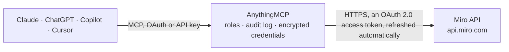

<!-- Generated by scripts/export-github-catalog.mjs in the anythingmcp-website repository. Do not edit by hand. -->

# Miro MCP connector

Let your AI work on your Miro boards: find boards, read what is on them, add and edit sticky notes, shapes, text, cards and frames, connect them with lines, organise with tags, and see who has access. The AnythingMCP connector gives Claude, ChatGPT, Microsoft Copilot, Cursor and Gemini 40 MCP tools for Miro: 13 read and 27 can change data.

**Category:** [Productivity](../productivity.md) · **Tools:** 40 · **Setup guide:** [anythingmcp.com](https://anythingmcp.com/guides/miro-to-mcp) · [Deutsch](https://anythingmcp.com/de/guides/miro-to-mcp) · [Italiano](https://anythingmcp.com/it/guides/miro-to-mcp) · [Español](https://anythingmcp.com/es/guides/miro-to-mcp) · [日本語](https://anythingmcp.com/ja/guides/miro-to-mcp) · [Русский](https://anythingmcp.com/ru/guides/miro-to-mcp) · [中文](https://anythingmcp.com/zh/guides/miro-to-mcp)

## Start without code

No installation and no terminal: AnythingMCP Cloud runs the Miro connector for you, operated by helpcode.ai in Frankfurt, Germany.

1. **Click the button above** and create an account or sign in. The Miro connector opens, ready to install.
2. **Sign in with your Miro account** when AnythingMCP asks. The first time, an admin creates a small app in the Miro developer console. Every click is in the [step-by-step guide](https://anythingmcp.com/guides/miro-to-mcp).
3. **Click Install.** AnythingMCP shows the address of your MCP server.
4. **Add that address to your assistant:** [Claude](https://anythingmcp.com/guides/connect-miro-to-claude) · [ChatGPT](https://anythingmcp.com/guides/connect-miro-to-chatgpt) · [Microsoft Copilot](https://anythingmcp.com/guides/connect-miro-to-copilot) · [Cursor](https://anythingmcp.com/guides/connect-miro-to-cursor) · [Gemini CLI](https://anythingmcp.com/guides/connect-miro-to-gemini) · [Meta Muse](https://anythingmcp.com/guides/connect-miro-to-muse).
5. **Ask your first question**, for example: *Find the sticky note that mentions invoice INV-2026-087 on board 'Invoice 2026 Q3 - NSO'.*

Prefer help with the setup? [Talk to us](https://anythingmcp.com/contact).

## How it works

- **The AI client** speaks MCP (Streamable HTTP) to AnythingMCP and only sees tool names, descriptions and results. It never gets the Miro credentials.
- **AnythingMCP** checks the client's role, builds the call from the tool definition, adds the credentials (an OAuth 2.0 access token, refreshed automatically), calls Miro, logs the call and returns the result.
- **Miro** sees an ordinary API client with the rights of the account the credentials belong to.

## Tools

| Tool | What it does | Access |
|---|---|---|
| [`miro_get_token_info`](#miro_get_token_info) | Show who the connection belongs to: the Miro user, the team the app was installed in, the organization and the granted scopes. | read |
| [`miro_list_boards`](#miro_list_boards) | Find boards the user can open: by text, owner, team or project. | read |
| [`miro_get_board`](#miro_get_board) | Get one board: name, description, owner, team, project, sharing and permission policies, viewLink, createdAt and modifiedAt. | read |
| [`miro_create_board`](#miro_create_board) | Create a board. | write |
| [`miro_update_board`](#miro_update_board) | Rename a board, change its description or its sharing policy. | write |
| [`miro_copy_board`](#miro_copy_board) | Copy a board with all its content into a new board, optionally with a new name and in another team. | write |
| [`miro_delete_board`](#miro_delete_board) | Delete a whole board with everything on it. | write |
| [`miro_list_items`](#miro_list_items) | List the items on a board: id, type, data (content, title ...), style, position, geometry, parent (frame) and who changed them when. | read |
| [`miro_get_item`](#miro_get_item) | Get one item of any type (sticky note, shape, text, card, frame, image ...): type, data, style, position, geometry and parent. | read |
| [`miro_move_item`](#miro_move_item) | Move any item: to a new position, into a frame (parent {"id": "<frame id>"}) or out of it back onto the board (parent {"id": null}). | write |
| [`miro_delete_item`](#miro_delete_item) | Delete an item of any type (sticky note, shape, text, card, frame, image ...). | write |
| [`miro_create_sticky_note`](#miro_create_sticky_note) | Add a sticky note to a board. | write |
| [`miro_update_sticky_note`](#miro_update_sticky_note) | Change a sticky note's text, shape, color, position, size or frame. | write |
| [`miro_create_shape`](#miro_create_shape) | Add a shape (rectangle, circle, flowchart symbol ...) with optional text to a board. | write |
| [`miro_update_shape`](#miro_update_shape) | Change a shape's type, text, style, position, size or frame. | write |
| [`miro_create_text`](#miro_create_text) | Add a free text item to a board (a heading, a label, a paragraph). | write |
| [`miro_update_text`](#miro_update_text) | Change a text item. | write |
| [`miro_create_card`](#miro_create_card) | Add a card (a task-like item with title, description, assignee and due date) to a board. | write |
| [`miro_update_card`](#miro_update_card) | Change a card's title, description, assignee, due date, color, position, size or frame. | write |
| [`miro_create_frame`](#miro_create_frame) | Add a frame (a titled area that groups items) to a board. | write |
| [`miro_update_frame`](#miro_update_frame) | Change a frame's title, background, position or size. | write |
| [`miro_list_connectors`](#miro_list_connectors) | List the connector lines on a board: id, startItem and endItem (item ids), shape, captions and style. | read |
| [`miro_get_connector`](#miro_get_connector) | Get one connector line: the items it joins, its shape, captions and style. | read |
| [`miro_create_connector`](#miro_create_connector) | Draw a connector line between two items (sticky notes, shapes, cards, texts; not frames), e.g. to link steps of a flowchart. | write |
| [`miro_update_connector`](#miro_update_connector) | Change a connector line: its ends, shape, captions or style. | write |
| [`miro_delete_connector`](#miro_delete_connector) | Delete a connector line between two items; the items it joined stay where they are. | write |
| [`miro_list_board_members`](#miro_list_board_members) | List who has access to a board: member id (the user id), name, role (viewer, commenter, editor, coowner, owner). | read |
| [`miro_get_board_member`](#miro_get_board_member) | Get one member of a board: user id, name and role (viewer, commenter, editor, coowner, owner). | read |
| [`miro_share_board`](#miro_share_board) | Invite people to a board by email with a role; Miro emails them an invitation. | write |
| [`miro_update_board_member`](#miro_update_board_member) | Change a board member's role, e.g. from viewer to editor. | write |
| [`miro_remove_board_member`](#miro_remove_board_member) | Remove someone's access to a board. | write |
| [`miro_list_tags`](#miro_list_tags) | List the tags defined on a board: id, title and fillColor. | read |
| [`miro_get_tag`](#miro_get_tag) | Get one tag of a board by its id: title and fillColor, as shown on cards and sticky notes. | read |
| [`miro_create_tag`](#miro_create_tag) | Create a tag on a board, to attach to cards and sticky notes. | write |
| [`miro_update_tag`](#miro_update_tag) | Rename a tag or change its color; every item carrying it changes too. | write |
| [`miro_delete_tag`](#miro_delete_tag) | Delete a tag from a board; it is removed from every item that carries it. | write |
| [`miro_attach_tag`](#miro_attach_tag) | Attach an existing tag to a card or sticky note (other item types cannot carry tags; at most 8 per item). | write |
| [`miro_remove_tag_from_item`](#miro_remove_tag_from_item) | Take a tag off a card or sticky note; the tag itself stays on the board. | write |
| [`miro_get_item_tags`](#miro_get_item_tags) | List the tags attached to one card or sticky note, each with id, title and fillColor. | read |
| [`miro_list_items_by_tag`](#miro_list_items_by_tag) | List the cards and sticky notes that carry a tag. | read |

## Tool reference

Every parameter as the AI client sees it in `tools/list`. Source: [`packages/backend/src/adapters/intl/miro.json`](../../../packages/backend/src/adapters/intl/miro.json).

### `miro_get_token_info`

Show who the connection belongs to: the Miro user, the team the app was installed in, the organization and the granted scopes. A cheap check that the authorization works.

**Access:** read · **Call:** `GET https://api.miro.com/v1/oauth-token`

No parameters.

### `miro_list_boards`

Find boards the user can open: by text, owner, team or project. Returns id, name, description, owner, team, viewLink, createdAt and modifiedAt, with total for paging by offset. Recently created boards can take a few seconds to show up in a search.

**Access:** read · **Call:** `GET /boards`

| Parameter | Type | Required | Description |
|---|---|---|---|
| `query` | string | no | Text to search in board names and descriptions. |
| `team_id` | string | no | Only boards of this team (then query and owner are ignored). |
| `project_id` | string | no | Only boards in this project (space). |
| `owner` | string | no | Only boards owned by this user id. |
| `sort` | `default` \| `last_modified` \| `last_opened` \| `last_created` \| `alphabetically` | no | default, last_modified, last_opened, last_created or alphabetically (applies when filtering by team or project). |
| `limit` | integer | no | Boards per page, 1 to 50 (default 20). |
| `offset` | integer | no | How many boards to skip, for paging (default 0). |

### `miro_get_board`

Get one board: name, description, owner, team, project, sharing and permission policies, viewLink, createdAt and modifiedAt.

**Access:** read · **Call:** `GET /boards/{board_id}`

| Parameter | Type | Required | Description |
|---|---|---|---|
| `board_id` | string | yes | Board id, e.g. uXjVOD6LSME= (the part after /board/ in the board's URL, = included). |

### `miro_create_board`

Create a board. Returns the new board with its id and viewLink. Free plans allow only 3 editable boards per team. Confirm with the user first.

**Access:** write · **Call:** `POST /boards`

| Parameter | Type | Required | Description |
|---|---|---|---|
| `name` | string | no | Board name, up to 60 characters (default Untitled). |
| `description` | string | no | Description, up to 300 characters. |
| `team_id` | string | no | Team to create it in; the user's default team otherwise. |
| `project_id` | string | no | Project (space) to put it in. |
| `policy` | object | no | Sharing and permissions, e.g. {"sharingPolicy": {"access": "private", "teamAccess": "edit"}, "permissionsPolicy": {"copyAccess": "team_members"}}. access and teamAccess: private, view, comment or edit. |

### `miro_update_board`

Rename a board, change its description or its sharing policy. Only the fields given change.

**Access:** write · **Call:** `PATCH /boards/{board_id}`

| Parameter | Type | Required | Description |
|---|---|---|---|
| `board_id` | string | yes | Board id, e.g. uXjVOD6LSME= (the part after /board/ in the board's URL, = included). |
| `name` | string | no | New name, up to 60 characters. |
| `description` | string | no | New description, up to 300 characters. |
| `policy` | object | no | Sharing and permissions, e.g. {"sharingPolicy": {"access": "private", "teamAccess": "edit"}, "permissionsPolicy": {"copyAccess": "team_members"}}. access and teamAccess: private, view, comment or edit. |

### `miro_copy_board`

Copy a board with all its content into a new board, optionally with a new name and in another team. Returns the new board. Confirm with the user first.

**Access:** write · **Call:** `PUT /boards?copy_from={board_id}`

| Parameter | Type | Required | Description |
|---|---|---|---|
| `board_id` | string | yes | Board id, e.g. uXjVOD6LSME= (the part after /board/ in the board's URL, = included). |
| `name` | string | no | Name of the copy. |
| `description` | string | no | Description of the copy. |
| `team_id` | string | no | Team to put the copy in. |

### `miro_delete_board`

Delete a whole board with everything on it. On paid plans it stays in the trash for 90 days. Switched off at install.

**Access:** write · **Call:** `DELETE /boards/{board_id}`

| Parameter | Type | Required | Description |
|---|---|---|---|
| `board_id` | string | yes | Board id, e.g. uXjVOD6LSME= (the part after /board/ in the board's URL, = included). |

### `miro_list_items`

List the items on a board: id, type, data (content, title ...), style, position, geometry, parent (frame) and who changed them when. Filter by type or by frame (parent_item_id). Pages with cursor: pass the cursor of the answer until none comes back.

**Access:** read · **Call:** `GET /boards/{board_id}/items`

| Parameter | Type | Required | Description |
|---|---|---|---|
| `board_id` | string | yes | Board id, e.g. uXjVOD6LSME= (the part after /board/ in the board's URL, = included). |
| `type` | `sticky_note` \| `shape` \| `text` \| `card` \| `app_card` \| `frame` \| `image` \| `document` \| `embed` \| `preview` | no | Only items of this type. |
| `parent_item_id` | string | no | Only items inside this frame. |
| `limit` | integer | no | Items per page, 10 to 50 (default 10). |
| `cursor` | string | no | cursor from the previous page. |

### `miro_get_item`

Get one item of any type (sticky note, shape, text, card, frame, image ...): type, data, style, position, geometry and parent.

**Access:** read · **Call:** `GET /boards/{board_id}/items/{item_id}`

| Parameter | Type | Required | Description |
|---|---|---|---|
| `board_id` | string | yes | Board id, e.g. uXjVOD6LSME= (the part after /board/ in the board's URL, = included). |
| `item_id` | string | yes | Item id, a long number as a string, e.g. "3458764517517819000". Keep it a string. |

### `miro_move_item`

Move any item: to a new position, into a frame (parent {"id": "<frame id>"}) or out of it back onto the board (parent {"id": null}).

**Access:** write · **Call:** `PATCH /boards/{board_id}/items/{item_id}`

| Parameter | Type | Required | Description |
|---|---|---|---|
| `board_id` | string | yes | Board id, e.g. uXjVOD6LSME= (the part after /board/ in the board's URL, = included). |
| `item_id` | string | yes | Item id, a long number as a string, e.g. "3458764517517819000". Keep it a string. |
| `position` | object | no | Where the item's center goes, in board units: {"x": 0, "y": 0} is the board center; x grows to the right, y downwards. Inside a frame (parent), relative to the frame's top-left corner. |
| `parent` | object | no | New frame {"id": "<frame id>"}, or {"id": null} to take it out of its frame. |

### `miro_delete_item`

Delete an item of any type (sticky note, shape, text, card, frame, image ...). Deleting a frame does not delete the items inside it. Confirm with the user before deleting anything they did not just create.

**Access:** write · **Call:** `DELETE /boards/{board_id}/items/{item_id}`

| Parameter | Type | Required | Description |
|---|---|---|---|
| `board_id` | string | yes | Board id, e.g. uXjVOD6LSME= (the part after /board/ in the board's URL, = included). |
| `item_id` | string | yes | Item id, a long number as a string, e.g. "3458764517517819000". Keep it a string. |

### `miro_create_sticky_note`

Add a sticky note to a board. Returns the note with its id. Content may use simple HTML (
, <strong>, <a>).

**Access:** write · **Call:** `POST /boards/{board_id}/sticky_notes`

| Parameter | Type | Required | Description |
|---|---|---|---|
| `board_id` | string | yes | Board id, e.g. uXjVOD6LSME= (the part after /board/ in the board's URL, = included). |
| `content` | string | yes | Text of the note. |
| `shape` | `square` \| `rectangle` | no | square (default) or rectangle. |
| `style` | object | no | Look: {"fillColor": "light_yellow", "textAlign": "center", "textAlignVertical": "middle"}. fillColor is a name: gray, light_yellow (default), yellow, orange, light_green, green, dark_green, cyan, light_pink, pink, violet, red, light_blue, blue, dark_blue or black. textAlign left, center or right; textAlignVertical top, middle or bottom. |
| `position` | object | no | Where the item's center goes, in board units: {"x": 0, "y": 0} is the board center; x grows to the right, y downwards. Inside a frame (parent), relative to the frame's top-left corner. |
| `geometry` | object | no | Size: {"width": 200} or {"height": 200}, never both (sticky notes keep their aspect ratio). |
| `parent` | object | no | Frame to put the item in: {"id": "<frame id>"}. |

### `miro_update_sticky_note`

Change a sticky note's text, shape, color, position, size or frame. Only the fields given change.

**Access:** write · **Call:** `PATCH /boards/{board_id}/sticky_notes/{item_id}`

| Parameter | Type | Required | Description |
|---|---|---|---|
| `board_id` | string | yes | Board id, e.g. uXjVOD6LSME= (the part after /board/ in the board's URL, = included). |
| `item_id` | string | yes | Item id, a long number as a string, e.g. "3458764517517819000". Keep it a string. |
| `content` | string | no | New text. |
| `shape` | `square` \| `rectangle` | no | square or rectangle. |
| `style` | object | no | Look: {"fillColor": "light_yellow", "textAlign": "center", "textAlignVertical": "middle"}. fillColor is a name: gray, light_yellow (default), yellow, orange, light_green, green, dark_green, cyan, light_pink, pink, violet, red, light_blue, blue, dark_blue or black. textAlign left, center or right; textAlignVertical top, middle or bottom. |
| `position` | object | no | Where the item's center goes, in board units: {"x": 0, "y": 0} is the board center; x grows to the right, y downwards. Inside a frame (parent), relative to the frame's top-left corner. |
| `geometry` | object | no | Size: {"width": 200} or {"height": 200}, never both (sticky notes keep their aspect ratio). |
| `parent` | object | no | Frame to put the item in: {"id": "<frame id>"}. |

### `miro_create_shape`

Add a shape (rectangle, circle, flowchart symbol ...) with optional text to a board. Returns the shape with its id.

**Access:** write · **Call:** `POST /boards/{board_id}/shapes`

| Parameter | Type | Required | Description |
|---|---|---|---|
| `board_id` | string | yes | Board id, e.g. uXjVOD6LSME= (the part after /board/ in the board's URL, = included). |
| `shape` | string | no | Shape: rectangle (default), round_rectangle, circle, triangle, rhombus, parallelogram, trapezoid, pentagon, hexagon, octagon, star, cloud, cross, can, right_arrow, left_arrow, left_right_arrow, left_brace, right_brace, wedge_round_rectangle_callout, or a flowchart shape such as flow_chart_process, flow_chart_decision, flow_chart_terminator. |
| `content` | string | no | Text inside the shape; simple HTML allowed. |
| `style` | object | no | Look, all values as strings: {"fillColor": "#fff9b1", "fillOpacity": "1", "borderColor": "#1a1a1a", "borderWidth": "2", "borderStyle": "normal", "color": "#1a1a1a", "fontSize": "14", "fontFamily": "arial", "textAlign": "center", "textAlignVertical": "middle"}. Colors are hex; borderStyle normal, dotted or dashed; fontSize 10 to 288. |
| `position` | object | no | Where the item's center goes, in board units: {"x": 0, "y": 0} is the board center; x grows to the right, y downwards. Inside a frame (parent), relative to the frame's top-left corner. |
| `geometry` | object | no | Size: {"width": 300, "height": 200} in board units; shapes, cards and frames also take "rotation" in degrees. |
| `parent` | object | no | Frame to put the item in: {"id": "<frame id>"}. |

### `miro_update_shape`

Change a shape's type, text, style, position, size or frame. Only the fields given change.

**Access:** write · **Call:** `PATCH /boards/{board_id}/shapes/{item_id}`

| Parameter | Type | Required | Description |
|---|---|---|---|
| `board_id` | string | yes | Board id, e.g. uXjVOD6LSME= (the part after /board/ in the board's URL, = included). |
| `item_id` | string | yes | Item id, a long number as a string, e.g. "3458764517517819000". Keep it a string. |
| `shape` | string | no | New shape: rectangle (default), round_rectangle, circle, triangle, rhombus, parallelogram, trapezoid, pentagon, hexagon, octagon, star, cloud, cross, can, right_arrow, left_arrow, left_right_arrow, left_brace, right_brace, wedge_round_rectangle_callout, or a flowchart shape such as flow_chart_process, flow_chart_decision, flow_chart_terminator. |
| `content` | string | no | New text. |
| `style` | object | no | Look, all values as strings: {"fillColor": "#fff9b1", "fillOpacity": "1", "borderColor": "#1a1a1a", "borderWidth": "2", "borderStyle": "normal", "color": "#1a1a1a", "fontSize": "14", "fontFamily": "arial", "textAlign": "center", "textAlignVertical": "middle"}. Colors are hex; borderStyle normal, dotted or dashed; fontSize 10 to 288. |
| `position` | object | no | Where the item's center goes, in board units: {"x": 0, "y": 0} is the board center; x grows to the right, y downwards. Inside a frame (parent), relative to the frame's top-left corner. |
| `geometry` | object | no | Size: {"width": 300, "height": 200} in board units; shapes, cards and frames also take "rotation" in degrees. |
| `parent` | object | no | Frame to put the item in: {"id": "<frame id>"}. |

### `miro_create_text`

Add a free text item to a board (a heading, a label, a paragraph). Returns it with its id.

**Access:** write · **Call:** `POST /boards/{board_id}/texts`

| Parameter | Type | Required | Description |
|---|---|---|---|
| `board_id` | string | yes | Board id, e.g. uXjVOD6LSME= (the part after /board/ in the board's URL, = included). |
| `content` | string | yes | The text; simple HTML allowed. |
| `style` | object | no | Look, values as strings: {"color": "#1a1a1a", "fontSize": "24", "fontFamily": "arial", "textAlign": "left", "fillColor": "#ffffff", "fillOpacity": "1"}. |
| `position` | object | no | Where the item's center goes, in board units: {"x": 0, "y": 0} is the board center; x grows to the right, y downwards. Inside a frame (parent), relative to the frame's top-left corner. |
| `geometry` | object | no | {"width": 400} and optionally "rotation"; the height follows the text. The width must be at least 1.7 times the font size. |
| `parent` | object | no | Frame to put the item in: {"id": "<frame id>"}. |

### `miro_update_text`

Change a text item. Miro wants the text on every update, so pass the current content when only changing style, position or size.

**Access:** write · **Call:** `PATCH /boards/{board_id}/texts/{item_id}`

| Parameter | Type | Required | Description |
|---|---|---|---|
| `board_id` | string | yes | Board id, e.g. uXjVOD6LSME= (the part after /board/ in the board's URL, = included). |
| `item_id` | string | yes | Item id, a long number as a string, e.g. "3458764517517819000". Keep it a string. |
| `content` | string | yes | The text (new or current). |
| `style` | object | no | Look, values as strings: {"color": "#1a1a1a", "fontSize": "24", "fontFamily": "arial", "textAlign": "left", "fillColor": "#ffffff", "fillOpacity": "1"}. |
| `position` | object | no | Where the item's center goes, in board units: {"x": 0, "y": 0} is the board center; x grows to the right, y downwards. Inside a frame (parent), relative to the frame's top-left corner. |
| `geometry` | object | no | {"width": 400} and optionally "rotation"; the height follows the text. The width must be at least 1.7 times the font size. |
| `parent` | object | no | Frame to put the item in: {"id": "<frame id>"}. |

### `miro_create_card`

Add a card (a task-like item with title, description, assignee and due date) to a board. Returns it with its id. Cards and sticky notes are the items that can carry tags.

**Access:** write · **Call:** `POST /boards/{board_id}/cards`

| Parameter | Type | Required | Description |
|---|---|---|---|
| `board_id` | string | yes | Board id, e.g. uXjVOD6LSME= (the part after /board/ in the board's URL, = included). |
| `title` | string | no | Card title; simple HTML allowed. |
| `description` | string | no | Card description. |
| `assignee_id` | string | no | User id of the assignee (from miro_list_board_members). |
| `due_date` | string | no | Due date and time, ISO 8601 in UTC, e.g. 2026-10-31T17:00:00Z. |
| `style` | object | no | {"cardTheme": "#2d9bf0"}: the card's accent color in hex. |
| `position` | object | no | Where the item's center goes, in board units: {"x": 0, "y": 0} is the board center; x grows to the right, y downwards. Inside a frame (parent), relative to the frame's top-left corner. |
| `geometry` | object | no | Size: {"width": 300, "height": 200} in board units; shapes, cards and frames also take "rotation" in degrees. |
| `parent` | object | no | Frame to put the item in: {"id": "<frame id>"}. |

### `miro_update_card`

Change a card's title, description, assignee, due date, color, position, size or frame. Only the fields given change.

**Access:** write · **Call:** `PATCH /boards/{board_id}/cards/{item_id}`

| Parameter | Type | Required | Description |
|---|---|---|---|
| `board_id` | string | yes | Board id, e.g. uXjVOD6LSME= (the part after /board/ in the board's URL, = included). |
| `item_id` | string | yes | Item id, a long number as a string, e.g. "3458764517517819000". Keep it a string. |
| `title` | string | no | Card title; simple HTML allowed. |
| `description` | string | no | Card description. |
| `assignee_id` | string | no | User id of the assignee (from miro_list_board_members). |
| `due_date` | string | no | Due date and time, ISO 8601 in UTC, e.g. 2026-10-31T17:00:00Z. |
| `style` | object | no | {"cardTheme": "#2d9bf0"}: the card's accent color in hex. |
| `position` | object | no | Where the item's center goes, in board units: {"x": 0, "y": 0} is the board center; x grows to the right, y downwards. Inside a frame (parent), relative to the frame's top-left corner. |
| `geometry` | object | no | Size: {"width": 300, "height": 200} in board units; shapes, cards and frames also take "rotation" in degrees. |
| `parent` | object | no | Frame to put the item in: {"id": "<frame id>"}. |

### `miro_create_frame`

Add a frame (a titled area that groups items) to a board. Returns it with its id; put items into it with their parent field or miro_move_item. Frames cannot sit inside other frames here. Miro sometimes answers a valid request with 500 "Internal error occurred" for several minutes; wait a minute and try the same request again instead of changing it.

**Access:** write · **Call:** `POST /boards/{board_id}/frames`

| Parameter | Type | Required | Description |
|---|---|---|---|
| `board_id` | string | yes | Board id, e.g. uXjVOD6LSME= (the part after /board/ in the board's URL, = included). |
| `title` | string | no | Frame title. |
| `style` | object | no | {"fillColor": "#ffffff"}: background color in hex; transparent when left out. |
| `position` | object | no | Where the item's center goes, in board units: {"x": 0, "y": 0} is the board center; x grows to the right, y downwards. Inside a frame (parent), relative to the frame's top-left corner. |
| `geometry` | object | no | Size: {"width": 1200, "height": 800}. |

### `miro_update_frame`

Change a frame's title, background, position or size. Only the fields given change; the items inside move with the frame.

**Access:** write · **Call:** `PATCH /boards/{board_id}/frames/{item_id}`

| Parameter | Type | Required | Description |
|---|---|---|---|
| `board_id` | string | yes | Board id, e.g. uXjVOD6LSME= (the part after /board/ in the board's URL, = included). |
| `item_id` | string | yes | Item id, a long number as a string, e.g. "3458764517517819000". Keep it a string. |
| `title` | string | no | New title. |
| `style` | object | no | {"fillColor": "#ffffff"}: background color in hex; transparent when left out. |
| `position` | object | no | Where the item's center goes, in board units: {"x": 0, "y": 0} is the board center; x grows to the right, y downwards. Inside a frame (parent), relative to the frame's top-left corner. |
| `geometry` | object | no | Size: {"width": 1200, "height": 800}. |

### `miro_list_connectors`

List the connector lines on a board: id, startItem and endItem (item ids), shape, captions and style. Pages with cursor.

**Access:** read · **Call:** `GET /boards/{board_id}/connectors`

| Parameter | Type | Required | Description |
|---|---|---|---|
| `board_id` | string | yes | Board id, e.g. uXjVOD6LSME= (the part after /board/ in the board's URL, = included). |
| `limit` | integer | no | Connectors per page, 10 to 50 (default 10). |
| `cursor` | string | no | cursor from the previous page. |

### `miro_get_connector`

Get one connector line: the items it joins, its shape, captions and style.

**Access:** read · **Call:** `GET /boards/{board_id}/connectors/{connector_id}`

| Parameter | Type | Required | Description |
|---|---|---|---|
| `board_id` | string | yes | Board id, e.g. uXjVOD6LSME= (the part after /board/ in the board's URL, = included). |
| `connector_id` | string | yes | Connector id. |

### `miro_create_connector`

Draw a connector line between two items (sticky notes, shapes, cards, texts; not frames), e.g. to link steps of a flowchart. Returns it with its id.

**Access:** write · **Call:** `POST /boards/{board_id}/connectors`

| Parameter | Type | Required | Description |
|---|---|---|---|
| `board_id` | string | yes | Board id, e.g. uXjVOD6LSME= (the part after /board/ in the board's URL, = included). |
| `start_item` | object | yes | Where the line starts: {"id": "<item id>", "snapTo": "auto"} (snapTo auto, top, right, bottom or left) or {"id": "<item id>", "position": {"x": "50%", "y": "0%"}}. Frames cannot be connected. |
| `end_item` | object | yes | Where the line ends, another item: {"id": "<item id>", "snapTo": "auto"} (snapTo auto, top, right, bottom or left) or {"id": "<item id>", "position": {"x": "50%", "y": "0%"}}. Frames cannot be connected. |
| `shape` | `straight` \| `elbowed` \| `curved` | no | straight, elbowed or curved (default curved). |
| `captions` | object[] | no | Labels on the line, up to 20: [{"content": "yes", "position": "50%"}]. |
| `style` | object | no | Line look, values as strings: {"strokeColor": "#1a1a1a", "strokeWidth": "2", "strokeStyle": "normal", "startStrokeCap": "none", "endStrokeCap": "arrow", "color": "#1a1a1a", "fontSize": "14"}. strokeStyle normal, dotted or dashed; caps none, arrow, stealth, triangle, filled_triangle, diamond, oval and more. |

### `miro_update_connector`

Change a connector line: its ends, shape, captions or style. Only the fields given change.

**Access:** write · **Call:** `PATCH /boards/{board_id}/connectors/{connector_id}`

| Parameter | Type | Required | Description |
|---|---|---|---|
| `board_id` | string | yes | Board id, e.g. uXjVOD6LSME= (the part after /board/ in the board's URL, = included). |
| `connector_id` | string | yes | Connector id. |
| `start_item` | object | no | New start: {"id": "<item id>", "snapTo": "auto"} (snapTo auto, top, right, bottom or left) or {"id": "<item id>", "position": {"x": "50%", "y": "0%"}}. Frames cannot be connected. |
| `end_item` | object | no | New end: {"id": "<item id>", "snapTo": "auto"} (snapTo auto, top, right, bottom or left) or {"id": "<item id>", "position": {"x": "50%", "y": "0%"}}. Frames cannot be connected. |
| `shape` | `straight` \| `elbowed` \| `curved` | no | straight, elbowed or curved. |
| `captions` | object[] | no | Labels on the line, up to 20: [{"content": "yes", "position": "50%"}]. |
| `style` | object | no | Line look, values as strings: {"strokeColor": "#1a1a1a", "strokeWidth": "2", "strokeStyle": "normal", "startStrokeCap": "none", "endStrokeCap": "arrow", "color": "#1a1a1a", "fontSize": "14"}. strokeStyle normal, dotted or dashed; caps none, arrow, stealth, triangle, filled_triangle, diamond, oval and more. |

### `miro_delete_connector`

Delete a connector line between two items; the items it joined stay where they are.

**Access:** write · **Call:** `DELETE /boards/{board_id}/connectors/{connector_id}`

| Parameter | Type | Required | Description |
|---|---|---|---|
| `board_id` | string | yes | Board id, e.g. uXjVOD6LSME= (the part after /board/ in the board's URL, = included). |
| `connector_id` | string | yes | Connector id. |

### `miro_list_board_members`

List who has access to a board: member id (the user id), name, role (viewer, commenter, editor, coowner, owner). Pages by offset.

**Access:** read · **Call:** `GET /boards/{board_id}/members`

| Parameter | Type | Required | Description |
|---|---|---|---|
| `board_id` | string | yes | Board id, e.g. uXjVOD6LSME= (the part after /board/ in the board's URL, = included). |
| `limit` | integer | no | Members per page, 1 to 50 (default 20). |
| `offset` | integer | no | How many to skip. |

### `miro_get_board_member`

Get one member of a board: user id, name and role (viewer, commenter, editor, coowner, owner).

**Access:** read · **Call:** `GET /boards/{board_id}/members/{board_member_id}`

| Parameter | Type | Required | Description |
|---|---|---|---|
| `board_id` | string | yes | Board id, e.g. uXjVOD6LSME= (the part after /board/ in the board's URL, = included). |
| `board_member_id` | string | yes | Member id, from miro_list_board_members. |

### `miro_share_board`

Invite people to a board by email with a role; Miro emails them an invitation. Returns successful and failed invitations. Switched off at install.

**Access:** write · **Call:** `POST /boards/{board_id}/members`

| Parameter | Type | Required | Description |
|---|---|---|---|
| `board_id` | string | yes | Board id, e.g. uXjVOD6LSME= (the part after /board/ in the board's URL, = included). |
| `emails` | string[] | yes | Email addresses, up to 20. |
| `role` | `viewer` \| `commenter` \| `editor` \| `coowner` | no | viewer, commenter (default), editor or coowner. |
| `message` | string | no | Personal message for the invitation email. |

### `miro_update_board_member`

Change a board member's role, e.g. from viewer to editor. Switched off at install.

**Access:** write · **Call:** `PATCH /boards/{board_id}/members/{board_member_id}`

| Parameter | Type | Required | Description |
|---|---|---|---|
| `board_id` | string | yes | Board id, e.g. uXjVOD6LSME= (the part after /board/ in the board's URL, = included). |
| `board_member_id` | string | yes | Member id. |
| `role` | `viewer` \| `commenter` \| `editor` \| `coowner` | yes | New role. |

### `miro_remove_board_member`

Remove someone's access to a board. Switched off at install.

**Access:** write · **Call:** `DELETE /boards/{board_id}/members/{board_member_id}`

| Parameter | Type | Required | Description |
|---|---|---|---|
| `board_id` | string | yes | Board id, e.g. uXjVOD6LSME= (the part after /board/ in the board's URL, = included). |
| `board_member_id` | string | yes | Member id. |

### `miro_list_tags`

List the tags defined on a board: id, title and fillColor. Pages by offset.

**Access:** read · **Call:** `GET /boards/{board_id}/tags`

| Parameter | Type | Required | Description |
|---|---|---|---|
| `board_id` | string | yes | Board id, e.g. uXjVOD6LSME= (the part after /board/ in the board's URL, = included). |
| `limit` | integer | no | Tags per page, 1 to 50 (default 20). |
| `offset` | integer | no | How many to skip. |

### `miro_get_tag`

Get one tag of a board by its id: title and fillColor, as shown on cards and sticky notes.

**Access:** read · **Call:** `GET /boards/{board_id}/tags/{tag_id}`

| Parameter | Type | Required | Description |
|---|---|---|---|
| `board_id` | string | yes | Board id, e.g. uXjVOD6LSME= (the part after /board/ in the board's URL, = included). |
| `tag_id` | string | yes | Tag id, a long number as a string, from miro_list_tags. |

### `miro_create_tag`

Create a tag on a board, to attach to cards and sticky notes. Titles are unique per board and case-sensitive. Returns the tag with its id.

**Access:** write · **Call:** `POST /boards/{board_id}/tags`

| Parameter | Type | Required | Description |
|---|---|---|---|
| `board_id` | string | yes | Board id, e.g. uXjVOD6LSME= (the part after /board/ in the board's URL, = included). |
| `title` | string | yes | Tag text, up to 120 characters. |
| `fill_color` | `red` \| `light_green` \| `cyan` \| `yellow` \| `magenta` \| `green` \| `blue` \| `gray` \| `violet` \| `dark_green` \| `dark_blue` \| `black` | no | Color (default red). |

### `miro_update_tag`

Rename a tag or change its color; every item carrying it changes too. The board shows API tag changes after a refresh.

**Access:** write · **Call:** `PATCH /boards/{board_id}/tags/{tag_id}`

| Parameter | Type | Required | Description |
|---|---|---|---|
| `board_id` | string | yes | Board id, e.g. uXjVOD6LSME= (the part after /board/ in the board's URL, = included). |
| `tag_id` | string | yes | Tag id, a long number as a string, from miro_list_tags. |
| `title` | string | no | New text. |
| `fill_color` | `red` \| `light_green` \| `cyan` \| `yellow` \| `magenta` \| `green` \| `blue` \| `gray` \| `violet` \| `dark_green` \| `dark_blue` \| `black` | no | New color. |

### `miro_delete_tag`

Delete a tag from a board; it is removed from every item that carries it.

**Access:** write · **Call:** `DELETE /boards/{board_id}/tags/{tag_id}`

| Parameter | Type | Required | Description |
|---|---|---|---|
| `board_id` | string | yes | Board id, e.g. uXjVOD6LSME= (the part after /board/ in the board's URL, = included). |
| `tag_id` | string | yes | Tag id, a long number as a string, from miro_list_tags. |

### `miro_attach_tag`

Attach an existing tag to a card or sticky note (other item types cannot carry tags; at most 8 per item). The board shows it after a refresh.

**Access:** write · **Call:** `POST /boards/{board_id}/items/{item_id}?tag_id={tag_id}`

| Parameter | Type | Required | Description |
|---|---|---|---|
| `board_id` | string | yes | Board id, e.g. uXjVOD6LSME= (the part after /board/ in the board's URL, = included). |
| `item_id` | string | yes | Id of a card or sticky note. |
| `tag_id` | string | yes | Tag id, a long number as a string, from miro_list_tags. |

### `miro_remove_tag_from_item`

Take a tag off a card or sticky note; the tag itself stays on the board. Always pass tag_id: this is the same address as deleting the item.

**Access:** write · **Call:** `DELETE /boards/{board_id}/items/{item_id}?tag_id={tag_id}`

| Parameter | Type | Required | Description |
|---|---|---|---|
| `board_id` | string | yes | Board id, e.g. uXjVOD6LSME= (the part after /board/ in the board's URL, = included). |
| `item_id` | string | yes | Id of the card or sticky note. |
| `tag_id` | string | yes | Tag id, a long number as a string, from miro_list_tags. |

### `miro_get_item_tags`

List the tags attached to one card or sticky note, each with id, title and fillColor.

**Access:** read · **Call:** `GET /boards/{board_id}/items/{item_id}/tags`

| Parameter | Type | Required | Description |
|---|---|---|---|
| `board_id` | string | yes | Board id, e.g. uXjVOD6LSME= (the part after /board/ in the board's URL, = included). |
| `item_id` | string | yes | Id of the card or sticky note. |

### `miro_list_items_by_tag`

List the cards and sticky notes that carry a tag. Pages by offset.

**Access:** read · **Call:** `GET /boards/{board_id}/items`

| Parameter | Type | Required | Description |
|---|---|---|---|
| `board_id` | string | yes | Board id, e.g. uXjVOD6LSME= (the part after /board/ in the board's URL, = included). |
| `tag_id` | string | yes | Tag id, a long number as a string, from miro_list_tags. |
| `limit` | integer | no | Items per page, 1 to 50 (default 20). |
| `offset` | integer | no | How many to skip. |

## Run it yourself

AnythingMCP is open source (AGPL-3.0). [Run it with Docker](../../../README.md#run-it-yourself), open **Connectors → Store**, pick **Miro** and enter `MIRO_CLIENT_ID`, `MIRO_CLIENT_SECRET`, then add your MCP server URL to the AI client.

[← Productivity connectors](../productivity.md) · [All categories](../README.md)
