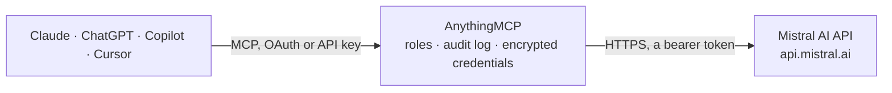

<!-- Generated by scripts/export-github-catalog.mjs in the anythingmcp-website repository. Do not edit by hand. -->

# Mistral AI MCP connector

Let your AI use Mistral AI with your own API key: ask Mistral models, complete code with Codestral, read PDFs and scans with Mistral OCR, create embeddings, moderate content, search the web through … The AnythingMCP connector gives Claude, ChatGPT, Microsoft Copilot, Cursor and Gemini 23 MCP tools for Mistral AI: 18 read and 5 can change data.

**Category:** [Public Data](../data.md) · **Tools:** 23 · **Setup guide:** [anythingmcp.com](https://anythingmcp.com/guides/mistral-to-mcp) · [Deutsch](https://anythingmcp.com/de/guides/mistral-to-mcp) · [Italiano](https://anythingmcp.com/it/guides/mistral-to-mcp) · [Español](https://anythingmcp.com/es/guides/mistral-to-mcp) · [日本語](https://anythingmcp.com/ja/guides/mistral-to-mcp) · [Русский](https://anythingmcp.com/ru/guides/mistral-to-mcp) · [中文](https://anythingmcp.com/zh/guides/mistral-to-mcp)

## Start without code

No installation and no terminal: AnythingMCP Cloud runs the Mistral AI connector for you, operated by helpcode.ai in Frankfurt, Germany.

1. **Click the button above** and create an account or sign in. The Mistral AI connector opens, ready to install.
2. **Paste the API key or token from your Mistral AI account.** Every click is in the [step-by-step guide](https://anythingmcp.com/guides/mistral-to-mcp).
3. **Click Install.** AnythingMCP shows the address of your MCP server.
4. **Add that address to your assistant:** [Claude](https://anythingmcp.com/guides/connect-mistral-to-claude) · [ChatGPT](https://anythingmcp.com/guides/connect-mistral-to-chatgpt) · [Microsoft Copilot](https://anythingmcp.com/guides/connect-mistral-to-copilot) · [Cursor](https://anythingmcp.com/guides/connect-mistral-to-cursor) · [Gemini CLI](https://anythingmcp.com/guides/connect-mistral-to-gemini) · [Meta Muse](https://anythingmcp.com/guides/connect-mistral-to-muse).
5. **Ask your first question**, for example: *Locate the PDF invoice file for customer SolTek Ltd, invoice number INV-2026-1142*

Prefer help with the setup? [Talk to us](https://anythingmcp.com/contact).

## How it works

- **The AI client** speaks MCP (Streamable HTTP) to AnythingMCP and only sees tool names, descriptions and results. It never gets the Mistral AI credentials.
- **AnythingMCP** checks the client's role, builds the call from the tool definition, adds the credentials (a bearer token), calls Mistral AI, logs the call and returns the result.
- **Mistral AI** sees an ordinary API client with the rights of the account the credentials belong to.

## Tools

| Tool | What it does | Access |
|---|---|---|
| [`mistral_list_models`](#mistral_list_models) | List the Mistral models the API key can use, with id, description, context length, capabilities (chat, function calling, reasoning, vision, OCR, FIM,… | read |
| [`mistral_get_model`](#mistral_get_model) | Get one Mistral model by id or alias (e.g. mistral-small-latest) with its capabilities, context length, aliases and deprecation date. | read |
| [`mistral_chat`](#mistral_chat) | Ask a Mistral model and get its answer (chat completions, no streaming). | read |
| [`mistral_fim_complete`](#mistral_fim_complete) | Fill in the middle of code with Codestral: give the code before the gap as prompt and, optionally, the code after it as suffix, and get the code that goes… | read |
| [`mistral_create_embeddings`](#mistral_create_embeddings) | Turn one text, or a list of texts, into embedding vectors for semantic search, clustering or similarity. | read |
| [`mistral_moderate`](#mistral_moderate) | Check one text or a list of texts against Mistral's moderation categories (sexual, hate and discrimination, violence and threats, dangerous and criminal… | read |
| [`mistral_moderate_chat`](#mistral_moderate_chat) | Check a whole conversation with Mistral's moderation model, judging the last message in its context, e.g. whether an assistant reply is harmful given the… | read |
| [`mistral_classify`](#mistral_classify) | Classify one text or a list of texts with a custom Mistral classifier model the workspace already has (its id starts with ft:). | read |
| [`mistral_ocr`](#mistral_ocr) | Read a PDF, a slide deck or an image with Mistral OCR and get each page as Markdown (tables, headers and footers optional), from a public link or an… | read |
| [`mistral_start_conversation`](#mistral_start_conversation) | Start a conversation with a Mistral model or agent through the Conversations API (beta), which can use Mistral's built-in tools, e.g. tools [{"type":… | write |
| [`mistral_continue_conversation`](#mistral_continue_conversation) | Add a user message to a stored Mistral conversation and get the next answer (Conversations API, beta). | write |
| [`mistral_list_conversations`](#mistral_list_conversations) | List the stored Mistral conversations of the workspace (Conversations API, beta), newest first, with id, name, model or agent and dates. | read |
| [`mistral_get_conversation_messages`](#mistral_get_conversation_messages) | Read the messages of a stored Mistral conversation (user and assistant turns, Conversations API, beta). | read |
| [`mistral_list_agents`](#mistral_list_agents) | List the Mistral agents of the workspace (Agents API, beta) with id, name, model, description and version. | read |
| [`mistral_get_agent`](#mistral_get_agent) | Get one Mistral agent (Agents API, beta) with its model, instructions, tools, completion settings and versions. | read |
| [`mistral_list_files`](#mistral_list_files) | List the files stored in the Mistral workspace (for OCR, batch jobs or fine-tuning) with id, name, purpose, size and dates. | read |
| [`mistral_get_file`](#mistral_get_file) | Get the details of one file in the Mistral workspace: name, purpose, size, type, dates. | read |
| [`mistral_get_file_url`](#mistral_get_file_url) | Get a temporary signed download link for a file in the Mistral workspace, e.g. the output file of a batch job. | read |
| [`mistral_upload_file`](#mistral_upload_file) | Upload a file to the Mistral workspace from a public link, e.g. a PDF for mistral_ocr (purpose ocr) or a JSONL file of requests for a batch job (purpose batch). | write |
| [`mistral_delete_file`](#mistral_delete_file) | Delete a file from the Mistral workspace. | write |
| [`mistral_list_batch_jobs`](#mistral_list_batch_jobs) | List the Mistral batch jobs of the workspace, newest first, with status (QUEUED, RUNNING, SUCCESS, FAILED, TIMEOUT_EXCEEDED, CANCELLATION_REQUESTED,… | read |
| [`mistral_get_batch_job`](#mistral_get_batch_job) | Get one Mistral batch job with status, progress counts, errors and the output_file id (download it with mistral_get_file_url). | read |
| [`mistral_cancel_batch_job`](#mistral_cancel_batch_job) | Ask Mistral to cancel a batch job that is queued or running. | write |

## Tool reference

Every parameter as the AI client sees it in `tools/list`. Source: [`packages/backend/src/adapters/intl/mistral.json`](../../../packages/backend/src/adapters/intl/mistral.json).

### `mistral_list_models`

List the Mistral models the API key can use, with id, description, context length, capabilities (chat, function calling, reasoning, vision, OCR, FIM, moderation, audio), aliases and deprecation date. Free. Read-only.

**Access:** read · **Call:** `GET /models`

No parameters.

### `mistral_get_model`

Get one Mistral model by id or alias (e.g. mistral-small-latest) with its capabilities, context length, aliases and deprecation date. Free. Read-only.

**Access:** read · **Call:** `GET /models/{model_id}`

| Parameter | Type | Required | Description |
|---|---|---|---|
| `model_id` | string | yes | Model id or alias, e.g. mistral-small-latest. |

### `mistral_chat`

Ask a Mistral model and get its answer (chat completions, no streaming). Billed per token to the user's Mistral account; the default mistral-small-latest costs about $0.15 per million input and $0.60 per million output tokens. Returns answer, finish_reason (length means it was cut: raise max_tokens), usage and any tool_calls. Read-only: it changes nothing in the account.

**Access:** read · **Call:** `POST /chat/completions`

| Parameter | Type | Required | Description |
|---|---|---|---|
| `messages` | object[] | yes | The conversation as a list of messages, e.g. [{"role": "system", "content": "Answer in German."}, {"role": "user", "content": "Summarise this text: ..."}]. Roles: system, user, assistant. For a picture, a user message can carry content [{"type": "text", "text": "What is this?"}, {"type": "image_url", "image_url": "https://..."}] (vision models such as mistral-small-latest). |
| `model` | string | no | Model id. Default mistral-small-latest (cheap, 256k context, vision). mistral-medium-latest or mistral-large-latest for harder work, ministral-8b-latest for the cheapest, codestral-latest for code. Others: mistral_list_models. |
| `max_tokens` | integer | no | Upper limit for the answer in tokens. Model default when left out. |
| `temperature` | number | no | Randomness from 0 to 1.5; Mistral recommends 0 to 0.7. Model default when left out. |
| `reasoning_effort` | `none` \| `minimal` \| `low` \| `medium` \| `high` \| `xhigh` | no | Thinking before answering, on models that support it (mistral-small-latest, mistral-medium-latest). Higher is slower and uses more output tokens. Leave out for a direct answer. |
| `response_format` | object | no | For JSON output: {"type": "json_object"}, or {"type": "json_schema", "json_schema": {"name": "invoice", "schema": {...}, "strict": true}}. |
| `stop` | string,array | no | Stop generating at this text, or at any of a list of texts. |
| `random_seed` | integer | no | Seed for reproducible answers. |
| `tools` | any[] | no | Function definitions the model may call, e.g. [{"type": "function", "function": {"name": "get_weather", "parameters": {...}}}]. The connector does not run them: the answer then lists tool_calls. Web search is not available here; use mistral_start_conversation. |
| `tool_choice` | string,object | no | auto, none, any or required, or {"type": "function", "function": {"name": "..."}}. |

### `mistral_fim_complete`

Fill in the middle of code with Codestral: give the code before the gap as prompt and, optionally, the code after it as suffix, and get the code that goes in between. Billed per token to the user's Mistral account (codestral-latest about $0.30 per million input and $0.90 per million output tokens). Returns answer, finish_reason and usage. Read-only.

**Access:** read · **Call:** `POST /fim/completions`

| Parameter | Type | Required | Description |
|---|---|---|---|
| `prompt` | string | yes | The code before the gap. |
| `suffix` | string | no | The code after the gap, so the completion fits in between. |
| `model` | string | no | FIM model. Default codestral-latest. |
| `max_tokens` | integer | no | Upper limit for the completion in tokens. Default 256. |
| `min_tokens` | integer | no | Minimum tokens to generate. |
| `temperature` | number | no | Randomness from 0 to 1.5. Low values (0 to 0.2) suit code. |
| `stop` | string,array | no | Stop at this text, or at any of a list of texts, e.g. "\n\n". |

### `mistral_create_embeddings`

Turn one text, or a list of texts, into embedding vectors for semantic search, clustering or similarity. Default mistral-embed (1024 dimensions, about $0.10 per million input tokens); codestral-embed for code, which also takes output_dimension. Billed per token to the user's Mistral account. Read-only.

**Access:** read · **Call:** `POST /embeddings`

| Parameter | Type | Required | Description |
|---|---|---|---|
| `input` | string,array | yes | A text, or a list of texts. |
| `model` | string | no | Embedding model: mistral-embed (default) or codestral-embed. |
| `output_dimension` | integer | no | Vector length, codestral-embed only (e.g. 256 for smaller answers). |
| `output_dtype` | `float` \| `int8` \| `uint8` \| `binary` \| `ubinary` | no | Number type of the vector, codestral-embed only. Default float. |

### `mistral_moderate`

Check one text or a list of texts against Mistral's moderation categories (sexual, hate and discrimination, violence and threats, dangerous and criminal content, self-harm, health, financial, law, PII, jailbreaking). Returns per text the categories flagged true and a score per category. Billed per token to the user's Mistral account at a very low rate. Read-only.

**Access:** read · **Call:** `POST /moderations`

| Parameter | Type | Required | Description |
|---|---|---|---|
| `input` | string,array | yes | A text, or a list of texts. |
| `model` | string | no | Moderation model. Default mistral-moderation-latest. |

### `mistral_moderate_chat`

Check a whole conversation with Mistral's moderation model, judging the last message in its context, e.g. whether an assistant reply is harmful given the user's question. Returns categories and scores. Billed per token to the user's Mistral account at a very low rate. Read-only.

**Access:** read · **Call:** `POST /chat/moderations`

| Parameter | Type | Required | Description |
|---|---|---|---|
| `messages` | object[] | yes | The conversation, e.g. [{"role": "user", "content": "..."}, {"role": "assistant", "content": "..."}]. |
| `model` | string | no | Moderation model. Default mistral-moderation-latest. |

### `mistral_classify`

Classify one text or a list of texts with a custom Mistral classifier model the workspace already has (its id starts with ft:). Returns the scores per label. Billed per token to the user's Mistral account. For content safety use mistral_moderate instead. Read-only.

**Access:** read · **Call:** `POST /classifications`

| Parameter | Type | Required | Description |
|---|---|---|---|
| `model` | string | yes | The classifier model id, e.g. ft:classifier:ministral-3b-latest:abc123:20250101:xyz (see mistral_list_models). |
| `input` | string,array | yes | A text, or a list of texts. |

### `mistral_ocr`

Read a PDF, a slide deck or an image with Mistral OCR and get each page as Markdown (tables, headers and footers optional), from a public link or an uploaded file. COSTS MONEY per page, billed to the user's Mistral account: mistral-ocr-latest about $4 per 1,000 pages ($5 with annotations). For documents over about 50 pages, confirm with the user first or pass pages. Returns pages with index and markdown, tables when table_format is set, and usage_info.pages_processed. Read-only.

**Access:** read · **Call:** `POST /ocr`

| Parameter | Type | Required | Description |
|---|---|---|---|
| `document` | object | yes | What to read, one of: {"type": "document_url", "document_url": "https://.../file.pdf"} for a PDF, PPTX or DOCX by public link; {"type": "image_url", "image_url": "https://.../scan.png"} for an image; {"type": "file", "file_id": "<uuid>"} for a file uploaded with purpose ocr (mistral_upload_file). |
| `model` | string | no | OCR model. Default mistral-ocr-latest. |
| `pages` | string,array | no | Only these pages, 0-based: "0-4", "0,2,5" or [0, 1, 2]. All pages when left out. |
| `table_format` | `markdown` \| `html` | no | Return tables separately in this format (the page markdown then holds a placeholder). Tables stay inline in the markdown when left out. |
| `extract_header` | boolean | no | Move page headers out of the markdown into header. |
| `extract_footer` | boolean | no | Move page footers out of the markdown into footer. |
| `include_blocks` | boolean | no | Also return paragraph bounding boxes. Default false, which keeps the answer small. |
| `document_annotation_format` | object | no | Structured extraction from the whole document: {"type": "json_schema", "json_schema": {"name": "invoice", "schema": {...}}}. The result comes back in document_annotation (annotated pages cost more). |
| `document_annotation_prompt` | string | no | Extra guidance for document_annotation_format. |

### `mistral_start_conversation`

Start a conversation with a Mistral model or agent through the Conversations API (beta), which can use Mistral's built-in tools, e.g. tools [{"type": "web_search"}] to answer from the web. Billed per token to the user's Mistral account, and each built-in tool call (web search, code interpreter, image generation) is billed on top. Returns conversation_id, answer, sources (web results used), tool_calls and usage. Continue with mistral_continue_conversation.

**Access:** write · **Call:** `POST /conversations`

| Parameter | Type | Required | Description |
|---|---|---|---|
| `inputs` | string,array | yes | The user message as text, or a list of entries such as [{"role": "user", "content": "..."}]. |
| `model` | string | no | Model id when no agent_id is given. Default mistral-small-latest. Leave agent_id empty when you set a model. |
| `agent_id` | string | no | Talk to an existing agent (mistral_list_agents) instead of a plain model. The model default is then ignored. |
| `instructions` | string | no | System instructions: role, tone, language, format. Not with agent_id. |
| `tools` | any[] | no | Built-in tools: [{"type": "web_search"}], [{"type": "web_search_premium"}] (adds news agencies), [{"type": "code_interpreter"}], [{"type": "image_generation"}], [{"type": "document_library", "library_ids": ["..."]}]. Each tool call is billed. Not with agent_id. |
| `completion_args` | object | no | Generation settings, e.g. {"temperature": 0.3, "max_tokens": 1000, "reasoning_effort": "low"}. |
| `store` | boolean | no | Keep the conversation at Mistral so it can be continued and listed. Default true; false for a one-off answer that cannot be continued. |
| `name` | string | no | Optional name for the conversation. |

### `mistral_continue_conversation`

Add a user message to a stored Mistral conversation and get the next answer (Conversations API, beta). Billed per token to the user's Mistral account, plus any built-in tool calls. Returns conversation_id, answer, sources, tool_calls and usage.

**Access:** write · **Call:** `POST /conversations/{conversation_id}`

| Parameter | Type | Required | Description |
|---|---|---|---|
| `conversation_id` | string | yes | The conversation_id from mistral_start_conversation or mistral_list_conversations. |
| `inputs` | string,array | yes | The next user message as text, or a list of entries. |
| `completion_args` | object | no | Generation settings for this turn, e.g. {"max_tokens": 800}. |
| `store` | boolean | no | Keep this turn at Mistral. Default true. |

### `mistral_list_conversations`

List the stored Mistral conversations of the workspace (Conversations API, beta), newest first, with id, name, model or agent and dates. Free. Read-only.

**Access:** read · **Call:** `GET /conversations`

| Parameter | Type | Required | Description |
|---|---|---|---|
| `page` | integer | no | Page number, starting at 0. |
| `page_size` | integer | no | Conversations per page. Default 20. |

### `mistral_get_conversation_messages`

Read the messages of a stored Mistral conversation (user and assistant turns, Conversations API, beta). Free. Read-only.

**Access:** read · **Call:** `GET /conversations/{conversation_id}/messages`

| Parameter | Type | Required | Description |
|---|---|---|---|
| `conversation_id` | string | yes | The conversation id. |

### `mistral_list_agents`

List the Mistral agents of the workspace (Agents API, beta) with id, name, model, description and version. Pass page_token from next_page_token to page on. Free. Read-only.

**Access:** read · **Call:** `GET /agents/pages`

| Parameter | Type | Required | Description |
|---|---|---|---|
| `search` | string | no | Find agents whose name or id contains this text. |
| `page_size` | integer | no | Agents per page. Default 20. |
| `page_token` | string | no | next_page_token from the previous page. |

### `mistral_get_agent`

Get one Mistral agent (Agents API, beta) with its model, instructions, tools, completion settings and versions. Free. Read-only.

**Access:** read · **Call:** `GET /agents/{agent_id}`

| Parameter | Type | Required | Description |
|---|---|---|---|
| `agent_id` | string | yes | The agent id, e.g. ag_0123... |
| `agent_version` | integer,string | no | A specific version number or alias. Latest when left out. |

### `mistral_list_files`

List the files stored in the Mistral workspace (for OCR, batch jobs or fine-tuning) with id, name, purpose, size and dates. Free. Read-only.

**Access:** read · **Call:** `GET /files`

| Parameter | Type | Required | Description |
|---|---|---|---|
| `purpose` | `ocr` \| `batch` \| `fine-tune` \| `agentic_safety` | no | Only files with this purpose. |
| `search` | string | no | Only files whose name contains this text. |
| `page` | integer | no | Page number, starting at 0. |
| `page_size` | integer | no | Files per page. Default 20. |

### `mistral_get_file`

Get the details of one file in the Mistral workspace: name, purpose, size, type, dates. Free. Read-only.

**Access:** read · **Call:** `GET /files/{file_id}`

| Parameter | Type | Required | Description |
|---|---|---|---|
| `file_id` | string | yes | File id (a UUID). |

### `mistral_get_file_url`

Get a temporary signed download link for a file in the Mistral workspace, e.g. the output file of a batch job. Anyone with the link can download the file until it expires, so share it only with the user. Free.

**Access:** read · **Call:** `GET /files/{file_id}/url`

| Parameter | Type | Required | Description |
|---|---|---|---|
| `file_id` | string | yes | File id (a UUID). |
| `expiry` | integer | no | Hours until the link expires, 1 to 168. Default 1. |

### `mistral_upload_file`

Upload a file to the Mistral workspace from a public link, e.g. a PDF for mistral_ocr (purpose ocr) or a JSONL file of requests for a batch job (purpose batch). The connector downloads the link (up to 10 MB) and sends the file. Storing is free; using the file (OCR, batch) is billed. Confirm with the user before uploading their documents. Returns the file id.

**Access:** write · **Call:** `POST /files`

| Parameter | Type | Required | Description |
|---|---|---|---|
| `file_url` | string | yes | Public HTTPS link to the file. |
| `purpose` | `ocr` \| `batch` \| `fine-tune` | no | What the file is for. Default ocr. |
| `expiry` | integer | no | Optional lifetime of the file in hours; it is deleted afterwards. |

### `mistral_delete_file`

Delete a file from the Mistral workspace. It cannot be restored, and batch jobs or agents that use it lose it. Confirm with the user first. Installed switched off.

**Access:** write · **Call:** `DELETE /files/{file_id}`

| Parameter | Type | Required | Description |
|---|---|---|---|
| `file_id` | string | yes | File id (a UUID). |

### `mistral_list_batch_jobs`

List the Mistral batch jobs of the workspace, newest first, with status (QUEUED, RUNNING, SUCCESS, FAILED, TIMEOUT_EXCEEDED, CANCELLATION_REQUESTED, CANCELLED), endpoint, model, request counts and output file. Free. Read-only.

**Access:** read · **Call:** `GET /batch/jobs`

| Parameter | Type | Required | Description |
|---|---|---|---|
| `status` | `QUEUED` \| `RUNNING` \| `SUCCESS` \| `FAILED` \| `TIMEOUT_EXCEEDED` \| `CANCELLATION_REQUESTED` \| `CANCELLED`[] | no | Only jobs with these statuses. |
| `model` | string | no | Only jobs for this model. |
| `created_after` | string | no | Only jobs created after this time, ISO 8601. |
| `created_by_me` | boolean | no | Only jobs created with this API key's user. |
| `page` | integer | no | Page number, starting at 0. |
| `page_size` | integer | no | Jobs per page. Default 20. |

### `mistral_get_batch_job`

Get one Mistral batch job with status, progress counts, errors and the output_file id (download it with mistral_get_file_url). Free. Read-only.

**Access:** read · **Call:** `GET /batch/jobs/{job_id}`

| Parameter | Type | Required | Description |
|---|---|---|---|
| `job_id` | string | yes | Batch job id (a UUID). |

### `mistral_cancel_batch_job`

Ask Mistral to cancel a batch job that is queued or running. Requests already processed are still billed; the rest are dropped and the job cannot be resumed. Confirm with the user first: the job may belong to another application or teammate. Installed switched off.

**Access:** write · **Call:** `POST /batch/jobs/{job_id}/cancel`

| Parameter | Type | Required | Description |
|---|---|---|---|
| `job_id` | string | yes | Batch job id (a UUID). |

## Run it yourself

AnythingMCP is open source (AGPL-3.0). [Run it with Docker](../../../README.md#run-it-yourself), open **Connectors → Store**, pick **Mistral AI** and enter `MISTRAL_API_KEY`, then add your MCP server URL to the AI client.

[← Public Data connectors](../data.md) · [All categories](../README.md)
