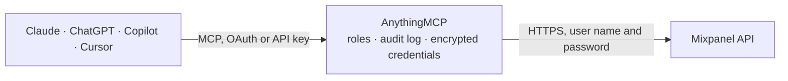

<!-- Generated by scripts/export-github-catalog.mjs in the anythingmcp-website repository. Do not edit by hand. -->

# Mixpanel MCP connector

Let your AI read your Mixpanel product analytics: event trends, segmentation by any property, saved funnels, retention, frequency, saved Insights reports, cohorts and user profiles, and manage chart annotations. The AnythingMCP connector gives Claude, ChatGPT, Microsoft Copilot, Cursor and Gemini 23 MCP tools for Mixpanel: 20 read and 3 can change data.

**Category:** [Analytics](../analytics.md) · **Tools:** 23 · **Setup guide:** [anythingmcp.com](https://anythingmcp.com/guides/mixpanel-to-mcp) · [Deutsch](https://anythingmcp.com/de/guides/mixpanel-to-mcp) · [Italiano](https://anythingmcp.com/it/guides/mixpanel-to-mcp) · [Español](https://anythingmcp.com/es/guides/mixpanel-to-mcp) · [日本語](https://anythingmcp.com/ja/guides/mixpanel-to-mcp) · [Русский](https://anythingmcp.com/ru/guides/mixpanel-to-mcp) · [中文](https://anythingmcp.com/zh/guides/mixpanel-to-mcp)

## Start without code

No installation and no terminal: AnythingMCP Cloud runs the Mixpanel connector for you, operated by helpcode.ai in Frankfurt, Germany.

1. **Click the button above** and create an account or sign in. The Mixpanel connector opens, ready to install.
2. **Paste the API key or token from your Mixpanel account.** Every click is in the [step-by-step guide](https://anythingmcp.com/guides/mixpanel-to-mcp).
3. **Click Install.** AnythingMCP shows the address of your MCP server.
4. **Add that address to your assistant:** [Claude](https://anythingmcp.com/guides/connect-mixpanel-to-claude) · [ChatGPT](https://anythingmcp.com/guides/connect-mixpanel-to-chatgpt) · [Microsoft Copilot](https://anythingmcp.com/guides/connect-mixpanel-to-copilot) · [Cursor](https://anythingmcp.com/guides/connect-mixpanel-to-cursor) · [Gemini CLI](https://anythingmcp.com/guides/connect-mixpanel-to-gemini) · [Meta Muse](https://anythingmcp.com/guides/connect-mixpanel-to-muse).
5. **Ask your first question**, for example: *Show the Mixpanel profile for distinct_id user_789 so I can see email, last_seen and plan.*

Prefer help with the setup? [Talk to us](https://anythingmcp.com/contact).

## How it works

- **The AI client** speaks MCP (Streamable HTTP) to AnythingMCP and only sees tool names, descriptions and results. It never gets the Mixpanel credentials.
- **AnythingMCP** checks the client's role, builds the call from the tool definition, adds the credentials (user name and password), calls Mixpanel, logs the call and returns the result.
- **Mixpanel** sees an ordinary API client with the rights of the account the credentials belong to.

## Tools

| Tool | What it does | Access |
|---|---|---|
| [`mixpanel_list_event_names`](#mixpanel_list_event_names) | List the names of the most common events in the project over the last 31 days, as a plain array of strings. | read |
| [`mixpanel_get_top_events`](#mixpanel_get_top_events) | Get today's top events with their count (amount) and percent_change against yesterday, under events, plus the counting type. | read |
| [`mixpanel_get_event_counts`](#mixpanel_get_event_counts) | Count one or more events per minute, hour, day, week or month over a date range. | read |
| [`mixpanel_get_top_event_properties`](#mixpanel_get_top_event_properties) | List the most used property names of one event with how many events carry each, as an object of property name to {count}. | read |
| [`mixpanel_get_top_property_values`](#mixpanel_get_top_property_values) | List the most common values of one property of one event, as a plain array of strings (e.g. the browsers or plans seen). | read |
| [`mixpanel_get_event_property_counts`](#mixpanel_get_event_property_counts) | Count one event broken down by the values of one of its properties, per unit over a date range. | read |
| [`mixpanel_query_segmentation`](#mixpanel_query_segmentation) | Segmentation: count one event over a date range, optionally filtered with where and broken down with on. | read |
| [`mixpanel_query_segmentation_numeric`](#mixpanel_query_segmentation_numeric) | Segmentation into numeric buckets: count one event per day or hour, grouped into ranges of a numeric property expression (e.g. order amount 0 to 50, 50 to 100). | read |
| [`mixpanel_query_segmentation_sum`](#mixpanel_query_segmentation_sum) | Sum a numeric expression over the events of one type per day or hour, e.g. revenue per day from properties["amount"]. | read |
| [`mixpanel_query_segmentation_average`](#mixpanel_query_segmentation_average) | Average a numeric expression over the events of one type per day or hour, e.g. the average order value from properties["amount"]. | read |
| [`mixpanel_list_funnels`](#mixpanel_list_funnels) | List the saved funnels of the project with funnel_id and name. | read |
| [`mixpanel_query_funnel`](#mixpanel_query_funnel) | Get the conversion data of a saved funnel over a date range: meta.dates and, per date, steps (count, step_conv_ratio, overall_conv_ratio, avg_time, event)… | read |
| [`mixpanel_query_retention`](#mixpanel_query_retention) | Retention: of the users who did born_event (first-time, "birth") or any event (recurring, "compounded") in each cohort date, how many came back per interval. | read |
| [`mixpanel_query_frequency`](#mixpanel_query_frequency) | Frequency (addiction): how often users do an event within each day, week or month, counted per hour or per day. | read |
| [`mixpanel_query_insights_report`](#mixpanel_query_insights_report) | Run a saved Insights report and return what it shows: computed_at, date_range, headers and series (metric name to date to value). | read |
| [`mixpanel_list_cohorts`](#mixpanel_list_cohorts) | List the saved cohorts of the project with id, name, description, count (members now), created and is_visible. | read |
| [`mixpanel_query_profiles`](#mixpanel_query_profiles) | Read user profiles (or group profiles with data_group_id): one, a list of distinct ids, those matching a where expression, or the members of a cohort. | read |
| [`mixpanel_list_annotations`](#mixpanel_list_annotations) | List the annotations of the project (notes pinned to a date on charts), optionally within a date range. | read |
| [`mixpanel_get_annotation`](#mixpanel_get_annotation) | Read one annotation by id: results with id, date, description, user (who added it) and tags. | read |
| [`mixpanel_list_annotation_tags`](#mixpanel_list_annotation_tags) | List the tags used on annotations with id, name and has_annotations. | read |
| [`mixpanel_create_annotation`](#mixpanel_create_annotation) | Add an annotation to the project: a note pinned to a date and time that every chart of the project shows to all its users. | write |
| [`mixpanel_update_annotation`](#mixpanel_update_annotation) | Change the description or tags of an existing annotation (the date cannot be changed). | write |
| [`mixpanel_delete_annotation`](#mixpanel_delete_annotation) | Delete an annotation for everyone in the project; it cannot be restored. | write |

## Tool reference

Every parameter as the AI client sees it in `tools/list`. Source: [`packages/backend/src/adapters/intl/mixpanel.json`](../../../packages/backend/src/adapters/intl/mixpanel.json).

### `mixpanel_list_event_names`

List the names of the most common events in the project over the last 31 days, as a plain array of strings. A cheap first call to learn which event names exist; a project without events returns an empty list.

**Access:** read · **Call:** `GET /api/query/events/names`

| Parameter | Type | Required | Description |
|---|---|---|---|
| `type` | `general` \| `unique` \| `average` | no | general counts every event (default), unique counts distinct users, average gives events per user. |
| `limit` | integer | no | Maximum number of names to return. Mixpanel defaults to 255. |

### `mixpanel_get_top_events`

Get today's top events with their count (amount) and percent_change against yesterday, under events, plus the counting type. A project without events today returns an empty events list.

**Access:** read · **Call:** `GET /api/query/events/top`

| Parameter | Type | Required | Description |
|---|---|---|---|
| `type` | `general` \| `unique` \| `average` | no | general counts every event (default), unique counts distinct users, average gives events per user. |
| `limit` | integer | no | Maximum number of events to return. Mixpanel defaults to 100. |

### `mixpanel_get_event_counts`

Count one or more events per minute, hour, day, week or month over a date range. Returns data.series (the dates) and data.values (event name to date to count) with legend_size. Events without data come back with zero or empty values.

**Access:** read · **Call:** `GET /api/query/events`

| Parameter | Type | Required | Description |
|---|---|---|---|
| `events` | string | yes | The events as a JSON array of names, e.g. ["Sign Up", "Purchase"]. A single event is ["Sign Up"]. |
| `type` | `general` \| `unique` \| `average` | no | general counts every event (default), unique counts distinct users, average gives events per user. |
| `unit` | `minute` \| `hour` \| `day` \| `week` \| `month` | no | Bucket size of the series: minute, hour, day (default), week or month. Unique counts cannot be hourly. |
| `from_date` | string | yes | First day of the range, inclusive, as YYYY-MM-DD in the project's time zone. |
| `to_date` | string | yes | Last day of the range, inclusive, as YYYY-MM-DD in the project's time zone. |

### `mixpanel_get_top_event_properties`

List the most used property names of one event with how many events carry each, as an object of property name to {count}. Use it before a breakdown to find the right property; an event without data returns an empty object.

**Access:** read · **Call:** `GET /api/query/events/properties/top`

| Parameter | Type | Required | Description |
|---|---|---|---|
| `event` | string | yes | Exact event name as tracked, e.g. "Sign Up" (case-sensitive). mixpanel_list_event_names lists the names. |
| `limit` | integer | no | Maximum number of properties to return. Mixpanel defaults to 10. |

### `mixpanel_get_top_property_values`

List the most common values of one property of one event, as a plain array of strings (e.g. the browsers or plans seen). Useful to write an exact where filter; returns an empty list when the property was never set.

**Access:** read · **Call:** `GET /api/query/events/properties/values`

| Parameter | Type | Required | Description |
|---|---|---|---|
| `event` | string | yes | Exact event name as tracked, e.g. "Sign Up" (case-sensitive). mixpanel_list_event_names lists the names. |
| `name` | string | yes | Property name, e.g. "$browser" or "plan". mixpanel_get_top_event_properties lists them. |
| `limit` | integer | no | Maximum number of values to return. Mixpanel defaults to 255. |

### `mixpanel_get_event_property_counts`

Count one event broken down by the values of one of its properties, per unit over a date range. Returns data.series (dates) and data.values (property value to date to count) with legend_size; empty values when nothing matched.

**Access:** read · **Call:** `GET /api/query/events/properties`

| Parameter | Type | Required | Description |
|---|---|---|---|
| `event` | string | yes | Exact event name as tracked, e.g. "Sign Up" (case-sensitive). mixpanel_list_event_names lists the names. |
| `name` | string | yes | Property to break the event down by, e.g. "$browser" or "plan". |
| `values` | string | no | Optional JSON array of the property values to keep, e.g. ["pro", "team"]. Without it the most common values are returned. |
| `type` | `general` \| `unique` \| `average` | no | general counts every event (default), unique counts distinct users, average gives events per user. |
| `unit` | `minute` \| `hour` \| `day` \| `week` \| `month` | no | Bucket size of the series: minute, hour, day (default), week or month. |
| `from_date` | string | yes | First day of the range, inclusive, as YYYY-MM-DD in the project's time zone. |
| `to_date` | string | yes | Last day of the range, inclusive, as YYYY-MM-DD in the project's time zone. |
| `limit` | integer | no | Maximum number of property values. Mixpanel defaults to 255. |

### `mixpanel_query_segmentation`

Segmentation: count one event over a date range, optionally filtered with where and broken down with on. Returns data.series (the dates) and data.values (segment or event name to date to count) with legend_size; empty values when nothing matched.

**Access:** read · **Call:** `GET /api/query/segmentation`

| Parameter | Type | Required | Description |
|---|---|---|---|
| `event` | string | yes | Exact event name as tracked, e.g. "Sign Up" (case-sensitive). mixpanel_list_event_names lists the names. |
| `from_date` | string | yes | First day of the range, inclusive, as YYYY-MM-DD in the project's time zone. |
| `to_date` | string | yes | Last day of the range, inclusive, as YYYY-MM-DD in the project's time zone. |
| `on` | string | no | Optional property expression to break the results down by, e.g. properties["$country_code"]. Each distinct value becomes its own series. |
| `where` | string | no | Optional filter expression, e.g. properties["$browser"] == "Chrome" or properties["plan"] == "pro" and properties["amount"] >= 50. Syntax in the connector instructions. |
| `unit` | `minute` \| `hour` \| `day` \| `month` | no | Bucket size: minute, hour, day (Mixpanel default) or month. |
| `interval` | integer | no | Optional number of days per bucket, instead of unit. |
| `type` | `general` \| `unique` \| `average` | no | general counts every event (default), unique counts distinct users, average gives events per user. |
| `limit` | integer | no | With on: how many top segment values to return. Mixpanel defaults to 60, at most 10000. |

### `mixpanel_query_segmentation_numeric`

Segmentation into numeric buckets: count one event per day or hour, grouped into ranges of a numeric property expression (e.g. order amount 0 to 50, 50 to 100). Returns data.series and data.values (range to date to count); empty when nothing matched.

**Access:** read · **Call:** `GET /api/query/segmentation/numeric`

| Parameter | Type | Required | Description |
|---|---|---|---|
| `event` | string | yes | Exact event name as tracked, e.g. "Sign Up" (case-sensitive). mixpanel_list_event_names lists the names. |
| `from_date` | string | yes | First day of the range, inclusive, as YYYY-MM-DD in the project's time zone. |
| `to_date` | string | yes | Last day of the range, inclusive, as YYYY-MM-DD in the project's time zone. |
| `on` | string | yes | Numeric property expression to bucket on, e.g. number(properties["amount"]). |
| `where` | string | no | Optional filter expression, e.g. properties["$browser"] == "Chrome" or properties["plan"] == "pro" and properties["amount"] >= 50. Syntax in the connector instructions. |
| `unit` | `hour` \| `day` | no | Bucket size of the series: hour or day (Mixpanel default). |
| `type` | `general` \| `unique` \| `average` | no | general counts every event (default), unique counts distinct users, average gives events per user. |

### `mixpanel_query_segmentation_sum`

Sum a numeric expression over the events of one type per day or hour, e.g. revenue per day from properties["amount"]. Returns results (date to sum), status and computed_at; non-numeric values count as 0 and an empty range returns empty results.

**Access:** read · **Call:** `GET /api/query/segmentation/sum`

| Parameter | Type | Required | Description |
|---|---|---|---|
| `event` | string | yes | Exact event name as tracked, e.g. "Sign Up" (case-sensitive). mixpanel_list_event_names lists the names. |
| `from_date` | string | yes | First day of the range, inclusive, as YYYY-MM-DD in the project's time zone. |
| `to_date` | string | yes | Last day of the range, inclusive, as YYYY-MM-DD in the project's time zone. |
| `on` | string | yes | Numeric expression to add up, e.g. properties["amount"] or number(properties["price"]) * number(properties["quantity"]). |
| `where` | string | no | Optional filter expression, e.g. properties["$browser"] == "Chrome" or properties["plan"] == "pro" and properties["amount"] >= 50. Syntax in the connector instructions. |
| `unit` | `hour` \| `day` | no | Bucket size: hour or day (Mixpanel default). |

### `mixpanel_query_segmentation_average`

Average a numeric expression over the events of one type per day or hour, e.g. the average order value from properties["amount"]. Returns results (date to average) and status; an empty range returns empty results.

**Access:** read · **Call:** `GET /api/query/segmentation/average`

| Parameter | Type | Required | Description |
|---|---|---|---|
| `event` | string | yes | Exact event name as tracked, e.g. "Sign Up" (case-sensitive). mixpanel_list_event_names lists the names. |
| `from_date` | string | yes | First day of the range, inclusive, as YYYY-MM-DD in the project's time zone. |
| `to_date` | string | yes | Last day of the range, inclusive, as YYYY-MM-DD in the project's time zone. |
| `on` | string | yes | Numeric expression to average, e.g. properties["amount"]. |
| `where` | string | no | Optional filter expression, e.g. properties["$browser"] == "Chrome" or properties["plan"] == "pro" and properties["amount"] >= 50. Syntax in the connector instructions. |
| `unit` | `hour` \| `day` | no | Bucket size: hour or day (Mixpanel default). |

### `mixpanel_list_funnels`

List the saved funnels of the project with funnel_id and name. mixpanel_query_funnel needs one of these ids; a project without saved funnels returns an empty list.

**Access:** read · **Call:** `GET /api/query/funnels/list`

No parameters.

### `mixpanel_query_funnel`

Get the conversion data of a saved funnel over a date range: meta.dates and, per date, steps (count, step_conv_ratio, overall_conv_ratio, avg_time, event) and analysis (starting_amount, completion, worst step). Dates without traffic show zero counts.

**Access:** read · **Call:** `GET /api/query/funnels`

| Parameter | Type | Required | Description |
|---|---|---|---|
| `funnel_id` | integer | yes | Id of a saved funnel, from mixpanel_list_funnels. |
| `from_date` | string | yes | First day of the range, inclusive, as YYYY-MM-DD in the project's time zone. |
| `to_date` | string | yes | Last day of the range, inclusive, as YYYY-MM-DD in the project's time zone. |
| `length` | integer | no | Conversion window in length_unit units from the first step, at most 90 days. Defaults to the window saved with the funnel. |
| `length_unit` | `day` \| `hour` \| `minute` \| `second` | no | Unit of length: day, hour, minute or second. Defaults to the saved value. |
| `interval` | integer | no | Days per bucket (Mixpanel default 1). |
| `unit` | `day` \| `week` \| `month` | no | Bucket size instead of interval: day, week or month. |
| `on` | string | no | Optional property expression to break the results down by, e.g. properties["$country_code"]. Each distinct value becomes its own series. |
| `where` | string | no | Optional filter expression, e.g. properties["$browser"] == "Chrome" or properties["plan"] == "pro" and properties["amount"] >= 50. Syntax in the connector instructions. |
| `limit` | integer | no | With on: how many top segment values to return. Mixpanel defaults to 255, at most 10000. |

### `mixpanel_query_retention`

Retention: of the users who did born_event (first-time, "birth") or any event (recurring, "compounded") in each cohort date, how many came back per interval. Returns cohort date to {first, counts}; empty when nobody qualified.

**Access:** read · **Call:** `GET /api/query/retention`

| Parameter | Type | Required | Description |
|---|---|---|---|
| `from_date` | string | yes | First day of the range, inclusive, as YYYY-MM-DD in the project's time zone. |
| `to_date` | string | yes | Last day of the range, inclusive, as YYYY-MM-DD in the project's time zone. |
| `retention_type` | `birth` \| `compounded` | no | birth (first-time retention, Mixpanel default; needs born_event) or compounded (recurring retention). |
| `born_event` | string | no | With birth: the event that puts a user into a cohort, e.g. "Sign Up". |
| `event` | string | no | The event that counts as coming back. Without it any event counts. |
| `born_where` | string | no | Optional filter expression on born_event, e.g. properties["$os"] == "iOS". |
| `where` | string | no | Optional filter expression, e.g. properties["$browser"] == "Chrome" or properties["plan"] == "pro" and properties["amount"] >= 50. Syntax in the connector instructions. |
| `interval` | integer | no | Units per bucket (Mixpanel default 1); at most 90 when unit is day. |
| `interval_count` | integer | no | Number of buckets to return (Mixpanel default 1, plus bucket 0 for returns within the first interval). |
| `unit` | `day` \| `week` \| `month` | no | Bucket unit: day (Mixpanel default), week or month. |
| `unbounded_retention` | boolean | no | true counts a user as retained in bucket N when they came back in N or any later bucket. Default false. |
| `on` | string | no | Optional property expression to break the returning event down by. |
| `limit` | integer | no | With on: how many top segment values to return. |

### `mixpanel_query_frequency`

Frequency (addiction): how often users do an event within each day, week or month, counted per hour or per day. Returns data: per date, an array of user counts by number of active hours or days in the period; empty when there is no data.

**Access:** read · **Call:** `GET /api/query/retention/addiction`

| Parameter | Type | Required | Description |
|---|---|---|---|
| `from_date` | string | yes | First day of the range, inclusive, as YYYY-MM-DD in the project's time zone. |
| `to_date` | string | yes | Last day of the range, inclusive, as YYYY-MM-DD in the project's time zone. |
| `unit` | `day` \| `week` \| `month` | yes | Period each frequency is measured over: day, week or month. |
| `addiction_unit` | `hour` \| `day` | yes | Granularity counted inside the period: hour or day. |
| `event` | string | no | The event to measure. Without it any event counts. |
| `where` | string | no | Optional filter expression, e.g. properties["$browser"] == "Chrome" or properties["plan"] == "pro" and properties["amount"] >= 50. Syntax in the connector instructions. |
| `on` | string | no | Optional property expression to break the results down by. |
| `limit` | integer | no | With on: how many top segment values to return. |

### `mixpanel_query_insights_report`

Run a saved Insights report and return what it shows: computed_at, date_range, headers and series (metric name to date to value). Needs the report's bookmark id from its address; a report without data returns an empty series.

**Access:** read · **Call:** `GET /api/query/insights`

| Parameter | Type | Required | Description |
|---|---|---|---|
| `bookmark_id` | integer | yes | Id of the saved Insights report: the number after "report-" in the report address (editor-card-id=report-<id>), or after #report/ in older addresses. |

### `mixpanel_list_cohorts`

List the saved cohorts of the project with id, name, description, count (members now), created and is_visible. Read-only although Mixpanel serves it as a POST. Use an id with mixpanel_query_profiles to read the members; empty list when none.

**Access:** read · **Call:** `POST /api/query/cohorts/list`

No parameters.

### `mixpanel_query_profiles`

Read user profiles (or group profiles with data_group_id): one, a list of distinct ids, those matching a where expression, or the members of a cohort. Read-only although Mixpanel serves it as a POST. Returns results ($distinct_id, $properties), page, page_size, session_id and total; empty results when nothing matched.

**Access:** read · **Call:** `POST /api/query/engage`

| Parameter | Type | Required | Description |
|---|---|---|---|
| `distinct_id` | string | no | Read one profile by its distinct id. |
| `distinct_ids` | string | no | JSON array of distinct ids to read, e.g. ["u-1", "u-2"]. |
| `where` | string | no | Filter expression on profile properties, e.g. user["$email"] == "ana@example.com" or defined(user["plan"]). |
| `filter_by_cohort` | string | no | JSON object with the cohort id to read its members, e.g. {"id": 12345}. Cohort ids come from mixpanel_list_cohorts. |
| `include_all_users` | boolean | no | Only with filter_by_cohort: true (Mixpanel default) also returns cohort members without a profile, false only those with one. |
| `output_properties` | string | no | JSON array of the property names to return, e.g. ["$email", "$name", "plan"]. Strongly recommended: it keeps answers small and fast. |
| `data_group_id` | string | no | Group key id to read group profiles (e.g. companies) instead of user profiles. |
| `session_id` | string | no | session_id from the previous answer, to read the next page. |
| `page` | integer | no | Page number, starting at 0. A page above 0 needs the session_id of page 0 and the same filter. |

### `mixpanel_list_annotations`

List the annotations of the project (notes pinned to a date on charts), optionally within a date range. Returns results with id, date, description, user (who added it) and tags; empty results when there are none.

**Access:** read · **Call:** `GET /api/app/projects/{{MIXPANEL_PROJECT_ID}}/annotations`

| Parameter | Type | Required | Description |
|---|---|---|---|
| `from_date` | string | no | Optional first day, inclusive, as YYYY-MM-DD. |
| `to_date` | string | no | Optional last day, inclusive, as YYYY-MM-DD. |

### `mixpanel_get_annotation`

Read one annotation by id: results with id, date, description, user (who added it) and tags. Ids come from mixpanel_list_annotations.

**Access:** read · **Call:** `GET /api/app/projects/{{MIXPANEL_PROJECT_ID}}/annotations/{annotation_id}`

| Parameter | Type | Required | Description |
|---|---|---|---|
| `annotation_id` | integer | yes | Id of the annotation, from mixpanel_list_annotations. |

### `mixpanel_list_annotation_tags`

List the tags used on annotations with id, name and has_annotations. Tag ids go into the tags of mixpanel_create_annotation and mixpanel_update_annotation. Needs the Analyst role or higher; empty list when no tag exists.

**Access:** read · **Call:** `GET /api/app/projects/{{MIXPANEL_PROJECT_ID}}/annotations/tags`

No parameters.

### `mixpanel_create_annotation`

Add an annotation to the project: a note pinned to a date and time that every chart of the project shows to all its users. Confirm the text and date with the user first. Needs the Analyst role or higher. Returns the new annotation with its id.

**Access:** write · **Call:** `POST /api/app/projects/{{MIXPANEL_PROJECT_ID}}/annotations`

| Parameter | Type | Required | Description |
|---|---|---|---|
| `date` | string | yes | When it happened, as "YYYY-MM-DD HH:mm:ss", e.g. "2026-10-01 09:00:00". |
| `description` | string | yes | The note shown on the charts, e.g. "Pricing page relaunch". |
| `tags` | integer[] | no | Optional tag ids from mixpanel_list_annotation_tags. |

### `mixpanel_update_annotation`

Change the description or tags of an existing annotation (the date cannot be changed). Everyone in the project sees the change, so confirm it with the user first. Needs the Analyst role or higher. Returns the updated annotation.

**Access:** write · **Call:** `PATCH /api/app/projects/{{MIXPANEL_PROJECT_ID}}/annotations/{annotation_id}`

| Parameter | Type | Required | Description |
|---|---|---|---|
| `annotation_id` | integer | yes | Id of the annotation, from mixpanel_list_annotations. |
| `description` | string | no | New text of the note. |
| `tags` | integer[] | no | New full list of tag ids; replaces the current tags. |

### `mixpanel_delete_annotation`

Delete an annotation for everyone in the project; it cannot be restored. Confirm with the user first. Needs the Analyst role or higher. Returns the id of the deleted annotation. Switched off at install.

**Access:** write · **Call:** `DELETE /api/app/projects/{{MIXPANEL_PROJECT_ID}}/annotations/{annotation_id}`

| Parameter | Type | Required | Description |
|---|---|---|---|
| `annotation_id` | integer | yes | Id of the annotation to delete, from mixpanel_list_annotations. |

## Run it yourself

AnythingMCP is open source (AGPL-3.0). [Run it with Docker](../../../README.md#run-it-yourself), open **Connectors → Store**, pick **Mixpanel** and enter `MIXPANEL_API_HOST`, `MIXPANEL_SERVICE_ACCOUNT_USERNAME`, `MIXPANEL_SERVICE_ACCOUNT_SECRET`, `MIXPANEL_PROJECT_ID`, then add your MCP server URL to the AI client.

[← Analytics connectors](../analytics.md) · [All categories](../README.md)
