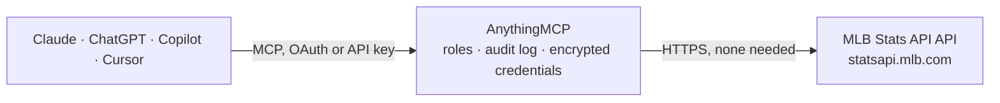

<!-- Generated by scripts/export-github-catalog.mjs in the anythingmcp-website repository. Do not edit by hand. -->

# MLB Stats API MCP connector

Official MLB Stats API data, no API key: schedules and live games, box scores, line scores, play by play, teams, rosters, standings, players, stats, league leaders and transactions for MLB and the minor leagues. The AnythingMCP connector gives Claude, ChatGPT, Microsoft Copilot, Cursor and Gemini 15 MCP tools for MLB Stats API, all read-only.

**Category:** [Sports](../sports.md) · **Tools:** 15 · **Setup guide:** [anythingmcp.com](https://anythingmcp.com/guides/mlb-to-mcp) · [Deutsch](https://anythingmcp.com/de/guides/mlb-to-mcp) · [Italiano](https://anythingmcp.com/it/guides/mlb-to-mcp) · [Español](https://anythingmcp.com/es/guides/mlb-to-mcp) · [日本語](https://anythingmcp.com/ja/guides/mlb-to-mcp) · [Русский](https://anythingmcp.com/ru/guides/mlb-to-mcp) · [中文](https://anythingmcp.com/zh/guides/mlb-to-mcp)

## Start without code

No installation and no terminal: AnythingMCP Cloud runs the MLB Stats API connector for you, operated by helpcode.ai in Frankfurt, Germany.

1. **Click the button above** and create an account or sign in. The MLB Stats API connector opens, ready to install.
2. **Nothing to enter:** this connector needs no credentials. Every click is in the [step-by-step guide](https://anythingmcp.com/guides/mlb-to-mcp).
3. **Click Install.** AnythingMCP shows the address of your MCP server.
4. **Add that address to your assistant:** [Claude](https://anythingmcp.com/guides/connect-mlb-to-claude) · [ChatGPT](https://anythingmcp.com/guides/connect-mlb-to-chatgpt) · [Microsoft Copilot](https://anythingmcp.com/guides/connect-mlb-to-copilot) · [Cursor](https://anythingmcp.com/guides/connect-mlb-to-cursor) · [Gemini CLI](https://anythingmcp.com/guides/connect-mlb-to-gemini) · [Meta Muse](https://anythingmcp.com/guides/connect-mlb-to-muse).
5. **Ask your first question**, for example: *Final score, attendance and winning pitcher for Yankees vs Red Sox on 2026-07-04?*

Prefer help with the setup? [Talk to us](https://anythingmcp.com/contact).

## How it works

- **The AI client** speaks MCP (Streamable HTTP) to AnythingMCP and only sees tool names, descriptions and results. It never gets the MLB Stats API credentials.
- **AnythingMCP** checks the client's role, builds the call from the tool definition, adds the credentials (none needed), calls MLB Stats API, logs the call and returns the result.
- **MLB Stats API** sees an ordinary API client with the rights of the account the credentials belong to.

## Tools

| Tool | What it does | Access |
|---|---|---|
| [`mlb_get_schedule`](#mlb_get_schedule) | Games for a date or a date range: game id (gamePk), start time in UTC, status, teams, score, winner, records, probable pitchers, venue and series. | read |
| [`mlb_get_game`](#mlb_get_game) | One game from the live feed: status, teams, venue, weather, probable pitchers, inning by inning runs with totals, the winning, losing and save pitchers,… | read |
| [`mlb_get_boxscore`](#mlb_get_boxscore) | Box score of a game: team batting and pitching totals, each batter's line in batting order and each pitcher's line with pitch count, umpires and the game… | read |
| [`mlb_get_linescore`](#mlb_get_linescore) | Line score of a game: runs, hits and errors by inning and in total, the current inning, count and outs, and while it is live the pitcher, batter, on-deck… | read |
| [`mlb_get_play_by_play`](#mlb_get_play_by_play) | Every plate appearance of a game in order: inning, top or bottom, batter, pitcher, result and description, RBI and the score after the play. | read |
| [`mlb_list_teams`](#mlb_list_teams) | Teams of a level (MLB by default) with id, name, abbreviation, league, division, ballpark and first year of play. | read |
| [`mlb_get_team_roster`](#mlb_get_team_roster) | Roster of a team with person id, name, jersey number, position and status. | read |
| [`mlb_get_standings`](#mlb_get_standings) | Standings by division: wins, losses, winning percentage, games back, wild card games back, division and wild card rank, run differential, streak, home, away… | read |
| [`mlb_search_people`](#mlb_search_people) | Find players (and coaches or umpires) by name: id, position, number, current team, birth date, bats and throws, MLB debut. | read |
| [`mlb_get_person`](#mlb_get_person) | Profile of one player: position, number, team, birth date and place, height, weight, bats and throws, debut and draft year. | read |
| [`mlb_get_player_stats`](#mlb_get_player_stats) | Statistics of a player. | read |
| [`mlb_get_team_stats`](#mlb_get_team_stats) | Team statistics: season totals, statSplits by situation or byMonth for hitting, pitching or fielding. | read |
| [`mlb_get_stat_leaders`](#mlb_get_stat_leaders) | League leaders in one or more categories, such as homeRuns, battingAverage, onBasePlusSlugging, stolenBases, earnedRunAverage, strikeouts, wins or saves:… | read |
| [`mlb_list_transactions`](#mlb_list_transactions) | Roster moves in a date range: trades, signings, injured list placements and activations, call-ups, options and releases, with player, teams and the official… | read |
| [`mlb_get_season`](#mlb_get_season) | Key dates of a season: spring training, regular season start and end, All-Star game, postseason start and end. | read |

## Tool reference

Every parameter as the AI client sees it in `tools/list`. Source: [`packages/backend/src/adapters/intl/mlb.json`](../../../packages/backend/src/adapters/intl/mlb.json).

### `mlb_get_schedule`

Games for a date or a date range: game id (gamePk), start time in UTC, status, teams, score, winner, records, probable pitchers, venue and series. Filter by team, sport level or game type. Leave out every date for today's games.

**Access:** read · **Call:** `GET /api/v1/schedule`

| Parameter | Type | Required | Description |
|---|---|---|---|
| `date` | string | no | One day, YYYY-MM-DD. |
| `start_date` | string | no | Start of a range, YYYY-MM-DD; use with end_date. |
| `end_date` | string | no | End of a range, YYYY-MM-DD, inclusive. |
| `team_id` | integer | no | MLB team id, e.g. 147 (New York Yankees), 119 (Los Angeles Dodgers). Ids come from mlb_list_teams. |
| `sport_id` | integer | no | 1 MLB (default), 11 Triple-A, 12 Double-A, 13 High-A, 14 Single-A, 16 Rookie, 17 Winter Leagues. |
| `game_type` | string | no | R regular season, P postseason (all rounds), F wild card, D division series, L league championship, W World Series, S spring training, A All-Star game. Comma separated for several. |
| `hydrate` | string | no | Extra data to attach. Default probablePitcher,linescore. |

### `mlb_get_game`

One game from the live feed: status, teams, venue, weather, probable pitchers, inning by inning runs with totals, the winning, losing and save pitchers, every scoring play and the current at-bat while it is live.

**Access:** read · **Call:** `GET /api/v1.1/game/{game_pk}/feed/live`

| Parameter | Type | Required | Description |
|---|---|---|---|
| `game_pk` | integer | yes | MLB game id (gamePk), e.g. 849817. It comes from mlb_get_schedule. |

### `mlb_get_boxscore`

Box score of a game: team batting and pitching totals, each batter's line in batting order and each pitcher's line with pitch count, umpires and the game notes (pitches-strikes, weather, attendance, time).

**Access:** read · **Call:** `GET /api/v1/game/{game_pk}/boxscore`

| Parameter | Type | Required | Description |
|---|---|---|---|
| `game_pk` | integer | yes | MLB game id (gamePk), e.g. 849817. It comes from mlb_get_schedule. |

### `mlb_get_linescore`

Line score of a game: runs, hits and errors by inning and in total, the current inning, count and outs, and while it is live the pitcher, batter, on-deck batter and runners on base.

**Access:** read · **Call:** `GET /api/v1/game/{game_pk}/linescore`

| Parameter | Type | Required | Description |
|---|---|---|---|
| `game_pk` | integer | yes | MLB game id (gamePk), e.g. 849817. It comes from mlb_get_schedule. |

### `mlb_get_play_by_play`

Every plate appearance of a game in order: inning, top or bottom, batter, pitcher, result and description, RBI and the score after the play. Large for long games.

**Access:** read · **Call:** `GET /api/v1/game/{game_pk}/playByPlay`

| Parameter | Type | Required | Description |
|---|---|---|---|
| `game_pk` | integer | yes | MLB game id (gamePk), e.g. 849817. It comes from mlb_get_schedule. |

### `mlb_list_teams`

Teams of a level (MLB by default) with id, name, abbreviation, league, division, ballpark and first year of play.

**Access:** read · **Call:** `GET /api/v1/teams`

| Parameter | Type | Required | Description |
|---|---|---|---|
| `sport_id` | integer | no | 1 MLB (default), 11 Triple-A, 12 Double-A, 13 High-A, 14 Single-A, 16 Rookie, 17 Winter Leagues. |
| `season` | integer | no | Season year, e.g. 2026. Leave out for the current season. |

### `mlb_get_team_roster`

Roster of a team with person id, name, jersey number, position and status. rosterType active is the 26-man roster; 40Man, fullSeason and depthChart are also available.

**Access:** read · **Call:** `GET /api/v1/teams/{team_id}/roster`

| Parameter | Type | Required | Description |
|---|---|---|---|
| `team_id` | integer | yes | MLB team id, e.g. 147 (New York Yankees), 119 (Los Angeles Dodgers). Ids come from mlb_list_teams. |
| `roster_type` | `active` \| `40Man` \| `fullSeason` \| `fullRoster` \| `depthChart` \| `coach` | no | Which roster, default active. |
| `season` | integer | no | Season year, e.g. 2026. Leave out for the current season. |
| `date` | string | no | Roster as of this date, YYYY-MM-DD. |

### `mlb_get_standings`

Standings by division: wins, losses, winning percentage, games back, wild card games back, division and wild card rank, run differential, streak, home, away and last ten records, clinch status.

**Access:** read · **Call:** `GET /api/v1/standings`

| Parameter | Type | Required | Description |
|---|---|---|---|
| `league_id` | string | no | 103 American League, 104 National League; default both. |
| `season` | integer | no | Season year, e.g. 2026. Leave out for the current season. |
| `standings_types` | string | no | regularSeason (default), wildCard, divisionLeaders, springTraining, firstHalf, secondHalf. |
| `date` | string | no | Standings as of this date, YYYY-MM-DD. |

### `mlb_search_people`

Find players (and coaches or umpires) by name: id, position, number, current team, birth date, bats and throws, MLB debut. Use the id for mlb_get_person and mlb_get_player_stats.

**Access:** read · **Call:** `GET /api/v1/people/search`

| Parameter | Type | Required | Description |
|---|---|---|---|
| `names` | string | yes | Name or part of it, e.g. judge or shohei ohtani. |
| `sport_id` | integer | no | 1 MLB (default), 11 Triple-A, 12 Double-A, 13 High-A, 14 Single-A, 16 Rookie, 17 Winter Leagues. |
| `active` | boolean | no | true for active players only. |

### `mlb_get_person`

Profile of one player: position, number, team, birth date and place, height, weight, bats and throws, debut and draft year. Set hydrate to attach stats in the same call.

**Access:** read · **Call:** `GET /api/v1/people/{person_id}`

| Parameter | Type | Required | Description |
|---|---|---|---|
| `person_id` | integer | yes | MLB person id, e.g. 592450 (Aaron Judge). Ids come from mlb_search_people or a roster. |
| `hydrate` | string | no | Extra data to attach. Default currentTeam; add stats with e.g. currentTeam,stats(group=[hitting],type=[season,career]). |

### `mlb_get_player_stats`

Statistics of a player. stats picks the kind: season, career, yearByYear, gameLog, lastXGames, statSplits (with sit_codes such as vl,vr for vs left and right), vsTeam (with opposing_team_id) or sabermetrics.

**Access:** read · **Call:** `GET /api/v1/people/{person_id}/stats`

| Parameter | Type | Required | Description |
|---|---|---|---|
| `person_id` | integer | yes | MLB person id, e.g. 592450 (Aaron Judge). Ids come from mlb_search_people or a roster. |
| `stats` | string | no | season (default), career, yearByYear, gameLog, lastXGames, statSplits, vsTeam, sabermetrics. Comma separated for several. |
| `group` | `hitting` \| `pitching` \| `fielding` | no | Stat group. |
| `season` | integer | no | Season year, e.g. 2026. Leave out for the current season. |
| `game_type` | string | no | R regular season, P postseason (all rounds), F wild card, D division series, L league championship, W World Series, S spring training, A All-Star game. Comma separated for several. |
| `sit_codes` | string | no | Situation codes for statSplits, e.g. vl,vr (vs left or right), h,a (home, away), risp. |
| `opposing_team_id` | integer | no | Opponent team id for vsTeam. |
| `limit` | integer | no | Number of games for lastXGames. |

### `mlb_get_team_stats`

Team statistics: season totals, statSplits by situation or byMonth for hitting, pitching or fielding.

**Access:** read · **Call:** `GET /api/v1/teams/{team_id}/stats`

| Parameter | Type | Required | Description |
|---|---|---|---|
| `team_id` | integer | yes | MLB team id, e.g. 147 (New York Yankees), 119 (Los Angeles Dodgers). Ids come from mlb_list_teams. |
| `stats` | string | no | season (default), statSplits, byMonth, byDateRange, gameLog. |
| `group` | `hitting` \| `pitching` \| `fielding` | no | Stat group. |
| `season` | integer | no | Season year, e.g. 2026. Leave out for the current season. |
| `game_type` | string | no | R regular season, P postseason (all rounds), F wild card, D division series, L league championship, W World Series, S spring training, A All-Star game. Comma separated for several. |
| `sit_codes` | string | no | Situation codes for statSplits, e.g. vl,vr or h,a. |

### `mlb_get_stat_leaders`

League leaders in one or more categories, such as homeRuns, battingAverage, onBasePlusSlugging, stolenBases, earnedRunAverage, strikeouts, wins or saves: rank, value, player and team.

**Access:** read · **Call:** `GET /api/v1/stats/leaders`

| Parameter | Type | Required | Description |
|---|---|---|---|
| `leader_categories` | string | yes | Comma separated, e.g. homeRuns,battingAverage or earnedRunAverage,strikeouts. |
| `season` | integer | no | Season year, e.g. 2026. Leave out for the current season. |
| `stat_group` | `hitting` \| `pitching` \| `fielding` | no | Needed for categories that exist in more than one group, such as strikeouts (pitching) or hits. |
| `league_id` | integer | no | 103 American League or 104 National League; leave out for both. |
| `game_type` | string | no | R regular season, P postseason (all rounds), F wild card, D division series, L league championship, W World Series, S spring training, A All-Star game. Comma separated for several. |
| `limit` | integer | no | Leaders per category, default 10. |

### `mlb_list_transactions`

Roster moves in a date range: trades, signings, injured list placements and activations, call-ups, options and releases, with player, teams and the official description. Filter by team to keep it short.

**Access:** read · **Call:** `GET /api/v1/transactions`

| Parameter | Type | Required | Description |
|---|---|---|---|
| `start_date` | string | yes | Start date, YYYY-MM-DD. |
| `end_date` | string | yes | End date, YYYY-MM-DD, inclusive. |
| `team_id` | integer | no | MLB team id, e.g. 147 (New York Yankees), 119 (Los Angeles Dodgers). Ids come from mlb_list_teams. |

### `mlb_get_season`

Key dates of a season: spring training, regular season start and end, All-Star game, postseason start and end.

**Access:** read · **Call:** `GET /api/v1/seasons/{season}`

| Parameter | Type | Required | Description |
|---|---|---|---|
| `season` | integer | yes | Season year, e.g. 2026. |
| `sport_id` | integer | no | 1 MLB (default), 11 Triple-A, 12 Double-A, 13 High-A, 14 Single-A, 16 Rookie, 17 Winter Leagues. |

## Run it yourself

AnythingMCP is open source (AGPL-3.0). [Run it with Docker](../../../README.md#run-it-yourself), open **Connectors → Store**, pick **MLB Stats API**, then add your MCP server URL to the AI client.

[← Sports connectors](../sports.md) · [All categories](../README.md)
