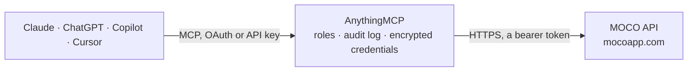

<!-- Generated by scripts/export-github-catalog.mjs in the anythingmcp-website repository. Do not edit by hand. -->

# MOCO MCP connector

MOCO project and time tracking for agencies: browse users, projects, companies, activities and invoices, report utilization, and book time through the REST API. The AnythingMCP connector gives Claude, ChatGPT, Microsoft Copilot, Cursor and Gemini 8 MCP tools for MOCO: 7 read and 1 can change data.

**Category:** [Time Tracking](../time-tracking.md) · **Tools:** 8 · **Setup guide:** [anythingmcp.com](https://anythingmcp.com/guides/moco-to-mcp) · [Deutsch](https://anythingmcp.com/de/guides/moco-to-mcp) · [Italiano](https://anythingmcp.com/it/guides/moco-to-mcp) · [Español](https://anythingmcp.com/es/guides/moco-to-mcp) · [日本語](https://anythingmcp.com/ja/guides/moco-to-mcp) · [Русский](https://anythingmcp.com/ru/guides/moco-to-mcp) · [中文](https://anythingmcp.com/zh/guides/moco-to-mcp)

## Start without code

No installation and no terminal: AnythingMCP Cloud runs the MOCO connector for you, operated by helpcode.ai in Frankfurt, Germany.

1. **Click the button above** and create an account or sign in. The MOCO connector opens, ready to install.
2. **Paste the API key or token from your MOCO account.** Every click is in the [step-by-step guide](https://anythingmcp.com/guides/moco-to-mcp).
3. **Click Install.** AnythingMCP shows the address of your MCP server.
4. **Add that address to your assistant:** [Claude](https://anythingmcp.com/guides/connect-moco-to-claude) · [ChatGPT](https://anythingmcp.com/guides/connect-moco-to-chatgpt) · [Microsoft Copilot](https://anythingmcp.com/guides/connect-moco-to-copilot) · [Cursor](https://anythingmcp.com/guides/connect-moco-to-cursor) · [Gemini CLI](https://anythingmcp.com/guides/connect-moco-to-gemini) · [Meta Muse](https://anythingmcp.com/guides/connect-moco-to-muse).
5. **Ask your first question**, for example: *Show invoice INV-2026-045 for Kunde Atelier Blau GmbH — is it still open and what's the amount and due date?*

Prefer help with the setup? [Talk to us](https://anythingmcp.com/contact).

## How it works

- **The AI client** speaks MCP (Streamable HTTP) to AnythingMCP and only sees tool names, descriptions and results. It never gets the MOCO credentials.
- **AnythingMCP** checks the client's role, builds the call from the tool definition, adds the credentials (a bearer token), calls MOCO, logs the call and returns the result.
- **MOCO** sees an ordinary API client with the rights of the account the credentials belong to.

## Tools

| Tool | What it does | Access |
|---|---|---|
| [`moco_list_users`](#moco_list_users) | List MOCO users visible to this API key, including their IDs and names. | read |
| [`moco_list_projects`](#moco_list_projects) | List MOCO projects with IDs, names, customer links and status. | read |
| [`moco_get_project`](#moco_get_project) | Get a single MOCO project by its numeric ID, including project details and assigned tasks needed when creating a time activity. | read |
| [`moco_list_activities`](#moco_list_activities) | List tracked time activities within a date range, optionally filtered by user, project or billability. | read |
| [`moco_list_companies`](#moco_list_companies) | List customers, suppliers and organizations in MOCO. | read |
| [`moco_list_invoices`](#moco_list_invoices) | List MOCO invoices visible to this API key. | read |
| [`moco_report_utilization`](#moco_report_utilization) | Get MOCO's utilization report for a date range, showing available and booked capacity so you can assess team workload. | read |
| [`moco_create_activity`](#moco_create_activity) | Book a new MOCO time activity for the API key's user. | write |

## Tool reference

Every parameter as the AI client sees it in `tools/list`. Source: [`packages/backend/src/adapters/de/moco.json`](../../../packages/backend/src/adapters/de/moco.json).

### `moco_list_users`

List MOCO users visible to this API key, including their IDs and names. Use this to confirm credentials and identify people for activity reports.

**Access:** read · **Call:** `GET /users`

| Parameter | Type | Required | Description |
|---|---|---|---|
| `page` | integer | no | Page number, starting at 1. |

### `moco_list_projects`

List MOCO projects with IDs, names, customer links and status. Filter archived projects, one company or recently updated records to narrow the result.

**Access:** read · **Call:** `GET /projects`

| Parameter | Type | Required | Description |
|---|---|---|---|
| `include_archived` | boolean | no | Include archived projects when true. |
| `company_id` | integer | no | Return projects belonging to this numeric company ID. |
| `updated_after` | string | no | Only projects changed after this ISO 8601 UTC timestamp, e.g. 2026-10-01T00:00:00Z. |
| `page` | integer | no | Page number, starting at 1. |

### `moco_get_project`

Get a single MOCO project by its numeric ID, including project details and assigned tasks needed when creating a time activity.

**Access:** read · **Call:** `GET /projects/{id}`

| Parameter | Type | Required | Description |
|---|---|---|---|
| `id` | integer | yes | Numeric project ID from moco_list_projects. |

### `moco_list_activities`

List tracked time activities within a date range, optionally filtered by user, project or billability. Results include durations and linked projects.

**Access:** read · **Call:** `GET /activities`

| Parameter | Type | Required | Description |
|---|---|---|---|
| `from` | string | yes | First activity date, YYYY-MM-DD, e.g. 2026-10-01. |
| `to` | string | yes | Last activity date, YYYY-MM-DD, e.g. 2026-10-31. |
| `user_id` | integer | no | Restrict to one numeric user ID. |
| `project_id` | integer | no | Restrict to one numeric project ID. |
| `billable` | boolean | no | True for billable time, false for non-billable time. |
| `page` | integer | no | Page number, starting at 1. |

### `moco_list_companies`

List customers, suppliers and organizations in MOCO. Filter by company type or search term to find the IDs used by projects and invoices.

**Access:** read · **Call:** `GET /companies`

| Parameter | Type | Required | Description |
|---|---|---|---|
| `type` | `customer` \| `supplier` \| `organization` | no | Company type to include. |
| `term` | string | no | Search company names or other matching text. |
| `page` | integer | no | Page number, starting at 1. |

### `moco_list_invoices`

List MOCO invoices visible to this API key. Narrow by status, invoice date range or company ID to review outstanding customer billing.

**Access:** read · **Call:** `GET /invoices`

| Parameter | Type | Required | Description |
|---|---|---|---|
| `status` | string | no | Invoice status: draft, created, sent, partially_paid, paid, overdue or ignored. Several can be combined comma-separated, e.g. sent,overdue. |
| `date_from` | string | no | Earliest invoice date, YYYY-MM-DD. |
| `date_to` | string | no | Latest invoice date, YYYY-MM-DD. |
| `company_id` | integer | no | Restrict to one numeric company ID. |
| `page` | integer | no | Page number, starting at 1. |

### `moco_report_utilization`

Get MOCO's utilization report for a date range, showing available and booked capacity so you can assess team workload.

**Access:** read · **Call:** `GET /report/utilization`

| Parameter | Type | Required | Description |
|---|---|---|---|
| `from` | string | yes | Report start date, YYYY-MM-DD. |
| `to` | string | yes | Report end date, YYYY-MM-DD. |

### `moco_create_activity`

Book a new MOCO time activity for the API key's user. This creates a real, non-idempotent time entry; confirm the details before calling it.

**Access:** write · **Call:** `POST /activities`

| Parameter | Type | Required | Description |
|---|---|---|---|
| `date` | string | yes | Activity date, YYYY-MM-DD. |
| `project_id` | integer | yes | Numeric project ID from moco_list_projects. |
| `task_id` | integer | yes | Numeric task ID from the project details. |
| `seconds` | integer | yes | Duration in whole seconds; 7200 means two hours. |
| `description` | string | no | What work was completed during this time. |

## Run it yourself

AnythingMCP is open source (AGPL-3.0). [Run it with Docker](../../../README.md#run-it-yourself), open **Connectors → Store**, pick **MOCO** and enter `MOCO_SUBDOMAIN`, `MOCO_API_KEY`, then add your MCP server URL to the AI client.

[← Time Tracking connectors](../time-tracking.md) · [All categories](../README.md)
