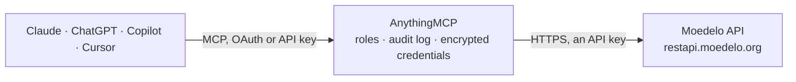

<!-- Generated by scripts/export-github-catalog.mjs in the anythingmcp-website repository. Do not edit by hand. -->

# Moedelo MCP connector

Connect Moedelo (Моё Дело), the Russian online accounting service, to Claude or ChatGPT: counterparties and contracts, sales bills, acts, waybills, VAT invoices and UPDs, purchase documents, the bank … The AnythingMCP connector gives Claude, ChatGPT, Microsoft Copilot, Cursor and Gemini 40 MCP tools for Moedelo: 37 read and 3 can change data.

**Category:** [Accounting](../accounting.md) · **Tools:** 40 · **Setup guide:** [anythingmcp.com](https://anythingmcp.com/guides/moedelo-to-mcp) · [Deutsch](https://anythingmcp.com/de/guides/moedelo-to-mcp) · [Italiano](https://anythingmcp.com/it/guides/moedelo-to-mcp) · [Español](https://anythingmcp.com/es/guides/moedelo-to-mcp) · [日本語](https://anythingmcp.com/ja/guides/moedelo-to-mcp) · [Русский](https://anythingmcp.com/ru/guides/moedelo-to-mcp) · [中文](https://anythingmcp.com/zh/guides/moedelo-to-mcp)

## Start without code

No installation and no terminal: AnythingMCP Cloud runs the Moedelo connector for you, operated by helpcode.ai in Frankfurt, Germany.

1. **Click the button above** and create an account or sign in. The Moedelo connector opens, ready to install.
2. **Paste the API key or token from your Moedelo account.** Every click is in the [step-by-step guide](https://anythingmcp.com/guides/moedelo-to-mcp).
3. **Click Install.** AnythingMCP shows the address of your MCP server.
4. **Add that address to your assistant:** [Claude](https://anythingmcp.com/guides/connect-moedelo-to-claude) · [ChatGPT](https://anythingmcp.com/guides/connect-moedelo-to-chatgpt) · [Microsoft Copilot](https://anythingmcp.com/guides/connect-moedelo-to-copilot) · [Cursor](https://anythingmcp.com/guides/connect-moedelo-to-cursor) · [Gemini CLI](https://anythingmcp.com/guides/connect-moedelo-to-gemini) · [Meta Muse](https://anythingmcp.com/guides/connect-moedelo-to-muse).
5. **Ask your first question**, for example: *Show the issued VAT invoice №SF-2026-084 for КлиентСтрой, date 2026-09-14*

Prefer help with the setup? [Talk to us](https://anythingmcp.com/contact).

## How it works

- **The AI client** speaks MCP (Streamable HTTP) to AnythingMCP and only sees tool names, descriptions and results. It never gets the Moedelo credentials.
- **AnythingMCP** checks the client's role, builds the call from the tool definition, adds the credentials (an API key), calls Moedelo, logs the call and returns the result.
- **Moedelo** sees an ordinary API client with the rights of the account the credentials belong to.

## Tools

| Tool | What it does | Access |
|---|---|---|
| [`moedelo_list_kontragents`](#moedelo_list_kontragents) | List counterparties (контрагенты: customers and suppliers) with id, INN, KPP, OGRN, name, type (buyer, supplier, both) and legal form. | read |
| [`moedelo_get_kontragent`](#moedelo_get_kontragent) | Read one counterparty in full: INN, KPP, OGRN, OKPO, names, legal and postal address, signer and legal form. | read |
| [`moedelo_list_kontragent_bank_accounts`](#moedelo_list_kontragent_bank_accounts) | List the bank accounts (расчётные счета) of a counterparty: bank, BIK, account and correspondent account. | read |
| [`moedelo_list_kontragent_contacts`](#moedelo_list_kontragent_contacts) | List the contact persons of a counterparty with their position, phone and email. | read |
| [`moedelo_list_contracts`](#moedelo_list_contracts) | List contracts (договоры) with number, date, counterparty, subject and status. | read |
| [`moedelo_get_contract`](#moedelo_get_contract) | Read one contract (договор) in full: number, date, counterparty, subject, amounts and status. | read |
| [`moedelo_list_bills`](#moedelo_list_bills) | List sales bills (счета на оплату) with number, date, counterparty, contract, sum, status (4 unpaid, 5 partly paid, 6 paid) and positions. | read |
| [`moedelo_get_bill`](#moedelo_get_bill) | Read one sales bill (счёт) with its positions, VAT, payment status and contract. | read |
| [`moedelo_list_bill_linked_documents`](#moedelo_list_bill_linked_documents) | List the documents linked to a sales bill: acts, waybills, UPDs, invoices and the payments that settle it. | read |
| [`moedelo_list_sales_acts`](#moedelo_list_sales_acts) | List sales acts (акты выполненных работ) with number, date, counterparty, sum and positions. | read |
| [`moedelo_get_sales_act`](#moedelo_get_sales_act) | Read one sales act (акт выполненных работ) with its positions, VAT, counterparty and linked bill. | read |
| [`moedelo_list_sales_waybills`](#moedelo_list_sales_waybills) | List sales waybills (товарные накладные, ТОРГ-12) with number, date, counterparty, warehouse, sum and positions. | read |
| [`moedelo_get_sales_waybill`](#moedelo_get_sales_waybill) | Read one sales waybill (накладная) with its goods, quantities, prices and VAT. | read |
| [`moedelo_list_sales_invoices`](#moedelo_list_sales_invoices) | List issued VAT invoices (счета-фактуры, regular) with number, date, counterparty and VAT sums. | read |
| [`moedelo_get_sales_invoice`](#moedelo_get_sales_invoice) | Read one issued VAT invoice (счёт-фактура) with its positions and VAT. | read |
| [`moedelo_list_sales_advance_invoices`](#moedelo_list_sales_advance_invoices) | List issued advance VAT invoices (авансовые счета-фактуры) for prepayments received. | read |
| [`moedelo_get_sales_upd`](#moedelo_get_sales_upd) | Read one sales UPD (универсальный передаточный документ) with its positions, VAT and status. | read |
| [`moedelo_list_sales_upd_linked_documents`](#moedelo_list_sales_upd_linked_documents) | List the documents linked to a sales UPD: bills, payments and corrections. | read |
| [`moedelo_list_retail_reports`](#moedelo_list_retail_reports) | List retail sales reports (отчёты о розничной продаже) with number, date and sums. | read |
| [`moedelo_list_purchase_acts`](#moedelo_list_purchase_acts) | List received acts (акты от поставщиков) for services bought, with supplier, date and sum. | read |
| [`moedelo_list_purchase_waybills`](#moedelo_list_purchase_waybills) | List received waybills (накладные от поставщиков) for goods bought, with supplier, warehouse, date and sum. | read |
| [`moedelo_list_purchase_invoices`](#moedelo_list_purchase_invoices) | List received VAT invoices (счета-фактуры от поставщиков, regular) with supplier, date and VAT. | read |
| [`moedelo_get_purchase_upd`](#moedelo_get_purchase_upd) | Read one received UPD (универсальный передаточный документ от поставщика) with its positions and VAT. | read |
| [`moedelo_list_money_operations`](#moedelo_list_money_operations) | List money operations (реестр операций): bank and cash receipts and payments with date, number, counterparty, direction, sum and type, in one register. | read |
| [`moedelo_get_bank_operation`](#moedelo_get_bank_operation) | Read one bank operation (Деньги / Банк) by its document id from moedelo_list_money_operations: type, counterparty, sum, purpose and linked documents. | read |
| [`moedelo_get_cash_operation`](#moedelo_get_cash_operation) | Read one cash desk operation (Деньги / Касса) by its document id from moedelo_list_money_operations. | read |
| [`moedelo_list_settlement_accounts`](#moedelo_list_settlement_accounts) | List the company's own bank accounts (расчётные счета): bank, BIK, account number and currency. | read |
| [`moedelo_list_cash_desks`](#moedelo_list_cash_desks) | List the company's cash desks (кассы) with their ids and names, for cash operations and balances. | read |
| [`moedelo_get_cash_balance`](#moedelo_get_cash_balance) | Get the balance of every cash desk of the company on a given date (остаток по кассам на дату). | read |
| [`moedelo_list_warehouses`](#moedelo_list_warehouses) | List warehouses (склады) with their ids, names and type, for stock and purchase waybill filters. | read |
| [`moedelo_list_goods`](#moedelo_list_goods) | List goods and materials (товары) with id, name, article, unit, prices and VAT. | read |
| [`moedelo_get_good`](#moedelo_get_good) | Read one product (товар) in full: name, article, unit, sale and purchase price, VAT and group. | read |
| [`moedelo_list_services`](#moedelo_list_services) | List services (услуги) from the catalogue with name, unit, price and VAT. | read |
| [`moedelo_list_chart_of_accounts`](#moedelo_list_chart_of_accounts) | List the chart of accounts (план счетов бухгалтерского учёта) with synthetic account codes and names. | read |
| [`moedelo_get_document_postings`](#moedelo_get_document_postings) | Get the accounting postings (проводки) Moedelo generated for one document, by its base document id. | read |
| [`moedelo_list_employees`](#moedelo_list_employees) | List employees (сотрудники) with name, position, department and hiring dates. | read |
| [`moedelo_list_tax_calendar`](#moedelo_list_tax_calendar) | List the events of the tax calendar (налоговый календарь): report and payment deadlines for the company. | read |
| [`moedelo_create_kontragent`](#moedelo_create_kontragent) | Create a counterparty (контрагент) with its requisites. | write |
| [`moedelo_update_kontragent`](#moedelo_update_kontragent) | Save changes to a counterparty. | write |
| [`moedelo_create_bill`](#moedelo_create_bill) | Create a sales bill (счёт на оплату) for a counterparty. | write |

## Tool reference

Every parameter as the AI client sees it in `tools/list`. Source: [`packages/backend/src/adapters/intl/moedelo.json`](../../../packages/backend/src/adapters/intl/moedelo.json).

### `moedelo_list_kontragents`

List counterparties (контрагенты: customers and suppliers) with id, INN, KPP, OGRN, name, type (buyer, supplier, both) and legal form. Search by INN or name.

**Access:** read · **Call:** `GET /kontragents/api/v1/kontragent`

| Parameter | Type | Required | Description |
|---|---|---|---|
| `pageNo` | integer | no | Page number, from 1. |
| `pageSize` | integer | no | Records per page (Moedelo's default is 50). |
| `inn` | string | no | Filter by INN (tax id). |
| `name` | string | no | Filter by name (part of it). |
| `isArchived` | boolean | no | true for archived counterparties only, false for active only. |

### `moedelo_get_kontragent`

Read one counterparty in full: INN, KPP, OGRN, OKPO, names, legal and postal address, signer and legal form.

**Access:** read · **Call:** `GET /kontragents/api/v1/kontragent/{id}`

| Parameter | Type | Required | Description |
|---|---|---|---|
| `id` | integer | yes | Numeric id of the counterparty. |

### `moedelo_list_kontragent_bank_accounts`

List the bank accounts (расчётные счета) of a counterparty: bank, BIK, account and correspondent account.

**Access:** read · **Call:** `GET /kontragents/api/v1/kontragent/{kontragentId}/account`

| Parameter | Type | Required | Description |
|---|---|---|---|
| `kontragentId` | integer | yes | Numeric id of the counterparty. |

### `moedelo_list_kontragent_contacts`

List the contact persons of a counterparty with their position, phone and email.

**Access:** read · **Call:** `GET /kontragents/api/v1/kontragent/{kontragentId}/contact`

| Parameter | Type | Required | Description |
|---|---|---|---|
| `kontragentId` | integer | yes | Numeric id of the counterparty. |

### `moedelo_list_contracts`

List contracts (договоры) with number, date, counterparty, subject and status. The contract id is the projectId of bills.

**Access:** read · **Call:** `GET /contract/api/v1/contract`

| Parameter | Type | Required | Description |
|---|---|---|---|
| `pageNo` | integer | no | Page number, from 1. |
| `pageSize` | integer | no | Records per page (Moedelo's default is 50). |
| `kontragentId` | integer | no | Only the contracts of this counterparty. |

### `moedelo_get_contract`

Read one contract (договор) in full: number, date, counterparty, subject, amounts and status.

**Access:** read · **Call:** `GET /contract/api/v1/contract/{id}`

| Parameter | Type | Required | Description |
|---|---|---|---|
| `id` | integer | yes | Numeric id of the contract. |

### `moedelo_list_bills`

List sales bills (счета на оплату) with number, date, counterparty, contract, sum, status (4 unpaid, 5 partly paid, 6 paid) and positions. Filters by number, document date, change date and counterparty; pages of pageSize.

**Access:** read · **Call:** `GET /accounting/api/v1/sales/bill`

| Parameter | Type | Required | Description |
|---|---|---|---|
| `pageNo` | integer | no | Page number, from 1. |
| `pageSize` | integer | no | Records per page (Moedelo's default is 50). |
| `number` | string | no | Only documents whose number contains this text. |
| `docAfterDate` | string | no | Only documents dated on or after this date, YYYY-MM-DD. |
| `docBeforeDate` | string | no | Only documents dated on or before this date, YYYY-MM-DD. |
| `afterDate` | string | no | Only documents created or changed after this moment, ISO 8601 (for syncing changes). |
| `beforeDate` | string | no | Only documents created or changed before this moment, ISO 8601. |
| `kontragentId` | integer | no | Only documents of this counterparty (numeric id from moedelo_list_kontragents). |
| `projectId` | integer | no | Only bills under this contract (contract id). |

### `moedelo_get_bill`

Read one sales bill (счёт) with its positions, VAT, payment status and contract.

**Access:** read · **Call:** `GET /accounting/api/v1/sales/bill/{id}`

| Parameter | Type | Required | Description |
|---|---|---|---|
| `id` | integer | yes | Numeric id of the bill. |

### `moedelo_list_bill_linked_documents`

List the documents linked to a sales bill: acts, waybills, UPDs, invoices and the payments that settle it.

**Access:** read · **Call:** `GET /accounting/api/v1/sales/bill/{id}/LinkedDocuments`

| Parameter | Type | Required | Description |
|---|---|---|---|
| `id` | integer | yes | Numeric id of the bill. |

### `moedelo_list_sales_acts`

List sales acts (акты выполненных работ) with number, date, counterparty, sum and positions. Filters by number, document date, change date and counterparty; pages of pageSize.

**Access:** read · **Call:** `GET /accounting/api/v1/sales/act`

| Parameter | Type | Required | Description |
|---|---|---|---|
| `pageNo` | integer | no | Page number, from 1. |
| `pageSize` | integer | no | Records per page (Moedelo's default is 50). |
| `number` | string | no | Only documents whose number contains this text. |
| `docAfterDate` | string | no | Only documents dated on or after this date, YYYY-MM-DD. |
| `docBeforeDate` | string | no | Only documents dated on or before this date, YYYY-MM-DD. |
| `afterDate` | string | no | Only documents created or changed after this moment, ISO 8601 (for syncing changes). |
| `beforeDate` | string | no | Only documents created or changed before this moment, ISO 8601. |
| `kontragentId` | integer | no | Only documents of this counterparty (numeric id from moedelo_list_kontragents). |

### `moedelo_get_sales_act`

Read one sales act (акт выполненных работ) with its positions, VAT, counterparty and linked bill.

**Access:** read · **Call:** `GET /accounting/api/v1/sales/act/{id}`

| Parameter | Type | Required | Description |
|---|---|---|---|
| `id` | integer | yes | Numeric id of the act. |

### `moedelo_list_sales_waybills`

List sales waybills (товарные накладные, ТОРГ-12) with number, date, counterparty, warehouse, sum and positions. Filters by number, document date, change date and counterparty; pages of pageSize.

**Access:** read · **Call:** `GET /accounting/api/v1/sales/waybill`

| Parameter | Type | Required | Description |
|---|---|---|---|
| `pageNo` | integer | no | Page number, from 1. |
| `pageSize` | integer | no | Records per page (Moedelo's default is 50). |
| `number` | string | no | Only documents whose number contains this text. |
| `docAfterDate` | string | no | Only documents dated on or after this date, YYYY-MM-DD. |
| `docBeforeDate` | string | no | Only documents dated on or before this date, YYYY-MM-DD. |
| `afterDate` | string | no | Only documents created or changed after this moment, ISO 8601 (for syncing changes). |
| `beforeDate` | string | no | Only documents created or changed before this moment, ISO 8601. |
| `kontragentId` | integer | no | Only documents of this counterparty (numeric id from moedelo_list_kontragents). |

### `moedelo_get_sales_waybill`

Read one sales waybill (накладная) with its goods, quantities, prices and VAT.

**Access:** read · **Call:** `GET /accounting/api/v1/sales/waybill/{id}`

| Parameter | Type | Required | Description |
|---|---|---|---|
| `id` | integer | yes | Numeric id of the waybill. |

### `moedelo_list_sales_invoices`

List issued VAT invoices (счета-фактуры, regular) with number, date, counterparty and VAT sums. Filters by number, document date, change date and counterparty; pages of pageSize.

**Access:** read · **Call:** `GET /accounting/api/v1/sales/invoice/common`

| Parameter | Type | Required | Description |
|---|---|---|---|
| `pageNo` | integer | no | Page number, from 1. |
| `pageSize` | integer | no | Records per page (Moedelo's default is 50). |
| `number` | string | no | Only documents whose number contains this text. |
| `docAfterDate` | string | no | Only documents dated on or after this date, YYYY-MM-DD. |
| `docBeforeDate` | string | no | Only documents dated on or before this date, YYYY-MM-DD. |
| `afterDate` | string | no | Only documents created or changed after this moment, ISO 8601 (for syncing changes). |
| `beforeDate` | string | no | Only documents created or changed before this moment, ISO 8601. |
| `kontragentId` | integer | no | Only documents of this counterparty (numeric id from moedelo_list_kontragents). |

### `moedelo_get_sales_invoice`

Read one issued VAT invoice (счёт-фактура) with its positions and VAT.

**Access:** read · **Call:** `GET /accounting/api/v1/sales/invoice/common/{id}`

| Parameter | Type | Required | Description |
|---|---|---|---|
| `id` | integer | yes | Numeric id of the VAT invoice. |

### `moedelo_list_sales_advance_invoices`

List issued advance VAT invoices (авансовые счета-фактуры) for prepayments received. Filters by number, document date, change date and counterparty; pages of pageSize.

**Access:** read · **Call:** `GET /accounting/api/v1/sales/invoice/advance`

| Parameter | Type | Required | Description |
|---|---|---|---|
| `pageNo` | integer | no | Page number, from 1. |
| `pageSize` | integer | no | Records per page (Moedelo's default is 50). |
| `number` | string | no | Only documents whose number contains this text. |
| `docAfterDate` | string | no | Only documents dated on or after this date, YYYY-MM-DD. |
| `docBeforeDate` | string | no | Only documents dated on or before this date, YYYY-MM-DD. |
| `afterDate` | string | no | Only documents created or changed after this moment, ISO 8601 (for syncing changes). |
| `beforeDate` | string | no | Only documents created or changed before this moment, ISO 8601. |
| `kontragentId` | integer | no | Only documents of this counterparty (numeric id from moedelo_list_kontragents). |

### `moedelo_get_sales_upd`

Read one sales UPD (универсальный передаточный документ) with its positions, VAT and status.

**Access:** read · **Call:** `GET /docs/api/v1/Sales/Upd/{id}`

| Parameter | Type | Required | Description |
|---|---|---|---|
| `id` | integer | yes | Numeric id of the UPD. |

### `moedelo_list_sales_upd_linked_documents`

List the documents linked to a sales UPD: bills, payments and corrections.

**Access:** read · **Call:** `GET /upds/api/v1/Sales/{id}/LinkedDocuments`

| Parameter | Type | Required | Description |
|---|---|---|---|
| `id` | integer | yes | Numeric id of the UPD. |

### `moedelo_list_retail_reports`

List retail sales reports (отчёты о розничной продаже) with number, date and sums. Filters by number and date; pages of pageSize.

**Access:** read · **Call:** `GET /accounting/api/v1/sales/retailreport`

| Parameter | Type | Required | Description |
|---|---|---|---|
| `pageNo` | integer | no | Page number, from 1. |
| `pageSize` | integer | no | Records per page (Moedelo's default is 50). |
| `number` | string | no | Only documents whose number contains this text. |
| `docAfterDate` | string | no | Only documents dated on or after this date, YYYY-MM-DD. |
| `docBeforeDate` | string | no | Only documents dated on or before this date, YYYY-MM-DD. |
| `afterDate` | string | no | Only documents created or changed after this moment, ISO 8601 (for syncing changes). |
| `beforeDate` | string | no | Only documents created or changed before this moment, ISO 8601. |

### `moedelo_list_purchase_acts`

List received acts (акты от поставщиков) for services bought, with supplier, date and sum. Filters by number, document date, change date and counterparty; pages of pageSize.

**Access:** read · **Call:** `GET /accounting/api/v1/purchases/act`

| Parameter | Type | Required | Description |
|---|---|---|---|
| `pageNo` | integer | no | Page number, from 1. |
| `pageSize` | integer | no | Records per page (Moedelo's default is 50). |
| `number` | string | no | Only documents whose number contains this text. |
| `docAfterDate` | string | no | Only documents dated on or after this date, YYYY-MM-DD. |
| `docBeforeDate` | string | no | Only documents dated on or before this date, YYYY-MM-DD. |
| `afterDate` | string | no | Only documents created or changed after this moment, ISO 8601 (for syncing changes). |
| `beforeDate` | string | no | Only documents created or changed before this moment, ISO 8601. |
| `kontragentId` | integer | no | Only documents of this counterparty (numeric id from moedelo_list_kontragents). |

### `moedelo_list_purchase_waybills`

List received waybills (накладные от поставщиков) for goods bought, with supplier, warehouse, date and sum. Filters by number, document date, change date and counterparty; pages of pageSize.

**Access:** read · **Call:** `GET /accounting/api/v1/purchases/waybill`

| Parameter | Type | Required | Description |
|---|---|---|---|
| `pageNo` | integer | no | Page number, from 1. |
| `pageSize` | integer | no | Records per page (Moedelo's default is 50). |
| `number` | string | no | Only documents whose number contains this text. |
| `docAfterDate` | string | no | Only documents dated on or after this date, YYYY-MM-DD. |
| `docBeforeDate` | string | no | Only documents dated on or before this date, YYYY-MM-DD. |
| `afterDate` | string | no | Only documents created or changed after this moment, ISO 8601 (for syncing changes). |
| `beforeDate` | string | no | Only documents created or changed before this moment, ISO 8601. |
| `kontragentId` | integer | no | Only documents of this counterparty (numeric id from moedelo_list_kontragents). |
| `stockId` | integer | no | Only waybills to this warehouse (id from moedelo_list_warehouses). |

### `moedelo_list_purchase_invoices`

List received VAT invoices (счета-фактуры от поставщиков, regular) with supplier, date and VAT. Filters by number, document date, change date and counterparty; pages of pageSize.

**Access:** read · **Call:** `GET /accounting/api/v1/purchases/invoice/common`

| Parameter | Type | Required | Description |
|---|---|---|---|
| `pageNo` | integer | no | Page number, from 1. |
| `pageSize` | integer | no | Records per page (Moedelo's default is 50). |
| `number` | string | no | Only documents whose number contains this text. |
| `docAfterDate` | string | no | Only documents dated on or after this date, YYYY-MM-DD. |
| `docBeforeDate` | string | no | Only documents dated on or before this date, YYYY-MM-DD. |
| `afterDate` | string | no | Only documents created or changed after this moment, ISO 8601 (for syncing changes). |
| `beforeDate` | string | no | Only documents created or changed before this moment, ISO 8601. |
| `kontragentId` | integer | no | Only documents of this counterparty (numeric id from moedelo_list_kontragents). |

### `moedelo_get_purchase_upd`

Read one received UPD (универсальный передаточный документ от поставщика) with its positions and VAT.

**Access:** read · **Call:** `GET /docs/api/v1/Purchases/Upd/{id}`

| Parameter | Type | Required | Description |
|---|---|---|---|
| `id` | integer | yes | Numeric id of the UPD. |

### `moedelo_list_money_operations`

List money operations (реестр операций): bank and cash receipts and payments with date, number, counterparty, direction, sum and type, in one register.

**Access:** read · **Call:** `GET /money/api/v1/Registry`

| Parameter | Type | Required | Description |
|---|---|---|---|
| `Offset` | integer | no | Records to skip. |
| `Limit` | integer | no | Records to return. |
| `StartDate` | string | no | Period start, YYYY-MM-DD. |
| `EndDate` | string | no | Period end, YYYY-MM-DD. |
| `AfterDate` | string | no | Only operations created or changed after this moment, ISO 8601. |
| `OperationSource` | integer | no | Source: 1 bank (settlement account), 2 cash desk, 3 electronic wallet. |
| `ContractorId` | integer | no | Only operations with this counterparty (id). |
| `Query` | string | no | Search by document number. |

### `moedelo_get_bank_operation`

Read one bank operation (Деньги / Банк) by its document id from moedelo_list_money_operations: type, counterparty, sum, purpose and linked documents.

**Access:** read · **Call:** `GET /money/api/v1/PaymentOrders/{documentBaseId}`

| Parameter | Type | Required | Description |
|---|---|---|---|
| `documentBaseId` | integer | yes | Numeric id of the operation (documentBaseId). |

### `moedelo_get_cash_operation`

Read one cash desk operation (Деньги / Касса) by its document id from moedelo_list_money_operations.

**Access:** read · **Call:** `GET /money/api/v1/CashOrders/{documentBaseId}`

| Parameter | Type | Required | Description |
|---|---|---|---|
| `documentBaseId` | integer | yes | Numeric id of the operation (documentBaseId). |

### `moedelo_list_settlement_accounts`

List the company's own bank accounts (расчётные счета): bank, BIK, account number and currency.

**Access:** read · **Call:** `GET /requisites/api/v1/SettlementAccount`

| Parameter | Type | Required | Description |
|---|---|---|---|
| `pageNo` | integer | no | Page number, from 1. |
| `pageSize` | integer | no | Records per page (Moedelo's default is 50). |

### `moedelo_list_cash_desks`

List the company's cash desks (кассы) with their ids and names, for cash operations and balances.

**Access:** read · **Call:** `GET /accounting/api/v1/cashier`

No parameters.

### `moedelo_get_cash_balance`

Get the balance of every cash desk of the company on a given date (остаток по кассам на дату).

**Access:** read · **Call:** `GET /accounting/api/v1/cashier/GetCashBalance/{onDate}`

| Parameter | Type | Required | Description |
|---|---|---|---|
| `onDate` | string | yes | Date, YYYY-MM-DD. |

### `moedelo_list_warehouses`

List warehouses (склады) with their ids, names and type, for stock and purchase waybill filters.

**Access:** read · **Call:** `GET /stock/api/v1/stock`

| Parameter | Type | Required | Description |
|---|---|---|---|
| `pageNo` | integer | no | Page number, from 1. |
| `pageSize` | integer | no | Records per page (Moedelo's default is 50). |
| `includeCommissionAgentStocks` | boolean | no | true to include warehouses held by commission agents. |

### `moedelo_list_goods`

List goods and materials (товары) with id, name, article, unit, prices and VAT.

**Access:** read · **Call:** `GET /stock/api/v1/good`

| Parameter | Type | Required | Description |
|---|---|---|---|
| `pageNo` | integer | no | Page number, from 1. |
| `pageSize` | integer | no | Records per page (Moedelo's default is 50). |
| `name` | string | no | Filter by product name (part of it). |
| `afterDate` | string | no | Only products created or changed after this moment, ISO 8601. |
| `beforeDate` | string | no | Only products created or changed before this moment, ISO 8601. |

### `moedelo_get_good`

Read one product (товар) in full: name, article, unit, sale and purchase price, VAT and group.

**Access:** read · **Call:** `GET /stock/api/v1/good/{id}`

| Parameter | Type | Required | Description |
|---|---|---|---|
| `id` | integer | yes | Numeric id of the product. |

### `moedelo_list_services`

List services (услуги) from the catalogue with name, unit, price and VAT. Search by name.

**Access:** read · **Call:** `GET /accounting/api/v1/services`

| Parameter | Type | Required | Description |
|---|---|---|---|
| `query` | string | no | Text to search in service names; leave out for all. |
| `count` | integer | no | How many services to return (Moedelo's default is 5). |

### `moedelo_list_chart_of_accounts`

List the chart of accounts (план счетов бухгалтерского учёта) with synthetic account codes and names.

**Access:** read · **Call:** `GET /accpostings/api/v1/SyntheticAccount`

No parameters.

### `moedelo_get_document_postings`

Get the accounting postings (проводки) Moedelo generated for one document, by its base document id.

**Access:** read · **Call:** `GET /accpostingsapi/api/v1/Postings/{documentBaseId}`

| Parameter | Type | Required | Description |
|---|---|---|---|
| `documentBaseId` | integer | yes | Numeric id of the document (documentBaseId). |

### `moedelo_list_employees`

List employees (сотрудники) with name, position, department and hiring dates. Payroll data is personal: share it only with people allowed to see it.

**Access:** read · **Call:** `GET /payroll/api/v1/Employee`

| Parameter | Type | Required | Description |
|---|---|---|---|
| `pageNo` | integer | no | Page number, from 1. |
| `pageSize` | integer | no | Records per page (Moedelo's default is 50). |

### `moedelo_list_tax_calendar`

List the events of the tax calendar (налоговый календарь): report and payment deadlines for the company.

**Access:** read · **Call:** `GET /requisites/api/v1/calendar/event`

No parameters.

### `moedelo_create_kontragent`

Create a counterparty (контрагент) with its requisites. Installed switched off: confirm with the user first.

**Access:** write · **Call:** `POST /kontragents/api/v1/kontragent`

| Parameter | Type | Required | Description |
|---|---|---|---|
| `Name` | string | yes | Full name of the organisation, or the person's full name. |
| `ShortName` | string | no | Short name. |
| `Inn` | string | no | INN. |
| `Kpp` | string | no | KPP. |
| `Ogrn` | string | no | OGRN or OGRNIP. |
| `Okpo` | string | no | OKPO. |
| `Type` | `Kontragent` \| `Client` \| `Partner` \| `Other` | no | Kontragent (buyer and supplier), Client, Partner or Other. |
| `Form` | `UL` \| `IP` \| `FL` \| `NR` | no | Legal form: UL company, IP sole trader, FL person, NR non-resident. |
| `LegalAddress` | string | no | Legal address. |
| `ActualAddress` | string | no | Postal address. |
| `SignerFio` | string | no | Signer's name. |
| `Position` | string | no | Signer's position. |
| `InReason` | string | no | Signer acts on the basis of (устав, доверенность). |
| `TaxpayerNumber` | string | no | Taxpayer number, non-residents only. |

### `moedelo_update_kontragent`

Save changes to a counterparty. Moedelo replaces the record: send every field to keep, not only the changed ones. Installed switched off: confirm with the user first.

**Access:** write · **Call:** `PUT /kontragents/api/v1/kontragent/{id}`

| Parameter | Type | Required | Description |
|---|---|---|---|
| `id` | integer | yes | Numeric id of the counterparty. |
| `Name` | string | yes | Full name of the organisation, or the person's full name. |
| `ShortName` | string | no | Short name. |
| `Inn` | string | no | INN. |
| `Kpp` | string | no | KPP. |
| `Ogrn` | string | no | OGRN or OGRNIP. |
| `Okpo` | string | no | OKPO. |
| `Type` | `Kontragent` \| `Client` \| `Partner` \| `Other` | no | Kontragent (buyer and supplier), Client, Partner or Other. |
| `Form` | `UL` \| `IP` \| `FL` \| `NR` | no | Legal form: UL company, IP sole trader, FL person, NR non-resident. |
| `LegalAddress` | string | no | Legal address. |
| `ActualAddress` | string | no | Postal address. |
| `SignerFio` | string | no | Signer's name. |
| `Position` | string | no | Signer's position. |
| `InReason` | string | no | Signer acts on the basis of (устав, доверенность). |
| `TaxpayerNumber` | string | no | Taxpayer number, non-residents only. |

### `moedelo_create_bill`

Create a sales bill (счёт на оплату) for a counterparty. It records the bill only: no payment is made or registered. Installed switched off: confirm the counterparty, positions and VAT with the user first.

**Access:** write · **Call:** `POST /accounting/api/v1/sales/bill`

| Parameter | Type | Required | Description |
|---|---|---|---|
| `KontragentId` | integer | yes | Counterparty id. |
| `DocDate` | string | yes | Bill date, YYYY-MM-DD. |
| `Type` | `1` \| `2` | yes | 1 regular bill, 2 bill-contract. |
| `Number` | string | no | Bill number; leave out to number it automatically. |
| `ProjectId` | integer | no | Contract id, or -1 for the main contract. |
| `StockId` | integer | no | Warehouse id for goods. |
| `SettlementAccountId` | integer | no | Own bank account id to show on the bill. |
| `DeadLine` | string | no | Valid until, YYYY-MM-DD. |
| `NdsPositionType` | `1` \| `2` \| `3` | no | VAT: 1 none, 2 on top of prices, 3 included in prices. |
| `Comment` | string | no | Comment. |
| `AdditionalInfo` | string | no | Additional information printed on the bill. |
| `Items` | object[] | yes | Positions: [{"Type": 2, "Name": "Консультация", "Count": 1, "Unit": "усл.", "Price": 10000, "NdsType": 20}]. Type 1 goods (with StockProductId), 2 service. NdsType -1 no VAT, 0, 10 or 20 percent. |

## Run it yourself

AnythingMCP is open source (AGPL-3.0). [Run it with Docker](../../../README.md#run-it-yourself), open **Connectors → Store**, pick **Moedelo** and enter `MOEDELO_API_KEY`, then add your MCP server URL to the AI client.

[← Accounting connectors](../accounting.md) · [All categories](../README.md)
