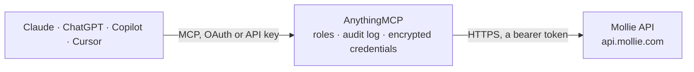

<!-- Generated by scripts/export-github-catalog.mjs in the anythingmcp-website repository. Do not edit by hand. -->

# Mollie MCP connector

Drive Mollie (EU-friendly payments) from any AI agent: payments, payment links, refunds, customers, subscriptions, mandates, methods. 18 tools, Bearer auth. The AnythingMCP connector gives Claude, ChatGPT, Microsoft Copilot, Cursor and Gemini 18 MCP tools for Mollie: 10 read and 8 can change data.

**Category:** [Payments](../payments.md) · **Tools:** 18 · **Setup guide:** [anythingmcp.com](https://anythingmcp.com/guides/mollie-to-mcp) · [Deutsch](https://anythingmcp.com/de/guides/mollie-to-mcp) · [Italiano](https://anythingmcp.com/it/guides/mollie-to-mcp) · [Español](https://anythingmcp.com/es/guides/mollie-to-mcp) · [日本語](https://anythingmcp.com/ja/guides/mollie-to-mcp) · [Русский](https://anythingmcp.com/ru/guides/mollie-to-mcp) · [中文](https://anythingmcp.com/zh/guides/mollie-to-mcp)

## Start without code

No installation and no terminal: AnythingMCP Cloud runs the Mollie connector for you, operated by helpcode.ai in Frankfurt, Germany.

1. **Click the button above** and create an account or sign in. The Mollie connector opens, ready to install.
2. **Paste the API key or token from your Mollie account.** Every click is in the [step-by-step guide](https://anythingmcp.com/guides/mollie-to-mcp).
3. **Click Install.** AnythingMCP shows the address of your MCP server.
4. **Add that address to your assistant:** [Claude](https://anythingmcp.com/guides/connect-mollie-to-claude) · [ChatGPT](https://anythingmcp.com/guides/connect-mollie-to-chatgpt) · [Microsoft Copilot](https://anythingmcp.com/guides/connect-mollie-to-copilot) · [Cursor](https://anythingmcp.com/guides/connect-mollie-to-cursor) · [Gemini CLI](https://anythingmcp.com/guides/connect-mollie-to-gemini) · [Meta Muse](https://anythingmcp.com/guides/connect-mollie-to-muse).
5. **Ask your first question**, for example: *What is the status and checkout URL for payment tr_dk9a7F45 issued for invoice INV-2026-118?*

Prefer help with the setup? [Talk to us](https://anythingmcp.com/contact).

## How it works

- **The AI client** speaks MCP (Streamable HTTP) to AnythingMCP and only sees tool names, descriptions and results. It never gets the Mollie credentials.
- **AnythingMCP** checks the client's role, builds the call from the tool definition, adds the credentials (a bearer token), calls Mollie, logs the call and returns the result.
- **Mollie** sees an ordinary API client with the rights of the account the credentials belong to.

## Tools

| Tool | What it does | Access |
|---|---|---|
| [`mollie_list_methods`](#mollie_list_methods) | List payment methods enabled for the profile. | read |
| [`mollie_create_payment`](#mollie_create_payment) | Create a payment. | write |
| [`mollie_get_payment`](#mollie_get_payment) | Fetch a payment by ID. | read |
| [`mollie_list_payments`](#mollie_list_payments) | List payments. | read |
| [`mollie_cancel_payment`](#mollie_cancel_payment) | Cancel a payment in 'open' state (before customer pays). | write |
| [`mollie_create_refund`](#mollie_create_refund) | Refund a paid payment. | write |
| [`mollie_list_refunds`](#mollie_list_refunds) | List refunds (across all payments by default; pass paymentId for per-payment). | read |
| [`mollie_create_customer`](#mollie_create_customer) | Create a Mollie customer (required for recurring subscriptions, optional for one-off payments). | write |
| [`mollie_list_customers`](#mollie_list_customers) | List customers. | read |
| [`mollie_create_subscription`](#mollie_create_subscription) | Create a subscription for a customer. | write |
| [`mollie_cancel_subscription`](#mollie_cancel_subscription) | Cancel a subscription (stops future charges immediately). | write |
| [`mollie_list_subscriptions`](#mollie_list_subscriptions) | List subscriptions for a customer. | read |
| [`mollie_list_mandates`](#mollie_list_mandates) | List mandates (pre-authorized payment methods) on a customer. | read |
| [`mollie_revoke_mandate`](#mollie_revoke_mandate) | Revoke a mandate (stops future recurring charges using it). | write |
| [`mollie_list_payment_links`](#mollie_list_payment_links) | List payment links (newest first) with description, amount, paidAt (null = not paid yet), expiresAt, reusable and the hosted checkout URL under… | read |
| [`mollie_get_payment_link`](#mollie_get_payment_link) | Read one payment link: amount, description, whether and when it was paid (paidAt), expiry, allowed methods, lines and addresses, and the checkout URL to… | read |
| [`mollie_list_payment_link_payments`](#mollie_list_payment_link_payments) | List the payments made through one payment link (a reusable link can collect several), with status, method and amount. | read |
| [`mollie_create_payment_link`](#mollie_create_payment_link) | Create a payment link: a hosted checkout page to send to a customer (by email, chat or on an invoice), no website needed. | write |

## Tool reference

Every parameter as the AI client sees it in `tools/list`. Source: [`packages/backend/src/adapters/intl/mollie.json`](../../../packages/backend/src/adapters/intl/mollie.json).

### `mollie_list_methods`

List payment methods enabled for the profile. Each method has id (e.g. 'ideal', 'creditcard', 'paypal', 'klarna', 'banktransfer'), description, minimumAmount, maximumAmount, image, status.

**Access:** read · **Call:** `GET /methods`

| Parameter | Type | Required | Description |
|---|---|---|---|
| `sequenceType` | string | no | first, recurring, oneoff. |
| `locale` | string | no | Locale for descriptions, e.g. 'en_US', 'nl_NL'. |
| `amount_currency` | string | no | Optional: only methods accepting this currency. |
| `amount_value` | string | no | Optional: only methods accepting this value (as decimal string). |

### `mollie_create_payment`

Create a payment. amount is {currency, value}. Always include `redirectUrl` (where the customer returns post-payment) and `webhookUrl` (where Mollie pushes status updates).

**Access:** write · **Call:** `POST /payments`

| Parameter | Type | Required | Description |
|---|---|---|---|
| `amount` | object | yes | {currency:'EUR', value:'10.00'} — value MUST be a string with 2 decimals. |
| `description` | string | yes | Shown to customer on Mollie checkout (≤255 chars). |
| `redirectUrl` | string | no | URL the customer is sent back to after payment. |
| `webhookUrl` | string | no | Your endpoint that receives payment-status notifications. |
| `method` | string | no | Restrict to a method (or array of methods). Omit to show Mollie's full checkout. |
| `metadata` | object | no | Free-form key/value (≤1KB) — passes through unchanged. |
| `locale` | string | no | Mollie checkout language: en_US, nl_NL, de_DE, fr_FR, es_ES, it_IT, pt_PT, pl_PL, ... |
| `customerId` | string | no | Mollie customer ID (for recurring or saved methods). |
| `sequenceType` | string | no | first (creates mandate for future recurring), recurring (uses existing mandate), oneoff (default). |
| `mandateId` | string | no | Mandate ID for recurring. |

### `mollie_get_payment`

Fetch a payment by ID. Returns status + _links.checkout (URL to send customer to) for pending payments.

**Access:** read · **Call:** `GET /payments/{paymentId}`

| Parameter | Type | Required | Description |
|---|---|---|---|
| `paymentId` | string | yes | Payment ID (starts with 'tr_'). |

### `mollie_list_payments`

List payments. Filter by profile, customer, status, mandate. Cursor-paginated.

**Access:** read · **Call:** `GET /payments`

| Parameter | Type | Required | Description |
|---|---|---|---|
| `from` | string | no | Cursor: payment ID to start from. |
| `limit` | integer | no | Max per page (default 50, max 250). |
| `profileId` | string | no | Filter by profile. |
| `testmode` | boolean | no | true for test, false for live (defaults to key's environment). |

### `mollie_cancel_payment`

Cancel a payment in 'open' state (before customer pays). After 'paid' use refund instead.

**Access:** write · **Call:** `DELETE /payments/{paymentId}`

| Parameter | Type | Required | Description |
|---|---|---|---|
| `paymentId` | string | yes | Payment ID. |

### `mollie_create_refund`

Refund a paid payment. Full refund: omit amount. Partial: pass amount {currency,value}.

**Access:** write · **Call:** `POST /payments/{paymentId}/refunds`

| Parameter | Type | Required | Description |
|---|---|---|---|
| `paymentId` | string | yes | Payment ID to refund. |
| `amount` | object | no | {currency,value} — omit for full refund. |
| `description` | string | no | Refund description (shown on bank statement when possible). |
| `metadata` | object | no | Free-form metadata. |

### `mollie_list_refunds`

List refunds (across all payments by default; pass paymentId for per-payment).

**Access:** read · **Call:** `GET /refunds`

| Parameter | Type | Required | Description |
|---|---|---|---|
| `paymentId` | string | no | Optional: limit to one payment. |
| `from` | string | no | Cursor. |
| `limit` | integer | no | Max per page. |

### `mollie_create_customer`

Create a Mollie customer (required for recurring subscriptions, optional for one-off payments). Customer is the durable identity across payments.

**Access:** write · **Call:** `POST /customers`

| Parameter | Type | Required | Description |
|---|---|---|---|
| `name` | string | no | Customer name. |
| `email` | string | no | Email. |
| `locale` | string | no | Default locale for emails/checkout. |
| `metadata` | object | no | Free-form metadata. |

### `mollie_list_customers`

List customers. Cursor-paginated.

**Access:** read · **Call:** `GET /customers`

| Parameter | Type | Required | Description |
|---|---|---|---|
| `from` | string | no | Cursor. |
| `limit` | integer | no | Per page. |

### `mollie_create_subscription`

Create a subscription for a customer. Required: customerId + amount + interval. interval examples: '1 month', '14 days', '1 year'. Requires the customer to have an active mandate (created via a `sequenceType=first` payment).

**Access:** write · **Call:** `POST /customers/{customerId}/subscriptions`

| Parameter | Type | Required | Description |
|---|---|---|---|
| `customerId` | string | yes | Customer ID (starts with 'cst_'). |
| `amount` | object | yes | {currency, value}. |
| `times` | integer | no | Optional max charges (omit for unlimited). |
| `interval` | string | yes | Charge cadence: '1 month', '14 days', '1 year'. |
| `startDate` | string | no | YYYY-MM-DD when first charge happens. |
| `description` | string | yes | Shown on each invoice. |
| `method` | string | no | Restrict to a method (e.g. 'directdebit'). |
| `mandateId` | string | no | Mandate to use (defaults to customer's most recent). |
| `webhookUrl` | string | no | Endpoint for subscription event notifications. |
| `metadata` | object | no | Free-form metadata. |

### `mollie_cancel_subscription`

Cancel a subscription (stops future charges immediately).

**Access:** write · **Call:** `DELETE /customers/{customerId}/subscriptions/{subscriptionId}`

| Parameter | Type | Required | Description |
|---|---|---|---|
| `customerId` | string | yes | Customer ID. |
| `subscriptionId` | string | yes | Subscription ID (starts with 'sub_'). |

### `mollie_list_subscriptions`

List subscriptions for a customer.

**Access:** read · **Call:** `GET /customers/{customerId}/subscriptions`

| Parameter | Type | Required | Description |
|---|---|---|---|
| `customerId` | string | yes | Customer ID. |
| `from` | string | no | Cursor. |
| `limit` | integer | no | Per page. |

### `mollie_list_mandates`

List mandates (pre-authorized payment methods) on a customer.

**Access:** read · **Call:** `GET /customers/{customerId}/mandates`

| Parameter | Type | Required | Description |
|---|---|---|---|
| `customerId` | string | yes | Customer ID. |
| `from` | string | no | Cursor. |
| `limit` | integer | no | Per page. |

### `mollie_revoke_mandate`

Revoke a mandate (stops future recurring charges using it).

**Access:** write · **Call:** `DELETE /customers/{customerId}/mandates/{mandateId}`

| Parameter | Type | Required | Description |
|---|---|---|---|
| `customerId` | string | yes | Customer ID. |
| `mandateId` | string | yes | Mandate ID (mdt_*). |

### `mollie_list_payment_links`

List payment links (newest first) with description, amount, paidAt (null = not paid yet), expiresAt, reusable and the hosted checkout URL under _links.paymentLink. Page with `from` = the id of the first link of the next page (_links.next). If the list is unexpectedly empty, read a known link by id with mollie_get_payment_link.

**Access:** read · **Call:** `GET /payment-links`

| Parameter | Type | Required | Description |
|---|---|---|---|
| `limit` | integer | no | Links per page, 1 to 250. Default 50. |
| `from` | string | no | Payment link id (pl_...) to start from, for paging. |

### `mollie_get_payment_link`

Read one payment link: amount, description, whether and when it was paid (paidAt), expiry, allowed methods, lines and addresses, and the checkout URL to share under _links.paymentLink.href.

**Access:** read · **Call:** `GET /payment-links/{paymentLinkId}`

| Parameter | Type | Required | Description |
|---|---|---|---|
| `paymentLinkId` | string | yes | Payment link id, starts with pl_. |

### `mollie_list_payment_link_payments`

List the payments made through one payment link (a reusable link can collect several), with status, method and amount.

**Access:** read · **Call:** `GET /payment-links/{paymentLinkId}/payments`

| Parameter | Type | Required | Description |
|---|---|---|---|
| `paymentLinkId` | string | yes | Payment link id, starts with pl_. |
| `limit` | integer | no | Payments per page, 1 to 250. |
| `from` | string | no | Payment id (tr_...) to start from, for paging. |

### `mollie_create_payment_link`

Create a payment link: a hosted checkout page to send to a customer (by email, chat or on an invoice), no website needed. Returns the link with its URL under _links.paymentLink.href. The amount is {"currency": "EUR", "value": "10.00"} with the value as a string. Billie, Klarna and Riverty need lines and billingAddress, and the lines' totalAmount must add up to amount. With a live key this creates a real payable link: confirm amount and description with the user first.

**Access:** write · **Call:** `POST /payment-links`

| Parameter | Type | Required | Description |
|---|---|---|---|
| `description` | string | yes | Shown on the checkout page and the bank statement, e.g. Invoice RE-2026-0142. |
| `amount` | object | no | {"currency": "EUR", "value": "49.90"}. Omit only for a reusable link where the customer enters the amount. |
| `redirectUrl` | string | no | Where the customer lands after paying. |
| `webhookUrl` | string | no | Where Mollie posts status changes. |
| `expiresAt` | string | no | Expiry as ISO 8601, e.g. 2026-11-30T23:59:00+01:00. |
| `reusable` | boolean | no | true lets the link be paid more than once. |
| `allowedMethods` | string[] | no | Restrict the methods, e.g. ["ideal", "creditcard", "banktransfer"]. |
| `lines` | object[] | no | Order lines: [{"description", "quantity", "unitPrice": {currency, value}, "totalAmount": {currency, value}, "vatRate": "21.00", "vatAmount": {currency, value}}]. |
| `billingAddress` | object | no | {"givenName", "familyName", "organizationName", "email", "streetAndNumber", "postalCode", "city", "country"}. |
| `shippingAddress` | object | no | Same shape as billingAddress. |
| `profileId` | string | no | Only with an organization access token. Leave out with an API key (live_ or test_): the key already belongs to one profile. |

## Run it yourself

AnythingMCP is open source (AGPL-3.0). [Run it with Docker](../../../README.md#run-it-yourself), open **Connectors → Store**, pick **Mollie** and enter `MOLLIE_API_KEY`, then add your MCP server URL to the AI client.

[← Payments connectors](../payments.md) · [All categories](../README.md)
