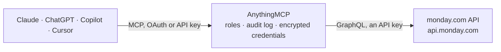

<!-- Generated by scripts/export-github-catalog.mjs in the anythingmcp-website repository. Do not edit by hand. -->

# monday.com MCP connector

Let your AI work in monday.com: find boards and items, read column values and comments, create items, update statuses, dates and owners, and post updates. The AnythingMCP connector gives Claude, ChatGPT, Microsoft Copilot, Cursor and Gemini 15 MCP tools for monday.com: 9 read and 6 can change data.

**Category:** [Project Management](../project-management.md) · **Tools:** 15 · **Setup guide:** [anythingmcp.com](https://anythingmcp.com/guides/monday-to-mcp) · [Deutsch](https://anythingmcp.com/de/guides/monday-to-mcp) · [Italiano](https://anythingmcp.com/it/guides/monday-to-mcp) · [Español](https://anythingmcp.com/es/guides/monday-to-mcp) · [日本語](https://anythingmcp.com/ja/guides/monday-to-mcp) · [Русский](https://anythingmcp.com/ru/guides/monday-to-mcp) · [中文](https://anythingmcp.com/zh/guides/monday-to-mcp)

## Start without code

No installation and no terminal: AnythingMCP Cloud runs the monday.com connector for you, operated by helpcode.ai in Frankfurt, Germany.

1. **Click the button above** and create an account or sign in. The monday.com connector opens, ready to install.
2. **Paste the API key or token from your monday.com account.** Every click is in the [step-by-step guide](https://anythingmcp.com/guides/monday-to-mcp).
3. **Click Install.** AnythingMCP shows the address of your MCP server.
4. **Add that address to your assistant:** [Claude](https://anythingmcp.com/guides/connect-monday-to-claude) · [ChatGPT](https://anythingmcp.com/guides/connect-monday-to-chatgpt) · [Microsoft Copilot](https://anythingmcp.com/guides/connect-monday-to-copilot) · [Cursor](https://anythingmcp.com/guides/connect-monday-to-cursor) · [Gemini CLI](https://anythingmcp.com/guides/connect-monday-to-gemini) · [Meta Muse](https://anythingmcp.com/guides/connect-monday-to-muse).
5. **Ask your first question**, for example: *Show the item for invoice INV-2026-1123 on the Finance — Invoices board, I need amount, status and due date*

Prefer help with the setup? [Talk to us](https://anythingmcp.com/contact).

## How it works

- **The AI client** speaks MCP (Streamable HTTP) to AnythingMCP and only sees tool names, descriptions and results. It never gets the monday.com credentials.
- **AnythingMCP** checks the client's role, builds the call from the tool definition, adds the credentials (an API key), calls monday.com, logs the call and returns the result.
- **monday.com** sees an ordinary API client with the rights of the account the credentials belong to.

## Tools

| Tool | What it does | Access |
|---|---|---|
| [`monday_get_me`](#monday_get_me) | Check the token and return who it acts as: user id, name, email, title, time zone, and the account's id, name, slug and plan tier. | read |
| [`monday_list_workspaces`](#monday_list_workspaces) | List the workspaces the user can see: id, name, kind (open, closed, template) and description, a page at a time. | read |
| [`monday_list_boards`](#monday_list_boards) | List boards the user can access: id, name, description, kind (public, private, share), state, workspace id, item count, last update and URL. | read |
| [`monday_get_board`](#monday_get_board) | Get one board's structure: name, workspace, owners, item count, its groups (id, title, color, position) and its columns (id, title, type and settings, which… | read |
| [`monday_get_items_page`](#monday_get_items_page) | Read a board's items with their column values (id, type, text and raw JSON value), optionally filtered and sorted with query_params, up to 500 per page. | read |
| [`monday_next_items_page`](#monday_next_items_page) | Fetch the next page of items for a cursor returned by monday_get_items_page (or by a previous call of this tool), with the same item fields. | read |
| [`monday_get_items`](#monday_get_items) | Get items by id, from any board: name, board, group, state, creator, timestamps, URL, all column values and their subitems (id and name). | read |
| [`monday_create_item`](#monday_create_item) | Create an item on a board, optionally in a group and with column values. | write |
| [`monday_change_column_values`](#monday_change_column_values) | Change one or more column values of an item, including its name (column id "name"). | write |
| [`monday_move_item_to_group`](#monday_move_item_to_group) | Move an item to another group of the same board. | write |
| [`monday_create_group`](#monday_create_group) | Add a group (section) to a board, at the top by default or next to another group. | write |
| [`monday_list_updates`](#monday_list_updates) | Read the updates (comments) on an item, newest first, with their replies: id, plain text, HTML body, creator and time. | read |
| [`monday_create_update`](#monday_create_update) | Post an update (comment) on an item, or a reply to an update with parent_id. | write |
| [`monday_list_users`](#monday_list_users) | List the account's users: id, name, email, title, kind (admin, member, guest, view_only), status and time zone. | read |
| [`monday_archive_item`](#monday_archive_item) | Archive an item and its subitems: it leaves the board and can be restored from the board's archive. | write |

## Tool reference

Every parameter as the AI client sees it in `tools/list`. Source: [`packages/backend/src/adapters/intl/monday.json`](../../../packages/backend/src/adapters/intl/monday.json).

### `monday_get_me`

Check the token and return who it acts as: user id, name, email, title, time zone, and the account's id, name, slug and plan tier.

**Access:** read · **Call:** `query query Me { me { id name email title kind time_zone_identifier account { id name slug tier plan { tier max_users } } } }`

No parameters.

### `monday_list_workspaces`

List the workspaces the user can see: id, name, kind (open, closed, template) and description, a page at a time. Workspace ids narrow monday_list_boards.

**Access:** read · **Call:** `query query Workspaces($limit: Int = 25, $page: Int = 1) { workspaces(limit: $limit, page: $page) { id name kind description } }`

| Parameter | Type | Required | Description |
|---|---|---|---|
| `limit` | integer | no | Workspaces per page (default 25). |
| `page` | integer | no | Page number, starting at 1. |

### `monday_list_boards`

List boards the user can access: id, name, description, kind (public, private, share), state, workspace id, item count, last update and URL. Pages with limit and page; an empty list means no more pages.

**Access:** read · **Call:** `query query Boards($workspaceIds: [ID], $state: State = active, $orderBy: BoardsOrderBy, $limit: Int = 25, $page: Int = 1) { boards(workspace_ids: $workspaceIds, state: $state, order_by: $orderBy, limit: $limit, page: $page) { id name description board_kind state workspace_id items_count updated_at url } }`

| Parameter | Type | Required | Description |
|---|---|---|---|
| `workspace_ids` | string[] | no | Only boards in these workspaces (ids from monday_list_workspaces). |
| `state` | `active` \| `archived` \| `deleted` \| `all` | no | Board state (default active). |
| `order_by` | `created_at` \| `used_at` | no | Sort by creation date or last use, newest first. |
| `limit` | integer | no | Boards per page (default 25). |
| `page` | integer | no | Page number, starting at 1. |

### `monday_get_board`

Get one board's structure: name, workspace, owners, item count, its groups (id, title, color, position) and its columns (id, title, type and settings, which hold the allowed status and dropdown labels). Read this before filtering items or writing column values.

**Access:** read · **Call:** `query query Board($boardId: ID!) { boards(ids: [$boardId]) { id name description board_kind state items_count url workspace { id name } owners { id name } groups { id title color position archived } columns { id title type description settings } } }`

| Parameter | Type | Required | Description |
|---|---|---|---|
| `board_id` | string | yes | Board id, e.g. "1234567890" (the number in the board URL). |

### `monday_get_items_page`

Read a board's items with their column values (id, type, text and raw JSON value), optionally filtered and sorted with query_params, up to 500 per page. Returns items and a cursor: while it is not null, call monday_next_items_page with it. Cursors expire 60 minutes after the first request.

**Access:** read · **Call:** `query query ItemsPage($boardId: ID!, $limit: Int! = 25, $queryParams: ItemsQuery, $columnIds: [String!]) { boards(ids: [$boardId]) { id name items_page(limit: $limit, query_params: $queryParams) { cursor items { id name state url created_at updated_at group { id title } column_values(ids: $columnIds) { id type text value } } } } }`

| Parameter | Type | Required | Description |
|---|---|---|---|
| `board_id` | string | yes | Board id. |
| `limit` | integer | no | Items per page, 1 to 500 (default 25). |
| `column_ids` | string[] | no | Only these column ids (from monday_get_board), e.g. ["status", "person", "date4"]. Leave out for all columns. |
| `query_params` | object | no | Optional filter and sort. Example: {"rules": [{"column_id": "status", "compare_value": [1], "operator": "any_of"}], "operator": "and", "order_by": [{"column_id": "date4", "direction": "desc"}]}. Rule operators: any_of, not_any_of, is_empty, is_not_empty, greater_than, greater_than_or_equals, lower_than, lower_than_or_equal, between, contains_text, not_contains_text, contains_terms, starts_with, ends_with, within_the_last, within_the_next. Status columns compare label indexes from the column settings; people columns compare "person-<user id>"; "group" as column_id filters by group id; ids: [item ids] limits to given items. |

### `monday_next_items_page`

Fetch the next page of items for a cursor returned by monday_get_items_page (or by a previous call of this tool), with the same item fields. Returns a new cursor, null on the last page.

**Access:** read · **Call:** `query query NextItemsPage($cursor: String!, $limit: Int! = 25, $columnIds: [String!]) { next_items_page(cursor: $cursor, limit: $limit) { cursor items { id name state url created_at updated_at group { id title } column_values(ids: $columnIds) { id type text value } } } }`

| Parameter | Type | Required | Description |
|---|---|---|---|
| `cursor` | string | yes | cursor from the previous page. |
| `limit` | integer | no | Items per page, 1 to 500 (default 25). |
| `column_ids` | string[] | no | Only these column ids (from monday_get_board), e.g. ["status", "person", "date4"]. Leave out for all columns. |

### `monday_get_items`

Get items by id, from any board: name, board, group, state, creator, timestamps, URL, all column values and their subitems (id and name).

**Access:** read · **Call:** `query query Items($ids: [ID!], $columnIds: [String!]) { items(ids: $ids, limit: 100) { id name state url created_at updated_at creator { id name } board { id name } group { id title } column_values(ids: $columnIds) { id type text value } subitems { id name } } }`

| Parameter | Type | Required | Description |
|---|---|---|---|
| `item_ids` | string[] | yes | Item ids, up to 100. |
| `column_ids` | string[] | no | Only these column ids (from monday_get_board), e.g. ["status", "person", "date4"]. Leave out for all columns. |

### `monday_create_item`

Create an item on a board, optionally in a group and with column values. Returns the new item's id, name and URL. Show the user what will be created and wait for confirmation; never retry a successful create.

**Access:** write · **Call:** `mutation mutation CreateItem($boardId: ID!, $itemName: String!, $groupId: String, $columnValues: JSON, $createLabels: Boolean) { create_item(board_id: $boardId, item_name: $itemName, group_id: $groupId, column_values: $columnValues, create_labels_if_missing: $createLabels) { id name url group { id title } } }`

| Parameter | Type | Required | Description |
|---|---|---|---|
| `board_id` | string | yes | Board id. |
| `item_name` | string | yes | Item name (the first column). |
| `group_id` | string | no | Group id from monday_get_board, e.g. "topics". Default: the board's top group. |
| `column_values` | string | no | Column values as a JSON string keyed by column id, e.g. "{\"status\": {\"label\": \"Working on it\"}, \"date4\": {\"date\": \"2026-10-15\"}, \"person\": {\"personsAndTeams\": [{\"id\": 123, \"kind\": \"person\"}]}, \"text\": \"Hello\"}". Simple columns (text, numbers) take a plain string. |
| `create_labels_if_missing` | boolean | no | true to add status or dropdown labels that do not exist yet (needs board owner rights). |

### `monday_change_column_values`

Change one or more column values of an item, including its name (column id "name"). Only the given columns change. Returns the item with the changed columns' text. Confirm with the user before writing.

**Access:** write · **Call:** `mutation mutation ChangeColumnValues($boardId: ID!, $itemId: ID, $columnValues: JSON!, $createLabels: Boolean) { change_multiple_column_values(board_id: $boardId, item_id: $itemId, column_values: $columnValues, create_labels_if_missing: $createLabels) { id name column_values { id text } } }`

| Parameter | Type | Required | Description |
|---|---|---|---|
| `board_id` | string | yes | Board id of the item. |
| `item_id` | string | yes | Item id. |
| `column_values` | string | yes | JSON string keyed by column id, e.g. "{\"status\": {\"label\": \"Done\"}, \"numbers\": \"42\", \"name\": \"New name\"}". To clear a column send an empty value, e.g. {\"status\": null} or {\"text\": \"\"}. |
| `create_labels_if_missing` | boolean | no | true to add status or dropdown labels that do not exist yet. |

### `monday_move_item_to_group`

Move an item to another group of the same board. Returns the item with its new group. Confirm with the user before writing.

**Access:** write · **Call:** `mutation mutation MoveItem($itemId: ID, $groupId: String!) { move_item_to_group(item_id: $itemId, group_id: $groupId) { id name group { id title } } }`

| Parameter | Type | Required | Description |
|---|---|---|---|
| `item_id` | string | yes | Item id. |
| `group_id` | string | yes | Target group id from monday_get_board. |

### `monday_create_group`

Add a group (section) to a board, at the top by default or next to another group. Returns the group id and title. Confirm with the user before writing.

**Access:** write · **Call:** `mutation mutation CreateGroup($boardId: ID!, $groupName: String!, $relativeTo: String, $method: PositionRelative) { create_group(board_id: $boardId, group_name: $groupName, relative_to: $relativeTo, position_relative_method: $method) { id title } }`

| Parameter | Type | Required | Description |
|---|---|---|---|
| `board_id` | string | yes | Board id. |
| `group_name` | string | yes | Group title. |
| `relative_to` | string | no | Id of an existing group to place the new one next to. |
| `position_relative_method` | `before_at` \| `after_at` | no | Place before or after relative_to. |

### `monday_list_updates`

Read the updates (comments) on an item, newest first, with their replies: id, plain text, HTML body, creator and time. Returns a cursor for older updates while it is not null.

**Access:** read · **Call:** `query query Updates($itemId: ID!, $limit: Int = 25, $cursor: String) { items(ids: [$itemId]) { id name updates_page(limit: $limit, cursor: $cursor) { cursor updates { id text_body body created_at creator { id name } replies { id text_body created_at creator { id name } } } } } }`

| Parameter | Type | Required | Description |
|---|---|---|---|
| `item_id` | string | yes | Item id. |
| `limit` | integer | no | Updates per page (default 25). |
| `cursor` | string | no | cursor from the previous page. |

### `monday_create_update`

Post an update (comment) on an item, or a reply to an update with parent_id. The body accepts simple HTML. People who follow the item are notified. Confirm the text with the user before posting.

**Access:** write · **Call:** `mutation mutation CreateUpdate($itemId: ID, $body: String!, $parentId: ID) { create_update(item_id: $itemId, body: $body, parent_id: $parentId) { id text_body created_at item_id } }`

| Parameter | Type | Required | Description |
|---|---|---|---|
| `item_id` | string | no | Item id to comment on. |
| `body` | string | yes | Update text; HTML such as 
, <b>, <ul><li> is allowed. |
| `parent_id` | string | no | Update id to reply to, instead of starting a new update. |

### `monday_list_users`

List the account's users: id, name, email, title, kind (admin, member, guest, view_only), status and time zone. Filter by name or email. User ids are what people columns and mentions use.

**Access:** read · **Call:** `query query Users($name: String, $emails: [String!], $limit: Int = 50, $page: Int = 1) { users(name: $name, emails: $emails, limit: $limit, page: $page) { id name email title kind status is_deleted time_zone_identifier } }`

| Parameter | Type | Required | Description |
|---|---|---|---|
| `name` | string | no | Only users whose name contains this text. |
| `emails` | string[] | no | Only users with these email addresses. |
| `limit` | integer | no | Users per page (default 50). |
| `page` | integer | no | Page number, starting at 1. |

### `monday_archive_item`

Archive an item and its subitems: it leaves the board and can be restored from the board's archive. Installed switched off; turn it on only if the AI should remove items, and confirm every archive with the user.

**Access:** write · **Call:** `mutation mutation ArchiveItem($itemId: ID) { archive_item(item_id: $itemId) { id name state } }`

| Parameter | Type | Required | Description |
|---|---|---|---|
| `item_id` | string | yes | Item id to archive. |

## Run it yourself

AnythingMCP is open source (AGPL-3.0). [Run it with Docker](../../../README.md#run-it-yourself), open **Connectors → Store**, pick **monday.com** and enter `MONDAY_API_TOKEN`, then add your MCP server URL to the AI client.

[← Project Management connectors](../project-management.md) · [All categories](../README.md)
