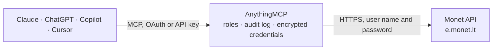

<!-- Generated by scripts/export-github-catalog.mjs in the anythingmcp-website repository. Do not edit by hand. -->

# Monet MCP connector

Connect MONET, the Lithuanian cloud accounting system, to Claude or ChatGPT: customers and vendors with balances and open items, sales and purchase invoices, items and stock, contracts, and every … The AnythingMCP connector gives Claude, ChatGPT, Microsoft Copilot, Cursor and Gemini 42 MCP tools for Monet: 27 read and 15 can change data.

**Category:** [Accounting](../accounting.md) · **Tools:** 42 · **Setup guide:** [anythingmcp.com](https://anythingmcp.com/guides/monet-to-mcp) · [Deutsch](https://anythingmcp.com/de/guides/monet-to-mcp) · [Italiano](https://anythingmcp.com/it/guides/monet-to-mcp) · [Español](https://anythingmcp.com/es/guides/monet-to-mcp) · [日本語](https://anythingmcp.com/ja/guides/monet-to-mcp) · [Русский](https://anythingmcp.com/ru/guides/monet-to-mcp) · [中文](https://anythingmcp.com/zh/guides/monet-to-mcp)

## Start without code

No installation and no terminal: AnythingMCP Cloud runs the Monet connector for you, operated by helpcode.ai in Frankfurt, Germany.

1. **Click the button above** and create an account or sign in. The Monet connector opens, ready to install.
2. **Paste the API key or token from your Monet account.** Every click is in the [step-by-step guide](https://anythingmcp.com/guides/monet-to-mcp).
3. **Click Install.** AnythingMCP shows the address of your MCP server.
4. **Add that address to your assistant:** [Claude](https://anythingmcp.com/guides/connect-monet-to-claude) · [ChatGPT](https://anythingmcp.com/guides/connect-monet-to-chatgpt) · [Microsoft Copilot](https://anythingmcp.com/guides/connect-monet-to-copilot) · [Cursor](https://anythingmcp.com/guides/connect-monet-to-cursor) · [Gemini CLI](https://anythingmcp.com/guides/connect-monet-to-gemini) · [Meta Muse](https://anythingmcp.com/guides/connect-monet-to-muse).
5. **Ask your first question**, for example: *What's the current balance and open items for customer Riverton Elektronika UAB (short code REUAB)?*

Prefer help with the setup? [Talk to us](https://anythingmcp.com/contact).

## How it works

- **The AI client** speaks MCP (Streamable HTTP) to AnythingMCP and only sees tool names, descriptions and results. It never gets the Monet credentials.
- **AnythingMCP** checks the client's role, builds the call from the tool definition, adds the credentials (user name and password), calls Monet, logs the call and returns the result.
- **Monet** sees an ordinary API client with the rights of the account the credentials belong to.

## Tools

| Tool | What it does | Access |
|---|---|---|
| [`monet_get_company`](#monet_get_company) | Read the company the Monet login currently works in (GetCompany): its name and code. | read |
| [`monet_list_companies`](#monet_list_companies) | List the companies this Monet login can switch to (GetCompanyList), for accountants and groups with several companies under one login. | read |
| [`monet_set_company`](#monet_set_company) | Switch the current company of this Monet login to another one from monet_list_companies (SetCompany). | write |
| [`monet_get_language`](#monet_get_language) | Read the interface language set for this Monet login (GetLanguage), which also decides the language of report headings and some messages. | read |
| [`monet_list_currencies`](#monet_list_currencies) | List the currency codes defined in the current company (GetCurrencyCodeList), e.g. EUR, USD, PLN, to use on invoices and in filters. | read |
| [`monet_list_dimensions`](#monet_list_dimensions) | List dimensions (požymiai) of the current company (GetDimList): departments, projects or products used to split postings. | read |
| [`monet_list_ledger_accounts`](#monet_list_ledger_accounts) | List the chart of accounts of the current company (GetLedgerList): account numbers and names, to read reports and post service lines to the right account. | read |
| [`monet_list_vat_groups`](#monet_list_vat_groups) | List the VAT codes (PVM kodai, item tax groups) of the current company (GetTaxItemGroupList), used on invoice lines and items. | read |
| [`monet_list_warehouses`](#monet_list_warehouses) | List the warehouses (sandėliai) of the current company (GetLocationList), for stock quantities and item and invoice lines. | read |
| [`monet_list_item_groups`](#monet_list_item_groups) | List the item groups (prekių grupės) of the current company (GetItemGroupList), to filter items and stock reports by group. | read |
| [`monet_list_item_types`](#monet_list_item_types) | List the item types (prekių tipai) defined in the current company (GetItemTypeList), such as stocked goods or services. | read |
| [`monet_list_customers`](#monet_list_customers) | List customers (klientai) of the current company (GetCustList) with their short code (account number), name, company and VAT codes, contacts and terms. | read |
| [`monet_list_vendors`](#monet_list_vendors) | List vendors (tiekėjai) of the current company (GetVendList) with their short code, name, company and VAT codes, contacts and terms. | read |
| [`monet_get_customer_balance`](#monet_get_customer_balance) | Read the balance a customer owes or has in credit (GetCustBalance), by customer short code. | read |
| [`monet_list_customer_open_items`](#monet_list_customer_open_items) | List a customer's open (not fully settled) invoices and payments (GetCustOpenPayments) with amounts, due dates and what is left to settle. | read |
| [`monet_get_vendor_balance`](#monet_get_vendor_balance) | Read the balance owed to a vendor (GetVendBalance), by vendor short code. | read |
| [`monet_list_vendor_open_items`](#monet_list_vendor_open_items) | List a vendor's open (not fully settled) invoices and payments (GetVendOpenPayments) with amounts, due dates and what is left to pay. | read |
| [`monet_list_sales_invoices`](#monet_list_sales_invoices) | List sales invoices (pardavimo sąskaitos faktūros) in a date range (GetCustInvoiceList), with number, customer, dates, amounts and VAT. | read |
| [`monet_list_purchase_invoices`](#monet_list_purchase_invoices) | List purchase invoices (pirkimo sąskaitos faktūros) in a date range (GetVendInvoiceList), with number, vendor, dates, amounts and VAT. | read |
| [`monet_get_sales_invoice_balance`](#monet_get_sales_invoice_balance) | Read what is still open on one sales invoice of a customer (GetCustInvoiceBalanceCur), in the invoice currency. | read |
| [`monet_get_purchase_invoice_balance`](#monet_get_purchase_invoice_balance) | Read what is still open on one purchase invoice of a vendor (GetVendInvoiceBalanceCur), in the invoice currency. | read |
| [`monet_list_items`](#monet_list_items) | List items and services (prekės) of the current company (GetItemList) with number, name, group, type, unit and prices. | read |
| [`monet_get_item`](#monet_get_item) | Read one item with its stock on hand per warehouse (GetItem), by item number. | read |
| [`monet_list_stock_quantities`](#monet_list_stock_quantities) | List stock quantities on hand (ItemsQuantity): all items, or with _all false only the items whose stock changed today, which suits a daily sync. | read |
| [`monet_list_sales_contracts`](#monet_list_sales_contracts) | List sales contracts (sutartys) with their billing schedule (GetSalesSchedList), filtered by contract number and/or customer. | read |
| [`monet_get_employee_timetable`](#monet_get_employee_timetable) | Read the work timetable of employees of a company for a period (GetCompanyWorkerTimeTable): hours per day per employment agreement. | read |
| [`monet_get_report_parameters`](#monet_get_report_parameters) | List the parameters a Monet report takes (GetReportParameters): key, label, type (DateTime, String, Integer), whether it is required and whether several… | read |
| [`monet_get_report`](#monet_get_report) | Run a Monet report and get its content (GetReport): general ledger, trial balance, profit and loss, VAT, customer and vendor transactions and debts, stock… | read |
| [`monet_create_customer`](#monet_create_customer) | Create a customer (klientas) in the current company (InsertCust). | write |
| [`monet_update_customer`](#monet_update_customer) | Change an existing customer (klientas) in the current company (UpdateCust). | write |
| [`monet_create_vendor`](#monet_create_vendor) | Create a vendor (tiekėjas) in the current company (InsertVend). | write |
| [`monet_update_vendor`](#monet_update_vendor) | Change an existing vendor (tiekėjas) in the current company (UpdateVend). | write |
| [`monet_delete_customer`](#monet_delete_customer) | Delete a customer (DeleteCust) by short code. | write |
| [`monet_delete_vendor`](#monet_delete_vendor) | Delete a vendor (DeleteVend) by short code. | write |
| [`monet_create_item`](#monet_create_item) | Create an item or service (InsertItem). | write |
| [`monet_update_item`](#monet_update_item) | Change an existing item (UpdateItem), identified by ItemId. | write |
| [`monet_delete_item`](#monet_delete_item) | Delete an item (DeleteItem) by item number. | write |
| [`monet_create_dimension`](#monet_create_dimension) | Add a dimension value (InsertDim): a department, project or product code used to split postings. | write |
| [`monet_create_sales_invoice`](#monet_create_sales_invoice) | Enter a sale of stocked items (PostSales): creates and, unless SkipPost, posts a sales invoice with item lines, moving stock out of the warehouse. | write |
| [`monet_create_sales_service_invoice`](#monet_create_sales_service_invoice) | Enter a sale of services (PostSalesService): creates and, unless SkipPost, posts a sales invoice with free-text service lines; no items are needed. | write |
| [`monet_create_purchase_invoice`](#monet_create_purchase_invoice) | Enter a purchase of stocked items (PostPurch): registers a vendor invoice with item lines and receives the stock, posted unless SkipPost. | write |
| [`monet_create_purchase_service_invoice`](#monet_create_purchase_service_invoice) | Enter a purchase of services (PostPurchService): registers a vendor invoice with expense lines on ledger accounts, posted unless SkipPost. | write |

## Tool reference

Every parameter as the AI client sees it in `tools/list`. Source: [`packages/backend/src/adapters/intl/monet.json`](../../../packages/backend/src/adapters/intl/monet.json).

### `monet_get_company`

Read the company the Monet login currently works in (GetCompany): its name and code. Every other call reads and writes this company, so check it first when the account has several.

**Access:** read · **Call:** `GET /GetCompany`

No parameters.

### `monet_list_companies`

List the companies this Monet login can switch to (GetCompanyList), for accountants and groups with several companies under one login. Filter by part of the name.

**Access:** read · **Call:** `GET /GetCompanyList`

| Parameter | Type | Required | Description |
|---|---|---|---|
| `_search` | string | no | Text to look for in the company name. Leave out to list all. |

### `monet_set_company`

Switch the current company of this Monet login to another one from monet_list_companies (SetCompany). All later calls of this login, from any client, then read and write that company until it is switched again. Changes no accounting data.

**Access:** write · **Call:** `PUT /SetCompany`

| Parameter | Type | Required | Description |
|---|---|---|---|
| `_company` | string | yes | Company id or code exactly as monet_list_companies returns it. |

### `monet_get_language`

Read the interface language set for this Monet login (GetLanguage), which also decides the language of report headings and some messages.

**Access:** read · **Call:** `GET /GetLanguage`

No parameters.

### `monet_list_currencies`

List the currency codes defined in the current company (GetCurrencyCodeList), e.g. EUR, USD, PLN, to use on invoices and in filters.

**Access:** read · **Call:** `GET /GetCurrencyCodeList`

| Parameter | Type | Required | Description |
|---|---|---|---|
| `_page` | integer | no | Page number, starting at 0. |
| `_size` | integer | no | Rows per page, 1 to 300. |
| `_search` | string | no | Text to look for in the currency code. Leave out to list all. |

### `monet_list_dimensions`

List dimensions (požymiai) of the current company (GetDimList): departments, projects or products used to split postings. Choose the kind with _type.

**Access:** read · **Call:** `GET /GetDimList`

| Parameter | Type | Required | Description |
|---|---|---|---|
| `_page` | integer | no | Page number, starting at 0. |
| `_size` | integer | no | Rows per page, 1 to 300. |
| `_type` | `0` \| `1` \| `2` | no | Kind of dimension: 0 department (padalinys), 1 project (projektas), 2 product (produktas). |
| `_search` | string | no | Text to look for in the dimension code or name. Leave out to list all. |

### `monet_list_ledger_accounts`

List the chart of accounts of the current company (GetLedgerList): account numbers and names, to read reports and post service lines to the right account.

**Access:** read · **Call:** `GET /GetLedgerList`

| Parameter | Type | Required | Description |
|---|---|---|---|
| `_page` | integer | no | Page number, starting at 0. |
| `_size` | integer | no | Rows per page, 1 to 300. |
| `_search` | string | no | Text to look for in the account number or name. Leave out to list all. |

### `monet_list_vat_groups`

List the VAT codes (PVM kodai, item tax groups) of the current company (GetTaxItemGroupList), used on invoice lines and items.

**Access:** read · **Call:** `GET /GetTaxItemGroupList`

| Parameter | Type | Required | Description |
|---|---|---|---|
| `_page` | integer | no | Page number, starting at 0. |
| `_size` | integer | no | Rows per page, 1 to 300. |
| `_search` | string | no | Text to look for in the VAT code. Leave out to list all. |

### `monet_list_warehouses`

List the warehouses (sandėliai) of the current company (GetLocationList), for stock quantities and item and invoice lines.

**Access:** read · **Call:** `GET /GetLocationList`

| Parameter | Type | Required | Description |
|---|---|---|---|
| `_page` | integer | no | Page number, starting at 0. |
| `_size` | integer | no | Rows per page, 1 to 300. |
| `_search` | string | no | Text to look for in the warehouse code or name. Leave out to list all. |

### `monet_list_item_groups`

List the item groups (prekių grupės) of the current company (GetItemGroupList), to filter items and stock reports by group.

**Access:** read · **Call:** `GET /GetItemGroupList`

| Parameter | Type | Required | Description |
|---|---|---|---|
| `_page` | integer | no | Page number, starting at 0. |
| `_size` | integer | no | Rows per page, 1 to 300. |
| `_search` | string | no | Text to look for in the group code or name. Leave out to list all. |

### `monet_list_item_types`

List the item types (prekių tipai) defined in the current company (GetItemTypeList), such as stocked goods or services.

**Access:** read · **Call:** `GET /GetItemTypeList`

| Parameter | Type | Required | Description |
|---|---|---|---|
| `_page` | integer | no | Page number, starting at 0. |
| `_size` | integer | no | Rows per page, 1 to 300. |
| `_search` | string | no | Text to look for in the type. Leave out to list all. |

### `monet_list_customers`

List customers (klientai) of the current company (GetCustList) with their short code (account number), name, company and VAT codes, contacts and terms. Search by short code or name.

**Access:** read · **Call:** `GET /GetCustList`

| Parameter | Type | Required | Description |
|---|---|---|---|
| `_page` | integer | no | Page number, starting at 0. |
| `_size` | integer | no | Rows per page, 1 to 300. |
| `_search` | string | no | Text to look for in the customer short code or name. Leave out to list all. |

### `monet_list_vendors`

List vendors (tiekėjai) of the current company (GetVendList) with their short code, name, company and VAT codes, contacts and terms. Search by short code or name.

**Access:** read · **Call:** `GET /GetVendList`

| Parameter | Type | Required | Description |
|---|---|---|---|
| `_page` | integer | no | Page number, starting at 0. |
| `_size` | integer | no | Rows per page, 1 to 300. |
| `_search` | string | no | Text to look for in the vendor short code or name. Leave out to list all. |

### `monet_get_customer_balance`

Read the balance a customer owes or has in credit (GetCustBalance), by customer short code. Positive amounts are receivables.

**Access:** read · **Call:** `GET /GetCustBalance`

| Parameter | Type | Required | Description |
|---|---|---|---|
| `_accountNum` | string | yes | The customer's short code (account number), as in monet_list_customers, e.g. 0001. |

### `monet_list_customer_open_items`

List a customer's open (not fully settled) invoices and payments (GetCustOpenPayments) with amounts, due dates and what is left to settle.

**Access:** read · **Call:** `GET /GetCustOpenPayments`

| Parameter | Type | Required | Description |
|---|---|---|---|
| `_page` | integer | no | Page number, starting at 0. |
| `_size` | integer | no | Rows per page, 1 to 300. |
| `_accountNum` | string | yes | The customer's short code (account number), as in monet_list_customers, e.g. 0001. |

### `monet_get_vendor_balance`

Read the balance owed to a vendor (GetVendBalance), by vendor short code.

**Access:** read · **Call:** `GET /GetVendBalance`

| Parameter | Type | Required | Description |
|---|---|---|---|
| `_accountNum` | string | yes | The vendor's short code (account number), as in monet_list_vendors, e.g. 0001. |

### `monet_list_vendor_open_items`

List a vendor's open (not fully settled) invoices and payments (GetVendOpenPayments) with amounts, due dates and what is left to pay.

**Access:** read · **Call:** `GET /GetVendOpenPayments`

| Parameter | Type | Required | Description |
|---|---|---|---|
| `_page` | integer | no | Page number, starting at 0. |
| `_size` | integer | no | Rows per page, 1 to 300. |
| `_accountNum` | string | yes | The vendor's short code (account number), as in monet_list_vendors, e.g. 0001. |

### `monet_list_sales_invoices`

List sales invoices (pardavimo sąskaitos faktūros) in a date range (GetCustInvoiceList), with number, customer, dates, amounts and VAT. Search by invoice number or customer name.

**Access:** read · **Call:** `GET /GetCustInvoiceList`

| Parameter | Type | Required | Description |
|---|---|---|---|
| `_page` | integer | no | Page number, starting at 0. |
| `_size` | integer | no | Rows per page, 1 to 300. |
| `_from` | string | yes | Period start, YYYY-MM-DD. |
| `_to` | string | yes | Period end, YYYY-MM-DD. |
| `_search` | string | no | Text to look for in the invoice number or customer name. Leave out to list all. |

### `monet_list_purchase_invoices`

List purchase invoices (pirkimo sąskaitos faktūros) in a date range (GetVendInvoiceList), with number, vendor, dates, amounts and VAT. Search by invoice number or vendor name.

**Access:** read · **Call:** `GET /GetVendInvoiceList`

| Parameter | Type | Required | Description |
|---|---|---|---|
| `_page` | integer | no | Page number, starting at 0. |
| `_size` | integer | no | Rows per page, 1 to 300. |
| `_from` | string | yes | Period start, YYYY-MM-DD. |
| `_to` | string | yes | Period end, YYYY-MM-DD. |
| `_search` | string | no | Text to look for in the invoice number or vendor name. Leave out to list all. |

### `monet_get_sales_invoice_balance`

Read what is still open on one sales invoice of a customer (GetCustInvoiceBalanceCur), in the invoice currency.

**Access:** read · **Call:** `GET /GetCustInvoiceBalanceCur`

| Parameter | Type | Required | Description |
|---|---|---|---|
| `_accountNum` | string | yes | The customer's short code (account number), as in monet_list_customers, e.g. 0001. |
| `_invoiceId` | string | yes | Sales invoice number, e.g. ADM-0000049. |

### `monet_get_purchase_invoice_balance`

Read what is still open on one purchase invoice of a vendor (GetVendInvoiceBalanceCur), in the invoice currency.

**Access:** read · **Call:** `GET /GetVendInvoiceBalanceCur`

| Parameter | Type | Required | Description |
|---|---|---|---|
| `_accountNum` | string | yes | The vendor's short code (account number), as in monet_list_vendors, e.g. 0001. |
| `_invoiceId` | string | yes | Purchase invoice number as registered in Monet. |

### `monet_list_items`

List items and services (prekės) of the current company (GetItemList) with number, name, group, type, unit and prices. Search by item number or name.

**Access:** read · **Call:** `GET /GetItemList`

| Parameter | Type | Required | Description |
|---|---|---|---|
| `_page` | integer | no | Page number, starting at 0. |
| `_size` | integer | no | Rows per page, 1 to 300. |
| `_search` | string | no | Text to look for in the item number or name. Leave out to list all. |

### `monet_get_item`

Read one item with its stock on hand per warehouse (GetItem), by item number.

**Access:** read · **Call:** `GET /GetItem`

| Parameter | Type | Required | Description |
|---|---|---|---|
| `itemId` | string | yes | Item number, as in monet_list_items. |
| `_showZero` | boolean | no | true to include warehouses where the item has no stock. |

### `monet_list_stock_quantities`

List stock quantities on hand (ItemsQuantity): all items, or with _all false only the items whose stock changed today, which suits a daily sync.

**Access:** read · **Call:** `GET /ItemsQuantity`

| Parameter | Type | Required | Description |
|---|---|---|---|
| `_page` | integer | no | Page number, starting at 0. |
| `_size` | integer | no | Rows per page, 1 to 300. |
| `_all` | boolean | no | true for all items, false for only items whose stock changed today. |
| `_showZero` | boolean | no | true to include warehouses where the item has no stock. |

### `monet_list_sales_contracts`

List sales contracts (sutartys) with their billing schedule (GetSalesSchedList), filtered by contract number and/or customer.

**Access:** read · **Call:** `GET /GetSalesSchedList`

| Parameter | Type | Required | Description |
|---|---|---|---|
| `_page` | integer | no | Page number, starting at 0. |
| `_size` | integer | no | Rows per page, 1 to 300. |
| `agreementNum` | string | no | Contract number, e.g. Agree-13. |
| `custAccount` | string | no | Customer short code, to list that customer's contracts. |

### `monet_get_employee_timetable`

Read the work timetable of employees of a company for a period (GetCompanyWorkerTimeTable): hours per day per employment agreement.

**Access:** read · **Call:** `GET /GetCompanyWorkerTimeTable`

| Parameter | Type | Required | Description |
|---|---|---|---|
| `_companyCode` | string | yes | Company registration code, e.g. 301844037. |
| `_agreementId` | string | yes | Comma-separated employment agreement ids, e.g. D_004,D_005. |
| `_dateFrom` | string | yes | Period start, YYYY-MM-DD. |
| `_dateTo` | string | yes | Period end, YYYY-MM-DD. |

### `monet_get_report_parameters`

List the parameters a Monet report takes (GetReportParameters): key, label, type (DateTime, String, Integer), whether it is required and whether several values are allowed. With loadValues true it also returns the values to choose from. Call it before monet_get_report.

**Access:** read · **Call:** `GET /GetReportParameters`

| Parameter | Type | Required | Description |
|---|---|---|---|
| `reportName` | string | yes | Report name, e.g. LedgerTransReport (general ledger transactions), LedgerTransByDateReport, LedgerTrialBalanceReport (trial balance), LedgerBalanceReport, LedgerAlternativeReport, LedgerTurnoverDimReport (turnover by dimension), ProfitLossReport, LedgerCustInvoicesByTaxReport and LedgerVendInvoicesByTaxReport (invoices by VAT code), LedgerCustSumReport, LedgerTaxNotClosedReport, CustTransReport and VendTransReport (customer and vendor transactions), CustVendDebtsOnDateReport and VendDebtsOnDateReport (debts on a date), InventTurnoverReport (stock turnover), InventOnhandByDateReport (stock on a date), AssetTurnoverReport, AssetTransReport, AssetDepreciationReport. |
| `loadValues` | boolean | no | true to also return the allowed values of each parameter (accounts, groups, profiles). |

### `monet_get_report`

Run a Monet report and get its content (GetReport): general ledger, trial balance, profit and loss, VAT, customer and vendor transactions and debts, stock and fixed asset reports. Use CSV or HTML to read the figures; PDF, EXCEL and WORD return a file. Read-only, Monet exposes it as a POST.

**Access:** read · **Call:** `POST /GetReport`

| Parameter | Type | Required | Description |
|---|---|---|---|
| `name` | string | yes | Report name, e.g. LedgerTransReport (general ledger transactions), LedgerTransByDateReport, LedgerTrialBalanceReport (trial balance), LedgerBalanceReport, LedgerAlternativeReport, LedgerTurnoverDimReport (turnover by dimension), ProfitLossReport, LedgerCustInvoicesByTaxReport and LedgerVendInvoicesByTaxReport (invoices by VAT code), LedgerCustSumReport, LedgerTaxNotClosedReport, CustTransReport and VendTransReport (customer and vendor transactions), CustVendDebtsOnDateReport and VendDebtsOnDateReport (debts on a date), InventTurnoverReport (stock turnover), InventOnhandByDateReport (stock on a date), AssetTurnoverReport, AssetTransReport, AssetDepreciationReport. |
| `format` | `CSV` \| `HTML` \| `PDF` \| `EXCEL` \| `WORD` | no | Output format. CSV or HTML for figures the assistant can read. |
| `language` | `Lt` \| `En-US` \| `En-GB` \| `Pl` \| `Ru` \| `Et` | no | Report language: Lt, En-US, En-GB, Pl, Ru or Et. |
| `parameters` | object[] | yes | Report parameters from monet_get_report_parameters, each with its key and a list of values, e.g. [{"key": "from", "values": ["2026-01-01"]}, {"key": "to", "values": ["2026-01-31"]}]. Dates as YYYY-MM-DD. |

### `monet_create_customer`

Create a customer (klientas) in the current company (InsertCust). Fields left out are left empty or at the company defaults. Installed switched off: changes the books, confirm with the user first.

**Access:** write · **Call:** `POST /InsertCust`

| Parameter | Type | Required | Description |
|---|---|---|---|
| `ID` | string | yes | The customer's short code (trumpinys), unique in the company; required. |
| `Name` | string | no | Name. |
| `EnterpriseCode` | string | no | Company or personal code (įmonės / asmens kodas). |
| `VATNum` | string | no | VAT payer code (PVM mokėtojo kodas). |
| `Email` | string | no | Email address. |
| `Phone` | string | no | Phone number. |
| `CellularPhone` | string | no | Mobile phone number. |
| `Address` | string | no | Street and number. |
| `City` | string | no | City. |
| `ZipCode` | string | no | Postal code. |
| `Country` | string | no | Country code, e.g. LT. |
| `Currency` | string | no | Default currency, e.g. EUR. |
| `PaymTerm` | string | no | Payment terms code. |
| `PaymMethod` | string | no | Payment method code. |
| `GroupId` | string | no | Group code. |
| `TaxGroup` | string | no | VAT group. |
| `Notes` | string | no | Notes. |
| `BankAccount` | string | no | Bank account (IBAN). |
| `CreditMax` | number | no | Credit limit. |
| `Blocked` | integer | no | Stopped: 0 no, 1 invoices, 2 payments, 3 all. |
| `URL` | string | no | Website. |

### `monet_update_customer`

Change an existing customer (klientas) in the current company (UpdateCust). Fields left out are left unchanged. Installed switched off: changes the books, confirm with the user first.

**Access:** write · **Call:** `PUT /UpdateCust`

| Parameter | Type | Required | Description |
|---|---|---|---|
| `ID` | string | yes | The customer's short code (trumpinys), unique in the company; identifies the customer to change. |
| `Name` | string | no | Name. |
| `EnterpriseCode` | string | no | Company or personal code (įmonės / asmens kodas). |
| `VATNum` | string | no | VAT payer code (PVM mokėtojo kodas). |
| `Email` | string | no | Email address. |
| `Phone` | string | no | Phone number. |
| `CellularPhone` | string | no | Mobile phone number. |
| `Address` | string | no | Street and number. |
| `City` | string | no | City. |
| `ZipCode` | string | no | Postal code. |
| `Country` | string | no | Country code, e.g. LT. |
| `Currency` | string | no | Default currency, e.g. EUR. |
| `PaymTerm` | string | no | Payment terms code. |
| `PaymMethod` | string | no | Payment method code. |
| `GroupId` | string | no | Group code. |
| `TaxGroup` | string | no | VAT group. |
| `Notes` | string | no | Notes. |
| `BankAccount` | string | no | Bank account (IBAN). |
| `CreditMax` | number | no | Credit limit. |
| `Blocked` | integer | no | Stopped: 0 no, 1 invoices, 2 payments, 3 all. |
| `URL` | string | no | Website. |

### `monet_create_vendor`

Create a vendor (tiekėjas) in the current company (InsertVend). Fields left out are left empty or at the company defaults. Installed switched off: changes the books, confirm with the user first.

**Access:** write · **Call:** `POST /InsertVend`

| Parameter | Type | Required | Description |
|---|---|---|---|
| `ID` | string | yes | The vendor's short code (trumpinys), unique in the company; required. |
| `Name` | string | no | Name. |
| `EnterpriseCode` | string | no | Company or personal code (įmonės / asmens kodas). |
| `VATNum` | string | no | VAT payer code (PVM mokėtojo kodas). |
| `Email` | string | no | Email address. |
| `Phone` | string | no | Phone number. |
| `CellularPhone` | string | no | Mobile phone number. |
| `Address` | string | no | Street and number. |
| `City` | string | no | City. |
| `ZipCode` | string | no | Postal code. |
| `Country` | string | no | Country code, e.g. LT. |
| `Currency` | string | no | Default currency, e.g. EUR. |
| `PaymTerm` | string | no | Payment terms code. |
| `PaymMethod` | string | no | Payment method code. |
| `GroupId` | string | no | Group code. |
| `TaxGroup` | string | no | VAT group. |
| `Notes` | string | no | Notes. |
| `BankAccount` | string | no | Bank account (IBAN). |
| `CreditMax` | number | no | Credit limit. |
| `Blocked` | integer | no | Stopped: 0 no, 1 invoices, 2 payments, 3 all. |
| `URL` | string | no | Website. |

### `monet_update_vendor`

Change an existing vendor (tiekėjas) in the current company (UpdateVend). Fields left out are left unchanged. Installed switched off: changes the books, confirm with the user first.

**Access:** write · **Call:** `PUT /UpdateVend`

| Parameter | Type | Required | Description |
|---|---|---|---|
| `ID` | string | yes | The vendor's short code (trumpinys), unique in the company; identifies the vendor to change. |
| `Name` | string | no | Name. |
| `EnterpriseCode` | string | no | Company or personal code (įmonės / asmens kodas). |
| `VATNum` | string | no | VAT payer code (PVM mokėtojo kodas). |
| `Email` | string | no | Email address. |
| `Phone` | string | no | Phone number. |
| `CellularPhone` | string | no | Mobile phone number. |
| `Address` | string | no | Street and number. |
| `City` | string | no | City. |
| `ZipCode` | string | no | Postal code. |
| `Country` | string | no | Country code, e.g. LT. |
| `Currency` | string | no | Default currency, e.g. EUR. |
| `PaymTerm` | string | no | Payment terms code. |
| `PaymMethod` | string | no | Payment method code. |
| `GroupId` | string | no | Group code. |
| `TaxGroup` | string | no | VAT group. |
| `Notes` | string | no | Notes. |
| `BankAccount` | string | no | Bank account (IBAN). |
| `CreditMax` | number | no | Credit limit. |
| `Blocked` | integer | no | Stopped: 0 no, 1 invoices, 2 payments, 3 all. |
| `URL` | string | no | Website. |

### `monet_delete_customer`

Delete a customer (DeleteCust) by short code. Monet refuses it while documents use the customer. Installed switched off: confirm with the user first.

**Access:** write · **Call:** `DELETE /DeleteCust`

| Parameter | Type | Required | Description |
|---|---|---|---|
| `_id` | string | yes | The customer's short code (account number), as in monet_list_customers, e.g. 0001. |

### `monet_delete_vendor`

Delete a vendor (DeleteVend) by short code. Monet refuses it while documents use the vendor. Installed switched off: confirm with the user first.

**Access:** write · **Call:** `DELETE /DeleteVend`

| Parameter | Type | Required | Description |
|---|---|---|---|
| `_id` | string | yes | The vendor's short code (account number), as in monet_list_vendors, e.g. 0001. |

### `monet_create_item`

Create an item or service (InsertItem). Without ItemId Monet numbers it. Installed switched off: confirm with the user first.

**Access:** write · **Call:** `POST /InsertItem`

| Parameter | Type | Required | Description |
|---|---|---|---|
| `ItemId` | string | no | Item number. |
| `Name` | string | yes | Item name. |
| `BarCode` | string | no | Barcode. |
| `Group` | string | no | Item group code. |
| `Type` | string | no | Item type. |
| `Unit` | string | no | Unit, e.g. vnt. |
| `Price` | number | no | Sales price. |
| `PurchPrice` | number | no | Purchase price. |
| `TaxItemGroup` | string | no | Sales VAT code. |
| `PurchTaxItemGroup` | string | no | Purchase VAT code. |
| `Location` | string | no | Default sales warehouse. |
| `Vendor` | string | no | Vendor short code. |
| `Note` | string | no | Note. |
| `Blocked` | integer | no | 1 to stop the item, 0 active. |
| `Dimension1` | string | no | Department dimension. |
| `Dimension2` | string | no | Project dimension. |
| `Dimension3` | string | no | Product dimension. |

### `monet_update_item`

Change an existing item (UpdateItem), identified by ItemId. Fields left out stay unchanged. Installed switched off: confirm with the user first.

**Access:** write · **Call:** `PUT /UpdateItem`

| Parameter | Type | Required | Description |
|---|---|---|---|
| `ItemId` | string | yes | Item number. |
| `Name` | string | no | Item name. |
| `BarCode` | string | no | Barcode. |
| `Group` | string | no | Item group code. |
| `Type` | string | no | Item type. |
| `Unit` | string | no | Unit, e.g. vnt. |
| `Price` | number | no | Sales price. |
| `PurchPrice` | number | no | Purchase price. |
| `TaxItemGroup` | string | no | Sales VAT code. |
| `PurchTaxItemGroup` | string | no | Purchase VAT code. |
| `Location` | string | no | Default sales warehouse. |
| `Vendor` | string | no | Vendor short code. |
| `Note` | string | no | Note. |
| `Blocked` | integer | no | 1 to stop the item, 0 active. |
| `Dimension1` | string | no | Department dimension. |
| `Dimension2` | string | no | Project dimension. |
| `Dimension3` | string | no | Product dimension. |

### `monet_delete_item`

Delete an item (DeleteItem) by item number. Monet refuses it while documents use the item. Installed switched off: confirm with the user first.

**Access:** write · **Call:** `DELETE /DeleteItem`

| Parameter | Type | Required | Description |
|---|---|---|---|
| `_id` | string | yes | Item number. |

### `monet_create_dimension`

Add a dimension value (InsertDim): a department, project or product code used to split postings. Installed switched off: confirm with the user first.

**Access:** write · **Call:** `POST /InsertDim`

| Parameter | Type | Required | Description |
|---|---|---|---|
| `Id` | string | yes | Code of the new dimension value. |
| `Name` | string | no | Name. |
| `Type` | `0` \| `1` \| `2` | yes | 0 department, 1 project, 2 product. |

### `monet_create_sales_invoice`

Enter a sale of stocked items (PostSales): creates and, unless SkipPost, posts a sales invoice with item lines, moving stock out of the warehouse. The items must exist. Installed switched off: confirm the lines and totals with the user first.

**Access:** write · **Call:** `POST /PostSales`

| Parameter | Type | Required | Description |
|---|---|---|---|
| `CustomerId` | string | yes | Customer short code. |
| `InvoiceId` | string | no | Invoice number when numbered by hand; leave out to use the company's numbering. |
| `Date` | string | no | Invoice date, YYYY-MM-DD. |
| `DueDate` | string | no | Due date, YYYY-MM-DD. |
| `InclTax` | boolean | no | true when prices include VAT. |
| `Notes` | string | no | Note on the document. |
| `FullAmount` | number | no | Total including VAT, rounded to 2 decimals, to check against. |
| `FullTax` | number | no | Total VAT, rounded to 2 decimals, to check against. |
| `SkipPost` | boolean | no | true to save the document without posting it to the ledger. |
| `Dim` | string[] | no | Dimensions as [department, project, product], e.g. ["VLN", "", ""]. |
| `CurrencyCode` | string | no | Currency, e.g. EUR. |
| `PaymentMode` | string | no | Payment method code. |
| `DocumentNum` | string | no | Document number. |
| `DeliveryCountry` | string | no | Delivery country, ISO alpha-2. |
| `SalesType` | `1` \| `3` \| `4` | no | 1 offer, 3 sales order (default), 4 returned goods. |
| `SalesOrderLines` | object[] | yes | Item lines: [{"ItemId": "P001", "Qty": 2, "Price": 10.5, "Location": "CENTR", "TaxItemGroup": "PVM1"}]. ItemId and Qty are required; LinePercent is a discount in percent; Name overrides the item name. |

### `monet_create_sales_service_invoice`

Enter a sale of services (PostSalesService): creates and, unless SkipPost, posts a sales invoice with free-text service lines; no items are needed. Installed switched off: confirm the lines and totals with the user first.

**Access:** write · **Call:** `POST /PostSalesService`

| Parameter | Type | Required | Description |
|---|---|---|---|
| `CustomerId` | string | yes | Customer short code. |
| `InvoiceId` | string | no | Invoice number when numbered by hand; leave out to use the company's numbering. |
| `Date` | string | no | Invoice date, YYYY-MM-DD. |
| `DueDate` | string | no | Due date, YYYY-MM-DD. |
| `InclTax` | boolean | no | true when prices include VAT. |
| `Notes` | string | no | Note on the document. |
| `FullAmount` | number | no | Total including VAT, rounded to 2 decimals, to check against. |
| `FullTax` | number | no | Total VAT, rounded to 2 decimals, to check against. |
| `SkipPost` | boolean | no | true to save the document without posting it to the ledger. |
| `Dim` | string[] | no | Dimensions as [department, project, product], e.g. ["VLN", "", ""]. |
| `Currency` | string | no | Currency, e.g. EUR. |
| `DocumentNum` | string | no | Document number. |
| `DocumentDate` | string | no | Document date, YYYY-MM-DD. |
| `DeliveryCountry` | string | no | Delivery country, ISO alpha-2. |
| `SalesServiceLines` | object[] | yes | Service lines: [{"Name": "Consulting", "Qty": 1, "Amount": 100, "LedgerAccount": "5001", "TaxItemGroup": "PVM1"}]. LedgerAccount is the offset account. |

### `monet_create_purchase_invoice`

Enter a purchase of stocked items (PostPurch): registers a vendor invoice with item lines and receives the stock, posted unless SkipPost. The items must exist. Installed switched off: confirm with the user first.

**Access:** write · **Call:** `POST /PostPurch`

| Parameter | Type | Required | Description |
|---|---|---|---|
| `VendorId` | string | yes | Vendor short code. |
| `InvoiceId` | string | no | Invoice number when numbered by hand; leave out to use the company's numbering. |
| `Date` | string | no | Invoice date, YYYY-MM-DD. |
| `DueDate` | string | no | Due date, YYYY-MM-DD. |
| `InclTax` | boolean | no | true when prices include VAT. |
| `Notes` | string | no | Note on the document. |
| `FullAmount` | number | no | Total including VAT, rounded to 2 decimals, to check against. |
| `FullTax` | number | no | Total VAT, rounded to 2 decimals, to check against. |
| `SkipPost` | boolean | no | true to save the document without posting it to the ledger. |
| `Dim` | string[] | no | Dimensions as [department, project, product], e.g. ["VLN", "", ""]. |
| `PurchOrderLines` | object[] | yes | Item lines: [{"ItemId": "P001", "Qty": 10, "Price": 4.2, "Location": "CENTR"}]. ItemId and Qty are required. |

### `monet_create_purchase_service_invoice`

Enter a purchase of services (PostPurchService): registers a vendor invoice with expense lines on ledger accounts, posted unless SkipPost. Installed switched off: confirm with the user first.

**Access:** write · **Call:** `PUT /PostPurchService`

| Parameter | Type | Required | Description |
|---|---|---|---|
| `VendorId` | string | yes | Vendor short code. |
| `InvoiceId` | string | no | Invoice number when numbered by hand; leave out to use the company's numbering. |
| `Date` | string | no | Invoice date, YYYY-MM-DD. |
| `DueDate` | string | no | Due date, YYYY-MM-DD. |
| `InclTax` | boolean | no | true when prices include VAT. |
| `Notes` | string | no | Note on the document. |
| `FullAmount` | number | no | Total including VAT, rounded to 2 decimals, to check against. |
| `FullTax` | number | no | Total VAT, rounded to 2 decimals, to check against. |
| `SkipPost` | boolean | no | true to save the document without posting it to the ledger. |
| `Dim` | string[] | no | Dimensions as [department, project, product], e.g. ["VLN", "", ""]. |
| `Currency` | string | no | Currency, e.g. EUR. |
| `DocumentDate` | string | no | Document date, YYYY-MM-DD. |
| `PurchServiceLines` | object[] | yes | Service lines: [{"Name": "Rent", "Amount": 500, "LedgerAccount": "6301", "TaxItemGroup": "PVM1"}]. Amount and LedgerAccount are required. |

## Run it yourself

AnythingMCP is open source (AGPL-3.0). [Run it with Docker](../../../README.md#run-it-yourself), open **Connectors → Store**, pick **Monet** and enter `MONET_USERNAME`, `MONET_PASSWORD`, then add your MCP server URL to the AI client.

[← Accounting connectors](../accounting.md) · [All categories](../README.md)
