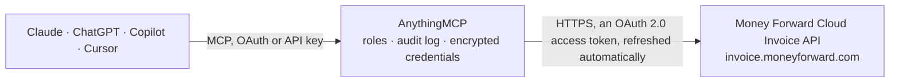

<!-- Generated by scripts/export-github-catalog.mjs in the anythingmcp-website repository. Do not edit by hand. -->

# Money Forward Cloud Invoice MCP connector

Money Forward Cloud Invoice (マネーフォワード クラウド請求書): partners and their billing departments, items, billings in the qualified invoice format with lines and payment status, quotes with order status and … The AnythingMCP connector gives Claude, ChatGPT, Microsoft Copilot, Cursor and Gemini 32 MCP tools for Money Forward Cloud Invoice: 13 read and 19 can change data.

**Category:** [Accounting](../accounting.md) · **Tools:** 32 · **Setup guide:** [anythingmcp.com](https://anythingmcp.com/guides/money-forward-invoice-to-mcp) · [Deutsch](https://anythingmcp.com/de/guides/money-forward-invoice-to-mcp) · [Italiano](https://anythingmcp.com/it/guides/money-forward-invoice-to-mcp) · [Español](https://anythingmcp.com/es/guides/money-forward-invoice-to-mcp) · [日本語](https://anythingmcp.com/ja/guides/money-forward-invoice-to-mcp) · [Русский](https://anythingmcp.com/ru/guides/money-forward-invoice-to-mcp) · [中文](https://anythingmcp.com/zh/guides/money-forward-invoice-to-mcp)

## Start without code

No installation and no terminal: AnythingMCP Cloud runs the Money Forward Cloud Invoice connector for you, operated by helpcode.ai in Frankfurt, Germany.

1. **Click the button above** and create an account or sign in. The Money Forward Cloud Invoice connector opens, ready to install.
2. **Sign in with your Money Forward Cloud Invoice account** when AnythingMCP asks. The first time, an admin creates a small app in the Money Forward Cloud Invoice developer console. Every click is in the [step-by-step guide](https://anythingmcp.com/guides/money-forward-invoice-to-mcp).
3. **Click Install.** AnythingMCP shows the address of your MCP server.
4. **Add that address to your assistant:** [Claude](https://anythingmcp.com/guides/connect-money-forward-invoice-to-claude) · [ChatGPT](https://anythingmcp.com/guides/connect-money-forward-invoice-to-chatgpt) · [Microsoft Copilot](https://anythingmcp.com/guides/connect-money-forward-invoice-to-copilot) · [Cursor](https://anythingmcp.com/guides/connect-money-forward-invoice-to-cursor) · [Gemini CLI](https://anythingmcp.com/guides/connect-money-forward-invoice-to-gemini) · [Meta Muse](https://anythingmcp.com/guides/connect-money-forward-invoice-to-muse).
5. **Ask your first question**, for example: *Show the billing department details for partner code MK-2026 (I need email and payment terms)*

Prefer help with the setup? [Talk to us](https://anythingmcp.com/contact).

## How it works

- **The AI client** speaks MCP (Streamable HTTP) to AnythingMCP and only sees tool names, descriptions and results. It never gets the Money Forward Cloud Invoice credentials.
- **AnythingMCP** checks the client's role, builds the call from the tool definition, adds the credentials (an OAuth 2.0 access token, refreshed automatically), calls Money Forward Cloud Invoice, logs the call and returns the result.
- **Money Forward Cloud Invoice** sees an ordinary API client with the rights of the account the credentials belong to.

## Tools

| Tool | What it does | Access |
|---|---|---|
| [`money_forward_invoice_get_office`](#money_forward_invoice_get_office) | Read your own business (事業者): id, name, address, phone, office type and the invoice registration number (適格請求書発行事業者登録番号). | read |
| [`money_forward_invoice_list_partners`](#money_forward_invoice_list_partners) | List partners (取引先) with id, code, name, kana, memo, their departments (請求先部門, with the id needed for billings) and default payment due date. | read |
| [`money_forward_invoice_get_partner`](#money_forward_invoice_get_partner) | Read one partner (取引先) with its departments and payment due date setting. | read |
| [`money_forward_invoice_create_partner`](#money_forward_invoice_create_partner) | Create a partner (取引先) with up to 10 departments (請求先). | write |
| [`money_forward_invoice_update_partner`](#money_forward_invoice_update_partner) | Change a partner (取引先): name, code, kana, honorific, memo or default payment due date. | write |
| [`money_forward_invoice_list_partner_departments`](#money_forward_invoice_list_partner_departments) | List the departments (請求先部門) of a partner: id, address, contact person, email and CC. | read |
| [`money_forward_invoice_get_partner_department`](#money_forward_invoice_get_partner_department) | Read one department of a partner with address, contact and email. | read |
| [`money_forward_invoice_create_partner_department`](#money_forward_invoice_create_partner_department) | Add a department (請求先) to a partner, e.g. a second billing address or contact. | write |
| [`money_forward_invoice_update_partner_department`](#money_forward_invoice_update_partner_department) | Change the address, contact or email of a partner department. | write |
| [`money_forward_invoice_list_items`](#money_forward_invoice_list_items) | List items (品目) with id, name, code, detail, unit, price, quantity and tax category. | read |
| [`money_forward_invoice_get_item`](#money_forward_invoice_get_item) | Read one item (品目) with its code, detail, unit price, unit, quantity and tax category. | read |
| [`money_forward_invoice_create_item`](#money_forward_invoice_create_item) | Create an item (品目) with price, unit and tax category, for reuse in billings and quotes. | write |
| [`money_forward_invoice_update_item`](#money_forward_invoice_update_item) | Change an item (品目): name, code, detail, unit, price, quantity or tax category. | write |
| [`money_forward_invoice_list_billings`](#money_forward_invoice_list_billings) | List billings (請求書) with number, title, partner, dates, subtotal, tax, total and payment, email and posting status. | read |
| [`money_forward_invoice_get_billing`](#money_forward_invoice_get_billing) | Read one billing (請求書) with its lines, tax breakdown per rate, totals, statuses, partner and your own registration number. | read |
| [`money_forward_invoice_create_billing`](#money_forward_invoice_create_billing) | Create a billing (請求書) in the qualified invoice format (インボイス制度対応) for a partner department, with its lines. | write |
| [`money_forward_invoice_update_billing`](#money_forward_invoice_update_billing) | Change the header of a billing: department, dates, title, number, payment terms, remarks, memo or tags. | write |
| [`money_forward_invoice_list_billing_items`](#money_forward_invoice_list_billing_items) | List the lines of a billing with their id, name, quantity, price and tax category. | read |
| [`money_forward_invoice_add_billing_item`](#money_forward_invoice_add_billing_item) | Add a line to a billing, from an item (item_id) or written out. | write |
| [`money_forward_invoice_remove_billing_item`](#money_forward_invoice_remove_billing_item) | Remove one line from a billing (the item master stays). | write |
| [`money_forward_invoice_update_billing_payment_status`](#money_forward_invoice_update_billing_payment_status) | Set the payment status (入金ステータス) of a billing: 0 not set, 1 unpaid (未入金), 2 paid (入金済み). | write |
| [`money_forward_invoice_post_billing`](#money_forward_invoice_post_billing) | Order postal mailing (郵送) of a billing by Money Forward. | write |
| [`money_forward_invoice_delete_billing`](#money_forward_invoice_delete_billing) | Delete a billing (請求書) with its lines for good; it cannot be restored. | write |
| [`money_forward_invoice_list_quotes`](#money_forward_invoice_list_quotes) | List quotes (見積書) with number, title, partner, quote and expiry dates, totals and order status. | read |
| [`money_forward_invoice_get_quote`](#money_forward_invoice_get_quote) | Read one quote (見積書) with its lines, totals and order status. | read |
| [`money_forward_invoice_create_quote`](#money_forward_invoice_create_quote) | Create a quote (見積書) for a partner department, with its lines. | write |
| [`money_forward_invoice_update_quote`](#money_forward_invoice_update_quote) | Change the header of a quote: department, dates, title, number, remarks, memo or tags. | write |
| [`money_forward_invoice_add_quote_item`](#money_forward_invoice_add_quote_item) | Add a line to a quote, from an item (item_id) or written out. | write |
| [`money_forward_invoice_update_quote_order_status`](#money_forward_invoice_update_quote_order_status) | Set the order status (受注ステータス) of a quote: -1 lost (失注), 0 not set, 1 not ordered yet (未受注), 2 ordered (受注済み). | write |
| [`money_forward_invoice_convert_quote_to_billing`](#money_forward_invoice_convert_quote_to_billing) | Create a billing (請求書) from a quote, with the same partner and lines. | write |
| [`money_forward_invoice_delete_quote`](#money_forward_invoice_delete_quote) | Delete a quote (見積書) with its lines for good; it cannot be restored. | write |
| [`money_forward_invoice_list_sent_histories`](#money_forward_invoice_list_sent_histories) | List the sending history (送付履歴) of billings and quotes: document type and id, from, to, cc, sender and sent time. | read |

## Tool reference

Every parameter as the AI client sees it in `tools/list`. Source: [`packages/backend/src/adapters/jp/money-forward-invoice.json`](../../../packages/backend/src/adapters/jp/money-forward-invoice.json).

### `money_forward_invoice_get_office`

Read your own business (事業者): id, name, address, phone, office type and the invoice registration number (適格請求書発行事業者登録番号). The install check.

**Access:** read · **Call:** `GET /office`

No parameters.

### `money_forward_invoice_list_partners`

List partners (取引先) with id, code, name, kana, memo, their departments (請求先部門, with the id needed for billings) and default payment due date. Filter by name, code, kana or person in charge; several values comma separated.

**Access:** read · **Call:** `GET /partners`

| Parameter | Type | Required | Description |
|---|---|---|---|
| `name` | string | no | Partner name(s), comma separated. |
| `code` | string | no | Partner code(s), comma separated. |
| `name_kana` | string | no | Kana name(s), comma separated. |
| `partner_pic` | string | no | Partner contact person name(s). |
| `office_pic` | string | no | Your staff member(s) in charge. |
| `page` | integer | no | Page number, 1-based (default 1). pagination.total_pages says how many there are. |
| `per_page` | integer | no | Rows per page (default 100). |

### `money_forward_invoice_get_partner`

Read one partner (取引先) with its departments and payment due date setting.

**Access:** read · **Call:** `GET /partners/{partner_id}`

| Parameter | Type | Required | Description |
|---|---|---|---|
| `partner_id` | string | yes | Partner id. |

### `money_forward_invoice_create_partner`

Create a partner (取引先) with up to 10 departments (請求先). A billing is addressed to a department, so give at least one with the address and email.

**Access:** write · **Call:** `POST /partners`

| Parameter | Type | Required | Description |
|---|---|---|---|
| `name` | string | yes | Partner name. |
| `code` | string | no | Partner code. |
| `name_kana` | string | no | Name in katakana. |
| `name_suffix` | string | no | Honorific, e.g. 御中 or 様. |
| `memo` | string | no | Internal memo. |
| `departments` | object[] | no | Up to 10 departments, e.g. [{"person_dept": "経理部", "person_name": "山田 太郎", "email": "keiri@example.co.jp", "zip": "100-0001", "prefecture": "東京都", "address1": "千代田区千代田1-1"}]. |
| `payment_deadline_setting` | object | no | Default payment due date for this partner (支払期日): {"due_month": "next_month", "due_date": -1, "contingency_day": "move_to_earlier_day"} means end of next month, moved earlier on holidays. |

### `money_forward_invoice_update_partner`

Change a partner (取引先): name, code, kana, honorific, memo or default payment due date. Departments change with money_forward_invoice_update_partner_department.

**Access:** write · **Call:** `PUT /partners/{partner_id}`

| Parameter | Type | Required | Description |
|---|---|---|---|
| `partner_id` | string | yes | Partner id. |
| `name` | string | no | Partner name. |
| `code` | string | no | Partner code. |
| `name_kana` | string | no | Name in katakana. |
| `name_suffix` | string | no | Honorific. |
| `memo` | string | no | Internal memo. |
| `payment_deadline_setting` | object | no | Default payment due date for this partner (支払期日): {"due_month": "next_month", "due_date": -1, "contingency_day": "move_to_earlier_day"} means end of next month, moved earlier on holidays. |

### `money_forward_invoice_list_partner_departments`

List the departments (請求先部門) of a partner: id, address, contact person, email and CC. The department id is what billings and quotes are addressed to.

**Access:** read · **Call:** `GET /partners/{partner_id}/departments`

| Parameter | Type | Required | Description |
|---|---|---|---|
| `partner_id` | string | yes | Partner id. |

### `money_forward_invoice_get_partner_department`

Read one department of a partner with address, contact and email.

**Access:** read · **Call:** `GET /partners/{partner_id}/departments/{department_id}`

| Parameter | Type | Required | Description |
|---|---|---|---|
| `partner_id` | string | yes | Partner id. |
| `department_id` | string | yes | Department id. |

### `money_forward_invoice_create_partner_department`

Add a department (請求先) to a partner, e.g. a second billing address or contact.

**Access:** write · **Call:** `POST /partners/{partner_id}/departments`

| Parameter | Type | Required | Description |
|---|---|---|---|
| `partner_id` | string | yes | Partner id. |
| `zip` | string | no | Postal code, e.g. 100-0001. |
| `tel` | string | no | Phone number. |
| `prefecture` | string | no | Prefecture name, e.g. 東京都. |
| `address1` | string | no | Address line 1 (city and street). |
| `address2` | string | no | Address line 2 (building). |
| `person_name` | string | no | Contact person (担当者名). |
| `person_title` | string | no | Contact title (役職). |
| `person_dept` | string | no | Contact department (部署名). |
| `office_member_name` | string | no | Your own staff member in charge (自社担当者). |
| `email` | string | no | Email the invoices go to. |
| `cc_emails` | string | no | CC emails, comma separated. |
| `peppol_id` | string | no | Peppol ID for e-invoices, if any. |

### `money_forward_invoice_update_partner_department`

Change the address, contact or email of a partner department.

**Access:** write · **Call:** `PUT /partners/{partner_id}/departments/{department_id}`

| Parameter | Type | Required | Description |
|---|---|---|---|
| `partner_id` | string | yes | Partner id. |
| `department_id` | string | yes | Department id. |
| `zip` | string | no | Postal code, e.g. 100-0001. |
| `tel` | string | no | Phone number. |
| `prefecture` | string | no | Prefecture name, e.g. 東京都. |
| `address1` | string | no | Address line 1 (city and street). |
| `address2` | string | no | Address line 2 (building). |
| `person_name` | string | no | Contact person (担当者名). |
| `person_title` | string | no | Contact title (役職). |
| `person_dept` | string | no | Contact department (部署名). |
| `office_member_name` | string | no | Your own staff member in charge (自社担当者). |
| `email` | string | no | Email the invoices go to. |
| `cc_emails` | string | no | CC emails, comma separated. |
| `peppol_id` | string | no | Peppol ID for e-invoices, if any. |

### `money_forward_invoice_list_items`

List items (品目) with id, name, code, detail, unit, price, quantity and tax category. Filter by name or code; several values comma separated.

**Access:** read · **Call:** `GET /items`

| Parameter | Type | Required | Description |
|---|---|---|---|
| `name` | string | no | Item name(s), comma separated. |
| `code` | string | no | Item code(s), comma separated. |
| `page` | integer | no | Page number, 1-based (default 1). pagination.total_pages says how many there are. |
| `per_page` | integer | no | Rows per page (default 100). |

### `money_forward_invoice_get_item`

Read one item (品目) with its code, detail, unit price, unit, quantity and tax category.

**Access:** read · **Call:** `GET /items/{item_id}`

| Parameter | Type | Required | Description |
|---|---|---|---|
| `item_id` | string | yes | Item id. |

### `money_forward_invoice_create_item`

Create an item (品目) with price, unit and tax category, for reuse in billings and quotes.

**Access:** write · **Call:** `POST /items`

| Parameter | Type | Required | Description |
|---|---|---|---|
| `name` | string | yes | Item name. |
| `code` | string | no | Item code. |
| `detail` | string | no | Detail. |
| `unit` | string | no | Unit. |
| `price` | number | no | Unit price in JPY. |
| `quantity` | number | no | Default quantity. |
| `is_deduct_withholding_tax` | boolean | no | Withholding tax (源泉徴収) applies to the line. Only for sole proprietors (個人事業主); leave out for corporations. |
| `excise` | `untaxable` \| `non_taxable` \| `tax_exemption` \| `five_percent` \| `eight_percent` \| `eight_percent_as_reduced_tax_rate` \| `ten_percent` | yes | Tax category (税率): ten_percent (10%), eight_percent_as_reduced_tax_rate (reduced 8%), eight_percent, five_percent, tax_exemption (免税), non_taxable (非課税) or untaxable (不課税). |

### `money_forward_invoice_update_item`

Change an item (品目): name, code, detail, unit, price, quantity or tax category.

**Access:** write · **Call:** `PUT /items/{item_id}`

| Parameter | Type | Required | Description |
|---|---|---|---|
| `item_id` | string | yes | Item id. |
| `name` | string | no | Item name. |
| `code` | string | no | Item code. |
| `detail` | string | no | Detail. |
| `unit` | string | no | Unit. |
| `price` | number | no | Unit price in JPY. |
| `quantity` | number | no | Default quantity. |
| `is_deduct_withholding_tax` | boolean | no | Withholding tax (源泉徴収) applies to the line. Only for sole proprietors (個人事業主); leave out for corporations. |
| `excise` | `untaxable` \| `non_taxable` \| `tax_exemption` \| `five_percent` \| `eight_percent` \| `eight_percent_as_reduced_tax_rate` \| `ten_percent` | no | Tax category (税率): ten_percent (10%), eight_percent_as_reduced_tax_rate (reduced 8%), eight_percent, five_percent, tax_exemption (免税), non_taxable (非課税) or untaxable (不課税). |

### `money_forward_invoice_list_billings`

List billings (請求書) with number, title, partner, dates, subtotal, tax, total and payment, email and posting status. Filter a date range (range_key with from and to), or search with q; up to 100 per page. Line items are left out: use money_forward_invoice_get_billing.

**Access:** read · **Call:** `GET /billings`

| Parameter | Type | Required | Description |
|---|---|---|---|
| `range_key` | `billing_date` \| `due_date` \| `sales_date` \| `created_at` \| `updated_at` | no | Which date from and to apply to: billing_date, due_date, sales_date, created_at or updated_at. |
| `from` | string | no | Range start, YYYY-MM-DD. |
| `to` | string | no | Range end, YYYY-MM-DD. |
| `q` | string | no | Free text over partner (exact), status, title and more; when set, the filters below are ignored. |
| `partner_id` | string | no | Partner id. |
| `document_number` | string | no | Billing number (請求書番号). |
| `status` | string | no | Status, e.g. 下書き, ロック中, 未ロック. |
| `partner_name` | string | no | Partner name. |
| `tags` | string | no | Tags, comma separated. |
| `page` | integer | no | Page number, 1-based (default 1). pagination.total_pages says how many there are. |
| `per_page` | integer | no | Rows per page (default 100). |

### `money_forward_invoice_get_billing`

Read one billing (請求書) with its lines, tax breakdown per rate, totals, statuses, partner and your own registration number.

**Access:** read · **Call:** `GET /billings/{billing_id}`

| Parameter | Type | Required | Description |
|---|---|---|---|
| `billing_id` | string | yes | Billing id. |

### `money_forward_invoice_create_billing`

Create a billing (請求書) in the qualified invoice format (インボイス制度対応) for a partner department, with its lines. It is created as a draft and not sent; sending by email happens in Money Forward. Returns the billing with id, number and totals.

**Access:** write · **Call:** `POST /invoice_template_billings`

| Parameter | Type | Required | Description |
|---|---|---|---|
| `department_id` | string | yes | Partner department id (請求先) from money_forward_invoice_list_partner_departments or the departments of a partner. |
| `billing_date` | string | yes | Billing date (請求日), YYYY-MM-DD. |
| `due_date` | string | no | Payment due date (お支払期限), YYYY-MM-DD; from the partner setting when omitted. |
| `sales_date` | string | no | Sales date (売上計上日), YYYY-MM-DD. |
| `title` | string | no | Title (件名). |
| `billing_number` | string | no | Billing number; numbered automatically when omitted. |
| `payment_condition` | string | no | Payment terms text printed on the invoice (振込先 etc.). |
| `note` | string | no | Remarks (備考) printed on the invoice. |
| `memo` | string | no | Internal memo, not printed. |
| `document_name` | string | no | Document title, default 請求書. |
| `tag_names` | string[] | no | Tags. |
| `items` | object[] | no | Lines (明細): [{"name": "Consulting", "price": 100000, "quantity": 1, "unit": "式", "excise": "ten_percent"}] or [{"item_id": "...", "quantity": 2}]. excise is required when no item_id is given. |

### `money_forward_invoice_update_billing`

Change the header of a billing: department, dates, title, number, payment terms, remarks, memo or tags. Lines change with money_forward_invoice_add_billing_item and money_forward_invoice_remove_billing_item. A locked billing (is_locked) cannot be changed.

**Access:** write · **Call:** `PUT /billings/{billing_id}`

| Parameter | Type | Required | Description |
|---|---|---|---|
| `billing_id` | string | yes | Billing id. |
| `department_id` | string | no | Partner department id. |
| `billing_date` | string | no | Billing date, YYYY-MM-DD. |
| `due_date` | string | no | Due date, YYYY-MM-DD. |
| `sales_date` | string | no | Sales date, YYYY-MM-DD. |
| `title` | string | no | Title. |
| `billing_number` | string | no | Billing number. |
| `payment_condition` | string | no | Payment terms text. |
| `note` | string | no | Remarks. |
| `memo` | string | no | Internal memo. |
| `document_name` | string | no | Document title. |
| `tag_names` | string[] | no | Tags; replaces the current ones. |

### `money_forward_invoice_list_billing_items`

List the lines of a billing with their id, name, quantity, price and tax category.

**Access:** read · **Call:** `GET /billings/{billing_id}/items`

| Parameter | Type | Required | Description |
|---|---|---|---|
| `billing_id` | string | yes | Billing id. |

### `money_forward_invoice_add_billing_item`

Add a line to a billing, from an item (item_id) or written out.

**Access:** write · **Call:** `POST /billings/{billing_id}/items`

| Parameter | Type | Required | Description |
|---|---|---|---|
| `billing_id` | string | yes | Billing id. |
| `delivery_number` | string | no | Delivery note number (納品書番号). |
| `delivery_date` | string | no | Delivery date, YYYY-MM-DD. |
| `item_id` | string | no | Item id from money_forward_invoice_list_items; its name is then used. |
| `name` | string | no | Line name (品目名), when no item_id is given. |
| `detail` | string | no | Line detail (詳細). |
| `unit` | string | no | Unit, e.g. 個, 時間, 式. |
| `price` | number | no | Unit price in JPY. |
| `quantity` | number | no | Quantity. |
| `is_deduct_withholding_tax` | boolean | no | Withholding tax (源泉徴収) applies to the line. Only for sole proprietors (個人事業主); leave out for corporations. |
| `excise` | `untaxable` \| `non_taxable` \| `tax_exemption` \| `five_percent` \| `eight_percent` \| `eight_percent_as_reduced_tax_rate` \| `ten_percent` | no | Tax category (税率): ten_percent (10%), eight_percent_as_reduced_tax_rate (reduced 8%), eight_percent, five_percent, tax_exemption (免税), non_taxable (非課税) or untaxable (不課税). |

### `money_forward_invoice_remove_billing_item`

Remove one line from a billing (the item master stays). Use the line id from money_forward_invoice_list_billing_items.

**Access:** write · **Call:** `DELETE /billings/{billing_id}/items/{item_id}`

| Parameter | Type | Required | Description |
|---|---|---|---|
| `billing_id` | string | yes | Billing id. |
| `item_id` | string | yes | Line id (billing item id) from money_forward_invoice_list_billing_items. |

### `money_forward_invoice_update_billing_payment_status`

Set the payment status (入金ステータス) of a billing: 0 not set, 1 unpaid (未入金), 2 paid (入金済み).

**Access:** write · **Call:** `PUT /billings/{billing_id}/payment_status`

| Parameter | Type | Required | Description |
|---|---|---|---|
| `billing_id` | string | yes | Billing id. |
| `payment_status` | `0` \| `1` \| `2` | yes | 0 未設定, 1 未入金, 2 入金済み. |

### `money_forward_invoice_post_billing`

Order postal mailing (郵送) of a billing by Money Forward. It is a paid service and sends paper to the partner. Installed switched off.

**Access:** write · **Call:** `POST /billings/{billing_id}/posting`

| Parameter | Type | Required | Description |
|---|---|---|---|
| `billing_id` | string | yes | Billing id. |
| `upload_to_cloud_box` | boolean | no | true also stores the document in Money Forward クラウドBox. |

### `money_forward_invoice_delete_billing`

Delete a billing (請求書) with its lines for good; it cannot be restored. Installed switched off.

**Access:** write · **Call:** `DELETE /billings/{billing_id}`

| Parameter | Type | Required | Description |
|---|---|---|---|
| `billing_id` | string | yes | Billing id. |

### `money_forward_invoice_list_quotes`

List quotes (見積書) with number, title, partner, quote and expiry dates, totals and order status. Filter a date range (range_key with from and to) or search with q.

**Access:** read · **Call:** `GET /quotes`

| Parameter | Type | Required | Description |
|---|---|---|---|
| `range_key` | `quote_date` \| `expired_date` \| `created_at` \| `updated_at` | no | Which date from and to apply to: quote_date, expired_date, created_at or updated_at. |
| `from` | string | no | Range start, YYYY-MM-DD. |
| `to` | string | no | Range end, YYYY-MM-DD. |
| `q` | string | no | Free text; when set, the filters below are ignored. |
| `partner_id` | string | no | Partner id. |
| `document_number` | string | no | Quote number. |
| `status` | string | no | Status, e.g. 下書き. |
| `partner_name` | string | no | Partner name. |
| `tags` | string | no | Tags, comma separated. |
| `page` | integer | no | Page number, 1-based (default 1). pagination.total_pages says how many there are. |
| `per_page` | integer | no | Rows per page (default 100). |

### `money_forward_invoice_get_quote`

Read one quote (見積書) with its lines, totals and order status.

**Access:** read · **Call:** `GET /quotes/{quote_id}`

| Parameter | Type | Required | Description |
|---|---|---|---|
| `quote_id` | string | yes | Quote id. |

### `money_forward_invoice_create_quote`

Create a quote (見積書) for a partner department, with its lines. Created as a draft, not sent.

**Access:** write · **Call:** `POST /quotes`

| Parameter | Type | Required | Description |
|---|---|---|---|
| `department_id` | string | yes | Partner department id. |
| `quote_date` | string | yes | Quote date (見積日), YYYY-MM-DD. |
| `expired_date` | string | yes | Valid until (有効期限), YYYY-MM-DD. |
| `title` | string | no | Title (件名). |
| `quote_number` | string | no | Quote number; numbered automatically when omitted. |
| `note` | string | no | Remarks printed on the quote. |
| `memo` | string | no | Internal memo. |
| `document_name` | string | no | Document title, default 見積書. |
| `tag_names` | string[] | no | Tags. |
| `items` | object[] | no | Lines (明細): [{"name": "Consulting", "price": 100000, "quantity": 1, "unit": "式", "excise": "ten_percent"}] or [{"item_id": "...", "quantity": 2}]. excise is required when no item_id is given. |

### `money_forward_invoice_update_quote`

Change the header of a quote: department, dates, title, number, remarks, memo or tags.

**Access:** write · **Call:** `PUT /quotes/{quote_id}`

| Parameter | Type | Required | Description |
|---|---|---|---|
| `quote_id` | string | yes | Quote id. |
| `department_id` | string | no | Partner department id. |
| `quote_date` | string | no | Quote date, YYYY-MM-DD. |
| `expired_date` | string | no | Valid until, YYYY-MM-DD. |
| `title` | string | no | Title. |
| `quote_number` | string | no | Quote number. |
| `note` | string | no | Remarks. |
| `memo` | string | no | Internal memo. |
| `document_name` | string | no | Document title. |
| `tag_names` | string[] | no | Tags; replaces the current ones. |

### `money_forward_invoice_add_quote_item`

Add a line to a quote, from an item (item_id) or written out.

**Access:** write · **Call:** `POST /quotes/{quote_id}/items`

| Parameter | Type | Required | Description |
|---|---|---|---|
| `quote_id` | string | yes | Quote id. |
| `item_id` | string | no | Item id from money_forward_invoice_list_items; its name is then used. |
| `name` | string | no | Line name (品目名), when no item_id is given. |
| `detail` | string | no | Line detail (詳細). |
| `unit` | string | no | Unit, e.g. 個, 時間, 式. |
| `price` | number | no | Unit price in JPY. |
| `quantity` | number | no | Quantity. |
| `is_deduct_withholding_tax` | boolean | no | Withholding tax (源泉徴収) applies to the line. Only for sole proprietors (個人事業主); leave out for corporations. |
| `excise` | `untaxable` \| `non_taxable` \| `tax_exemption` \| `five_percent` \| `eight_percent` \| `eight_percent_as_reduced_tax_rate` \| `ten_percent` | no | Tax category (税率): ten_percent (10%), eight_percent_as_reduced_tax_rate (reduced 8%), eight_percent, five_percent, tax_exemption (免税), non_taxable (非課税) or untaxable (不課税). |

### `money_forward_invoice_update_quote_order_status`

Set the order status (受注ステータス) of a quote: -1 lost (失注), 0 not set, 1 not ordered yet (未受注), 2 ordered (受注済み).

**Access:** write · **Call:** `PUT /quotes/{quote_id}/order_status`

| Parameter | Type | Required | Description |
|---|---|---|---|
| `quote_id` | string | yes | Quote id. |
| `order_status` | `-1` \| `0` \| `1` \| `2` | yes | -1 失注, 0 未設定, 1 未受注, 2 受注済み. |

### `money_forward_invoice_convert_quote_to_billing`

Create a billing (請求書) from a quote, with the same partner and lines. Returns the new billing; check its dates before sending.

**Access:** write · **Call:** `POST /quotes/{quote_id}/convert_to_billing`

| Parameter | Type | Required | Description |
|---|---|---|---|
| `quote_id` | string | yes | Quote id. |

### `money_forward_invoice_delete_quote`

Delete a quote (見積書) with its lines for good; it cannot be restored. Installed switched off.

**Access:** write · **Call:** `DELETE /quotes/{quote_id}`

| Parameter | Type | Required | Description |
|---|---|---|---|
| `quote_id` | string | yes | Quote id. |

### `money_forward_invoice_list_sent_histories`

List the sending history (送付履歴) of billings and quotes: document type and id, from, to, cc, sender and sent time.

**Access:** read · **Call:** `GET /sent_histories`

| Parameter | Type | Required | Description |
|---|---|---|---|
| `page` | integer | no | Page number, 1-based (default 1). pagination.total_pages says how many there are. |
| `per_page` | integer | no | Rows per page (default 100). |

## Run it yourself

AnythingMCP is open source (AGPL-3.0). [Run it with Docker](../../../README.md#run-it-yourself), open **Connectors → Store**, pick **Money Forward Cloud Invoice** and enter `MONEY_FORWARD_CLIENT_ID`, `MONEY_FORWARD_CLIENT_SECRET`, then add your MCP server URL to the AI client.

[← Accounting connectors](../accounting.md) · [All categories](../README.md)
