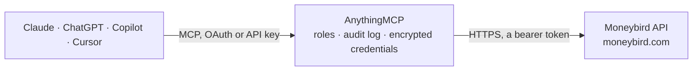

<!-- Generated by scripts/export-github-catalog.mjs in the anythingmcp-website repository. Do not edit by hand. -->

# Moneybird MCP connector

Moneybird — Dutch online bookkeeping for freelancers and small companies: contacts, sales invoices, purchase invoices, estimates, products and financial mutations. The AnythingMCP connector gives Claude, ChatGPT, Microsoft Copilot, Cursor and Gemini 9 MCP tools for Moneybird, all read-only.

**Category:** [Accounting](../accounting.md) · **Tools:** 9 · **Setup guide:** [anythingmcp.com](https://anythingmcp.com/guides/moneybird-to-mcp) · [Deutsch](https://anythingmcp.com/de/guides/moneybird-to-mcp) · [Italiano](https://anythingmcp.com/it/guides/moneybird-to-mcp) · [Español](https://anythingmcp.com/es/guides/moneybird-to-mcp) · [日本語](https://anythingmcp.com/ja/guides/moneybird-to-mcp) · [Русский](https://anythingmcp.com/ru/guides/moneybird-to-mcp) · [中文](https://anythingmcp.com/zh/guides/moneybird-to-mcp)

## Start without code

No installation and no terminal: AnythingMCP Cloud runs the Moneybird connector for you, operated by helpcode.ai in Frankfurt, Germany.

1. **Click the button above** and create an account or sign in. The Moneybird connector opens, ready to install.
2. **Paste the API key or token from your Moneybird account.** Every click is in the [step-by-step guide](https://anythingmcp.com/guides/moneybird-to-mcp).
3. **Click Install.** AnythingMCP shows the address of your MCP server.
4. **Add that address to your assistant:** [Claude](https://anythingmcp.com/guides/connect-moneybird-to-claude) · [ChatGPT](https://anythingmcp.com/guides/connect-moneybird-to-chatgpt) · [Microsoft Copilot](https://anythingmcp.com/guides/connect-moneybird-to-copilot) · [Cursor](https://anythingmcp.com/guides/connect-moneybird-to-cursor) · [Gemini CLI](https://anythingmcp.com/guides/connect-moneybird-to-gemini) · [Meta Muse](https://anythingmcp.com/guides/connect-moneybird-to-muse).
5. **Ask your first question**, for example: *Show full contact details for customer 'LumenFabriek BV' (company, contact, VAT number).*

Prefer help with the setup? [Talk to us](https://anythingmcp.com/contact).

## How it works

- **The AI client** speaks MCP (Streamable HTTP) to AnythingMCP and only sees tool names, descriptions and results. It never gets the Moneybird credentials.
- **AnythingMCP** checks the client's role, builds the call from the tool definition, adds the credentials (a bearer token), calls Moneybird, logs the call and returns the result.
- **Moneybird** sees an ordinary API client with the rights of the account the credentials belong to.

## Tools

| Tool | What it does | Access |
|---|---|---|
| [`moneybird_list_administrations`](#moneybird_list_administrations) | List the administrations this token can reach, with their id, name, language and currency. | read |
| [`moneybird_list_contacts`](#moneybird_list_contacts) | List contacts — customers and suppliers — with their company name, contact person, address, VAT number and customer id. | read |
| [`moneybird_get_contact`](#moneybird_get_contact) | Read one contact in full: addresses, tax identifiers, payment terms, custom fields and the notes recorded against them. | read |
| [`moneybird_list_sales_invoices`](#moneybird_list_sales_invoices) | List sales invoices with their number, date, due date, contact, totals and state. | read |
| [`moneybird_get_sales_invoice`](#moneybird_get_sales_invoice) | Read one sales invoice in full: every detail line with quantity, price and tax rate, the totals, the payment schedule and the payments received. | read |
| [`moneybird_list_purchase_invoices`](#moneybird_list_purchase_invoices) | List purchase invoices and receipts with their supplier, date, due date and total — the cost side of the ledger. | read |
| [`moneybird_list_estimates`](#moneybird_list_estimates) | List estimates (offertes) with their number, date, contact, total and state, to see what is out with customers and not yet won. | read |
| [`moneybird_list_products`](#moneybird_list_products) | List the products and services in the catalogue with their description, price, tax rate and ledger account. | read |
| [`moneybird_list_financial_mutations`](#moneybird_list_financial_mutations) | List bank mutations with their date, amount, description and reconciliation state, so unpaid invoices can be matched against money that actually arrived. | read |

## Tool reference

Every parameter as the AI client sees it in `tools/list`. Source: [`packages/backend/src/adapters/nl/moneybird.json`](../../../packages/backend/src/adapters/nl/moneybird.json).

### `moneybird_list_administrations`

List the administrations this token can reach, with their id, name, language and currency. The one call that needs no administration id.

**Access:** read · **Call:** `GET /administrations.json`

No parameters.

### `moneybird_list_contacts`

List contacts — customers and suppliers — with their company name, contact person, address, VAT number and customer id.

**Access:** read · **Call:** `GET /{MONEYBIRD_ADMINISTRATION_ID}/contacts.json`

| Parameter | Type | Required | Description |
|---|---|---|---|
| `query` | string | no | Search fragment matched against name, e-mail and customer id. |
| `page` | number | no | Page number, starting at 1. |
| `per_page` | number | no | Rows per page, max 100. |

### `moneybird_get_contact`

Read one contact in full: addresses, tax identifiers, payment terms, custom fields and the notes recorded against them.

**Access:** read · **Call:** `GET /{MONEYBIRD_ADMINISTRATION_ID}/contacts/{contactId}.json`

| Parameter | Type | Required | Description |
|---|---|---|---|
| `contactId` | string | yes | Moneybird contact id. |

### `moneybird_list_sales_invoices`

List sales invoices with their number, date, due date, contact, totals and state. Filter with `state:open` or `state:late` for the receivables question.

**Access:** read · **Call:** `GET /{MONEYBIRD_ADMINISTRATION_ID}/sales_invoices.json`

| Parameter | Type | Required | Description |
|---|---|---|---|
| `filter` | string | no | Comma-separated filter, e.g. period:this_year,state:open. States: all, draft, open, scheduled, pending_payment, late, reminded, paid, uncollectible (pipe to combine, e.g. state:open\|late). A filter replaces the defaults (period:this_year, state:all). |
| `page` | number | no | Page number, starting at 1. |
| `per_page` | number | no | Rows per page, max 100. |

### `moneybird_get_sales_invoice`

Read one sales invoice in full: every detail line with quantity, price and tax rate, the totals, the payment schedule and the payments received.

**Access:** read · **Call:** `GET /{MONEYBIRD_ADMINISTRATION_ID}/sales_invoices/{invoiceId}.json`

| Parameter | Type | Required | Description |
|---|---|---|---|
| `invoiceId` | string | yes | Moneybird sales invoice id. |

### `moneybird_list_purchase_invoices`

List purchase invoices and receipts with their supplier, date, due date and total — the cost side of the ledger.

**Access:** read · **Call:** `GET /{MONEYBIRD_ADMINISTRATION_ID}/documents/purchase_invoices.json`

| Parameter | Type | Required | Description |
|---|---|---|---|
| `filter` | string | no | Comma-separated filter, e.g. period:this_quarter. |
| `page` | number | no | Page number, starting at 1. |
| `per_page` | number | no | Rows per page, max 100. |

### `moneybird_list_estimates`

List estimates (offertes) with their number, date, contact, total and state, to see what is out with customers and not yet won.

**Access:** read · **Call:** `GET /{MONEYBIRD_ADMINISTRATION_ID}/estimates.json`

| Parameter | Type | Required | Description |
|---|---|---|---|
| `filter` | string | no | Comma-separated filter, e.g. state:open. |
| `page` | number | no | Page number, starting at 1. |
| `per_page` | number | no | Rows per page, max 100. |

### `moneybird_list_products`

List the products and services in the catalogue with their description, price, tax rate and ledger account.

**Access:** read · **Call:** `GET /{MONEYBIRD_ADMINISTRATION_ID}/products.json`

| Parameter | Type | Required | Description |
|---|---|---|---|
| `page` | number | no | Page number, starting at 1. |
| `per_page` | number | no | Rows per page, max 100. |

### `moneybird_list_financial_mutations`

List bank mutations with their date, amount, description and reconciliation state, so unpaid invoices can be matched against money that actually arrived. Returns at most 100 rows and has no paging: narrow the period instead.

**Access:** read · **Call:** `GET /{MONEYBIRD_ADMINISTRATION_ID}/financial_mutations.json`

| Parameter | Type | Required | Description |
|---|---|---|---|
| `filter` | string | no | Comma-separated filter, e.g. period:this_month or period:20260101..20260131,state:unprocessed. Keys: period, state (all, unprocessed, processed, auto_booked), mutation_type (all, debit, credit), financial_account_id, amount_from, amount_to. Default period is this_year. |

## Run it yourself

AnythingMCP is open source (AGPL-3.0). [Run it with Docker](../../../README.md#run-it-yourself), open **Connectors → Store**, pick **Moneybird** and enter `MONEYBIRD_API_TOKEN`, `MONEYBIRD_ADMINISTRATION_ID`, then add your MCP server URL to the AI client.

[← Accounting connectors](../accounting.md) · [All categories](../README.md)
