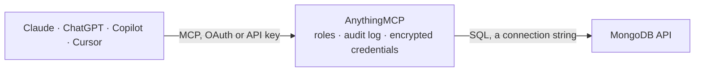

<!-- Generated by scripts/export-github-catalog.mjs in the anythingmcp-website repository. Do not edit by hand. -->

# MongoDB MCP connector

Query a MongoDB database directly: introspect collections and their field shapes, and run read-only find queries with filter, projection, sort and limit. The AnythingMCP connector gives Claude, ChatGPT, Microsoft Copilot, Cursor and Gemini 5 MCP tools for MongoDB, all read-only.

**Category:** [Databases](../database.md) · **Tools:** 5 · **Setup guide:** [anythingmcp.com](https://anythingmcp.com/guides/mongodb-to-mcp) · [Deutsch](https://anythingmcp.com/de/guides/mongodb-to-mcp) · [Italiano](https://anythingmcp.com/it/guides/mongodb-to-mcp) · [Español](https://anythingmcp.com/es/guides/mongodb-to-mcp) · [日本語](https://anythingmcp.com/ja/guides/mongodb-to-mcp) · [Русский](https://anythingmcp.com/ru/guides/mongodb-to-mcp) · [中文](https://anythingmcp.com/zh/guides/mongodb-to-mcp)

## Start without code

No installation and no terminal: AnythingMCP Cloud runs the MongoDB connector for you, operated by helpcode.ai in Frankfurt, Germany.

1. **Click the button above** and create an account or sign in. The MongoDB connector opens, ready to install.
2. **Paste the API key or token from your MongoDB account.** Every click is in the [step-by-step guide](https://anythingmcp.com/guides/mongodb-to-mcp).
3. **Click Install.** AnythingMCP shows the address of your MCP server.
4. **Add that address to your assistant:** [Claude](https://anythingmcp.com/guides/connect-mongodb-to-claude) · [ChatGPT](https://anythingmcp.com/guides/connect-mongodb-to-chatgpt) · [Microsoft Copilot](https://anythingmcp.com/guides/connect-mongodb-to-copilot) · [Cursor](https://anythingmcp.com/guides/connect-mongodb-to-cursor) · [Gemini CLI](https://anythingmcp.com/guides/connect-mongodb-to-gemini) · [Meta Muse](https://anythingmcp.com/guides/connect-mongodb-to-muse).
5. **Ask your first question**, for example: *Fetch invoice INV-2026-0412 for customer Helmi Design Oy and show amount, status and due date*

Prefer help with the setup? [Talk to us](https://anythingmcp.com/contact).

## How it works

- **The AI client** speaks MCP (Streamable HTTP) to AnythingMCP and only sees tool names, descriptions and results. It never gets the MongoDB credentials.
- **AnythingMCP** checks the client's role, builds the call from the tool definition, adds the credentials (a connection string), calls MongoDB, logs the call and returns the result.
- **MongoDB** sees an ordinary API client with the rights of the account the credentials belong to.

## Tools

| Tool | What it does | Access |
|---|---|---|
| [`mongodb_schema`](#mongodb_schema) | Introspect the database: every collection, its estimated document count and the field names and types inferred from a sampled document. | read |
| [`mongodb_find`](#mongodb_find) | Run a read-only find. | read |
| [`mongodb_find_recent`](#mongodb_find_recent) | Read the most recent documents of one collection, newest first by a timestamp field. | read |
| [`mongodb_matching`](#mongodb_matching) | Return the documents of one collection matching a filter, projecting only their ids, so a population can be sized without transferring it. | read |
| [`mongodb_query_examples`](#mongodb_query_examples) | Show worked MongoDB query specs for this connector: filters, operators, projection, sort and the limits that apply. | read |

## Tool reference

Every parameter as the AI client sees it in `tools/list`. Source: [`packages/backend/src/adapters/intl/mongodb.json`](../../../packages/backend/src/adapters/intl/mongodb.json).

### `mongodb_schema`

Introspect the database: every collection, its estimated document count and the field names and types inferred from a sampled document. The map to draw before composing any filter.

**Access:** read

No parameters.

### `mongodb_find`

Run a read-only find. Pass a JSON object with `collection` and optionally `filter`, `projection`, `sort` and `limit`. Capped at 1000 documents.

**Access:** read · **Call:** `query ${query}`

| Parameter | Type | Required | Description |
|---|---|---|---|
| `query` | string | yes | JSON query spec, e.g. {"collection":"orders","filter":{"status":"paid"},"sort":{"createdAt":-1},"limit":50}. |

### `mongodb_find_recent`

Read the most recent documents of one collection, newest first by a timestamp field. The usual first look at an unfamiliar collection. All three arguments are required.

**Access:** read · **Call:** `query {"collection": ${collection}, "sort": {${sortField}: -1}, "limit": ${limit}}`

| Parameter | Type | Required | Description |
|---|---|---|---|
| `collection` | string | yes | Collection name. |
| `sortField` | string | yes | Timestamp field to sort by descending, e.g. createdAt or updatedAt. |
| `limit` | number | yes | Maximum documents to return, 1-1000. Required — there is no default. |

### `mongodb_matching`

Return the documents of one collection matching a filter, projecting only their ids, so a population can be sized without transferring it. All three arguments are required.

**Access:** read · **Call:** `query {"collection": ${collection}, "filter": ${filter}, "projection": {"_id": 1}, "limit": ${limit}}`

| Parameter | Type | Required | Description |
|---|---|---|---|
| `collection` | string | yes | Collection name. |
| `filter` | object | yes | MongoDB filter as an object, e.g. {"status": "open"}. Pass {} to match everything. |
| `limit` | number | yes | Maximum documents to return, 1-1000. Required — there is no default. |

### `mongodb_query_examples`

Show worked MongoDB query specs for this connector: filters, operators, projection, sort and the limits that apply. Costs nothing and touches no data.

**Access:** read

No parameters.

## Run it yourself

AnythingMCP is open source (AGPL-3.0). [Run it with Docker](../../../README.md#run-it-yourself), open **Connectors → Store**, pick **MongoDB** and enter `MONGODB_HOST`, `MONGODB_PORT`, `MONGODB_DATABASE`, `MONGODB_USER`, `MONGODB_PASSWORD`, `MONGODB_AUTH_SOURCE`, then add your MCP server URL to the AI client.

[← Databases connectors](../database.md) · [All categories](../README.md)
