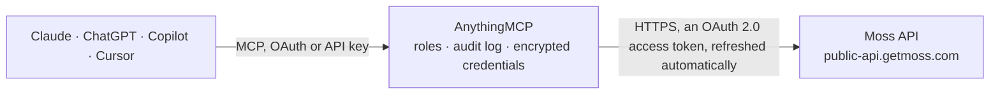

<!-- Generated by scripts/export-github-catalog.mjs in the anythingmcp-website repository. Do not edit by hand. -->

# Moss MCP connector

Moss spend management (Germany and Europe): expenses from cards, invoices and reimbursements with line items and receipts, wallet balances and bank transactions, suppliers, expense accounts, VAT … The AnythingMCP connector gives Claude, ChatGPT, Microsoft Copilot, Cursor and Gemini 30 MCP tools for Moss: 24 read and 6 can change data.

**Category:** [Finance](../finance.md) · **Tools:** 30 · **Setup guide:** [anythingmcp.com](https://anythingmcp.com/guides/moss-to-mcp) · [Deutsch](https://anythingmcp.com/de/guides/moss-to-mcp) · [Italiano](https://anythingmcp.com/it/guides/moss-to-mcp) · [Español](https://anythingmcp.com/es/guides/moss-to-mcp) · [日本語](https://anythingmcp.com/ja/guides/moss-to-mcp) · [Русский](https://anythingmcp.com/ru/guides/moss-to-mcp) · [中文](https://anythingmcp.com/zh/guides/moss-to-mcp)

## Start without code

No installation and no terminal: AnythingMCP Cloud runs the Moss connector for you, operated by helpcode.ai in Frankfurt, Germany.

1. **Click the button above** and create an account or sign in. The Moss connector opens, ready to install.
2. **Sign in with your Moss account** when AnythingMCP asks. The first time, an admin creates a small app in the Moss developer console. Every click is in the [step-by-step guide](https://anythingmcp.com/guides/moss-to-mcp).
3. **Click Install.** AnythingMCP shows the address of your MCP server.
4. **Add that address to your assistant:** [Claude](https://anythingmcp.com/guides/connect-moss-to-claude) · [ChatGPT](https://anythingmcp.com/guides/connect-moss-to-chatgpt) · [Microsoft Copilot](https://anythingmcp.com/guides/connect-moss-to-copilot) · [Cursor](https://anythingmcp.com/guides/connect-moss-to-cursor) · [Gemini CLI](https://anythingmcp.com/guides/connect-moss-to-gemini) · [Meta Muse](https://anythingmcp.com/guides/connect-moss-to-muse).
5. **Ask your first question**, for example: *Show the expense lines and totals for invoice INV-2026-118 from supplier LichtWärme GmbH.*

Prefer help with the setup? [Talk to us](https://anythingmcp.com/contact).

## How it works

- **The AI client** speaks MCP (Streamable HTTP) to AnythingMCP and only sees tool names, descriptions and results. It never gets the Moss credentials.
- **AnythingMCP** checks the client's role, builds the call from the tool definition, adds the credentials (an OAuth 2.0 access token, refreshed automatically), calls Moss, logs the call and returns the result.
- **Moss** sees an ordinary API client with the rights of the account the credentials belong to.

## Tools

| Tool | What it does | Access |
|---|---|---|
| [`moss_list_expenses`](#moss_list_expenses) | List expenses (card transactions, invoices and reimbursements) with their line items, amounts in original and home currency, status, export status, supplier… | read |
| [`moss_search_files`](#moss_search_files) | List the files (receipts, invoice PDFs) attached directly to the given expenses: id, name, original name, size and upload time. | read |
| [`moss_download_file`](#moss_download_file) | Download one file attached to an expense (receipt or invoice, usually a PDF or image) by its id from moss_search_files. | read |
| [`moss_list_expense_accounts`](#moss_list_expense_accounts) | List expense accounts (the accounting sub-categories booked on expense lines): id, name, account number and status. | read |
| [`moss_get_expense_account`](#moss_get_expense_account) | Get one expense account by id: name, account number and status. | read |
| [`moss_list_dimensions`](#moss_list_dimensions) | List the accounting dimensions of the organisation (e.g. cost centre, cost carrier, project; at most 50): id, name, ERP name and id, status. | read |
| [`moss_get_dimension`](#moss_get_dimension) | Get one accounting dimension by id: name, ERP name, ERP id and status. | read |
| [`moss_list_dimension_items`](#moss_list_dimension_items) | List the items (values) of one dimension, e.g. the cost centres: id, name, code and status. | read |
| [`moss_get_dimension_item`](#moss_get_dimension_item) | Get one dimension item (e.g. a cost centre) by id: name, code and status. | read |
| [`moss_list_suppliers`](#moss_list_suppliers) | List suppliers: id, name, supplier number (code), status, currency, VAT id, bank details, default payment method, payment term and default expense account,… | read |
| [`moss_get_supplier`](#moss_get_supplier) | Get one supplier by id (e.g. the supplierId of an expense) with bank details, VAT id and defaults. | read |
| [`moss_list_payment_terms`](#moss_list_payment_terms) | List payment terms: id, number, description, status and the due date rules (days, discounts). | read |
| [`moss_get_payment_term`](#moss_get_payment_term) | Get one payment term by id, e.g. the paymentTermId of a supplier. | read |
| [`moss_list_tax_rates`](#moss_list_tax_rates) | List VAT rates: id, name, code, rate and status. | read |
| [`moss_get_tax_rate`](#moss_get_tax_rate) | Get one VAT rate by id (taxRateId of an expense line): name, code, rate and status. | read |
| [`moss_list_users`](#moss_list_users) | List the users of the organisation: id, name, e-mail, team, manager, roles and status. | read |
| [`moss_get_user`](#moss_get_user) | Get one user by id: name, e-mail, team, manager, roles and status. | read |
| [`moss_list_teams`](#moss_list_teams) | List teams: id, name, department and status. | read |
| [`moss_get_team`](#moss_get_team) | Get one team by id (teamId of a user or default team of a supplier): name, department and status. | read |
| [`moss_list_departments`](#moss_list_departments) | List the departments of the organisation: id and name. | read |
| [`moss_get_department`](#moss_get_department) | Get one department by id (the department of a team) with its name. | read |
| [`moss_list_bank_accounts`](#moss_list_bank_accounts) | List the Moss bank accounts (wallets) of the organisation: id, funding type (CREDIT or DEBIT), currency and status (ACTIVE or CLOSED). | read |
| [`moss_get_bank_account_balance`](#moss_get_bank_account_balance) | Get the current balance of one Moss bank account: balance (ledger) and availableBalance (what can still be spent, lower when transactions are pending). | read |
| [`moss_search_bank_transactions`](#moss_search_bank_transactions) | Search the money movements of Moss wallets by booking date: card purchases and refunds, payouts, withdrawals, top-ups and repayments, with amount, booking… | read |
| [`moss_create_supplier`](#moss_create_supplier) | Create a supplier in Moss with name, supplier number, currency, VAT id, bank details, default payment method, payment term and default booking (expense… | write |
| [`moss_update_supplier`](#moss_update_supplier) | Change fields of an existing supplier; only the fields you send change. | write |
| [`moss_create_dimension`](#moss_create_dimension) | Create an accounting dimension (e.g. Project) with its Moss name and the name and id it has in the accounting system. | write |
| [`moss_update_dimension`](#moss_update_dimension) | Rename a dimension in Moss and set its name in the accounting system. | write |
| [`moss_create_dimension_item`](#moss_create_dimension_item) | Add an item to a dimension, e.g. a new cost centre or project with its name and code. | write |
| [`moss_update_dimension_item`](#moss_update_dimension_item) | Rename a dimension item, change its code, or activate or deactivate it. | write |

## Tool reference

Every parameter as the AI client sees it in `tools/list`. Source: [`packages/backend/src/adapters/de/moss.json`](../../../packages/backend/src/adapters/de/moss.json).

### `moss_list_expenses`

List expenses (card transactions, invoices and reimbursements) with their line items, amounts in original and home currency, status, export status, supplier id, expense account and tax rate per line. Filter by type, status, export status, creation date, expense date or last update; sort by status, create_time, home_amount or expense_time.

**Access:** read · **Call:** `GET /v1/expenses`

| Parameter | Type | Required | Description |
|---|---|---|---|
| `types` | `CARD_TRANSACTION` \| `INVOICE` \| `REIMBURSEMENT`[] | no | Expense types to include: CARD_TRANSACTION, INVOICE, REIMBURSEMENT. |
| `statuses` | `DRAFT` \| `SUBMITTED` \| `APPROVED` \| `FLAGGED` \| `REJECTED` \| `REVIEWED` \| `APPROVAL_SKIPPED` \| `VERIFIED` \| `VERIFICATION_SKIPPED` \| `COMPLETED` \| `DELETED` \| `INHERITED`[] | no | Expense statuses to include, e.g. SUBMITTED, APPROVED, FLAGGED, REJECTED, REVIEWED, VERIFIED, COMPLETED. |
| `export_statuses` | `NOT_EXPORTED` \| `READY_FOR_EXPORT` \| `EXPORT_PENDING` \| `EXPORTED` \| `EXPORT_FAILED`[] | no | Export statuses to include: NOT_EXPORTED, READY_FOR_EXPORT, EXPORT_PENDING, EXPORTED, EXPORT_FAILED. |
| `ids` | string[] | no | Only these expense ids (UUIDs, up to 100). |
| `created_from` | string | no | Created on or after this date, YYYY-MM-DD. |
| `created_to` | string | no | Created on or before this date, YYYY-MM-DD. |
| `expense_date_from` | string | no | Expense date (receipt, invoice or transaction date) on or after this date, YYYY-MM-DD. |
| `expense_date_to` | string | no | Expense date on or before this date, YYYY-MM-DD. |
| `updated_from` | string | no | Last updated at or after this ISO 8601 timestamp, e.g. 2026-10-01T00:00:00Z. |
| `updated_to` | string | no | Last updated before this ISO 8601 timestamp. |
| `sort` | string | no | One sort field, + ascending (default) or - descending: status, create_time, home_amount, expense_time. Example: -expense_time. |
| `page` | integer | no | Page number, 1-based (default 1). Check meta.pagination.hasMore and request the next page while it is true. |
| `page_size` | integer | no | Items per page, 1 to 100 (default 50). |

### `moss_search_files`

List the files (receipts, invoice PDFs) attached directly to the given expenses: id, name, original name, size and upload time. Files of line items are only returned when the line ids are passed too. Use moss_download_file with the id to get the content. Read-only, although it is a POST.

**Access:** read · **Call:** `POST /v1/files/search-query`

| Parameter | Type | Required | Description |
|---|---|---|---|
| `expense_ids` | string[] | yes | Expense or expense line ids (UUIDs, up to 100) from moss_list_expenses. |
| `page` | integer | no | Page number, 1-based (default 1). Check meta.pagination.hasMore and request the next page while it is true. |
| `page_size` | integer | no | Items per page, 1 to 100 (default 50). |

### `moss_download_file`

Download one file attached to an expense (receipt or invoice, usually a PDF or image) by its id from moss_search_files. The file is handed over as an attachment, not as text.

**Access:** read · **Call:** `GET /v1/files/{file_id}/content`

| Parameter | Type | Required | Description |
|---|---|---|---|
| `file_id` | string | yes | File id (UUID) from moss_search_files. |

### `moss_list_expense_accounts`

List expense accounts (the accounting sub-categories booked on expense lines): id, name, account number and status. Filter by status or account number range; sort by name, account_number or -create_time.

**Access:** read · **Call:** `GET /v1/expense-accounts`

| Parameter | Type | Required | Description |
|---|---|---|---|
| `status` | `ACTIVE` \| `DEACTIVATED` \| `DELETED` | no | Only accounts with this status. |
| `ids` | string[] | no | Only these expense account ids (UUIDs, up to 100). |
| `account_number_from` | string | no | Account number greater than or equal to this, e.g. 4000. |
| `account_number_to` | string | no | Account number less than or equal to this, e.g. 4999. |
| `sort` | string | no | name (ascending only), account_number or -account_number, or -create_time. |
| `page` | integer | no | Page number, 1-based (default 1). Check meta.pagination.hasMore and request the next page while it is true. |
| `page_size` | integer | no | Items per page, 1 to 100 (default 50). |

### `moss_get_expense_account`

Get one expense account by id: name, account number and status.

**Access:** read · **Call:** `GET /v1/expense-accounts/{expense_account_id}`

| Parameter | Type | Required | Description |
|---|---|---|---|
| `expense_account_id` | string | yes | Expense account id (UUID), e.g. expenseAccountId of an expense line. |

### `moss_list_dimensions`

List the accounting dimensions of the organisation (e.g. cost centre, cost carrier, project; at most 50): id, name, ERP name and id, status. The id is what the dimension item tools take.

**Access:** read · **Call:** `GET /v1/dimensions`

No parameters.

### `moss_get_dimension`

Get one accounting dimension by id: name, ERP name, ERP id and status.

**Access:** read · **Call:** `GET /v1/dimensions/{dimension_id}`

| Parameter | Type | Required | Description |
|---|---|---|---|
| `dimension_id` | string | yes | Dimension id (UUID) from moss_list_dimensions. |

### `moss_list_dimension_items`

List the items (values) of one dimension, e.g. the cost centres: id, name, code and status. Filter by status, ids, creation or update date; sort by name or -update_time.

**Access:** read · **Call:** `GET /v1/dimensions/{dimension_id}/items`

| Parameter | Type | Required | Description |
|---|---|---|---|
| `dimension_id` | string | yes | Dimension id (UUID) from moss_list_dimensions. |
| `status` | `ACTIVE` \| `DEACTIVATED` \| `DELETED` | no | Only items with this status. |
| `ids` | string[] | no | Only these dimension item ids (UUIDs, up to 100). |
| `created_from` | string | no | Created on or after this date, YYYY-MM-DD. |
| `created_to` | string | no | Created on or before this date, YYYY-MM-DD. |
| `updated_from` | string | no | Updated on or after this date, YYYY-MM-DD. |
| `updated_to` | string | no | Updated on or before this date, YYYY-MM-DD. |
| `sort` | string | no | name (ascending only) or -update_time. |
| `page` | integer | no | Page number, 1-based (default 1). Check meta.pagination.hasMore and request the next page while it is true. |
| `page_size` | integer | no | Items per page, 1 to 100 (default 50). |

### `moss_get_dimension_item`

Get one dimension item (e.g. a cost centre) by id: name, code and status.

**Access:** read · **Call:** `GET /v1/dimensions/{dimension_id}/items/{dimension_item_id}`

| Parameter | Type | Required | Description |
|---|---|---|---|
| `dimension_id` | string | yes | Dimension id (UUID). |
| `dimension_item_id` | string | yes | Dimension item id (UUID) from moss_list_dimension_items. |

### `moss_list_suppliers`

List suppliers: id, name, supplier number (code), status, currency, VAT id, bank details, default payment method, payment term and default expense account, VAT rate, cost centre and team. Filter by status, ids, creation date or last update; sort by name or supplier_number.

**Access:** read · **Call:** `GET /v1/suppliers`

| Parameter | Type | Required | Description |
|---|---|---|---|
| `status` | `ACTIVE` \| `DEACTIVATED` \| `DELETED` | no | Only suppliers with this status. |
| `ids` | string[] | no | Only these supplier ids (UUIDs, up to 100). |
| `created_from` | string | no | Created on or after this date, YYYY-MM-DD. |
| `created_to` | string | no | Created on or before this date, YYYY-MM-DD. |
| `updated_from` | string | no | Updated at or after this ISO 8601 timestamp. |
| `updated_to` | string | no | Updated before this ISO 8601 timestamp. |
| `sort` | string | no | name, -name, supplier_number or -supplier_number. |
| `page` | integer | no | Page number, 1-based (default 1). Check meta.pagination.hasMore and request the next page while it is true. |
| `page_size` | integer | no | Items per page, 1 to 100 (default 50). |

### `moss_get_supplier`

Get one supplier by id (e.g. the supplierId of an expense) with bank details, VAT id and defaults.

**Access:** read · **Call:** `GET /v1/suppliers/{supplier_id}`

| Parameter | Type | Required | Description |
|---|---|---|---|
| `supplier_id` | string | yes | Supplier id (UUID). |

### `moss_list_payment_terms`

List payment terms: id, number, description, status and the due date rules (days, discounts).

**Access:** read · **Call:** `GET /v1/payment-terms`

| Parameter | Type | Required | Description |
|---|---|---|---|
| `statuses` | `ACTIVE` \| `DEACTIVATED` \| `DELETED`[] | no | Only payment terms with these statuses. |
| `ids` | string[] | no | Only these payment term ids (UUIDs, up to 100). |
| `sort` | string | no | number, description or create_time, prefixed with - for descending. |
| `page` | integer | no | Page number, 1-based (default 1). Check meta.pagination.hasMore and request the next page while it is true. |
| `page_size` | integer | no | Items per page, 1 to 100 (default 50). |

### `moss_get_payment_term`

Get one payment term by id, e.g. the paymentTermId of a supplier.

**Access:** read · **Call:** `GET /v1/payment-terms/{payment_term_id}`

| Parameter | Type | Required | Description |
|---|---|---|---|
| `payment_term_id` | string | yes | Payment term id (UUID). |

### `moss_list_tax_rates`

List VAT rates: id, name, code, rate and status. The id is the taxRateId of expense lines.

**Access:** read · **Call:** `GET /v1/tax-rates`

| Parameter | Type | Required | Description |
|---|---|---|---|
| `status` | `ACTIVE` \| `INACTIVE` | no | Only tax rates with this status. |
| `ids` | string[] | no | Only these tax rate ids (UUIDs, up to 100). |
| `sort` | string | no | name, rate, code, or -update_time. |
| `page` | integer | no | Page number, 1-based (default 1). Check meta.pagination.hasMore and request the next page while it is true. |
| `page_size` | integer | no | Items per page, 1 to 100 (default 50). |

### `moss_get_tax_rate`

Get one VAT rate by id (taxRateId of an expense line): name, code, rate and status.

**Access:** read · **Call:** `GET /v1/tax-rates/{tax_rate_id}`

| Parameter | Type | Required | Description |
|---|---|---|---|
| `tax_rate_id` | string | yes | Tax rate id (UUID), e.g. taxRateId of an expense line. |

### `moss_list_users`

List the users of the organisation: id, name, e-mail, team, manager, roles and status. createdBy of an expense is a user id.

**Access:** read · **Call:** `GET /v1/users`

| Parameter | Type | Required | Description |
|---|---|---|---|
| `statuses` | `INVITED` \| `ACTIVE` \| `DEACTIVATED` \| `HIDDEN` \| `STAGED_FOR_INVITE`[] | no | Only users with these statuses: INVITED, ACTIVE, DEACTIVATED, HIDDEN, STAGED_FOR_INVITE. |
| `roles` | `USER` \| `SUPER_USER` \| `APPLICANT` \| `ACCOUNTANT` \| `INTERNAL_ACCOUNTANT` \| `EXTERNAL_ACCOUNTANT` \| `TEAMLEAD` \| `PAYER` \| `PURCHASER`[] | no | Only users with these roles. |
| `ids` | string[] | no | Only these user ids (UUIDs, up to 100). |
| `sort` | string | no | name or -name. |
| `page` | integer | no | Page number, 1-based (default 1). Check meta.pagination.hasMore and request the next page while it is true. |
| `page_size` | integer | no | Items per page, 1 to 100 (default 50). |

### `moss_get_user`

Get one user by id: name, e-mail, team, manager, roles and status.

**Access:** read · **Call:** `GET /v1/users/{user_id}`

| Parameter | Type | Required | Description |
|---|---|---|---|
| `user_id` | string | yes | User id (UUID). |

### `moss_list_teams`

List teams: id, name, department and status. Filter by department or status.

**Access:** read · **Call:** `GET /v1/teams`

| Parameter | Type | Required | Description |
|---|---|---|---|
| `status` | `ACTIVE` \| `ARCHIVED` | no | Only teams with this status. |
| `department_ids` | string[] | no | Only teams of these department ids (UUIDs). |
| `ids` | string[] | no | Only these team ids (UUIDs, up to 100). |
| `sort` | string | no | name or -name. |
| `page` | integer | no | Page number, 1-based (default 1). Check meta.pagination.hasMore and request the next page while it is true. |
| `page_size` | integer | no | Items per page, 1 to 100 (default 50). |

### `moss_get_team`

Get one team by id (teamId of a user or default team of a supplier): name, department and status.

**Access:** read · **Call:** `GET /v1/teams/{team_id}`

| Parameter | Type | Required | Description |
|---|---|---|---|
| `team_id` | string | yes | Team id (UUID). |

### `moss_list_departments`

List the departments of the organisation: id and name. Teams belong to departments.

**Access:** read · **Call:** `GET /v1/departments`

| Parameter | Type | Required | Description |
|---|---|---|---|
| `ids` | string[] | no | Only these department ids (UUIDs, up to 100). |
| `sort` | string | no | name or -name. |
| `page` | integer | no | Page number, 1-based (default 1). Check meta.pagination.hasMore and request the next page while it is true. |
| `page_size` | integer | no | Items per page, 1 to 100 (default 50). |

### `moss_get_department`

Get one department by id (the department of a team) with its name.

**Access:** read · **Call:** `GET /v1/departments/{department_id}`

| Parameter | Type | Required | Description |
|---|---|---|---|
| `department_id` | string | yes | Department id (UUID). |

### `moss_list_bank_accounts`

List the Moss bank accounts (wallets) of the organisation: id, funding type (CREDIT or DEBIT), currency and status (ACTIVE or CLOSED). Use the id for the balance and to filter bank transactions.

**Access:** read · **Call:** `GET /v1/bank-accounts`

No parameters.

### `moss_get_bank_account_balance`

Get the current balance of one Moss bank account: balance (ledger) and availableBalance (what can still be spent, lower when transactions are pending). Amounts are decimal strings with a currency.

**Access:** read · **Call:** `GET /v1/bank-accounts/{bank_account_id}/balance`

| Parameter | Type | Required | Description |
|---|---|---|---|
| `bank_account_id` | string | yes | Bank account id (UUID) from moss_list_bank_accounts. |

### `moss_search_bank_transactions`

Search the money movements of Moss wallets by booking date: card purchases and refunds, payouts, withdrawals, top-ups and repayments, with amount, booking and value date, description, counterparty and fees. The date range is required; filter by bank accounts or transaction ids. Read-only, although it is a POST.

**Access:** read · **Call:** `POST /v1/bank-transactions/search-query`

| Parameter | Type | Required | Description |
|---|---|---|---|
| `booking_date_from` | string | yes | First booking date, YYYY-MM-DD (inclusive). |
| `booking_date_to` | string | yes | Last booking date, YYYY-MM-DD (inclusive). |
| `account_ids` | string[] | no | Only these bank account ids (UUIDs) from moss_list_bank_accounts. |
| `ids` | string[] | no | Only these bank transaction ids (UUIDs). |
| `sort_order` | `ASC` \| `DESC` | no | Booking date order: DESC (newest first, default) or ASC. |
| `page` | integer | no | Page number, 1-based (default 1). Check meta.pagination.hasMore and request the next page while it is true. |
| `page_size` | integer | no | Items per page, 1 to 100 (default 50). |

### `moss_create_supplier`

Create a supplier in Moss with name, supplier number, currency, VAT id, bank details, default payment method, payment term and default booking (expense account, VAT rate, cost centre, cost carrier, team). Needs the write scope. Returns the new supplier with its id.

**Access:** write · **Call:** `POST /v1/suppliers`

| Parameter | Type | Required | Description |
|---|---|---|---|
| `name` | string | yes | Supplier name in Moss. |
| `code` | string | no | Supplier (creditor) account number in the accounting system. Leave it out when your accounting integration numbers suppliers itself. |
| `currency` | string | no | Default currency, ISO 4217, e.g. EUR. |
| `vat_id` | string | no | VAT identification number, e.g. DE123456789. |
| `iban` | string | no | IBAN of the supplier's bank account (for GBP use account_number). |
| `bic` | string | no | BIC of the supplier's bank (for GBP use sort_code). |
| `account_number` | string | no | UK bank account number, instead of an IBAN. |
| `sort_code` | string | no | UK sort code, instead of a BIC. |
| `default_payment_method` | `SEPA` \| `DIRECT_DEBIT` \| `NOT_APPLICABLE` | yes | How invoices of this supplier are paid: SEPA, DIRECT_DEBIT or NOT_APPLICABLE. |
| `payment_term_id` | string | no | Default payment term id from moss_list_payment_terms. |
| `default_expense_account_id` | string | no | Default expense account id from moss_list_expense_accounts. |
| `default_vat_rate_id` | string | no | Default VAT rate id from moss_list_tax_rates. |
| `default_cost_center_id` | string | no | Default cost centre id (a dimension item id). |
| `default_cost_carrier_id` | string | no | Default cost carrier id (a dimension item id). |
| `default_team_id` | string | no | Default team id from moss_list_teams. |
| `address` | object | no | Supplier address. |
| `external_user_id` | string | no | Id or e-mail of the person in your system on whose behalf the change is made. Moss stores it for traceability. |
| `status` | `ACTIVE` \| `DEACTIVATED` | no | Status of the new supplier (default ACTIVE). |

### `moss_update_supplier`

Change fields of an existing supplier; only the fields you send change. It can rewrite the bank details Moss pays this supplier's invoices to, so it is installed switched off. Show the user the old and new values before calling.

**Access:** write · **Call:** `PATCH /v1/suppliers/{supplier_id}`

| Parameter | Type | Required | Description |
|---|---|---|---|
| `name` | string | no | Supplier name in Moss. |
| `code` | string | no | Supplier (creditor) account number in the accounting system. Leave it out when your accounting integration numbers suppliers itself. |
| `currency` | string | no | Default currency, ISO 4217, e.g. EUR. |
| `vat_id` | string | no | VAT identification number, e.g. DE123456789. |
| `iban` | string | no | IBAN of the supplier's bank account (for GBP use account_number). |
| `bic` | string | no | BIC of the supplier's bank (for GBP use sort_code). |
| `account_number` | string | no | UK bank account number, instead of an IBAN. |
| `sort_code` | string | no | UK sort code, instead of a BIC. |
| `default_payment_method` | `SEPA` \| `DIRECT_DEBIT` \| `NOT_APPLICABLE` | no | How invoices of this supplier are paid: SEPA, DIRECT_DEBIT or NOT_APPLICABLE. |
| `payment_term_id` | string | no | Default payment term id from moss_list_payment_terms. |
| `default_expense_account_id` | string | no | Default expense account id from moss_list_expense_accounts. |
| `default_vat_rate_id` | string | no | Default VAT rate id from moss_list_tax_rates. |
| `default_cost_center_id` | string | no | Default cost centre id (a dimension item id). |
| `default_cost_carrier_id` | string | no | Default cost carrier id (a dimension item id). |
| `default_team_id` | string | no | Default team id from moss_list_teams. |
| `external_user_id` | string | no | Id or e-mail of the person in your system on whose behalf the change is made. Moss stores it for traceability. |
| `supplier_id` | string | yes | Supplier id (UUID) from moss_list_suppliers. |
| `status` | `ACTIVE` \| `DEACTIVATED` | no | New status: ACTIVE or DEACTIVATED. |
| `address` | object | no | Address fields to change; fields left out keep their value. |

### `moss_create_dimension`

Create an accounting dimension (e.g. Project) with its Moss name and the name and id it has in the accounting system. Needs the write scope and, for more than the default dimensions, the Multiple Dimensions module (402 otherwise).

**Access:** write · **Call:** `POST /v1/dimensions`

| Parameter | Type | Required | Description |
|---|---|---|---|
| `name` | string | yes | Name shown in Moss. |
| `erp_name` | string | yes | Name of the dimension in the accounting system. |
| `erp_id` | string | yes | Id of the dimension in the accounting system. |
| `external_user_id` | string | no | Id or e-mail of the person in your system on whose behalf the change is made. Moss stores it for traceability. |

### `moss_update_dimension`

Rename a dimension in Moss and set its name in the accounting system. Dimensions managed by an active accounting integration cannot be changed (409).

**Access:** write · **Call:** `PATCH /v1/dimensions/{dimension_id}`

| Parameter | Type | Required | Description |
|---|---|---|---|
| `dimension_id` | string | yes | Dimension id (UUID) from moss_list_dimensions. |
| `erp_name` | string | yes | Name of the dimension in the accounting system. |
| `name` | string | no | New name in Moss; leave out to keep it. |
| `external_user_id` | string | no | Id or e-mail of the person in your system on whose behalf the change is made. Moss stores it for traceability. |

### `moss_create_dimension_item`

Add an item to a dimension, e.g. a new cost centre or project with its name and code.

**Access:** write · **Call:** `POST /v1/dimensions/{dimension_id}/items`

| Parameter | Type | Required | Description |
|---|---|---|---|
| `dimension_id` | string | yes | Dimension id (UUID) from moss_list_dimensions. |
| `name` | string | yes | Item name. |
| `code` | string | no | Item code, e.g. the cost centre number. |
| `status` | `ACTIVE` \| `DEACTIVATED` | no | ACTIVE (default) or DEACTIVATED. |
| `external_user_id` | string | no | Id or e-mail of the person in your system on whose behalf the change is made. Moss stores it for traceability. |

### `moss_update_dimension_item`

Rename a dimension item, change its code, or activate or deactivate it. Moss wants name and status on every update: send the current values for what should stay.

**Access:** write · **Call:** `PATCH /v1/dimensions/{dimension_id}/items/{dimension_item_id}`

| Parameter | Type | Required | Description |
|---|---|---|---|
| `dimension_id` | string | yes | Dimension id (UUID). |
| `dimension_item_id` | string | yes | Dimension item id (UUID) from moss_list_dimension_items. |
| `name` | string | yes | Item name (current one to keep it). |
| `code` | string | no | Item code. |
| `status` | `ACTIVE` \| `DEACTIVATED` | yes | ACTIVE or DEACTIVATED. |
| `external_user_id` | string | no | Id or e-mail of the person in your system on whose behalf the change is made. Moss stores it for traceability. |

## Run it yourself

AnythingMCP is open source (AGPL-3.0). [Run it with Docker](../../../README.md#run-it-yourself), open **Connectors → Store**, pick **Moss** and enter `MOSS_KEY_ID`, `MOSS_SECRET_KEY`, then add your MCP server URL to the AI client.

[← Finance connectors](../finance.md) · [All categories](../README.md)
