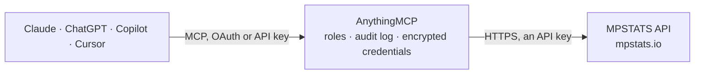

<!-- Generated by scripts/export-github-catalog.mjs in the anythingmcp-website repository. Do not edit by hand. -->

# MPSTATS MCP connector

MPSTATS marketplace analytics for Wildberries and Ozon, read-only: sales, estimated revenue, prices and stock per warehouse and size for any item, search queries and positions, competitors of an … The AnythingMCP connector gives Claude, ChatGPT, Microsoft Copilot, Cursor and Gemini 38 MCP tools for MPSTATS, all read-only.

**Category:** [Analytics](../analytics.md) · **Tools:** 38 · **Setup guide:** [anythingmcp.com](https://anythingmcp.com/guides/mpstats-to-mcp) · [Deutsch](https://anythingmcp.com/de/guides/mpstats-to-mcp) · [Italiano](https://anythingmcp.com/it/guides/mpstats-to-mcp) · [Español](https://anythingmcp.com/es/guides/mpstats-to-mcp) · [日本語](https://anythingmcp.com/ja/guides/mpstats-to-mcp) · [Русский](https://anythingmcp.com/ru/guides/mpstats-to-mcp) · [中文](https://anythingmcp.com/zh/guides/mpstats-to-mcp)

## Start without code

No installation and no terminal: AnythingMCP Cloud runs the MPSTATS connector for you, operated by helpcode.ai in Frankfurt, Germany.

1. **Click the button above** and create an account or sign in. The MPSTATS connector opens, ready to install.
2. **Paste the API key or token from your MPSTATS account.** Every click is in the [step-by-step guide](https://anythingmcp.com/guides/mpstats-to-mcp).
3. **Click Install.** AnythingMCP shows the address of your MCP server.
4. **Add that address to your assistant:** [Claude](https://anythingmcp.com/guides/connect-mpstats-to-claude) · [ChatGPT](https://anythingmcp.com/guides/connect-mpstats-to-chatgpt) · [Microsoft Copilot](https://anythingmcp.com/guides/connect-mpstats-to-copilot) · [Cursor](https://anythingmcp.com/guides/connect-mpstats-to-cursor) · [Gemini CLI](https://anythingmcp.com/guides/connect-mpstats-to-gemini) · [Meta Muse](https://anythingmcp.com/guides/connect-mpstats-to-muse).
5. **Ask your first question**, for example: *WB SKU 98765432 stock per warehouse and current price between 2026-09-01 and 2026-09-07?*

Prefer help with the setup? [Talk to us](https://anythingmcp.com/contact).

## How it works

- **The AI client** speaks MCP (Streamable HTTP) to AnythingMCP and only sees tool names, descriptions and results. It never gets the MPSTATS credentials.
- **AnythingMCP** checks the client's role, builds the call from the tool definition, adds the credentials (an API key), calls MPSTATS, logs the call and returns the result.
- **MPSTATS** sees an ordinary API client with the rights of the account the credentials belong to.

## Tools

| Tool | What it does | Access |
|---|---|---|
| [`mpstats_wb_find_items`](#mpstats_wb_find_items) | Wildberries: look up items by SKU list or by a keyword. | read |
| [`mpstats_wb_get_item`](#mpstats_wb_get_item) | Wildberries: full card of one item: name, brand, seller, rating, stock (FBO/FBS), orders, price and discount, sizes, photos, first seen date. | read |
| [`mpstats_wb_get_item_sales`](#mpstats_wb_get_item_sales) | Wildberries: one row per day for an item: sales, estimated revenue, stock, price and discounts, rating, comments, average category position and visibility. | read |
| [`mpstats_wb_get_item_search_stats`](#mpstats_wb_get_item_search_stats) | Wildberries: search summary of an item for a period compared with the previous one: number of search queries it ranks for, average organic and ad position,… | read |
| [`mpstats_wb_list_item_keywords`](#mpstats_wb_list_item_keywords) | Wildberries: search queries an item ranks for, with query frequency, results count and the item's position per day (organic and advertised), plus daily… | read |
| [`mpstats_wb_get_item_stock_by_warehouse`](#mpstats_wb_get_item_stock_by_warehouse) | Wildberries: stock of an item per Wildberries warehouse (store id, name, balance) for the period. | read |
| [`mpstats_wb_get_item_stock_by_size`](#mpstats_wb_get_item_stock_by_size) | Wildberries: stock of an item per size for the period, to spot sizes that are sold out. | read |
| [`mpstats_wb_get_item_sales_by_warehouse`](#mpstats_wb_get_item_sales_by_warehouse) | Wildberries: sales of an item for the period split by warehouse. | read |
| [`mpstats_wb_get_item_sales_by_size`](#mpstats_wb_get_item_sales_by_size) | Wildberries: sales of an item for the period split by size or variant. | read |
| [`mpstats_wb_list_related_items`](#mpstats_wb_list_related_items) | Wildberries: competitor items related to one SKU, with sales, revenue, price and stock for the period. | read |
| [`mpstats_wb_search_subjects`](#mpstats_wb_search_subjects) | Wildberries: find subjects (niches, the product type such as "Джинсы") by name, with their id, parent category, commissions and market figures. | read |
| [`mpstats_wb_list_subject_items`](#mpstats_wb_list_subject_items) | Wildberries: items of a subject (niche) with sales, revenue, price, stock, rating and position for the period; sales count only the days the item was in… | read |
| [`mpstats_wb_list_subject_breakdown`](#mpstats_wb_list_subject_breakdown) | Wildberries: a subject (niche) split by its categories, brands or sellers, each with items, sales and revenue for the period. | read |
| [`mpstats_wb_get_subject_trend`](#mpstats_wb_get_subject_trend) | Wildberries: market figures of a subject (niche) per day, week, month or quarter: sales, revenue, average price, stock, items, brands and sellers with sales. | read |
| [`mpstats_wb_list_category_items`](#mpstats_wb_list_category_items) | Wildberries: items of a category with sales, revenue, price, stock, rating and category position for the period. | read |
| [`mpstats_wb_list_category_breakdown`](#mpstats_wb_list_category_breakdown) | Wildberries: a category split by subcategories, subjects (niches), brands or sellers, each with items, sales and revenue for the period. | read |
| [`mpstats_wb_get_category_trend`](#mpstats_wb_get_category_trend) | Wildberries: market figures of a category per day, week, month or quarter: sales, revenue, average price, stock, items, brands and sellers with sales. | read |
| [`mpstats_wb_search_sellers`](#mpstats_wb_search_sellers) | Wildberries: find sellers by name, with their id (supplier_id), INN, items and sales. | read |
| [`mpstats_wb_list_seller_items`](#mpstats_wb_list_seller_items) | Wildberries: items of a seller (your own shop or a competitor) with sales, revenue, price and stock for the period. | read |
| [`mpstats_wb_search_brands`](#mpstats_wb_search_brands) | Wildberries: find brands by name, with their items and sales. | read |
| [`mpstats_wb_list_brand_items`](#mpstats_wb_list_brand_items) | Wildberries: items of a brand with sales, revenue, price and stock for the period. | read |
| [`mpstats_wb_get_keyword_frequency`](#mpstats_wb_get_keyword_frequency) | Wildberries: how often a search query is searched on Wildberries, as a weekly series (date, frequency). | read |
| [`mpstats_oz_find_items`](#mpstats_oz_find_items) | Ozon: look up items by SKU list or by a keyword. | read |
| [`mpstats_oz_get_item`](#mpstats_oz_get_item) | Ozon: full card of one item: name, brand, seller, rating, stock, price, category and figures for the period. | read |
| [`mpstats_oz_get_item_sales`](#mpstats_oz_get_item_sales) | Ozon: one row per day for an item: sales, revenue, stock, price, rating and comments. | read |
| [`mpstats_oz_list_item_keywords`](#mpstats_oz_list_item_keywords) | Ozon: search queries an item ranks for, with query frequency and its positions. | read |
| [`mpstats_oz_get_item_category_positions`](#mpstats_oz_get_item_category_positions) | Ozon: positions of an item in each of its categories per day. | read |
| [`mpstats_oz_get_item_stock_by_warehouse`](#mpstats_oz_get_item_stock_by_warehouse) | Ozon: stock of an item per Ozon warehouse on one day (date), FBO and optionally FBS. | read |
| [`mpstats_oz_get_item_sales_by_warehouse`](#mpstats_oz_get_item_sales_by_warehouse) | Ozon: sales of an item for the period split by the warehouse they shipped from. | read |
| [`mpstats_oz_list_similar_items`](#mpstats_oz_list_similar_items) | Ozon: items similar to one SKU (competitors as matched by MPSTATS) with sales, revenue, price and stock for the period. | read |
| [`mpstats_oz_search_niches`](#mpstats_oz_search_niches) | Ozon: find niches (product types) by name, with their id (category_id), name and market figures. | read |
| [`mpstats_oz_list_niche_items`](#mpstats_oz_list_niche_items) | Ozon: items of a niche with sales, revenue, price and stock for the period. | read |
| [`mpstats_oz_list_category_items`](#mpstats_oz_list_category_items) | Ozon: items of a category with sales, revenue, price and stock for the period. | read |
| [`mpstats_oz_list_category_breakdown`](#mpstats_oz_list_category_breakdown) | Ozon: a category split by subcategories, niches, brands or sellers, each with items, sales and revenue for the period. | read |
| [`mpstats_oz_get_category_trend`](#mpstats_oz_get_category_trend) | Ozon: market figures of a category per day, week, month or quarter: sales, revenue, average price, stock, items, brands and sellers. | read |
| [`mpstats_oz_search_sellers`](#mpstats_oz_search_sellers) | Ozon: find sellers by name, with their id (supplier_id), OGRN, items and sales. | read |
| [`mpstats_oz_list_seller_items`](#mpstats_oz_list_seller_items) | Ozon: items of a seller with sales, revenue, price and stock for the period. | read |
| [`mpstats_oz_list_brand_items`](#mpstats_oz_list_brand_items) | Ozon: items of a brand with sales, revenue, price and stock for the period. | read |

## Tool reference

Every parameter as the AI client sees it in `tools/list`. Source: [`packages/backend/src/adapters/intl/mpstats.json`](../../../packages/backend/src/adapters/intl/mpstats.json).

### `mpstats_wb_find_items`

Wildberries: look up items by SKU list or by a keyword. Returns id, name, brand, seller and thumbnail, to resolve names into SKUs before the per-item tools.

**Access:** read · **Call:** `POST /wb/items`

| Parameter | Type | Required | Description |
|---|---|---|---|
| `ids` | string | no | Comma-separated Wildberries SKUs, e.g. "180740354, 279067034". |
| `keyword` | string | no | Keyword to search item names for, e.g. "ботинки". |
| `d1` | string | no | Start date of the report, YYYY-MM-DD. |
| `d2` | string | no | End date of the report, YYYY-MM-DD (data is complete up to yesterday). |
| `startRow` | integer | no | First row to return, from 0. |
| `endRow` | integer | no | Row to stop at (exclusive). At most 500 rows per call: page with startRow/endRow and read total. |
| `filterModel` | object | no | Column filters, e.g. {"revenue": {"filterType": "number", "type": "greaterThan", "filter": 100000}}. Types: equals, notEqual, contains, notContains, startsWith, endsWith, lessThan, lessThanOrEqual, greaterThan, greaterThanOrEqual, inRange (with filterTo). |
| `sortModel` | object[] | no | Sorting, e.g. [{"colId": "revenue", "sort": "desc"}]. |

### `mpstats_wb_get_item`

Wildberries: full card of one item: name, brand, seller, rating, stock (FBO/FBS), orders, price and discount, sizes, photos, first seen date.

**Access:** read · **Call:** `GET /wb/items/{sku}/full`

| Parameter | Type | Required | Description |
|---|---|---|---|
| `sku` | integer | yes | Wildberries article number (nmId / SKU), e.g. 29934835. |
| `d1` | string | no | Start date of the report, YYYY-MM-DD. |
| `d2` | string | no | End date of the report, YYYY-MM-DD (data is complete up to yesterday). |
| `fbs` | `0` \| `1` | no | 1 also counts FBS sales and stock (shipped from the seller's own warehouse), 0 only marketplace warehouses (FBO). |

### `mpstats_wb_get_item_sales`

Wildberries: one row per day for an item: sales, estimated revenue, stock, price and discounts, rating, comments, average category position and visibility. withSearchStats=1 adds search positions and traffic.

**Access:** read · **Call:** `GET /wb/items/{sku}/by_period`

| Parameter | Type | Required | Description |
|---|---|---|---|
| `sku` | integer | yes | Wildberries article number (nmId / SKU), e.g. 29934835. |
| `d1` | string | no | Start date of the report, YYYY-MM-DD. |
| `d2` | string | no | End date of the report, YYYY-MM-DD (data is complete up to yesterday). |
| `fbs` | `0` \| `1` | no | 1 also counts FBS sales and stock (shipped from the seller's own warehouse), 0 only marketplace warehouses (FBO). |
| `withSearchStats` | `0` \| `1` | no | 1 adds search position, visibility and traffic per day. |

### `mpstats_wb_get_item_search_stats`

Wildberries: search summary of an item for a period compared with the previous one: number of search queries it ranks for, average organic and ad position, visibility and estimated traffic.

**Access:** read · **Call:** `GET /wb/items/{sku}/search_stats`

| Parameter | Type | Required | Description |
|---|---|---|---|
| `sku` | integer | yes | Wildberries article number (nmId / SKU), e.g. 29934835. |
| `d1` | string | no | Start date of the report, YYYY-MM-DD. |
| `d2` | string | no | End date of the report, YYYY-MM-DD (data is complete up to yesterday). |

### `mpstats_wb_list_item_keywords`

Wildberries: search queries an item ranks for, with query frequency, results count and the item's position per day (organic and advertised), plus daily sales and visibility. Paged.

**Access:** read · **Call:** `POST /wb/items/{sku}/keywords`

| Parameter | Type | Required | Description |
|---|---|---|---|
| `sku` | integer | yes | Wildberries article number (nmId / SKU), e.g. 29934835. |
| `d1` | string | no | Start date of the report, YYYY-MM-DD. |
| `d2` | string | no | End date of the report, YYYY-MM-DD (data is complete up to yesterday). |
| `fbs` | `0` \| `1` | no | 1 also counts FBS sales and stock (shipped from the seller's own warehouse), 0 only marketplace warehouses (FBO). |
| `dateSort` | string | no | Day whose positions the rows are sorted by, YYYY-MM-DD (default d2). |
| `dateSortDirection` | `asc` \| `desc` | no | Sort direction for dateSort. |
| `positionType` | `position` \| `ad_position` \| `organic_position` | no | Which position to sort by (default position). |
| `startRow` | integer | no | First row to return, from 0. |
| `endRow` | integer | no | Row to stop at (exclusive). At most 500 rows per call: page with startRow/endRow and read total. |
| `filterModel` | object | no | Column filters, e.g. {"revenue": {"filterType": "number", "type": "greaterThan", "filter": 100000}}. Types: equals, notEqual, contains, notContains, startsWith, endsWith, lessThan, lessThanOrEqual, greaterThan, greaterThanOrEqual, inRange (with filterTo). |
| `sortModel` | object[] | no | Sorting, e.g. [{"colId": "revenue", "sort": "desc"}]. |

### `mpstats_wb_get_item_stock_by_warehouse`

Wildberries: stock of an item per Wildberries warehouse (store id, name, balance) for the period.

**Access:** read · **Call:** `GET /wb/items/{sku}/balance/stores`

| Parameter | Type | Required | Description |
|---|---|---|---|
| `sku` | integer | yes | Wildberries article number (nmId / SKU), e.g. 29934835. |
| `d1` | string | no | Start date of the report, YYYY-MM-DD. |
| `d2` | string | no | End date of the report, YYYY-MM-DD (data is complete up to yesterday). |

### `mpstats_wb_get_item_stock_by_size`

Wildberries: stock of an item per size for the period, to spot sizes that are sold out.

**Access:** read · **Call:** `GET /wb/items/{sku}/balance/sizes`

| Parameter | Type | Required | Description |
|---|---|---|---|
| `sku` | integer | yes | Wildberries article number (nmId / SKU), e.g. 29934835. |
| `d1` | string | no | Start date of the report, YYYY-MM-DD. |
| `d2` | string | no | End date of the report, YYYY-MM-DD (data is complete up to yesterday). |

### `mpstats_wb_get_item_sales_by_warehouse`

Wildberries: sales of an item for the period split by warehouse.

**Access:** read · **Call:** `GET /wb/items/{sku}/sales/stores`

| Parameter | Type | Required | Description |
|---|---|---|---|
| `sku` | integer | yes | Wildberries article number (nmId / SKU), e.g. 29934835. |
| `d1` | string | no | Start date of the report, YYYY-MM-DD. |
| `d2` | string | no | End date of the report, YYYY-MM-DD (data is complete up to yesterday). |
| `fbs` | `0` \| `1` | no | 1 also counts FBS sales and stock (shipped from the seller's own warehouse), 0 only marketplace warehouses (FBO). |

### `mpstats_wb_get_item_sales_by_size`

Wildberries: sales of an item for the period split by size or variant.

**Access:** read · **Call:** `GET /wb/items/{sku}/sales/sizes`

| Parameter | Type | Required | Description |
|---|---|---|---|
| `sku` | integer | yes | Wildberries article number (nmId / SKU), e.g. 29934835. |
| `d1` | string | no | Start date of the report, YYYY-MM-DD. |
| `d2` | string | no | End date of the report, YYYY-MM-DD (data is complete up to yesterday). |
| `fbs` | `0` \| `1` | no | 1 also counts FBS sales and stock (shipped from the seller's own warehouse), 0 only marketplace warehouses (FBO). |

### `mpstats_wb_list_related_items`

Wildberries: competitor items related to one SKU, with sales, revenue, price and stock for the period. relation: similar = what Wildberries shows as similar on the item page, in_similar = items whose similar block shows this SKU, identical_wb = items Wildberries marks as identical, identical = similar items as matched by MPSTATS. Paged.

**Access:** read · **Call:** `POST /wb/{relation}/items`

| Parameter | Type | Required | Description |
|---|---|---|---|
| `relation` | `similar` \| `in_similar` \| `identical_wb` \| `identical` | yes | Which relation to list. |
| `sku` | integer | yes | Wildberries article number (nmId / SKU), e.g. 29934835. |
| `d1` | string | no | Start date of the report, YYYY-MM-DD. |
| `d2` | string | no | End date of the report, YYYY-MM-DD (data is complete up to yesterday). |
| `fbs` | `0` \| `1` | no | 1 also counts FBS sales and stock (shipped from the seller's own warehouse), 0 only marketplace warehouses (FBO). |
| `newsmode` | `7` \| `14` \| `30` | no | Only items that appeared in the last 7, 14 or 30 days. |
| `startRow` | integer | no | First row to return, from 0. |
| `endRow` | integer | no | Row to stop at (exclusive). At most 500 rows per call: page with startRow/endRow and read total. |
| `filterModel` | object | no | Column filters, e.g. {"revenue": {"filterType": "number", "type": "greaterThan", "filter": 100000}}. Types: equals, notEqual, contains, notContains, startsWith, endsWith, lessThan, lessThanOrEqual, greaterThan, greaterThanOrEqual, inRange (with filterTo). |
| `sortModel` | object[] | no | Sorting, e.g. [{"colId": "revenue", "sort": "desc"}]. |

### `mpstats_wb_search_subjects`

Wildberries: find subjects (niches, the product type such as "Джинсы") by name, with their id, parent category, commissions and market figures. Use the id with the subject tools. Paged.

**Access:** read · **Call:** `POST /wb/subject/list`

| Parameter | Type | Required | Description |
|---|---|---|---|
| `search` | string | no | Part of the subject name, e.g. "Телевизоры". |
| `date` | string | no | Day the figures refer to, YYYY-MM-DD (default latest). |
| `fbs` | `0` \| `1` | no | 1 also counts FBS sales and stock (shipped from the seller's own warehouse), 0 only marketplace warehouses (FBO). |
| `startRow` | integer | no | First row to return, from 0. |
| `endRow` | integer | no | Row to stop at (exclusive). At most 500 rows per call: page with startRow/endRow and read total. |
| `filterModel` | object | no | Column filters, e.g. {"revenue": {"filterType": "number", "type": "greaterThan", "filter": 100000}}. Types: equals, notEqual, contains, notContains, startsWith, endsWith, lessThan, lessThanOrEqual, greaterThan, greaterThanOrEqual, inRange (with filterTo). |
| `sortModel` | object[] | no | Sorting, e.g. [{"colId": "revenue", "sort": "desc"}]. |

### `mpstats_wb_list_subject_items`

Wildberries: items of a subject (niche) with sales, revenue, price, stock, rating and position for the period; sales count only the days the item was in this subject. Paged; sort with sortModel, e.g. by revenue.

**Access:** read · **Call:** `POST /wb/subject/items`

| Parameter | Type | Required | Description |
|---|---|---|---|
| `subject_id` | integer | yes | Wildberries subject (niche) id, from mpstats_wb_search_subjects, e.g. 69. |
| `d1` | string | no | Start date of the report, YYYY-MM-DD. |
| `d2` | string | no | End date of the report, YYYY-MM-DD (data is complete up to yesterday). |
| `fbs` | `0` \| `1` | no | 1 also counts FBS sales and stock (shipped from the seller's own warehouse), 0 only marketplace warehouses (FBO). |
| `newsmode` | `7` \| `14` \| `30` | no | Only items that appeared in the last 7, 14 or 30 days. |
| `startRow` | integer | no | First row to return, from 0. |
| `endRow` | integer | no | Row to stop at (exclusive). At most 500 rows per call: page with startRow/endRow and read total. |
| `filterModel` | object | no | Column filters, e.g. {"revenue": {"filterType": "number", "type": "greaterThan", "filter": 100000}}. Types: equals, notEqual, contains, notContains, startsWith, endsWith, lessThan, lessThanOrEqual, greaterThan, greaterThanOrEqual, inRange (with filterTo). |
| `sortModel` | object[] | no | Sorting, e.g. [{"colId": "revenue", "sort": "desc"}]. |

### `mpstats_wb_list_subject_breakdown`

Wildberries: a subject (niche) split by its categories, brands or sellers, each with items, sales and revenue for the period.

**Access:** read · **Call:** `POST /wb/subject/{breakdown}`

| Parameter | Type | Required | Description |
|---|---|---|---|
| `breakdown` | `categories` \| `brands` \| `sellers` | yes | How to split the subject. |
| `subject_id` | integer | yes | Wildberries subject (niche) id, from mpstats_wb_search_subjects, e.g. 69. |
| `d1` | string | no | Start date of the report, YYYY-MM-DD. |
| `d2` | string | no | End date of the report, YYYY-MM-DD (data is complete up to yesterday). |
| `fbs` | `0` \| `1` | no | 1 also counts FBS sales and stock (shipped from the seller's own warehouse), 0 only marketplace warehouses (FBO). |
| `startRow` | integer | no | First row to return, from 0. |
| `endRow` | integer | no | Row to stop at (exclusive). At most 500 rows per call: page with startRow/endRow and read total. |
| `sortModel` | object[] | no | Sorting, e.g. [{"colId": "revenue", "sort": "desc"}]. |

### `mpstats_wb_get_subject_trend`

Wildberries: market figures of a subject (niche) per day, week, month or quarter: sales, revenue, average price, stock, items, brands and sellers with sales. For seasonality and trend.

**Access:** read · **Call:** `POST /wb/subject/by_date`

| Parameter | Type | Required | Description |
|---|---|---|---|
| `subject_id` | integer | yes | Wildberries subject (niche) id, from mpstats_wb_search_subjects, e.g. 69. |
| `groupBy` | `day` \| `week` \| `month` \| `quarter` | no | Period of each row (default day). |
| `d1` | string | no | Start date of the report, YYYY-MM-DD. |
| `d2` | string | no | End date of the report, YYYY-MM-DD (data is complete up to yesterday). |
| `fbs` | `0` \| `1` | no | 1 also counts FBS sales and stock (shipped from the seller's own warehouse), 0 only marketplace warehouses (FBO). |

### `mpstats_wb_list_category_items`

Wildberries: items of a category with sales, revenue, price, stock, rating and category position for the period. Paged; sort with sortModel.

**Access:** read · **Call:** `POST /wb/category/items`

| Parameter | Type | Required | Description |
|---|---|---|---|
| `category` | string | yes | Full Wildberries category path as on the site, with / between levels, e.g. "Женщинам/Джинсы". |
| `d1` | string | no | Start date of the report, YYYY-MM-DD. |
| `d2` | string | no | End date of the report, YYYY-MM-DD (data is complete up to yesterday). |
| `fbs` | `0` \| `1` | no | 1 also counts FBS sales and stock (shipped from the seller's own warehouse), 0 only marketplace warehouses (FBO). |
| `newsmode` | `7` \| `14` \| `30` | no | Only items that appeared in the last 7, 14 or 30 days. |
| `startRow` | integer | no | First row to return, from 0. |
| `endRow` | integer | no | Row to stop at (exclusive). At most 500 rows per call: page with startRow/endRow and read total. |
| `filterModel` | object | no | Column filters, e.g. {"revenue": {"filterType": "number", "type": "greaterThan", "filter": 100000}}. Types: equals, notEqual, contains, notContains, startsWith, endsWith, lessThan, lessThanOrEqual, greaterThan, greaterThanOrEqual, inRange (with filterTo). |
| `sortModel` | object[] | no | Sorting, e.g. [{"colId": "revenue", "sort": "desc"}]. |

### `mpstats_wb_list_category_breakdown`

Wildberries: a category split by subcategories, subjects (niches), brands or sellers, each with items, sales and revenue for the period.

**Access:** read · **Call:** `POST /wb/category/{breakdown}`

| Parameter | Type | Required | Description |
|---|---|---|---|
| `breakdown` | `categories` \| `subjects` \| `brands` \| `sellers` | yes | How to split the category (categories = its subcategories). |
| `category` | string | yes | Full Wildberries category path as on the site, with / between levels, e.g. "Женщинам/Джинсы". |
| `d1` | string | no | Start date of the report, YYYY-MM-DD. |
| `d2` | string | no | End date of the report, YYYY-MM-DD (data is complete up to yesterday). |
| `fbs` | `0` \| `1` | no | 1 also counts FBS sales and stock (shipped from the seller's own warehouse), 0 only marketplace warehouses (FBO). |
| `startRow` | integer | no | First row to return, from 0. |
| `endRow` | integer | no | Row to stop at (exclusive). At most 500 rows per call: page with startRow/endRow and read total. |
| `sortModel` | object[] | no | Sorting, e.g. [{"colId": "revenue", "sort": "desc"}]. |

### `mpstats_wb_get_category_trend`

Wildberries: market figures of a category per day, week, month or quarter: sales, revenue, average price, stock, items, brands and sellers with sales.

**Access:** read · **Call:** `POST /wb/category/by_date`

| Parameter | Type | Required | Description |
|---|---|---|---|
| `category` | string | yes | Full Wildberries category path as on the site, with / between levels, e.g. "Женщинам/Джинсы". |
| `groupBy` | `day` \| `week` \| `month` \| `quarter` | no | Period of each row (default day). |
| `d1` | string | no | Start date of the report, YYYY-MM-DD. |
| `d2` | string | no | End date of the report, YYYY-MM-DD (data is complete up to yesterday). |
| `fbs` | `0` \| `1` | no | 1 also counts FBS sales and stock (shipped from the seller's own warehouse), 0 only marketplace warehouses (FBO). |

### `mpstats_wb_search_sellers`

Wildberries: find sellers by name, with their id (supplier_id), INN, items and sales. Use that id with mpstats_wb_list_seller_items. Paged.

**Access:** read · **Call:** `POST /wb/seller/list`

| Parameter | Type | Required | Description |
|---|---|---|---|
| `search` | string | no | Part of the seller name, e.g. "Кари". |
| `date` | string | no | Day the figures refer to, YYYY-MM-DD (default latest). |
| `fbs` | `0` \| `1` | no | 1 also counts FBS sales and stock (shipped from the seller's own warehouse), 0 only marketplace warehouses (FBO). |
| `startRow` | integer | no | First row to return, from 0. |
| `endRow` | integer | no | Row to stop at (exclusive). At most 500 rows per call: page with startRow/endRow and read total. |
| `filterModel` | object | no | Column filters, e.g. {"revenue": {"filterType": "number", "type": "greaterThan", "filter": 100000}}. Types: equals, notEqual, contains, notContains, startsWith, endsWith, lessThan, lessThanOrEqual, greaterThan, greaterThanOrEqual, inRange (with filterTo). |
| `sortModel` | object[] | no | Sorting, e.g. [{"colId": "revenue", "sort": "desc"}]. |

### `mpstats_wb_list_seller_items`

Wildberries: items of a seller (your own shop or a competitor) with sales, revenue, price and stock for the period. Paged.

**Access:** read · **Call:** `POST /wb/seller/items`

| Parameter | Type | Required | Description |
|---|---|---|---|
| `seller_id` | integer | yes | Wildberries seller id, e.g. 8475 (supplier_id in mpstats_wb_search_sellers, or an item's seller.id). |
| `d1` | string | no | Start date of the report, YYYY-MM-DD. |
| `d2` | string | no | End date of the report, YYYY-MM-DD (data is complete up to yesterday). |
| `fbs` | `0` \| `1` | no | 1 also counts FBS sales and stock (shipped from the seller's own warehouse), 0 only marketplace warehouses (FBO). |
| `newsmode` | `7` \| `14` \| `30` | no | Only items that appeared in the last 7, 14 or 30 days. |
| `startRow` | integer | no | First row to return, from 0. |
| `endRow` | integer | no | Row to stop at (exclusive). At most 500 rows per call: page with startRow/endRow and read total. |
| `filterModel` | object | no | Column filters, e.g. {"revenue": {"filterType": "number", "type": "greaterThan", "filter": 100000}}. Types: equals, notEqual, contains, notContains, startsWith, endsWith, lessThan, lessThanOrEqual, greaterThan, greaterThanOrEqual, inRange (with filterTo). |
| `sortModel` | object[] | no | Sorting, e.g. [{"colId": "revenue", "sort": "desc"}]. |

### `mpstats_wb_search_brands`

Wildberries: find brands by name, with their items and sales. Paged.

**Access:** read · **Call:** `POST /wb/brand/list`

| Parameter | Type | Required | Description |
|---|---|---|---|
| `search` | string | no | Part of the brand name. |
| `date` | string | no | Day the figures refer to, YYYY-MM-DD (default latest). |
| `fbs` | `0` \| `1` | no | 1 also counts FBS sales and stock (shipped from the seller's own warehouse), 0 only marketplace warehouses (FBO). |
| `startRow` | integer | no | First row to return, from 0. |
| `endRow` | integer | no | Row to stop at (exclusive). At most 500 rows per call: page with startRow/endRow and read total. |
| `filterModel` | object | no | Column filters, e.g. {"revenue": {"filterType": "number", "type": "greaterThan", "filter": 100000}}. Types: equals, notEqual, contains, notContains, startsWith, endsWith, lessThan, lessThanOrEqual, greaterThan, greaterThanOrEqual, inRange (with filterTo). |
| `sortModel` | object[] | no | Sorting, e.g. [{"colId": "revenue", "sort": "desc"}]. |

### `mpstats_wb_list_brand_items`

Wildberries: items of a brand with sales, revenue, price and stock for the period. Paged.

**Access:** read · **Call:** `POST /wb/brand/items`

| Parameter | Type | Required | Description |
|---|---|---|---|
| `brand` | string | yes | Brand name as on Wildberries, e.g. "Adidas". |
| `d1` | string | no | Start date of the report, YYYY-MM-DD. |
| `d2` | string | no | End date of the report, YYYY-MM-DD (data is complete up to yesterday). |
| `fbs` | `0` \| `1` | no | 1 also counts FBS sales and stock (shipped from the seller's own warehouse), 0 only marketplace warehouses (FBO). |
| `newsmode` | `7` \| `14` \| `30` | no | Only items that appeared in the last 7, 14 or 30 days. |
| `startRow` | integer | no | First row to return, from 0. |
| `endRow` | integer | no | Row to stop at (exclusive). At most 500 rows per call: page with startRow/endRow and read total. |
| `filterModel` | object | no | Column filters, e.g. {"revenue": {"filterType": "number", "type": "greaterThan", "filter": 100000}}. Types: equals, notEqual, contains, notContains, startsWith, endsWith, lessThan, lessThanOrEqual, greaterThan, greaterThanOrEqual, inRange (with filterTo). |
| `sortModel` | object[] | no | Sorting, e.g. [{"colId": "revenue", "sort": "desc"}]. |

### `mpstats_wb_get_keyword_frequency`

Wildberries: how often a search query is searched on Wildberries, as a weekly series (date, frequency).

**Access:** read · **Call:** `GET /wb/keywords/frequency`

| Parameter | Type | Required | Description |
|---|---|---|---|
| `keyword` | string | yes | The search query, e.g. "ботинки". |

### `mpstats_oz_find_items`

Ozon: look up items by SKU list or by a keyword. Returns id, name, brand, seller and thumbnail.

**Access:** read · **Call:** `POST /oz/items`

| Parameter | Type | Required | Description |
|---|---|---|---|
| `ids` | string | no | Comma-separated Ozon SKUs. |
| `keyword` | string | no | Keyword to search item names for, e.g. "кроссовки". |
| `d1` | string | no | Start date of the report, YYYY-MM-DD. |
| `d2` | string | no | End date of the report, YYYY-MM-DD (data is complete up to yesterday). |
| `startRow` | integer | no | First row to return, from 0. |
| `endRow` | integer | no | Row to stop at (exclusive). At most 500 rows per call: page with startRow/endRow and read total. |
| `filterModel` | object | no | Column filters, e.g. {"revenue": {"filterType": "number", "type": "greaterThan", "filter": 100000}}. Types: equals, notEqual, contains, notContains, startsWith, endsWith, lessThan, lessThanOrEqual, greaterThan, greaterThanOrEqual, inRange (with filterTo). |
| `sortModel` | object[] | no | Sorting, e.g. [{"colId": "revenue", "sort": "desc"}]. |

### `mpstats_oz_get_item`

Ozon: full card of one item: name, brand, seller, rating, stock, price, category and figures for the period.

**Access:** read · **Call:** `GET /oz/items/{sku}/full`

| Parameter | Type | Required | Description |
|---|---|---|---|
| `sku` | integer | yes | Ozon product SKU, e.g. 1786874757. |
| `d1` | string | no | Start date of the report, YYYY-MM-DD. |
| `d2` | string | no | End date of the report, YYYY-MM-DD (data is complete up to yesterday). |
| `fbs` | `0` \| `1` | no | 1 also counts FBS sales and stock (shipped from the seller's own warehouse), 0 only marketplace warehouses (FBO). |

### `mpstats_oz_get_item_sales`

Ozon: one row per day for an item: sales, revenue, stock, price, rating and comments. withSearchStats=1 adds search positions and traffic.

**Access:** read · **Call:** `GET /oz/items/{sku}/by_period`

| Parameter | Type | Required | Description |
|---|---|---|---|
| `sku` | integer | yes | Ozon product SKU, e.g. 1786874757. |
| `d1` | string | no | Start date of the report, YYYY-MM-DD. |
| `d2` | string | no | End date of the report, YYYY-MM-DD (data is complete up to yesterday). |
| `fbs` | `0` \| `1` | no | 1 also counts FBS sales and stock (shipped from the seller's own warehouse), 0 only marketplace warehouses (FBO). |
| `withSearchStats` | `0` \| `1` | no | 1 adds search position, visibility and traffic per day. |

### `mpstats_oz_list_item_keywords`

Ozon: search queries an item ranks for, with query frequency and its positions.

**Access:** read · **Call:** `GET /oz/items/{sku}/keywords`

| Parameter | Type | Required | Description |
|---|---|---|---|
| `sku` | integer | yes | Ozon product SKU, e.g. 1786874757. |
| `d1` | string | no | Start date of the report, YYYY-MM-DD. |
| `d2` | string | no | End date of the report, YYYY-MM-DD (data is complete up to yesterday). |

### `mpstats_oz_get_item_category_positions`

Ozon: positions of an item in each of its categories per day.

**Access:** read · **Call:** `GET /oz/items/{sku}/categories`

| Parameter | Type | Required | Description |
|---|---|---|---|
| `sku` | integer | yes | Ozon product SKU, e.g. 1786874757. |
| `d1` | string | no | Start date of the report, YYYY-MM-DD. |
| `d2` | string | no | End date of the report, YYYY-MM-DD (data is complete up to yesterday). |

### `mpstats_oz_get_item_stock_by_warehouse`

Ozon: stock of an item per Ozon warehouse on one day (date), FBO and optionally FBS.

**Access:** read · **Call:** `GET /oz/items/{sku}/balance`

| Parameter | Type | Required | Description |
|---|---|---|---|
| `sku` | integer | yes | Ozon product SKU, e.g. 1786874757. |
| `date` | string | no | Day of the stock, YYYY-MM-DD. |
| `fbs` | `0` \| `1` | no | 1 also counts FBS sales and stock (shipped from the seller's own warehouse), 0 only marketplace warehouses (FBO). |

### `mpstats_oz_get_item_sales_by_warehouse`

Ozon: sales of an item for the period split by the warehouse they shipped from.

**Access:** read · **Call:** `GET /oz/items/{sku}/sales`

| Parameter | Type | Required | Description |
|---|---|---|---|
| `sku` | integer | yes | Ozon product SKU, e.g. 1786874757. |
| `d1` | string | no | Start date of the report, YYYY-MM-DD. |
| `d2` | string | no | End date of the report, YYYY-MM-DD (data is complete up to yesterday). |
| `fbs` | `0` \| `1` | no | 1 also counts FBS sales and stock (shipped from the seller's own warehouse), 0 only marketplace warehouses (FBO). |

### `mpstats_oz_list_similar_items`

Ozon: items similar to one SKU (competitors as matched by MPSTATS) with sales, revenue, price and stock for the period. Paged.

**Access:** read · **Call:** `POST /oz/identical/items`

| Parameter | Type | Required | Description |
|---|---|---|---|
| `sku` | integer | yes | Ozon product SKU, e.g. 1786874757. |
| `d1` | string | no | Start date of the report, YYYY-MM-DD. |
| `d2` | string | no | End date of the report, YYYY-MM-DD (data is complete up to yesterday). |
| `fbs` | `0` \| `1` | no | 1 also counts FBS sales and stock (shipped from the seller's own warehouse), 0 only marketplace warehouses (FBO). |
| `startRow` | integer | no | First row to return, from 0. |
| `endRow` | integer | no | Row to stop at (exclusive). At most 500 rows per call: page with startRow/endRow and read total. |
| `filterModel` | object | no | Column filters, e.g. {"revenue": {"filterType": "number", "type": "greaterThan", "filter": 100000}}. Types: equals, notEqual, contains, notContains, startsWith, endsWith, lessThan, lessThanOrEqual, greaterThan, greaterThanOrEqual, inRange (with filterTo). |
| `sortModel` | object[] | no | Sorting, e.g. [{"colId": "revenue", "sort": "desc"}]. |

### `mpstats_oz_search_niches`

Ozon: find niches (product types) by name, with their id (category_id), name and market figures. Use that id with mpstats_oz_list_niche_items. Paged.

**Access:** read · **Call:** `POST /oz/niche/list`

| Parameter | Type | Required | Description |
|---|---|---|---|
| `search` | string | no | Part of the niche name, e.g. "Телевизоры". |
| `date` | string | no | Day the figures refer to, YYYY-MM-DD (default latest). |
| `fbs` | `0` \| `1` | no | 1 also counts FBS sales and stock (shipped from the seller's own warehouse), 0 only marketplace warehouses (FBO). |
| `startRow` | integer | no | First row to return, from 0. |
| `endRow` | integer | no | Row to stop at (exclusive). At most 500 rows per call: page with startRow/endRow and read total. |
| `filterModel` | object | no | Column filters, e.g. {"revenue": {"filterType": "number", "type": "greaterThan", "filter": 100000}}. Types: equals, notEqual, contains, notContains, startsWith, endsWith, lessThan, lessThanOrEqual, greaterThan, greaterThanOrEqual, inRange (with filterTo). |
| `sortModel` | object[] | no | Sorting, e.g. [{"colId": "revenue", "sort": "desc"}]. |

### `mpstats_oz_list_niche_items`

Ozon: items of a niche with sales, revenue, price and stock for the period. Paged.

**Access:** read · **Call:** `POST /oz/niche/items`

| Parameter | Type | Required | Description |
|---|---|---|---|
| `niche_id` | integer | yes | Ozon niche id (category_id in mpstats_oz_search_niches), e.g. 7502. |
| `d1` | string | no | Start date of the report, YYYY-MM-DD. |
| `d2` | string | no | End date of the report, YYYY-MM-DD (data is complete up to yesterday). |
| `fbs` | `0` \| `1` | no | 1 also counts FBS sales and stock (shipped from the seller's own warehouse), 0 only marketplace warehouses (FBO). |
| `startRow` | integer | no | First row to return, from 0. |
| `endRow` | integer | no | Row to stop at (exclusive). At most 500 rows per call: page with startRow/endRow and read total. |
| `filterModel` | object | no | Column filters, e.g. {"revenue": {"filterType": "number", "type": "greaterThan", "filter": 100000}}. Types: equals, notEqual, contains, notContains, startsWith, endsWith, lessThan, lessThanOrEqual, greaterThan, greaterThanOrEqual, inRange (with filterTo). |
| `sortModel` | object[] | no | Sorting, e.g. [{"colId": "revenue", "sort": "desc"}]. |

### `mpstats_oz_list_category_items`

Ozon: items of a category with sales, revenue, price and stock for the period. Paged.

**Access:** read · **Call:** `POST /oz/category/items`

| Parameter | Type | Required | Description |
|---|---|---|---|
| `category` | string | yes | Full Ozon category path with / between levels, e.g. "Одежда/Женская одежда". |
| `d1` | string | no | Start date of the report, YYYY-MM-DD. |
| `d2` | string | no | End date of the report, YYYY-MM-DD (data is complete up to yesterday). |
| `fbs` | `0` \| `1` | no | 1 also counts FBS sales and stock (shipped from the seller's own warehouse), 0 only marketplace warehouses (FBO). |
| `startRow` | integer | no | First row to return, from 0. |
| `endRow` | integer | no | Row to stop at (exclusive). At most 500 rows per call: page with startRow/endRow and read total. |
| `filterModel` | object | no | Column filters, e.g. {"revenue": {"filterType": "number", "type": "greaterThan", "filter": 100000}}. Types: equals, notEqual, contains, notContains, startsWith, endsWith, lessThan, lessThanOrEqual, greaterThan, greaterThanOrEqual, inRange (with filterTo). |
| `sortModel` | object[] | no | Sorting, e.g. [{"colId": "revenue", "sort": "desc"}]. |

### `mpstats_oz_list_category_breakdown`

Ozon: a category split by subcategories, niches, brands or sellers, each with items, sales and revenue for the period.

**Access:** read · **Call:** `POST /oz/category/{breakdown}`

| Parameter | Type | Required | Description |
|---|---|---|---|
| `breakdown` | `categories` \| `niches` \| `brands` \| `sellers` | yes | How to split the category (categories = its subcategories). |
| `category` | string | yes | Full Ozon category path with / between levels, e.g. "Одежда/Женская одежда". |
| `d1` | string | no | Start date of the report, YYYY-MM-DD. |
| `d2` | string | no | End date of the report, YYYY-MM-DD (data is complete up to yesterday). |
| `fbs` | `0` \| `1` | no | 1 also counts FBS sales and stock (shipped from the seller's own warehouse), 0 only marketplace warehouses (FBO). |
| `startRow` | integer | no | First row to return, from 0. |
| `endRow` | integer | no | Row to stop at (exclusive). At most 500 rows per call: page with startRow/endRow and read total. |
| `sortModel` | object[] | no | Sorting, e.g. [{"colId": "revenue", "sort": "desc"}]. |

### `mpstats_oz_get_category_trend`

Ozon: market figures of a category per day, week, month or quarter: sales, revenue, average price, stock, items, brands and sellers.

**Access:** read · **Call:** `POST /oz/category/by_date`

| Parameter | Type | Required | Description |
|---|---|---|---|
| `category` | string | yes | Full Ozon category path with / between levels, e.g. "Одежда/Женская одежда". |
| `groupBy` | `day` \| `week` \| `month` \| `quarter` | no | Period of each row (default day). |
| `d1` | string | no | Start date of the report, YYYY-MM-DD. |
| `d2` | string | no | End date of the report, YYYY-MM-DD (data is complete up to yesterday). |
| `fbs` | `0` \| `1` | no | 1 also counts FBS sales and stock (shipped from the seller's own warehouse), 0 only marketplace warehouses (FBO). |

### `mpstats_oz_search_sellers`

Ozon: find sellers by name, with their id (supplier_id), OGRN, items and sales. Paged.

**Access:** read · **Call:** `POST /oz/seller/list`

| Parameter | Type | Required | Description |
|---|---|---|---|
| `search` | string | no | Part of the seller name. |
| `date` | string | no | Day the figures refer to, YYYY-MM-DD (default latest). |
| `fbs` | `0` \| `1` | no | 1 also counts FBS sales and stock (shipped from the seller's own warehouse), 0 only marketplace warehouses (FBO). |
| `startRow` | integer | no | First row to return, from 0. |
| `endRow` | integer | no | Row to stop at (exclusive). At most 500 rows per call: page with startRow/endRow and read total. |
| `filterModel` | object | no | Column filters, e.g. {"revenue": {"filterType": "number", "type": "greaterThan", "filter": 100000}}. Types: equals, notEqual, contains, notContains, startsWith, endsWith, lessThan, lessThanOrEqual, greaterThan, greaterThanOrEqual, inRange (with filterTo). |
| `sortModel` | object[] | no | Sorting, e.g. [{"colId": "revenue", "sort": "desc"}]. |

### `mpstats_oz_list_seller_items`

Ozon: items of a seller with sales, revenue, price and stock for the period. Paged.

**Access:** read · **Call:** `POST /oz/seller/items`

| Parameter | Type | Required | Description |
|---|---|---|---|
| `seller_id` | integer | yes | Ozon seller id (supplier_id in mpstats_oz_search_sellers, or an item's seller.id). |
| `d1` | string | no | Start date of the report, YYYY-MM-DD. |
| `d2` | string | no | End date of the report, YYYY-MM-DD (data is complete up to yesterday). |
| `fbs` | `0` \| `1` | no | 1 also counts FBS sales and stock (shipped from the seller's own warehouse), 0 only marketplace warehouses (FBO). |
| `startRow` | integer | no | First row to return, from 0. |
| `endRow` | integer | no | Row to stop at (exclusive). At most 500 rows per call: page with startRow/endRow and read total. |
| `filterModel` | object | no | Column filters, e.g. {"revenue": {"filterType": "number", "type": "greaterThan", "filter": 100000}}. Types: equals, notEqual, contains, notContains, startsWith, endsWith, lessThan, lessThanOrEqual, greaterThan, greaterThanOrEqual, inRange (with filterTo). |
| `sortModel` | object[] | no | Sorting, e.g. [{"colId": "revenue", "sort": "desc"}]. |

### `mpstats_oz_list_brand_items`

Ozon: items of a brand with sales, revenue, price and stock for the period. Paged.

**Access:** read · **Call:** `POST /oz/brand/items`

| Parameter | Type | Required | Description |
|---|---|---|---|
| `brand` | string | yes | Brand name as on Ozon, e.g. "Adidas". |
| `d1` | string | no | Start date of the report, YYYY-MM-DD. |
| `d2` | string | no | End date of the report, YYYY-MM-DD (data is complete up to yesterday). |
| `fbs` | `0` \| `1` | no | 1 also counts FBS sales and stock (shipped from the seller's own warehouse), 0 only marketplace warehouses (FBO). |
| `startRow` | integer | no | First row to return, from 0. |
| `endRow` | integer | no | Row to stop at (exclusive). At most 500 rows per call: page with startRow/endRow and read total. |
| `filterModel` | object | no | Column filters, e.g. {"revenue": {"filterType": "number", "type": "greaterThan", "filter": 100000}}. Types: equals, notEqual, contains, notContains, startsWith, endsWith, lessThan, lessThanOrEqual, greaterThan, greaterThanOrEqual, inRange (with filterTo). |
| `sortModel` | object[] | no | Sorting, e.g. [{"colId": "revenue", "sort": "desc"}]. |

## Run it yourself

AnythingMCP is open source (AGPL-3.0). [Run it with Docker](../../../README.md#run-it-yourself), open **Connectors → Store**, pick **MPSTATS** and enter `MPSTATS_API_TOKEN`, then add your MCP server URL to the AI client.

[← Analytics connectors](../analytics.md) · [All categories](../README.md)
