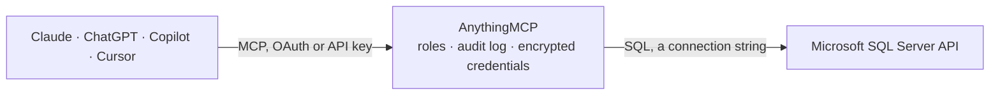

<!-- Generated by scripts/export-github-catalog.mjs in the anythingmcp-website repository. Do not edit by hand. -->

# Microsoft SQL Server MCP connector

Query a Microsoft SQL Server database directly: list tables, describe columns and run read-only T-SQL. The AnythingMCP connector gives Claude, ChatGPT, Microsoft Copilot, Cursor and Gemini 5 MCP tools for Microsoft SQL Server, all read-only.

**Category:** [Databases](../database.md) · **Tools:** 5 · **Setup guide:** [anythingmcp.com](https://anythingmcp.com/guides/mssql-to-mcp) · [Deutsch](https://anythingmcp.com/de/guides/mssql-to-mcp) · [Italiano](https://anythingmcp.com/it/guides/mssql-to-mcp) · [Español](https://anythingmcp.com/es/guides/mssql-to-mcp) · [日本語](https://anythingmcp.com/ja/guides/mssql-to-mcp) · [Русский](https://anythingmcp.com/ru/guides/mssql-to-mcp) · [中文](https://anythingmcp.com/zh/guides/mssql-to-mcp)

## Start without code

No installation and no terminal: AnythingMCP Cloud runs the Microsoft SQL Server connector for you, operated by helpcode.ai in Frankfurt, Germany.

1. **Click the button above** and create an account or sign in. The Microsoft SQL Server connector opens, ready to install.
2. **Paste the API key or token from your Microsoft SQL Server account.** Every click is in the [step-by-step guide](https://anythingmcp.com/guides/mssql-to-mcp).
3. **Click Install.** AnythingMCP shows the address of your MCP server.
4. **Add that address to your assistant:** [Claude](https://anythingmcp.com/guides/connect-mssql-to-claude) · [ChatGPT](https://anythingmcp.com/guides/connect-mssql-to-chatgpt) · [Microsoft Copilot](https://anythingmcp.com/guides/connect-mssql-to-copilot) · [Cursor](https://anythingmcp.com/guides/connect-mssql-to-cursor) · [Gemini CLI](https://anythingmcp.com/guides/connect-mssql-to-gemini) · [Meta Muse](https://anythingmcp.com/guides/connect-mssql-to-muse).
5. **Ask your first question**, for example: *Show invoice INV-2026-0917 for customer NovaBrew Handels GmbH: amount, due date, status.*

Prefer help with the setup? [Talk to us](https://anythingmcp.com/contact).

## How it works

- **The AI client** speaks MCP (Streamable HTTP) to AnythingMCP and only sees tool names, descriptions and results. It never gets the Microsoft SQL Server credentials.
- **AnythingMCP** checks the client's role, builds the call from the tool definition, adds the credentials (a connection string), calls Microsoft SQL Server, logs the call and returns the result.
- **Microsoft SQL Server** sees an ordinary API client with the rights of the account the credentials belong to.

## Tools

| Tool | What it does | Access |
|---|---|---|
| [`mssql_list_tables`](#mssql_list_tables) | List the tables and views in the database with their schema and, where the server tracks it, an approximate row count. | read |
| [`mssql_describe_table`](#mssql_describe_table) | Describe one table: every column with its data type, nullability and default. | read |
| [`mssql_find_columns`](#mssql_find_columns) | Find columns across every table whose name matches a pattern — the fast way to locate where customer e-mail addresses, IBANs or order numbers actually live. | read |
| [`mssql_query`](#mssql_query) | Run a read-only SQL statement against Microsoft SQL Server and return up to 1000 rows. | read |
| [`mssql_query_examples`](#mssql_query_examples) | Show worked example queries for Microsoft SQL Server: how to list schemas, find large tables, inspect indexes and check what is running right now. | read |

## Tool reference

Every parameter as the AI client sees it in `tools/list`. Source: [`packages/backend/src/adapters/intl/mssql.json`](../../../packages/backend/src/adapters/intl/mssql.json).

### `mssql_list_tables`

List the tables and views in the database with their schema and, where the server tracks it, an approximate row count. Start here — it is the map of what can be queried.

**Access:** read · **Call:** `query SELECT s.name AS table_schema, t.name AS table_name, 'BASE TABLE' AS table_type, p.rows AS approx_rows FROM sys.tables t JOIN sys.schemas s ON s.schema_id = t.schema_id JOIN sys.partitions p ON p.object_id = t.object_id AND p.index_id IN (0,1) ORDER BY s.name, t.name`

No parameters.

### `mssql_describe_table`

Describe one table: every column with its data type, nullability and default. Read this before writing a query against a table you have not seen.

**Access:** read · **Call:** `query SELECT column_name, data_type, is_nullable, column_default, character_maximum_length FROM information_schema.columns WHERE table_name = ${table_name} ORDER BY ordinal_position`

| Parameter | Type | Required | Description |
|---|---|---|---|
| `table_name` | string | yes | Table name, without the schema prefix. |

### `mssql_find_columns`

Find columns across every table whose name matches a pattern — the fast way to locate where customer e-mail addresses, IBANs or order numbers actually live.

**Access:** read · **Call:** `query SELECT table_schema, table_name, column_name, data_type FROM information_schema.columns WHERE column_name LIKE ${pattern} ORDER BY table_schema, table_name, column_name`

| Parameter | Type | Required | Description |
|---|---|---|---|
| `pattern` | string | yes | SQL LIKE pattern matched against the column name, e.g. %email% or %_id. |

### `mssql_query`

Run a read-only SQL statement against Microsoft SQL Server and return up to 1000 rows. The statement runs exactly as written — there is no automatic LIMIT, so say LIMIT.

**Access:** read · **Call:** `query ${query}`

| Parameter | Type | Required | Description |
|---|---|---|---|
| `query` | string | yes | A single SQL SELECT statement. Include your own LIMIT; nothing is added for you. |

### `mssql_query_examples`

Show worked example queries for Microsoft SQL Server: how to list schemas, find large tables, inspect indexes and check what is running right now. Costs nothing and touches no data.

**Access:** read

No parameters.

## Run it yourself

AnythingMCP is open source (AGPL-3.0). [Run it with Docker](../../../README.md#run-it-yourself), open **Connectors → Store**, pick **Microsoft SQL Server** and enter `MSSQL_HOST`, `MSSQL_PORT`, `MSSQL_DATABASE`, `MSSQL_USER`, `MSSQL_PASSWORD`, then add your MCP server URL to the AI client.

[← Databases connectors](../database.md) · [All categories](../README.md)
