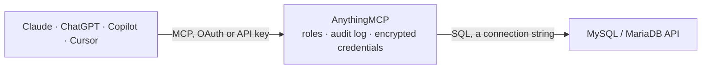

<!-- Generated by scripts/export-github-catalog.mjs in the anythingmcp-website repository. Do not edit by hand. -->

# MySQL / MariaDB MCP connector

Query a MySQL or MariaDB database directly: list tables, describe columns and run read-only SQL. The AnythingMCP connector gives Claude, ChatGPT, Microsoft Copilot, Cursor and Gemini 5 MCP tools for MySQL / MariaDB, all read-only.

**Category:** [Databases](../database.md) · **Tools:** 5 · **Setup guide:** [anythingmcp.com](https://anythingmcp.com/guides/mysql-to-mcp) · [Deutsch](https://anythingmcp.com/de/guides/mysql-to-mcp) · [Italiano](https://anythingmcp.com/it/guides/mysql-to-mcp) · [Español](https://anythingmcp.com/es/guides/mysql-to-mcp) · [日本語](https://anythingmcp.com/ja/guides/mysql-to-mcp) · [Русский](https://anythingmcp.com/ru/guides/mysql-to-mcp) · [中文](https://anythingmcp.com/zh/guides/mysql-to-mcp)

## Start without code

No installation and no terminal: AnythingMCP Cloud runs the MySQL / MariaDB connector for you, operated by helpcode.ai in Frankfurt, Germany.

1. **Click the button above** and create an account or sign in. The MySQL / MariaDB connector opens, ready to install.
2. **Paste the API key or token from your MySQL / MariaDB account.** Every click is in the [step-by-step guide](https://anythingmcp.com/guides/mysql-to-mcp).
3. **Click Install.** AnythingMCP shows the address of your MCP server.
4. **Add that address to your assistant:** [Claude](https://anythingmcp.com/guides/connect-mysql-to-claude) · [ChatGPT](https://anythingmcp.com/guides/connect-mysql-to-chatgpt) · [Microsoft Copilot](https://anythingmcp.com/guides/connect-mysql-to-copilot) · [Cursor](https://anythingmcp.com/guides/connect-mysql-to-cursor) · [Gemini CLI](https://anythingmcp.com/guides/connect-mysql-to-gemini) · [Meta Muse](https://anythingmcp.com/guides/connect-mysql-to-muse).
5. **Ask your first question**, for example: *Show invoice INV-2026-058 for customer 'Nordic Home Interiors' — I need invoice amount, date and payment status.*

Prefer help with the setup? [Talk to us](https://anythingmcp.com/contact).

## How it works

- **The AI client** speaks MCP (Streamable HTTP) to AnythingMCP and only sees tool names, descriptions and results. It never gets the MySQL / MariaDB credentials.
- **AnythingMCP** checks the client's role, builds the call from the tool definition, adds the credentials (a connection string), calls MySQL / MariaDB, logs the call and returns the result.
- **MySQL / MariaDB** sees an ordinary API client with the rights of the account the credentials belong to.

## Tools

| Tool | What it does | Access |
|---|---|---|
| [`mysql_list_tables`](#mysql_list_tables) | List the tables and views in the database with their schema and, where the server tracks it, an approximate row count. | read |
| [`mysql_describe_table`](#mysql_describe_table) | Describe one table: every column with its data type, nullability and default. | read |
| [`mysql_find_columns`](#mysql_find_columns) | Find columns across every table whose name matches a pattern — the fast way to locate where customer e-mail addresses, IBANs or order numbers actually live. | read |
| [`mysql_query`](#mysql_query) | Run a read-only SQL statement against MySQL / MariaDB and return up to 1000 rows. | read |
| [`mysql_query_examples`](#mysql_query_examples) | Show worked example queries for MySQL / MariaDB: how to list schemas, find large tables, inspect indexes and check what is running right now. | read |

## Tool reference

Every parameter as the AI client sees it in `tools/list`. Source: [`packages/backend/src/adapters/intl/mysql.json`](../../../packages/backend/src/adapters/intl/mysql.json).

### `mysql_list_tables`

List the tables and views in the database with their schema and, where the server tracks it, an approximate row count. Start here — it is the map of what can be queried.

**Access:** read · **Call:** `query SELECT table_schema, table_name, table_type, table_rows FROM information_schema.tables WHERE table_schema = DATABASE() ORDER BY table_name`

No parameters.

### `mysql_describe_table`

Describe one table: every column with its data type, nullability and default. Read this before writing a query against a table you have not seen.

**Access:** read · **Call:** `query SELECT column_name, column_type, is_nullable, column_default, column_key FROM information_schema.columns WHERE table_schema = DATABASE() AND table_name = ${table_name} ORDER BY ordinal_position`

| Parameter | Type | Required | Description |
|---|---|---|---|
| `table_name` | string | yes | Table name, without the schema prefix. |

### `mysql_find_columns`

Find columns across every table whose name matches a pattern — the fast way to locate where customer e-mail addresses, IBANs or order numbers actually live.

**Access:** read · **Call:** `query SELECT table_name, column_name, column_type FROM information_schema.columns WHERE table_schema = DATABASE() AND column_name LIKE ${pattern} ORDER BY table_name, column_name`

| Parameter | Type | Required | Description |
|---|---|---|---|
| `pattern` | string | yes | SQL LIKE pattern matched against the column name, e.g. %email% or %_id. |

### `mysql_query`

Run a read-only SQL statement against MySQL / MariaDB and return up to 1000 rows. The statement runs exactly as written — there is no automatic LIMIT, so say LIMIT.

**Access:** read · **Call:** `query ${query}`

| Parameter | Type | Required | Description |
|---|---|---|---|
| `query` | string | yes | A single SQL SELECT statement. Include your own LIMIT; nothing is added for you. |

### `mysql_query_examples`

Show worked example queries for MySQL / MariaDB: how to list schemas, find large tables, inspect indexes and check what is running right now. Costs nothing and touches no data.

**Access:** read

No parameters.

## Run it yourself

AnythingMCP is open source (AGPL-3.0). [Run it with Docker](../../../README.md#run-it-yourself), open **Connectors → Store**, pick **MySQL / MariaDB** and enter `MYSQL_HOST`, `MYSQL_PORT`, `MYSQL_DATABASE`, `MYSQL_USER`, `MYSQL_PASSWORD`, then add your MCP server URL to the AI client.

[← Databases connectors](../database.md) · [All categories](../README.md)
