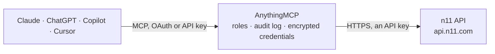

<!-- Generated by scripts/export-github-catalog.mjs in the anythingmcp-website repository. Do not edit by hand. -->

# n11 MCP connector

Run an n11 seller account from an AI agent: products with create, update, price and stock tasks and their results, category tree and attributes, orders as shipment packages with approval, splitting, … The AnythingMCP connector gives Claude, ChatGPT, Microsoft Copilot, Cursor and Gemini 24 MCP tools for n11: 10 read and 14 can change data.

**Category:** [E-commerce](../e-commerce.md) · **Tools:** 24 · **Setup guide:** [anythingmcp.com](https://anythingmcp.com/guides/n11-to-mcp) · [Deutsch](https://anythingmcp.com/de/guides/n11-to-mcp) · [Italiano](https://anythingmcp.com/it/guides/n11-to-mcp) · [Español](https://anythingmcp.com/es/guides/n11-to-mcp) · [日本語](https://anythingmcp.com/ja/guides/n11-to-mcp) · [Русский](https://anythingmcp.com/ru/guides/n11-to-mcp) · [中文](https://anythingmcp.com/zh/guides/n11-to-mcp)

## Start without code

No installation and no terminal: AnythingMCP Cloud runs the n11 connector for you, operated by helpcode.ai in Frankfurt, Germany.

1. **Click the button above** and create an account or sign in. The n11 connector opens, ready to install.
2. **Paste the API key or token from your n11 account.** Every click is in the [step-by-step guide](https://anythingmcp.com/guides/n11-to-mcp).
3. **Click Install.** AnythingMCP shows the address of your MCP server.
4. **Add that address to your assistant:** [Claude](https://anythingmcp.com/guides/connect-n11-to-claude) · [ChatGPT](https://anythingmcp.com/guides/connect-n11-to-chatgpt) · [Microsoft Copilot](https://anythingmcp.com/guides/connect-n11-to-copilot) · [Cursor](https://anythingmcp.com/guides/connect-n11-to-cursor) · [Gemini CLI](https://anythingmcp.com/guides/connect-n11-to-gemini) · [Meta Muse](https://anythingmcp.com/guides/connect-n11-to-muse).
5. **Ask your first question**, for example: *Show shipment package for order number 2026-ORD-4578*

Prefer help with the setup? [Talk to us](https://anythingmcp.com/contact).

## How it works

- **The AI client** speaks MCP (Streamable HTTP) to AnythingMCP and only sees tool names, descriptions and results. It never gets the n11 credentials.
- **AnythingMCP** checks the client's role, builds the call from the tool definition, adds the credentials (an API key), calls n11, logs the call and returns the result.
- **n11** sees an ordinary API client with the rights of the account the credentials belong to.

## Tools

| Tool | What it does | Access |
|---|---|---|
| [`n11_list_products`](#n11_list_products) | List your n11 products: n11 product id, stock code, title, category, product main id (group), status, sale status, prices, stock, VAT and commission rate,… | read |
| [`n11_list_categories`](#n11_list_categories) | Get the whole n11 category tree in one call (id, parentId, name, subCategories). | read |
| [`n11_get_category_attributes`](#n11_get_category_attributes) | Get the attributes of a leaf category with their allowed values: attributeId, name, isMandatory, isVariant (same productMainId groups variants),… | read |
| [`n11_get_task_details`](#n11_get_task_details) | Read the result of a product task (create, update, price and stock, delete): task status PROCESSED, IN_QUEUE or REJECT and per stock code (itemCode) SUCCESS… | read |
| [`n11_list_shipment_packages`](#n11_list_shipment_packages) | List orders as shipment packages: order number, package id, status, buyer, billing and shipping address, cargo company and tracking, agreed shipping date… | read |
| [`n11_list_claim_returns`](#n11_list_claim_returns) | List return requests (claims) with id, status, reason, order number, product, quantity, prices, buyer and cargo tracking; 20 per page, pages from 0. | read |
| [`n11_list_return_deny_reasons`](#n11_list_return_deny_reasons) | List the reasons (id and text) you may give when refusing a return with n11_deny_claim_return. | read |
| [`n11_list_return_pending_reasons`](#n11_list_return_pending_reasons) | List the reasons (id and text) you may give when postponing the decision on a return with n11_postpone_claim_return. | read |
| [`n11_list_product_questions`](#n11_list_product_questions) | List customer questions about your products (id, product, subject, question, answer). | read |
| [`n11_get_product_question`](#n11_get_product_question) | Get one customer question with buyer name and email, product, question and answer dates, visibility and status. | read |
| [`n11_update_price_and_stock`](#n11_update_price_and_stock) | Update price and/or stock of products by stock code (up to 1,000 per call). | write |
| [`n11_create_products`](#n11_create_products) | Create products (up to 1,000 per call) in leaf categories with title, description, categoryId, productMainId, stockCode, barcode, images, attributes… | write |
| [`n11_update_products`](#n11_update_products) | Update product data by stock code (up to 1,000 per call): status (Active or Suspended to take it off sale), preparingDay, shipmentTemplate, productMainId,… | write |
| [`n11_delete_products`](#n11_delete_products) | Delete products by stock code (up to 1,000 per call). | write |
| [`n11_approve_order_lines`](#n11_approve_order_lines) | Approve (accept) new order lines: moves Created lines to Picking. | write |
| [`n11_split_package`](#n11_split_package) | Split a Picking package into several packages by order line (each group becomes its own package with its own tracking code; lines not listed form another… | write |
| [`n11_split_package_by_quantity`](#n11_split_package_by_quantity) | Split a Picking package by quantity, optionally cancelling part of a line (cancelReasonId 61 out of stock, 62 defective, 63 wrong price, 64 force majeure,… | write |
| [`n11_create_collection_request`](#n11_create_collection_request) | Create a collection (pickup) request with a logistics company for Picking packages of bulky goods: every line of the package with box count, desi and… | write |
| [`n11_send_labor_costs`](#n11_send_labor_costs) | Send the labour cost (excluding VAT, with its VAT rate 0, 1, 10 or 20, default 20) of order lines, for gold, jewellery and similar categories. | write |
| [`n11_send_invoice_link`](#n11_send_invoice_link) | Save the invoice link (https, pdf, png or jpeg) of an order; a new link replaces the previous one. | write |
| [`n11_approve_claim_return`](#n11_approve_claim_return) | Approve a return request: the buyer gets the refund. | write |
| [`n11_postpone_claim_return`](#n11_postpone_claim_return) | Postpone the decision on a return request by some days, with a reason from n11_list_return_pending_reasons and a note. | write |
| [`n11_deny_claim_return`](#n11_deny_claim_return) | Refuse a return request with a reason from n11_list_return_deny_reasons and a note; for most reasons say how the product goes back (returnShipmentType… | write |
| [`n11_answer_product_question`](#n11_answer_product_question) | Answer a customer question (1 to 2,048 characters). | write |

## Tool reference

Every parameter as the AI client sees it in `tools/list`. Source: [`packages/backend/src/adapters/intl/n11.json`](../../../packages/backend/src/adapters/intl/n11.json).

### `n11_list_products`

List your n11 products: n11 product id, stock code, title, category, product main id (group), status, sale status, prices, stock, VAT and commission rate, attributes and images. Filter by id, stock code, group code, sale or approval status, brand or category; pages from 0, up to 250 per page.

**Access:** read · **Call:** `GET /ms/product-query`

| Parameter | Type | Required | Description |
|---|---|---|---|
| `id` | integer | no | n11 product id. |
| `productMainId` | string | no | Group code shared by the variants. |
| `stockCode` | string | no | Your stock code (one per call). |
| `saleStatus` | `On_Sale` \| `Out_Of_Stock` | no | On_Sale or Out_Of_Stock. |
| `productStatus` | `Active` \| `InCatalogApproval` \| `Suspended` \| `CatalogRejected` \| `Prohibited` \| `Unlisted` \| `InApproval` | no | Approval status: Active (approved), InCatalogApproval, Suspended, CatalogRejected, Prohibited, Unlisted, InApproval (action needed). |
| `brandName` | string | no | Brand name. |
| `categoryIds` | string | no | Comma-separated category ids. |
| `sender` | `SELLER` \| `N11` \| `ALL` | no | SELLER (you ship, default), N11 (n11depom warehouse) or ALL. |
| `page` | integer | no | Page number, starting at 0. |
| `size` | integer | no | Products per page, default 20, at most 250. |

### `n11_list_categories`

Get the whole n11 category tree in one call (id, parentId, name, subCategories). A category whose subCategories is null is a leaf; products are created in leaf categories only. Large answer: call it once and reuse the ids.

**Access:** read · **Call:** `GET /cdn/categories`

No parameters.

### `n11_get_category_attributes`

Get the attributes of a leaf category with their allowed values: attributeId, name, isMandatory, isVariant (same productMainId groups variants), isCustomValue (free text allowed) and the value ids. Needed before creating products.

**Access:** read · **Call:** `GET /cdn/category/{categoryId}/attribute`

| Parameter | Type | Required | Description |
|---|---|---|---|
| `categoryId` | integer | yes | Leaf category id from n11_list_categories. |

### `n11_get_task_details`

Read the result of a product task (create, update, price and stock, delete): task status PROCESSED, IN_QUEUE or REJECT and per stock code (itemCode) SUCCESS or FAIL with the reasons.

**Access:** read · **Call:** `POST /ms/product/task-details/page-query`

| Parameter | Type | Required | Description |
|---|---|---|---|
| `taskId` | integer | yes | Task id returned by a product write. |
| `page` | integer | no | Page of the per-SKU results, starting at 0. |
| `size` | integer | no | Results per page, e.g. 1000. |

### `n11_list_shipment_packages`

List orders as shipment packages: order number, package id, status, buyer, billing and shipping address, cargo company and tracking, agreed shipping date and the lines (orderLineId, product, stock code, quantity, price, discounts, sellerInvoiceAmount, commission). Dates in epoch milliseconds (Turkey time); without dates the last 15 days. At most 100 per page, pages from 0.

**Access:** read · **Call:** `GET /rest/delivery/v1/shipmentPackages`

| Parameter | Type | Required | Description |
|---|---|---|---|
| `status` | `Created` \| `Picking` \| `Shipped` \| `Cancelled` \| `Delivered` \| `Unpacked` \| `UnSupplied` | no | One status per call: Created (new), Picking (approved), Shipped, Delivered, Cancelled, Unpacked (split), UnSupplied. |
| `startDate` | integer | no | From this moment, epoch milliseconds in Turkey time (UTC+3), e.g. 1793318400000. Alone it lists the 15 days after it. |
| `endDate` | integer | no | Until this moment, epoch milliseconds in Turkey time. Windows longer than 15 days are cut to the last 15 days. |
| `orderNumber` | string | no | One order number. |
| `packageIds` | string | no | Package id(s), comma-separated. |
| `orderByField` | boolean | no | true makes the dates filter on the last update of the package instead of the order date. |
| `orderByDirection` | `ASC` \| `DESC` | no | Sort by last update: ASC oldest first, DESC newest first. |
| `sender` | `SELLER` \| `N11` \| `ALL` | no | SELLER (default), N11 (n11depom) or ALL. |
| `page` | integer | no | Page number, starting at 0. |
| `size` | integer | no | Packages per page, at most 100. |

### `n11_list_claim_returns`

List return requests (claims) with id, status, reason, order number, product, quantity, prices, buyer and cargo tracking; 20 per page, pages from 0. Without status the REQUESTED ones. Search by order number, product id, buyer name or email with searchInfoType and searchQuery.

**Access:** read · **Call:** `POST /ws/returnService/`

| Parameter | Type | Required | Description |
|---|---|---|---|
| `status` | `REQUESTED` \| `CANCELLED` \| `DENIED` \| `PENDING` \| `PENDED` \| `APPROVED` \| `MANUAL_REFUND` \| `ALL` | no | Return status; ALL for every status. |
| `executer` | `BUYER` \| `SELLER` \| `OPERATOR` \| `SYSTEM` \| `SHIPMENT` | no | Who acted last. |
| `searchInfoType` | `BUYEREMAIL` \| `RECIPIENTS` \| `BUYERNAME` \| `ORDERID` \| `PRODUCTID` | no | What searchQuery contains. |
| `searchQuery` | string | no | The order number, product id, name or email to search for. |
| `sender` | `SELLER` \| `N11` \| `ALL` | no | SELLER (default), N11 or ALL. |
| `startDate` | string | no | Requests from this day, dd/mm/yyyy. |
| `endDate` | string | no | Requests until this day, dd/mm/yyyy. |
| `currentPage` | integer | no | Page number, starting at 0. |

### `n11_list_return_deny_reasons`

List the reasons (id and text) you may give when refusing a return with n11_deny_claim_return.

**Access:** read · **Call:** `POST /ws/returnService/`

No parameters.

### `n11_list_return_pending_reasons`

List the reasons (id and text) you may give when postponing the decision on a return with n11_postpone_claim_return.

**Access:** read · **Call:** `POST /ws/returnService/`

No parameters.

### `n11_list_product_questions`

List customer questions about your products (id, product, subject, question, answer). startDate, endDate, currentPage and pageSize are required; without status the OPEN (unanswered) ones. n11 allows this call once a minute.

**Access:** read · **Call:** `POST /ws/productService/`

| Parameter | Type | Required | Description |
|---|---|---|---|
| `startDate` | string | yes | From this day, DD/MM/YYYY. |
| `endDate` | string | yes | Until this day, DD/MM/YYYY. |
| `currentPage` | integer | yes | Page number, starting at 0. |
| `pageSize` | integer | yes | Questions per page, e.g. 20. |
| `status` | `OPEN` \| `CLOSED` | no | OPEN (unanswered, default) or CLOSED. |
| `productId` | integer | no | Only questions about this n11 product id. |
| `buyerEmail` | string | no | Only questions of this buyer email. |
| `subject` | string | no | Only questions with this subject. |

### `n11_get_product_question`

Get one customer question with buyer name and email, product, question and answer dates, visibility and status.

**Access:** read · **Call:** `POST /ws/productService/`

| Parameter | Type | Required | Description |
|---|---|---|---|
| `productQuestionId` | integer | yes | Question id from n11_list_product_questions. |

### `n11_update_price_and_stock`

Update price and/or stock of products by stock code (up to 1,000 per call). listPrice and salePrice go together, with a dot and two decimals; salePrice may not exceed listPrice. Asynchronous: the answer is a task (id, type, status IN_QUEUE or REJECT, reasons); check the result per stock code with n11_get_task_details. Changes what buyers see at once: list each stock code with old and new values and get a yes first.

**Access:** write · **Call:** `POST /ms/product/tasks/price-stock-update`

| Parameter | Type | Required | Description |
|---|---|---|---|
| `skus` | object[] | yes | [{"stockCode": "ABC-1", "listPrice": 249.90, "salePrice": 199.90, "quantity": 10, "currencyType": "TL"}]. Leave out the fields you do not change. |

### `n11_create_products`

Create products (up to 1,000 per call) in leaf categories with title, description, categoryId, productMainId, stockCode, barcode, images, attributes (mandatory ones from n11_get_category_attributes), prices, quantity, VAT, preparingDay and shipmentTemplate. Asynchronous: the answer is a task (id, type, status IN_QUEUE or REJECT, reasons); check the result per stock code with n11_get_task_details. Confirm the data with the user first.

**Access:** write · **Call:** `POST /ms/product/tasks/product-create`

| Parameter | Type | Required | Description |
|---|---|---|---|
| `skus` | object[] | yes | Product objects as documented by n11, e.g. [{"title": "...", "description": "...", "categoryId": 1000476, "currencyType": "TL", "productMainId": "M1", "preparingDay": 3, "shipmentTemplate": "Standart", "stockCode": "ABC-1", "barcode": "8806094924862", "quantity": 10, "images": [{"url": "https://...", "order": 1}], "attributes": [{"id": 1, "valueId": null, "customValue": "Brand"}], "salePrice": 2000, "listPrice": 2200, "vatRate": 20}]. |

### `n11_update_products`

Update product data by stock code (up to 1,000 per call): status (Active or Suspended to take it off sale), preparingDay, shipmentTemplate, productMainId, maxPurchaseQuantity, description, images and product safety attributes. Asynchronous: the answer is a task (id, type, status IN_QUEUE or REJECT, reasons); check the result per stock code with n11_get_task_details. Confirm the changes with the user first.

**Access:** write · **Call:** `POST /ms/product/tasks/product-update`

| Parameter | Type | Required | Description |
|---|---|---|---|
| `skus` | object[] | yes | [{"stockCode": "ABC-1", "status": "Suspended", "preparingDay": 2}]. Send only the fields to change. |

### `n11_delete_products`

Delete products by stock code (up to 1,000 per call). Asynchronous: the answer is a task (id, type, status IN_QUEUE or REJECT, reasons); check the result per stock code with n11_get_task_details. Cannot be undone. Installed switched off; name every stock code and get a yes first.

**Access:** write · **Call:** `POST /ms/product/tasks/product-delete`

| Parameter | Type | Required | Description |
|---|---|---|---|
| `skus` | object[] | yes | [{"stockCode": "ABC-1"}]. |

### `n11_approve_order_lines`

Approve (accept) new order lines: moves Created lines to Picking. Use the orderLineId values from n11_list_shipment_packages; several lines per call. Confirm with the user first.

**Access:** write · **Call:** `PUT /rest/order/v1/update`

| Parameter | Type | Required | Description |
|---|---|---|---|
| `lines` | object[] | yes | Lines to approve: [{"lineId": 426659152}, {"lineId": 426659151}], lineId being the orderLineId from n11_list_shipment_packages. |

### `n11_split_package`

Split a Picking package into several packages by order line (each group becomes its own package with its own tracking code; lines not listed form another package). Confirm the grouping with the user first.

**Access:** write · **Call:** `POST /rest/delivery/v1/splitCombinePackage`

| Parameter | Type | Required | Description |
|---|---|---|---|
| `splitGroups` | object[] | yes | [{"orderLineIds": [466969524]}, {"orderLineIds": [466969525]}]. |

### `n11_split_package_by_quantity`

Split a Picking package by quantity, optionally cancelling part of a line (cancelReasonId 61 out of stock, 62 defective, 63 wrong price, 64 force majeure, 65 other). Cancelled quantities cannot be restored: show the split and cancellation and get a yes first.

**Access:** write · **Call:** `POST /rest/delivery/v1/splitPackageByQuantity`

| Parameter | Type | Required | Description |
|---|---|---|---|
| `splitPackages` | object[] | yes | [{"packageDetails": [{"orderLineId": 448627086, "quantities": 2}]}, {"packageDetails": [{"orderLineId": 448627086, "quantities": 1}]}]. |
| `cancelledItems` | object[] | no | Optional cancellations: [{"orderLineId": 389132250, "quantity": 1, "cancelReasonId": 61}]. |

### `n11_create_collection_request`

Create a collection (pickup) request with a logistics company for Picking packages of bulky goods: every line of the package with box count, desi and company code (HLZ Horoz, CEVA, BL Borusan). Books a real pickup: confirm with the user first.

**Access:** write · **Call:** `PUT /rest/delivery/v1/collectionRequest`

| Parameter | Type | Required | Description |
|---|---|---|---|
| `collectionRequestDetails` | object[] | yes | [{"id": "<package id>", "orderLineId": 471150189, "boxQuantity": 1, "desi": 100, "shipmentCompany": "HLZ"}]. |

### `n11_send_labor_costs`

Send the labour cost (excluding VAT, with its VAT rate 0, 1, 10 or 20, default 20) of order lines, for gold, jewellery and similar categories. Confirm the amounts with the user first.

**Access:** write · **Call:** `PUT /rest/order/v1/labor-costs`

| Parameter | Type | Required | Description |
|---|---|---|---|
| `laborCostDetails` | object[] | yes | [{"orderLineId": 434361111, "totalLaborCostExcludingVAT": 100, "laborVatRate": 20}]. |

### `n11_send_invoice_link`

Save the invoice link (https, pdf, png or jpeg) of an order; a new link replaces the previous one. For e-export orders (micro true) also send invoiceNumber and invoiceDateTime. Confirm with the user first.

**Access:** write · **Call:** `POST /ws/sellerInvoiceService/`

| Parameter | Type | Required | Description |
|---|---|---|---|
| `orderNumber` | string | yes | n11 order number. |
| `url` | string | yes | https URL of the invoice file, at most 2,048 characters. |
| `invoiceNumber` | string | no | Invoice number: 3 letters or digits, the year, then 9 digits, e.g. N112026000000001. Required for e-export. |
| `invoiceDateTime` | integer | no | Invoice date, epoch milliseconds in Turkey time. Required for e-export. |

### `n11_approve_claim_return`

Approve a return request: the buyer gets the refund. Name the return and get a yes first.

**Access:** write · **Call:** `POST /ws/returnService/`

| Parameter | Type | Required | Description |
|---|---|---|---|
| `claimReturnId` | integer | yes | Return request id from n11_list_claim_returns. |

### `n11_postpone_claim_return`

Postpone the decision on a return request by some days, with a reason from n11_list_return_pending_reasons and a note. Confirm with the user first.

**Access:** write · **Call:** `POST /ws/returnService/`

| Parameter | Type | Required | Description |
|---|---|---|---|
| `claimReturnId` | integer | yes | Return request id. |
| `pendingReasonId` | integer | yes | Reason id from n11_list_return_pending_reasons. |
| `pendingDayCount` | integer | yes | Number of days to postpone. |
| `pendingReasonNote` | string | yes | Explanation for the buyer. |

### `n11_deny_claim_return`

Refuse a return request with a reason from n11_list_return_deny_reasons and a note; for most reasons say how the product goes back (returnShipmentType CUSTOM with tracking number, or CAMPAIGN). Installed switched off; name the return and reason and get a yes first.

**Access:** write · **Call:** `POST /ws/returnService/`

| Parameter | Type | Required | Description |
|---|---|---|---|
| `claimReturnId` | integer | yes | Return request id. |
| `denyReasonId` | integer | yes | Reason id from n11_list_return_deny_reasons. |
| `denyReasonNote` | string | yes | Explanation of the refusal. |
| `returnShipmentType` | `CUSTOM` \| `CAMPAIGN` | no | CUSTOM (you send it back with your tracking number) or CAMPAIGN (with a cargo campaign code). Empty for "product did not reach the store". |
| `shipmentCompanyId` | integer | no | Cargo company id, only with CUSTOM. |
| `trackingNumber` | string | no | Tracking number, only with CUSTOM. |
| `deliveryReceiptNumber` | string | no | Delivery receipt number. |
| `imageFirstUrl` | string | no | URL of a photo of the returned product. |
| `imageSecondUrl` | string | no | Second photo URL. |
| `imageThirdUrl` | string | no | Third photo URL. |
| `videoUrl` | string | no | URL of a video of the returned product. |

### `n11_answer_product_question`

Answer a customer question (1 to 2,048 characters). A question can be answered only once; it is then CLOSED and the answer is public. Show the answer to the user and get a yes first.

**Access:** write · **Call:** `POST /ws/productService/`

| Parameter | Type | Required | Description |
|---|---|---|---|
| `productQuestionId` | integer | yes | Question id from n11_list_product_questions. |
| `answer` | string | yes | The answer text, 1 to 2,048 characters. |

## Run it yourself

AnythingMCP is open source (AGPL-3.0). [Run it with Docker](../../../README.md#run-it-yourself), open **Connectors → Store**, pick **n11** and enter `N11_APP_KEY`, `N11_APP_SECRET`, then add your MCP server URL to the AI client.

[← E-commerce connectors](../e-commerce.md) · [All categories](../README.md)
