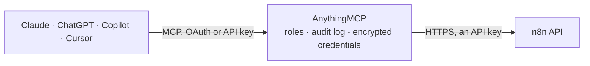

<!-- Generated by scripts/export-github-catalog.mjs in the anythingmcp-website repository. Do not edit by hand. -->

# n8n MCP connector

Manage an n8n instance, self-hosted or n8n Cloud, through its public API: list, read, build, update, activate and archive workflows, inspect and retry executions, and manage credentials, tags, … The AnythingMCP connector gives Claude, ChatGPT, Microsoft Copilot, Cursor and Gemini 43 MCP tools for n8n: 18 read and 25 can change data.

**Category:** [Productivity](../productivity.md) · **Tools:** 43 · **Setup guide:** [anythingmcp.com](https://anythingmcp.com/guides/n8n-to-mcp) · [Deutsch](https://anythingmcp.com/de/guides/n8n-to-mcp) · [Italiano](https://anythingmcp.com/it/guides/n8n-to-mcp) · [Español](https://anythingmcp.com/es/guides/n8n-to-mcp) · [日本語](https://anythingmcp.com/ja/guides/n8n-to-mcp) · [Русский](https://anythingmcp.com/ru/guides/n8n-to-mcp) · [中文](https://anythingmcp.com/zh/guides/n8n-to-mcp)

## Start without code

No installation and no terminal: AnythingMCP Cloud runs the n8n connector for you, operated by helpcode.ai in Frankfurt, Germany.

1. **Click the button above** and create an account or sign in. The n8n connector opens, ready to install.
2. **Paste the API key or token from your n8n account.** Every click is in the [step-by-step guide](https://anythingmcp.com/guides/n8n-to-mcp).
3. **Click Install.** AnythingMCP shows the address of your MCP server.
4. **Add that address to your assistant:** [Claude](https://anythingmcp.com/guides/connect-n8n-to-claude) · [ChatGPT](https://anythingmcp.com/guides/connect-n8n-to-chatgpt) · [Microsoft Copilot](https://anythingmcp.com/guides/connect-n8n-to-copilot) · [Cursor](https://anythingmcp.com/guides/connect-n8n-to-cursor) · [Gemini CLI](https://anythingmcp.com/guides/connect-n8n-to-gemini) · [Meta Muse](https://anythingmcp.com/guides/connect-n8n-to-muse).
5. **Ask your first question**, for example: *Show me the workflow called Invoice Processor and the nodes it uses*

Prefer help with the setup? [Talk to us](https://anythingmcp.com/contact).

## How it works

- **The AI client** speaks MCP (Streamable HTTP) to AnythingMCP and only sees tool names, descriptions and results. It never gets the n8n credentials.
- **AnythingMCP** checks the client's role, builds the call from the tool definition, adds the credentials (an API key), calls n8n, logs the call and returns the result.
- **n8n** sees an ordinary API client with the rights of the account the credentials belong to.

## Tools

| Tool | What it does | Access |
|---|---|---|
| [`n8n_list_workflows`](#n8n_list_workflows) | List the workflows of the n8n instance that the API key can see: id, name, whether it is active (published), archived, tags and timestamps. | read |
| [`n8n_get_workflow`](#n8n_get_workflow) | Read one workflow in full: name, nodes (type, parameters, credentials used, position), connections between nodes, settings, tags, active state and version id. | read |
| [`n8n_create_workflow`](#n8n_create_workflow) | Create a new workflow from nodes, connections and settings. | write |
| [`n8n_update_workflow`](#n8n_update_workflow) | Replace a workflow's name, nodes, connections and settings. | write |
| [`n8n_activate_workflow`](#n8n_activate_workflow) | Activate (publish) a workflow so its triggers run: schedules fire and production webhooks answer. | write |
| [`n8n_deactivate_workflow`](#n8n_deactivate_workflow) | Deactivate (unpublish) a workflow: its schedules and production webhooks stop until it is activated again. | write |
| [`n8n_archive_workflow`](#n8n_archive_workflow) | Archive a workflow (n8n 2.x): it is deactivated and moved to the archive, from where n8n_unarchive_workflow brings it back. | write |
| [`n8n_unarchive_workflow`](#n8n_unarchive_workflow) | Restore an archived workflow (n8n 2.x). | write |
| [`n8n_delete_workflow`](#n8n_delete_workflow) | Delete a workflow permanently, with its version history. | write |
| [`n8n_transfer_workflow`](#n8n_transfer_workflow) | Move a workflow to another project. | write |
| [`n8n_get_workflow_tags`](#n8n_get_workflow_tags) | List the tags attached to a workflow, with each tag's id and name, before changing them with n8n_set_workflow_tags. | read |
| [`n8n_set_workflow_tags`](#n8n_set_workflow_tags) | Set the tags of a workflow. | write |
| [`n8n_list_workflow_versions`](#n8n_list_workflow_versions) | List the saved versions of a workflow (n8n 2.x): version id, author, created time and which version is published. | read |
| [`n8n_get_workflow_version`](#n8n_get_workflow_version) | Read one saved version of a workflow (n8n 2.x) with its nodes and connections, e.g. to compare it with the current draft or to restore it through… | read |
| [`n8n_list_executions`](#n8n_list_executions) | List workflow executions, newest first: id, workflow id, status, mode (trigger, webhook, manual, retry, ...), start and stop time, and the ids of retries. | read |
| [`n8n_get_execution`](#n8n_get_execution) | Read one execution: status, mode, timing and workflow id; with include_data the run data of every node, including the error message and the node that failed. | read |
| [`n8n_retry_execution`](#n8n_retry_execution) | Retry a failed execution from the node that failed. | write |
| [`n8n_stop_execution`](#n8n_stop_execution) | Stop a running or waiting execution (n8n 2.x). | write |
| [`n8n_delete_execution`](#n8n_delete_execution) | Delete an execution and its stored run data permanently, for example to remove data that should not be kept. | write |
| [`n8n_list_credentials`](#n8n_list_credentials) | List the stored credentials (n8n 2.x; owner and admin only): id, name, type and timestamps. | read |
| [`n8n_get_credential_schema`](#n8n_get_credential_schema) | Show the fields a credential type needs (a JSON Schema with properties and required fields), e.g. for githubApi, slackOAuth2Api, httpHeaderAuth or postgres. | read |
| [`n8n_create_credential`](#n8n_create_credential) | Create a credential that nodes can use. | write |
| [`n8n_update_credential`](#n8n_update_credential) | Rename a credential or change its data (n8n 2.x; owner of the credential only). | write |
| [`n8n_test_credential`](#n8n_test_credential) | Test a stored credential against its service (n8n 2.x), the same check as the Test button in the editor. | read |
| [`n8n_transfer_credential`](#n8n_transfer_credential) | Move a credential to another project, so the workflows of that project can use it. | write |
| [`n8n_delete_credential`](#n8n_delete_credential) | Delete a credential permanently. | write |
| [`n8n_list_tags`](#n8n_list_tags) | List the workflow tags of the instance: id, name and timestamps. | read |
| [`n8n_create_tag`](#n8n_create_tag) | Create a workflow tag. | write |
| [`n8n_update_tag`](#n8n_update_tag) | Rename a tag. | write |
| [`n8n_delete_tag`](#n8n_delete_tag) | Delete a tag; it is removed from every workflow that carries it. | write |
| [`n8n_list_variables`](#n8n_list_variables) | List the instance's variables (used in workflows as $vars.<key>): id, key, value and project. | read |
| [`n8n_create_variable`](#n8n_create_variable) | Create a variable that workflows read as $vars.<key>. | write |
| [`n8n_update_variable`](#n8n_update_variable) | Change a variable's key or value. | write |
| [`n8n_delete_variable`](#n8n_delete_variable) | Delete a variable. | write |
| [`n8n_list_projects`](#n8n_list_projects) | List the projects of the instance (personal and team projects): id, name and type. | read |
| [`n8n_create_project`](#n8n_create_project) | Create a team project to group workflows, credentials and the people who work on them. | write |
| [`n8n_list_project_users`](#n8n_list_project_users) | List the members of a project with their project role (n8n 2.x). | read |
| [`n8n_add_project_users`](#n8n_add_project_users) | Add one or more users to a project, each with a project role (viewer, editor or admin). | write |
| [`n8n_list_users`](#n8n_list_users) | List the users of the instance (owner and admin keys only): id, email, first and last name, whether they are pending, and with include_role their global role. | read |
| [`n8n_get_user`](#n8n_get_user) | Read one user of the instance by id or email address: name, email, pending state and optionally the global role. | read |
| [`n8n_generate_audit`](#n8n_generate_audit) | Run n8n's security audit and return its report: unused or risky credentials, SQL and code nodes that may be unsafe, community and custom nodes, file system… | read |
| [`n8n_get_source_control_status`](#n8n_get_source_control_status) | Preview what a source control pull or push would change (n8n 2.x, instances connected to Git through Environments): the workflows, credentials, variables… | read |
| [`n8n_source_control_pull`](#n8n_source_control_pull) | Pull the connected Git branch into the instance (Environments feature): workflows, credentials stubs, variables and tags from the branch are imported. | write |

## Tool reference

Every parameter as the AI client sees it in `tools/list`. Source: [`packages/backend/src/adapters/intl/n8n.json`](../../../packages/backend/src/adapters/intl/n8n.json).

### `n8n_list_workflows`

List the workflows of the n8n instance that the API key can see: id, name, whether it is active (published), archived, tags and timestamps. Filter by active state, tags, name or project. Node definitions are left out to keep the answer short: call n8n_get_workflow for the full workflow.

**Access:** read · **Call:** `GET /workflows`

| Parameter | Type | Required | Description |
|---|---|---|---|
| `active` | boolean | no | true: only active (published) workflows; false: only inactive ones. Leave out for both. |
| `tags` | string | no | Only workflows carrying all of these tags, comma-separated tag names, e.g. production,crm. |
| `name` | string | no | Only workflows with exactly this name. |
| `project_id` | string | no | Only workflows of this project (from n8n_list_projects). |
| `limit` | integer | no | Items per page, 1 to 250 (default 100). |
| `cursor` | string | no | Paging cursor: the nextCursor value of the previous answer. Leave out for the first page. |

### `n8n_get_workflow`

Read one workflow in full: name, nodes (type, parameters, credentials used, position), connections between nodes, settings, tags, active state and version id. This is the object n8n_update_workflow expects back.

**Access:** read · **Call:** `GET /workflows/{workflow_id}`

| Parameter | Type | Required | Description |
|---|---|---|---|
| `workflow_id` | string | yes | Workflow id, e.g. 2tUt1wbLX592XDdX (from n8n_list_workflows or the workflow URL /workflow/<id>). |
| `exclude_pinned_data` | boolean | no | true leaves out pinned test data, which can be large. |

### `n8n_create_workflow`

Create a new workflow from nodes, connections and settings. The workflow is created inactive; publish it afterwards with n8n_activate_workflow. Returns the created workflow with its id.

**Access:** write · **Call:** `POST /workflows`

| Parameter | Type | Required | Description |
|---|---|---|---|
| `name` | string | yes | Workflow name. |
| `nodes` | object[] | yes | Workflow nodes. Each node needs name (unique in the workflow), type (e.g. n8n-nodes-base.manualTrigger, n8n-nodes-base.httpRequest), typeVersion, position [x, y] and parameters; credentials are referenced as {"<credentialType>": {"id": "<credential id>", "name": "<name>"}}. |
| `connections` | object | yes | Connections keyed by the source node name, e.g. {"Manual Trigger": {"main": [[{"node": "HTTP Request", "type": "main", "index": 0}]]}}. Use {} for a single node. |
| `settings` | object | yes | Workflow settings, e.g. {"executionOrder": "v1"}, plus optional timezone, errorWorkflow (a workflow id), saveDataErrorExecution, saveDataSuccessExecution, executionTimeout (seconds), callerPolicy. Use {"executionOrder": "v1"} when nothing else is needed. |
| `project_id` | string | no | Project to create the workflow in (n8n 2.x, from n8n_list_projects). Leave out for the personal project of the key's owner. |

### `n8n_update_workflow`

Replace a workflow's name, nodes, connections and settings. The update is a full replacement: read the workflow with n8n_get_workflow first, change what is needed and send all four fields back, or nodes that are left out are removed. On n8n 2.x an active workflow is re-published with the change unless publish_if_active is false.

**Access:** write · **Call:** `PUT /workflows/{workflow_id}`

| Parameter | Type | Required | Description |
|---|---|---|---|
| `workflow_id` | string | yes | Workflow id, e.g. 2tUt1wbLX592XDdX (from n8n_list_workflows or the workflow URL /workflow/<id>). |
| `name` | string | yes | Workflow name. |
| `nodes` | object[] | yes | Workflow nodes. Each node needs name (unique in the workflow), type (e.g. n8n-nodes-base.manualTrigger, n8n-nodes-base.httpRequest), typeVersion, position [x, y] and parameters; credentials are referenced as {"<credentialType>": {"id": "<credential id>", "name": "<name>"}}. |
| `connections` | object | yes | Connections keyed by the source node name, e.g. {"Manual Trigger": {"main": [[{"node": "HTTP Request", "type": "main", "index": 0}]]}}. Use {} for a single node. |
| `settings` | object | yes | Workflow settings, e.g. {"executionOrder": "v1"}, plus optional timezone, errorWorkflow (a workflow id), saveDataErrorExecution, saveDataSuccessExecution, executionTimeout (seconds), callerPolicy. Use {"executionOrder": "v1"} when nothing else is needed. |
| `publish_if_active` | boolean | no | n8n 2.x: false saves the change as a draft and keeps the published version live. Default true. |

### `n8n_activate_workflow`

Activate (publish) a workflow so its triggers run: schedules fire and production webhooks answer. The workflow needs at least one trigger node and valid credentials, otherwise n8n answers 400 with the reason.

**Access:** write · **Call:** `POST /workflows/{workflow_id}/activate`

| Parameter | Type | Required | Description |
|---|---|---|---|
| `workflow_id` | string | yes | Workflow id, e.g. 2tUt1wbLX592XDdX (from n8n_list_workflows or the workflow URL /workflow/<id>). |
| `version_id` | string | no | n8n 2.x: publish this version from n8n_list_workflow_versions instead of the latest one. |

### `n8n_deactivate_workflow`

Deactivate (unpublish) a workflow: its schedules and production webhooks stop until it is activated again. The workflow itself is kept.

**Access:** write · **Call:** `POST /workflows/{workflow_id}/deactivate`

| Parameter | Type | Required | Description |
|---|---|---|---|
| `workflow_id` | string | yes | Workflow id, e.g. 2tUt1wbLX592XDdX (from n8n_list_workflows or the workflow URL /workflow/<id>). |

### `n8n_archive_workflow`

Archive a workflow (n8n 2.x): it is deactivated and moved to the archive, from where n8n_unarchive_workflow brings it back. The safer alternative to n8n_delete_workflow.

**Access:** write · **Call:** `POST /workflows/{workflow_id}/archive`

| Parameter | Type | Required | Description |
|---|---|---|---|
| `workflow_id` | string | yes | Workflow id, e.g. 2tUt1wbLX592XDdX (from n8n_list_workflows or the workflow URL /workflow/<id>). |

### `n8n_unarchive_workflow`

Restore an archived workflow (n8n 2.x). It comes back inactive; activate it again if needed.

**Access:** write · **Call:** `POST /workflows/{workflow_id}/unarchive`

| Parameter | Type | Required | Description |
|---|---|---|---|
| `workflow_id` | string | yes | Workflow id, e.g. 2tUt1wbLX592XDdX (from n8n_list_workflows or the workflow URL /workflow/<id>). |

### `n8n_delete_workflow`

Delete a workflow permanently, with its version history. This cannot be undone; prefer n8n_archive_workflow on n8n 2.x.

**Access:** write · **Call:** `DELETE /workflows/{workflow_id}`

| Parameter | Type | Required | Description |
|---|---|---|---|
| `workflow_id` | string | yes | Workflow id, e.g. 2tUt1wbLX592XDdX (from n8n_list_workflows or the workflow URL /workflow/<id>). |

### `n8n_transfer_workflow`

Move a workflow to another project. Sharing and credentials follow n8n's project rules; the key's owner needs access to both projects.

**Access:** write · **Call:** `PUT /workflows/{workflow_id}/transfer`

| Parameter | Type | Required | Description |
|---|---|---|---|
| `workflow_id` | string | yes | Workflow id, e.g. 2tUt1wbLX592XDdX (from n8n_list_workflows or the workflow URL /workflow/<id>). |
| `destination_project_id` | string | yes | Id of the project to move the workflow to (from n8n_list_projects). |

### `n8n_get_workflow_tags`

List the tags attached to a workflow, with each tag's id and name, before changing them with n8n_set_workflow_tags.

**Access:** read · **Call:** `GET /workflows/{workflow_id}/tags`

| Parameter | Type | Required | Description |
|---|---|---|---|
| `workflow_id` | string | yes | Workflow id, e.g. 2tUt1wbLX592XDdX (from n8n_list_workflows or the workflow URL /workflow/<id>). |

### `n8n_set_workflow_tags`

Set the tags of a workflow. The list replaces the current tags: include the ids of tags to keep. Tag ids come from n8n_list_tags; create a missing tag with n8n_create_tag first.

**Access:** write · **Call:** `PUT /workflows/{workflow_id}/tags`

| Parameter | Type | Required | Description |
|---|---|---|---|
| `workflow_id` | string | yes | Workflow id, e.g. 2tUt1wbLX592XDdX (from n8n_list_workflows or the workflow URL /workflow/<id>). |
| `tags` | object[] | yes | The tags the workflow should carry, as objects with the tag id, e.g. [{"id": "2tUt1wbLX592XDdX"}]. An empty list removes all tags. |

### `n8n_list_workflow_versions`

List the saved versions of a workflow (n8n 2.x): version id, author, created time and which version is published. Use a version id with n8n_get_workflow_version or n8n_activate_workflow.

**Access:** read · **Call:** `GET /workflows/{workflow_id}/history`

| Parameter | Type | Required | Description |
|---|---|---|---|
| `workflow_id` | string | yes | Workflow id, e.g. 2tUt1wbLX592XDdX (from n8n_list_workflows or the workflow URL /workflow/<id>). |
| `limit` | integer | no | Items per page, 1 to 250 (default 100). |
| `cursor` | string | no | Paging cursor: the nextCursor value of the previous answer. Leave out for the first page. |

### `n8n_get_workflow_version`

Read one saved version of a workflow (n8n 2.x) with its nodes and connections, e.g. to compare it with the current draft or to restore it through n8n_update_workflow.

**Access:** read · **Call:** `GET /workflows/{workflow_id}/versions/{version_id}`

| Parameter | Type | Required | Description |
|---|---|---|---|
| `workflow_id` | string | yes | Workflow id, e.g. 2tUt1wbLX592XDdX (from n8n_list_workflows or the workflow URL /workflow/<id>). |
| `version_id` | string | yes | Version id from n8n_list_workflow_versions (or the versionId field of a workflow). |

### `n8n_list_executions`

List workflow executions, newest first: id, workflow id, status, mode (trigger, webhook, manual, retry, ...), start and stop time, and the ids of retries. Filter by workflow, project, status and start time. Leave include_data off unless the node outputs are really needed: they can be very large.

**Access:** read · **Call:** `GET /executions`

| Parameter | Type | Required | Description |
|---|---|---|---|
| `workflow_id` | string | no | Only executions of this workflow. |
| `project_id` | string | no | Only executions of workflows in this project. |
| `status` | `canceled` \| `crashed` \| `error` \| `new` \| `running` \| `success` \| `unknown` \| `waiting` | no | Only executions with this status. |
| `started_after` | string | no | Only executions started after this time, ISO 8601 (n8n 2.x), e.g. 2026-10-01T00:00:00Z. |
| `started_before` | string | no | Only executions started before this time, ISO 8601 (n8n 2.x). |
| `include_data` | boolean | no | true adds the full run data (inputs and outputs of every node). Large; use n8n_get_execution for one run instead. |
| `limit` | integer | no | Items per page, 1 to 250 (default 100). |
| `cursor` | string | no | Paging cursor: the nextCursor value of the previous answer. Leave out for the first page. |

### `n8n_get_execution`

Read one execution: status, mode, timing and workflow id; with include_data the run data of every node, including the error message and the node that failed.

**Access:** read · **Call:** `GET /executions/{execution_id}`

| Parameter | Type | Required | Description |
|---|---|---|---|
| `execution_id` | string | yes | Execution id, a number such as 1042 (from n8n_list_executions). |
| `include_data` | boolean | no | true adds the run data of every node (needed to see the error or the outputs). |

### `n8n_retry_execution`

Retry a failed execution from the node that failed. The retry runs the workflow's nodes again, so it can send messages or write data in other systems again.

**Access:** write · **Call:** `POST /executions/{execution_id}/retry`

| Parameter | Type | Required | Description |
|---|---|---|---|
| `execution_id` | string | yes | Execution id, a number such as 1042 (from n8n_list_executions). |
| `load_workflow` | boolean | no | true retries with the currently saved workflow instead of the version that ran originally. |

### `n8n_stop_execution`

Stop a running or waiting execution (n8n 2.x). Nodes that already ran are not undone.

**Access:** write · **Call:** `POST /executions/{execution_id}/stop`

| Parameter | Type | Required | Description |
|---|---|---|---|
| `execution_id` | string | yes | Execution id, a number such as 1042 (from n8n_list_executions). |

### `n8n_delete_execution`

Delete an execution and its stored run data permanently, for example to remove data that should not be kept.

**Access:** write · **Call:** `DELETE /executions/{execution_id}`

| Parameter | Type | Required | Description |
|---|---|---|---|
| `execution_id` | string | yes | Execution id, a number such as 1042 (from n8n_list_executions). |

### `n8n_list_credentials`

List the stored credentials (n8n 2.x; owner and admin only): id, name, type and timestamps. Secrets are never returned.

**Access:** read · **Call:** `GET /credentials`

| Parameter | Type | Required | Description |
|---|---|---|---|
| `limit` | integer | no | Items per page, 1 to 250 (default 100). |
| `cursor` | string | no | Paging cursor: the nextCursor value of the previous answer. Leave out for the first page. |

### `n8n_get_credential_schema`

Show the fields a credential type needs (a JSON Schema with properties and required fields), e.g. for githubApi, slackOAuth2Api, httpHeaderAuth or postgres. Call it before n8n_create_credential.

**Access:** read · **Call:** `GET /credentials/schema/{credential_type}`

| Parameter | Type | Required | Description |
|---|---|---|---|
| `credential_type` | string | yes | Credential type name as n8n names it, e.g. githubApi, httpHeaderAuth, postgres, openAiApi. It is the key under a node's credentials in n8n_get_workflow. |

### `n8n_create_credential`

Create a credential that nodes can use. The data must match the type's schema from n8n_get_credential_schema. The answer has the new id; the secret values are not returned. OAuth2 credentials still need the browser sign-in in the n8n editor.

**Access:** write · **Call:** `POST /credentials`

| Parameter | Type | Required | Description |
|---|---|---|---|
| `name` | string | yes | Display name of the credential. |
| `type` | string | yes | Credential type name, e.g. githubApi or httpHeaderAuth. |
| `data` | object | yes | The credential fields required by the type's schema, e.g. {"accessToken": "..."} for githubApi or {"name": "X-API-Key", "value": "..."} for httpHeaderAuth. |
| `project_id` | string | no | Project to create the credential in (n8n 2.x). Leave out for the personal project of the key's owner. |

### `n8n_update_credential`

Rename a credential or change its data (n8n 2.x; owner of the credential only). With is_partial_data true the given fields are merged into the stored data; otherwise data replaces it completely.

**Access:** write · **Call:** `PATCH /credentials/{credential_id}`

| Parameter | Type | Required | Description |
|---|---|---|---|
| `credential_id` | string | yes | Credential id (from n8n_list_credentials or the answer of n8n_create_credential). |
| `name` | string | no | New display name. |
| `data` | object | no | New credential fields, following the type's schema. |
| `is_partial_data` | boolean | no | true merges data into the stored fields instead of replacing all of them. |

### `n8n_test_credential`

Test a stored credential against its service (n8n 2.x), the same check as the Test button in the editor. Returns whether it works and the service's message.

**Access:** read · **Call:** `POST /credentials/{credential_id}/test`

| Parameter | Type | Required | Description |
|---|---|---|---|
| `credential_id` | string | yes | Credential id (from n8n_list_credentials or the answer of n8n_create_credential). |

### `n8n_transfer_credential`

Move a credential to another project, so the workflows of that project can use it.

**Access:** write · **Call:** `PUT /credentials/{credential_id}/transfer`

| Parameter | Type | Required | Description |
|---|---|---|---|
| `credential_id` | string | yes | Credential id (from n8n_list_credentials or the answer of n8n_create_credential). |
| `destination_project_id` | string | yes | Id of the project to move the credential to (from n8n_list_projects). |

### `n8n_delete_credential`

Delete a credential permanently. Workflow nodes that use it stop working until they get another credential.

**Access:** write · **Call:** `DELETE /credentials/{credential_id}`

| Parameter | Type | Required | Description |
|---|---|---|---|
| `credential_id` | string | yes | Credential id (from n8n_list_credentials or the answer of n8n_create_credential). |

### `n8n_list_tags`

List the workflow tags of the instance: id, name and timestamps.

**Access:** read · **Call:** `GET /tags`

| Parameter | Type | Required | Description |
|---|---|---|---|
| `limit` | integer | no | Items per page, 1 to 250 (default 100). |
| `cursor` | string | no | Paging cursor: the nextCursor value of the previous answer. Leave out for the first page. |

### `n8n_create_tag`

Create a workflow tag. Names are unique: an existing name answers 409.

**Access:** write · **Call:** `POST /tags`

| Parameter | Type | Required | Description |
|---|---|---|---|
| `name` | string | yes | Tag name. |

### `n8n_update_tag`

Rename a tag. Every workflow carrying it shows the new name.

**Access:** write · **Call:** `PUT /tags/{tag_id}`

| Parameter | Type | Required | Description |
|---|---|---|---|
| `tag_id` | string | yes | Tag id (from n8n_list_tags). |
| `name` | string | yes | New tag name. |

### `n8n_delete_tag`

Delete a tag; it is removed from every workflow that carries it.

**Access:** write · **Call:** `DELETE /tags/{tag_id}`

| Parameter | Type | Required | Description |
|---|---|---|---|
| `tag_id` | string | yes | Tag id (from n8n_list_tags). |

### `n8n_list_variables`

List the instance's variables (used in workflows as $vars.<key>): id, key, value and project. Variables need an n8n plan that includes them.

**Access:** read · **Call:** `GET /variables`

| Parameter | Type | Required | Description |
|---|---|---|---|
| `project_id` | string | no | Only variables of this project. |
| `state` | `empty` | no | empty: only variables without a value. |
| `limit` | integer | no | Items per page, 1 to 250 (default 100). |
| `cursor` | string | no | Paging cursor: the nextCursor value of the previous answer. Leave out for the first page. |

### `n8n_create_variable`

Create a variable that workflows read as $vars.<key>. Do not store secrets here: values are visible to every workflow editor; use credentials instead.

**Access:** write · **Call:** `POST /variables`

| Parameter | Type | Required | Description |
|---|---|---|---|
| `key` | string | yes | Variable name: letters, digits and underscores, starting with a letter or underscore, up to 50 characters. |
| `value` | string | yes | Value, up to 1000 characters. |
| `project_id` | string | no | Project the variable belongs to (n8n 2.x). Leave out for a global variable. |

### `n8n_update_variable`

Change a variable's key or value. Both fields are required: send the current key when only the value changes.

**Access:** write · **Call:** `PUT /variables/{variable_id}`

| Parameter | Type | Required | Description |
|---|---|---|---|
| `variable_id` | string | yes | Variable id (from n8n_list_variables). |
| `key` | string | yes | Variable name (the current one to keep it). |
| `value` | string | yes | New value, up to 1000 characters. |
| `project_id` | string | no | Project the variable belongs to (n8n 2.x). |

### `n8n_delete_variable`

Delete a variable. Workflows that read it get an empty value afterwards.

**Access:** write · **Call:** `DELETE /variables/{variable_id}`

| Parameter | Type | Required | Description |
|---|---|---|---|
| `variable_id` | string | yes | Variable id (from n8n_list_variables). |

### `n8n_list_projects`

List the projects of the instance (personal and team projects): id, name and type. Team projects need an n8n plan that includes them.

**Access:** read · **Call:** `GET /projects`

| Parameter | Type | Required | Description |
|---|---|---|---|
| `limit` | integer | no | Items per page, 1 to 250 (default 100). |
| `cursor` | string | no | Paging cursor: the nextCursor value of the previous answer. Leave out for the first page. |

### `n8n_create_project`

Create a team project to group workflows, credentials and the people who work on them.

**Access:** write · **Call:** `POST /projects`

| Parameter | Type | Required | Description |
|---|---|---|---|
| `name` | string | yes | Project name, up to 255 characters. |

### `n8n_list_project_users`

List the members of a project with their project role (n8n 2.x).

**Access:** read · **Call:** `GET /projects/{project_id}/users`

| Parameter | Type | Required | Description |
|---|---|---|---|
| `project_id` | string | yes | Project id (from n8n_list_projects). |
| `limit` | integer | no | Items per page, 1 to 250 (default 100). |
| `cursor` | string | no | Paging cursor: the nextCursor value of the previous answer. Leave out for the first page. |

### `n8n_add_project_users`

Add one or more users to a project, each with a project role (viewer, editor or admin).

**Access:** write · **Call:** `POST /projects/{project_id}/users`

| Parameter | Type | Required | Description |
|---|---|---|---|
| `project_id` | string | yes | Project id (from n8n_list_projects). |
| `relations` | object[] | yes | Users to add, e.g. [{"userId": "91765f0d-...", "role": "project:editor"}]. Roles: project:viewer, project:editor, project:admin. |

### `n8n_list_users`

List the users of the instance (owner and admin keys only): id, email, first and last name, whether they are pending, and with include_role their global role.

**Access:** read · **Call:** `GET /users`

| Parameter | Type | Required | Description |
|---|---|---|---|
| `include_role` | boolean | no | true adds each user's global role. |
| `project_id` | string | no | Only members of this project. |
| `limit` | integer | no | Items per page, 1 to 250 (default 100). |
| `cursor` | string | no | Paging cursor: the nextCursor value of the previous answer. Leave out for the first page. |

### `n8n_get_user`

Read one user of the instance by id or email address: name, email, pending state and optionally the global role.

**Access:** read · **Call:** `GET /users/{user_id}`

| Parameter | Type | Required | Description |
|---|---|---|---|
| `user_id` | string | yes | User id or email address. |
| `include_role` | boolean | no | true adds the user's global role. |

### `n8n_generate_audit`

Run n8n's security audit and return its report: unused or risky credentials, SQL and code nodes that may be unsafe, community and custom nodes, file system access, webhooks without authentication, outdated instance version. Reads only; nothing is changed.

**Access:** read · **Call:** `POST /audit`

| Parameter | Type | Required | Description |
|---|---|---|---|
| `categories` | `credentials` \| `database` \| `nodes` \| `filesystem` \| `instance`[] | no | Limit the audit to these areas; leave out for all. |
| `days_abandoned_workflow` | integer | no | A workflow counts as abandoned when it has not run for this many days (default 90). |

### `n8n_get_source_control_status`

Preview what a source control pull or push would change (n8n 2.x, instances connected to Git through Environments): the workflows, credentials, variables and tags that differ from the connected branch.

**Access:** read · **Call:** `GET /source-control/status`

| Parameter | Type | Required | Description |
|---|---|---|---|
| `direction` | `pull` \| `push` | yes | pull: what the branch would bring into the instance; push: what the instance would send to the branch. |

### `n8n_source_control_pull`

Pull the connected Git branch into the instance (Environments feature): workflows, credentials stubs, variables and tags from the branch are imported. With force true, local changes that conflict are overwritten.

**Access:** write · **Call:** `POST /source-control/pull`

| Parameter | Type | Required | Description |
|---|---|---|---|
| `force` | boolean | no | true discards conflicting local changes so the pull completes. |
| `auto_publish` | `none` \| `all` \| `published` | no | n8n 2.x: none (default) keeps each workflow's local published state, all publishes every imported workflow, published publishes only workflows that were published before. |

## Run it yourself

AnythingMCP is open source (AGPL-3.0). [Run it with Docker](../../../README.md#run-it-yourself), open **Connectors → Store**, pick **n8n** and enter `N8N_URL`, `N8N_API_KEY`, then add your MCP server URL to the AI client.

[← Productivity connectors](../productivity.md) · [All categories](../README.md)
