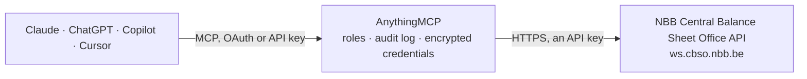

<!-- Generated by scripts/export-github-catalog.mjs in the anythingmcp-website repository. Do not edit by hand. -->

# NBB Central Balance Sheet Office MCP connector

Belgian annual accounts from the Central Balance Sheet Office of the National Bank of Belgium (authentic data web service): list every annual account a company filed by enterprise number, read a … The AnythingMCP connector gives Claude, ChatGPT, Microsoft Copilot, Cursor and Gemini 4 MCP tools for NBB Central Balance Sheet Office, all read-only.

**Category:** [Government](../government.md) · **Tools:** 4 · **Setup guide:** [anythingmcp.com](https://anythingmcp.com/guides/nbb-cbso-to-mcp) · [Deutsch](https://anythingmcp.com/de/guides/nbb-cbso-to-mcp) · [Italiano](https://anythingmcp.com/it/guides/nbb-cbso-to-mcp) · [Español](https://anythingmcp.com/es/guides/nbb-cbso-to-mcp) · [日本語](https://anythingmcp.com/ja/guides/nbb-cbso-to-mcp) · [Русский](https://anythingmcp.com/ru/guides/nbb-cbso-to-mcp) · [中文](https://anythingmcp.com/zh/guides/nbb-cbso-to-mcp)

## Start without code

No installation and no terminal: AnythingMCP Cloud runs the NBB Central Balance Sheet Office connector for you, operated by helpcode.ai in Frankfurt, Germany.

1. **Click the button above** and create an account or sign in. The NBB Central Balance Sheet Office connector opens, ready to install.
2. **Paste the API key or token from your NBB Central Balance Sheet Office account.** Every click is in the [step-by-step guide](https://anythingmcp.com/guides/nbb-cbso-to-mcp).
3. **Click Install.** AnythingMCP shows the address of your MCP server.
4. **Add that address to your assistant:** [Claude](https://anythingmcp.com/guides/connect-nbb-cbso-to-claude) · [ChatGPT](https://anythingmcp.com/guides/connect-nbb-cbso-to-chatgpt) · [Microsoft Copilot](https://anythingmcp.com/guides/connect-nbb-cbso-to-copilot) · [Cursor](https://anythingmcp.com/guides/connect-nbb-cbso-to-cursor) · [Gemini CLI](https://anythingmcp.com/guides/connect-nbb-cbso-to-gemini) · [Meta Muse](https://anythingmcp.com/guides/connect-nbb-cbso-to-muse).
5. **Ask your first question.**

Prefer help with the setup? [Talk to us](https://anythingmcp.com/contact).

## How it works

- **The AI client** speaks MCP (Streamable HTTP) to AnythingMCP and only sees tool names, descriptions and results. It never gets the NBB Central Balance Sheet Office credentials.
- **AnythingMCP** checks the client's role, builds the call from the tool definition, adds the credentials (an API key), calls NBB Central Balance Sheet Office, logs the call and returns the result.
- **NBB Central Balance Sheet Office** sees an ordinary API client with the rights of the account the credentials belong to.

## Tools

| Tool | What it does | Access |
|---|---|---|
| [`nbb_cbso_list_annual_accounts`](#nbb_cbso_list_annual_accounts) | List the annual accounts a Belgian company filed with the NBB Central Balance Sheet Office and the NBB accepted, by enterprise number. | read |
| [`nbb_cbso_get_annual_account_reference`](#nbb_cbso_get_annual_account_reference) | Get the reference data of one filed annual account by its reference number: deposit date, exercise dates, model type, deposit type, language, currency,… | read |
| [`nbb_cbso_get_annual_account_data`](#nbb_cbso_get_annual_account_data) | Get the accounting data of one filed annual account: balance sheet, income statement, notes and social balance as JSON-XBRL (default) or XBRL, coded with… | read |
| [`nbb_cbso_get_annual_account_pdf`](#nbb_cbso_get_annual_account_pdf) | Download the published annual account of one filing as a PDF file (the document as filed, or the NBB's PDF reproduction), attached to the result. | read |

## Tool reference

Every parameter as the AI client sees it in `tools/list`. Source: [`packages/backend/src/adapters/be/nbb-cbso.json`](../../../packages/backend/src/adapters/be/nbb-cbso.json).

### `nbb_cbso_list_annual_accounts`

List the annual accounts a Belgian company filed with the NBB Central Balance Sheet Office and the NBB accepted, by enterprise number. Each entry: ReferenceNumber, DepositDate, ExerciseDates (StartDate, EndDate), ModelType, DepositType (Initial or correction), Language, Currency, EnterpriseName, Address, LegalForm, LegalSituation, ActivityCode, GeneralAssemblyDate, AccountingDataURL, DataVersion. Start here; pass `year` for one fiscal year.

**Access:** read · **Call:** `GET /legalEntity/{enterprise_number}/references`

| Parameter | Type | Required | Description |
|---|---|---|---|
| `enterprise_number` | string | yes | 10-digit KBO/BCE enterprise number without dots or BE prefix, e.g. 0203201340. |
| `year` | integer | no | Fiscal year (year of the exercise end date), not later than the current year. Omit for all filings. |
| `request_id` | string | no | Version 4 UUID sent as X-Request-Id for tracing; a default is filled in. |

### `nbb_cbso_get_annual_account_reference`

Get the reference data of one filed annual account by its reference number: deposit date, exercise dates, model type, deposit type, language, currency, company name, address, legal form, legal situation, activity code, general assembly date and data version.

**Access:** read · **Call:** `GET /deposit/{reference_number}/reference`

| Parameter | Type | Required | Description |
|---|---|---|---|
| `reference_number` | string | yes | ReferenceNumber of the filing from nbb_cbso_list_annual_accounts, e.g. 2023-00123456. |
| `request_id` | string | no | Version 4 UUID sent as X-Request-Id for tracing; a default is filled in. |

### `nbb_cbso_get_annual_account_data`

Get the accounting data of one filed annual account: balance sheet, income statement, notes and social balance as JSON-XBRL (default) or XBRL, coded with the Belgian rubric codes (e.g. 10/15 equity, 70 turnover, 9904 profit or loss). Only standardised accounts have this data; for others use nbb_cbso_get_annual_account_pdf. The answer can arrive as an attached file.

**Access:** read · **Call:** `GET /deposit/{reference_number}/accountingData`

| Parameter | Type | Required | Description |
|---|---|---|---|
| `reference_number` | string | yes | ReferenceNumber of the filing from nbb_cbso_list_annual_accounts. |
| `format` | `application/x.jsonxbrl` \| `application/x.xbrl` | no | JSON-XBRL (default) or XBRL. |
| `request_id` | string | no | Version 4 UUID sent as X-Request-Id for tracing; a default is filled in. |

### `nbb_cbso_get_annual_account_pdf`

Download the published annual account of one filing as a PDF file (the document as filed, or the NBB's PDF reproduction), attached to the result. Works for standardised and non-standardised accounts alike.

**Access:** read · **Call:** `GET /deposit/{reference_number}/accountingData`

| Parameter | Type | Required | Description |
|---|---|---|---|
| `reference_number` | string | yes | ReferenceNumber of the filing from nbb_cbso_list_annual_accounts. |
| `request_id` | string | no | Version 4 UUID sent as X-Request-Id for tracing; a default is filled in. |

## Run it yourself

AnythingMCP is open source (AGPL-3.0). [Run it with Docker](../../../README.md#run-it-yourself), open **Connectors → Store**, pick **NBB Central Balance Sheet Office** and enter `NBB_CBSO_SUBSCRIPTION_KEY`, then add your MCP server URL to the AI client.

[← Government connectors](../government.md) · [All categories](../README.md)
