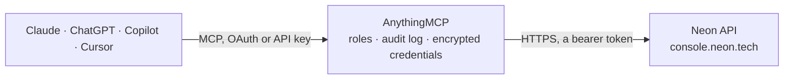

<!-- Generated by scripts/export-github-catalog.mjs in the anythingmcp-website repository. Do not edit by hand. -->

# Neon MCP connector

Let your AI manage Neon serverless Postgres: projects, branches, compute endpoints, databases, roles, schemas, operations and consumption. The AnythingMCP connector gives Claude, ChatGPT, Microsoft Copilot, Cursor and Gemini 17 MCP tools for Neon: 13 read and 4 can change data.

**Category:** [Databases](../database.md) · **Tools:** 17 · **Setup guide:** [anythingmcp.com](https://anythingmcp.com/guides/neon-to-mcp) · [Deutsch](https://anythingmcp.com/de/guides/neon-to-mcp) · [Italiano](https://anythingmcp.com/it/guides/neon-to-mcp) · [Español](https://anythingmcp.com/es/guides/neon-to-mcp) · [日本語](https://anythingmcp.com/ja/guides/neon-to-mcp) · [Русский](https://anythingmcp.com/ru/guides/neon-to-mcp) · [中文](https://anythingmcp.com/zh/guides/neon-to-mcp)

## Start without code

No installation and no terminal: AnythingMCP Cloud runs the Neon connector for you, operated by helpcode.ai in Frankfurt, Germany.

1. **Click the button above** and create an account or sign in. The Neon connector opens, ready to install.
2. **Paste the API key or token from your Neon account.** Every click is in the [step-by-step guide](https://anythingmcp.com/guides/neon-to-mcp).
3. **Click Install.** AnythingMCP shows the address of your MCP server.
4. **Add that address to your assistant:** [Claude](https://anythingmcp.com/guides/connect-neon-to-claude) · [ChatGPT](https://anythingmcp.com/guides/connect-neon-to-chatgpt) · [Microsoft Copilot](https://anythingmcp.com/guides/connect-neon-to-copilot) · [Cursor](https://anythingmcp.com/guides/connect-neon-to-cursor) · [Gemini CLI](https://anythingmcp.com/guides/connect-neon-to-gemini) · [Meta Muse](https://anythingmcp.com/guides/connect-neon-to-muse).
5. **Ask your first question**, for example: *What's the status and host of the read-write endpoint for project 'deep-analytics' default branch?*

Prefer help with the setup? [Talk to us](https://anythingmcp.com/contact).

## How it works

- **The AI client** speaks MCP (Streamable HTTP) to AnythingMCP and only sees tool names, descriptions and results. It never gets the Neon credentials.
- **AnythingMCP** checks the client's role, builds the call from the tool definition, adds the credentials (a bearer token), calls Neon, logs the call and returns the result.
- **Neon** sees an ordinary API client with the rights of the account the credentials belong to.

## Tools

| Tool | What it does | Access |
|---|---|---|
| [`neon_list_organizations`](#neon_list_organizations) | List the Neon organizations the API key belongs to, with org_id, name, handle and plan. | read |
| [`neon_list_projects`](#neon_list_projects) | List Neon projects with id, name, region, Postgres version, organization, storage size and last compute activity. | read |
| [`neon_get_project`](#neon_get_project) | Get one Neon project: region, Postgres version, default compute settings, history retention, and this billing period's compute time, active time, written… | read |
| [`neon_list_branches`](#neon_list_branches) | List the branches of a Neon project with id, name, parent, state, default and protected flags, logical size and this period's compute time. | read |
| [`neon_get_branch`](#neon_get_branch) | Get one Neon branch: name, parent and branch point, state, default and protected flags, expiry, logical size and this period's compute and data usage. | read |
| [`neon_create_branch`](#neon_create_branch) | Create a Neon branch (an instant copy-on-write copy of a parent branch, optionally at a point in time). | write |
| [`neon_delete_branch`](#neon_delete_branch) | Delete a Neon branch and its computes, ending all their connections. | write |
| [`neon_list_endpoints`](#neon_list_endpoints) | List the compute endpoints of a Neon project: id, branch, read-write or read-only, state (active, idle), autoscaling range in compute units, suspend… | read |
| [`neon_get_endpoint`](#neon_get_endpoint) | Get one Neon compute endpoint: state, branch, type, autoscaling range, suspend timeout, last activity, start and suspend times and host name. | read |
| [`neon_start_endpoint`](#neon_start_endpoint) | Start (wake) a Neon compute endpoint. | write |
| [`neon_suspend_endpoint`](#neon_suspend_endpoint) | Suspend a Neon compute endpoint now, which stops compute billing but closes every open connection to it. | write |
| [`neon_list_databases`](#neon_list_databases) | List the Postgres databases of a Neon branch with name and owner role. | read |
| [`neon_list_roles`](#neon_list_roles) | List the Postgres roles of a Neon branch with name, protected flag and authentication method. | read |
| [`neon_get_database_schema`](#neon_get_database_schema) | Get the schema of one database on a Neon branch (tables, columns, types, indexes, constraints, as pg_dump-style SQL), optionally as it was at a past time. | read |
| [`neon_list_operations`](#neon_list_operations) | List the operations of a Neon project (branch creation, compute start and suspend, config changes), newest first, with status, error and duration. | read |
| [`neon_get_operation`](#neon_get_operation) | Get one Neon operation: action, status (scheduling, running, finished, failed, cancelled), error, retries and duration. | read |
| [`neon_get_consumption`](#neon_get_consumption) | Get Neon consumption per project and period: compute unit seconds, root and child branch storage, instant restore storage, extra branches, snapshots and… | read |

## Tool reference

Every parameter as the AI client sees it in `tools/list`. Source: [`packages/backend/src/adapters/intl/neon.json`](../../../packages/backend/src/adapters/intl/neon.json).

### `neon_list_organizations`

List the Neon organizations the API key belongs to, with org_id, name, handle and plan. With an organization or project key it returns the one organization that owns the key. Start here for the org_id.

**Access:** read · **Call:** `GET /users/me/organizations`

No parameters.

### `neon_list_projects`

List Neon projects with id, name, region, Postgres version, organization, storage size and last compute activity. With a personal API key pass org_id for an organization's projects. Search by partial name or id.

**Access:** read · **Call:** `GET /projects`

| Parameter | Type | Required | Description |
|---|---|---|---|
| `org_id` | string | no | Organization id (from neon_list_organizations). Needed with a personal API key for organization projects. |
| `search` | string | no | Filter by partial project name or id. |
| `limit` | integer | no | Projects per page, 1 to 400. Default 50. |
| `cursor` | string | no | pagination.cursor from the previous page. |

### `neon_get_project`

Get one Neon project: region, Postgres version, default compute settings, history retention, and this billing period's compute time, active time, written data, data transfer and storage.

**Access:** read · **Call:** `GET /projects/{project_id}`

| Parameter | Type | Required | Description |
|---|---|---|---|
| `project_id` | string | yes | Neon project id, e.g. 'shiny-wind-028834' (id from neon_list_projects). |

### `neon_list_branches`

List the branches of a Neon project with id, name, parent, state, default and protected flags, logical size and this period's compute time. Newest changes first.

**Access:** read · **Call:** `GET /projects/{project_id}/branches`

| Parameter | Type | Required | Description |
|---|---|---|---|
| `project_id` | string | yes | Neon project id, e.g. 'shiny-wind-028834' (id from neon_list_projects). |
| `search` | string | no | Filter by partial branch name or id. |
| `sort_by` | `updated_at` \| `created_at` \| `name` | no | Sort field: updated_at (default), created_at or name. |
| `sort_order` | `desc` \| `asc` | no | desc (default) or asc. |
| `limit` | integer | no | Branches per page. Default 50. |
| `cursor` | string | no | pagination.next from the previous page. |

### `neon_get_branch`

Get one Neon branch: name, parent and branch point, state, default and protected flags, expiry, logical size and this period's compute and data usage.

**Access:** read · **Call:** `GET /projects/{project_id}/branches/{branch_id}`

| Parameter | Type | Required | Description |
|---|---|---|---|
| `project_id` | string | yes | Neon project id, e.g. 'shiny-wind-028834' (id from neon_list_projects). |
| `branch_id` | string | yes | Branch id, starting with 'br-', e.g. 'br-aged-salad-637688' (from neon_list_branches). |

### `neon_create_branch`

Create a Neon branch (an instant copy-on-write copy of a parent branch, optionally at a point in time). Confirm with the user first: extra branches and any compute you add can be billed. Pass endpoints [{"type": "read_write"}] to add a compute that starts at once. No passwords or connection strings are returned.

**Access:** write · **Call:** `POST /projects/{project_id}/branches`

| Parameter | Type | Required | Description |
|---|---|---|---|
| `project_id` | string | yes | Neon project id, e.g. 'shiny-wind-028834' (id from neon_list_projects). |
| `name` | string | no | Name for the new branch, e.g. 'feature-checkout'. Auto-generated if left out. |
| `parent_id` | string | no | Branch to copy from. Default: the project's default branch. |
| `parent_timestamp` | string | no | Copy the parent as it was at this time (RFC 3339, within the history retention window), e.g. '2026-10-14T08:00:00Z'. |
| `parent_lsn` | string | no | Copy the parent at this Postgres LSN instead of a time. |
| `init_source` | `parent-data` \| `parent-schema` \| `schema-only` | no | parent-data (default) copies schema and data; parent-schema copies only the parent's schema; schema-only creates a new root branch with the schema only. |
| `expires_at` | string | no | Delete the branch automatically at this time (RFC 3339), for temporary branches. |
| `endpoints` | object[] | no | Computes to create with the branch, e.g. [{"type": "read_write"}] or with sizes {"type": "read_write", "autoscaling_limit_min_cu": 0.25, "autoscaling_limit_max_cu": 1}. Leave out for a branch without compute. |

### `neon_delete_branch`

Delete a Neon branch and its computes, ending all their connections. Switched off at install. Confirm with the user first and name the branch; the root and default branch, and branches with children, cannot be deleted.

**Access:** write · **Call:** `DELETE /projects/{project_id}/branches/{branch_id}`

| Parameter | Type | Required | Description |
|---|---|---|---|
| `project_id` | string | yes | Neon project id, e.g. 'shiny-wind-028834' (id from neon_list_projects). |
| `branch_id` | string | yes | Branch id, starting with 'br-', e.g. 'br-aged-salad-637688' (from neon_list_branches). |

### `neon_list_endpoints`

List the compute endpoints of a Neon project: id, branch, read-write or read-only, state (active, idle), autoscaling range in compute units, suspend timeout, pooler and host name.

**Access:** read · **Call:** `GET /projects/{project_id}/endpoints`

| Parameter | Type | Required | Description |
|---|---|---|---|
| `project_id` | string | yes | Neon project id, e.g. 'shiny-wind-028834' (id from neon_list_projects). |

### `neon_get_endpoint`

Get one Neon compute endpoint: state, branch, type, autoscaling range, suspend timeout, last activity, start and suspend times and host name.

**Access:** read · **Call:** `GET /projects/{project_id}/endpoints/{endpoint_id}`

| Parameter | Type | Required | Description |
|---|---|---|---|
| `project_id` | string | yes | Neon project id, e.g. 'shiny-wind-028834' (id from neon_list_projects). |
| `endpoint_id` | string | yes | Compute endpoint id, starting with 'ep-' (from neon_list_endpoints). |

### `neon_start_endpoint`

Start (wake) a Neon compute endpoint. Confirm with the user first: a running compute uses billable compute hours until it scales to zero again. Follow the returned operations with neon_get_operation.

**Access:** write · **Call:** `POST /projects/{project_id}/endpoints/{endpoint_id}/start`

| Parameter | Type | Required | Description |
|---|---|---|---|
| `project_id` | string | yes | Neon project id, e.g. 'shiny-wind-028834' (id from neon_list_projects). |
| `endpoint_id` | string | yes | Compute endpoint id, starting with 'ep-' (from neon_list_endpoints). |

### `neon_suspend_endpoint`

Suspend a Neon compute endpoint now, which stops compute billing but closes every open connection to it. Confirm with the user first. It wakes again on the next connection.

**Access:** write · **Call:** `POST /projects/{project_id}/endpoints/{endpoint_id}/suspend`

| Parameter | Type | Required | Description |
|---|---|---|---|
| `project_id` | string | yes | Neon project id, e.g. 'shiny-wind-028834' (id from neon_list_projects). |
| `endpoint_id` | string | yes | Compute endpoint id, starting with 'ep-' (from neon_list_endpoints). |

### `neon_list_databases`

List the Postgres databases of a Neon branch with name and owner role.

**Access:** read · **Call:** `GET /projects/{project_id}/branches/{branch_id}/databases`

| Parameter | Type | Required | Description |
|---|---|---|---|
| `project_id` | string | yes | Neon project id, e.g. 'shiny-wind-028834' (id from neon_list_projects). |
| `branch_id` | string | yes | Branch id, starting with 'br-', e.g. 'br-aged-salad-637688' (from neon_list_branches). |

### `neon_list_roles`

List the Postgres roles of a Neon branch with name, protected flag and authentication method. Passwords are never returned.

**Access:** read · **Call:** `GET /projects/{project_id}/branches/{branch_id}/roles`

| Parameter | Type | Required | Description |
|---|---|---|---|
| `project_id` | string | yes | Neon project id, e.g. 'shiny-wind-028834' (id from neon_list_projects). |
| `branch_id` | string | yes | Branch id, starting with 'br-', e.g. 'br-aged-salad-637688' (from neon_list_branches). |

### `neon_get_database_schema`

Get the schema of one database on a Neon branch (tables, columns, types, indexes, constraints, as pg_dump-style SQL), optionally as it was at a past time. Read-only; no password needed.

**Access:** read · **Call:** `GET /projects/{project_id}/branches/{branch_id}/schema`

| Parameter | Type | Required | Description |
|---|---|---|---|
| `project_id` | string | yes | Neon project id, e.g. 'shiny-wind-028834' (id from neon_list_projects). |
| `branch_id` | string | yes | Branch id, starting with 'br-', e.g. 'br-aged-salad-637688' (from neon_list_branches). |
| `db_name` | string | yes | Database name, e.g. 'neondb' (from neon_list_databases). |
| `timestamp` | string | no | Read the schema as it was at this time (RFC 3339), within the history retention window. |
| `lsn` | string | no | Read the schema at this Postgres LSN instead of a time. |

### `neon_list_operations`

List the operations of a Neon project (branch creation, compute start and suspend, config changes), newest first, with status, error and duration.

**Access:** read · **Call:** `GET /projects/{project_id}/operations`

| Parameter | Type | Required | Description |
|---|---|---|---|
| `project_id` | string | yes | Neon project id, e.g. 'shiny-wind-028834' (id from neon_list_projects). |
| `limit` | integer | no | Operations per page, 1 to 1000. Default 20. |
| `cursor` | string | no | pagination.cursor from the previous page. |

### `neon_get_operation`

Get one Neon operation: action, status (scheduling, running, finished, failed, cancelled), error, retries and duration. Use it to follow a change until it finishes.

**Access:** read · **Call:** `GET /projects/{project_id}/operations/{operation_id}`

| Parameter | Type | Required | Description |
|---|---|---|---|
| `project_id` | string | yes | Neon project id, e.g. 'shiny-wind-028834' (id from neon_list_projects). |
| `operation_id` | string | yes | Operation id (a UUID) from an earlier answer. |

### `neon_get_consumption`

Get Neon consumption per project and period: compute unit seconds, root and child branch storage, instant restore storage, extra branches, snapshots and network transfer. Paid plans only; needs org_id. Does not wake computes.

**Access:** read · **Call:** `GET /consumption_history/v2/projects`

| Parameter | Type | Required | Description |
|---|---|---|---|
| `org_id` | string | yes | Organization id (from neon_list_organizations). |
| `from` | string | yes | Start, RFC 3339, e.g. '2026-10-01T00:00:00Z'. |
| `to` | string | yes | End, RFC 3339, e.g. '2026-10-15T00:00:00Z'. |
| `granularity` | `hourly` \| `daily` \| `monthly` | yes | hourly (last 168 hours), daily (last 60 days) or monthly (last year). |
| `metrics` | `compute_unit_seconds` \| `root_branch_bytes_month` \| `child_branch_bytes_month` \| `instant_restore_bytes_month` \| `public_network_transfer_bytes` \| `private_network_transfer_bytes` \| `extra_branches_month` \| `snapshot_storage_bytes_month`[] | no | Metrics to return. Default: compute_unit_seconds, root_branch_bytes_month, child_branch_bytes_month, public_network_transfer_bytes. |
| `project_ids` | string[] | no | Only these project ids (up to 100). |
| `limit` | integer | no | Projects per page, 1 to 100. Default 10. |
| `cursor` | string | no | pagination.cursor from the previous page. |

## Run it yourself

AnythingMCP is open source (AGPL-3.0). [Run it with Docker](../../../README.md#run-it-yourself), open **Connectors → Store**, pick **Neon** and enter `NEON_API_KEY`, then add your MCP server URL to the AI client.

[← Databases connectors](../database.md) · [All categories](../README.md)
