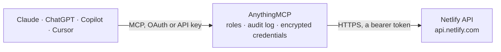

<!-- Generated by scripts/export-github-catalog.mjs in the anythingmcp-website repository. Do not edit by hand. -->

# Netlify MCP connector

Let your AI check and run your Netlify sites: sites, deploys and builds, functions, forms and submissions, environment variable names and DNS, and start builds, publish or roll back deploys and lock … The AnythingMCP connector gives Claude, ChatGPT, Microsoft Copilot, Cursor and Gemini 23 MCP tools for Netlify: 16 read and 7 can change data.

**Category:** [Infrastructure](../infrastructure.md) · **Tools:** 23 · **Setup guide:** [anythingmcp.com](https://anythingmcp.com/guides/netlify-to-mcp) · [Deutsch](https://anythingmcp.com/de/guides/netlify-to-mcp) · [Italiano](https://anythingmcp.com/it/guides/netlify-to-mcp) · [Español](https://anythingmcp.com/es/guides/netlify-to-mcp) · [日本語](https://anythingmcp.com/ja/guides/netlify-to-mcp) · [Русский](https://anythingmcp.com/ru/guides/netlify-to-mcp) · [中文](https://anythingmcp.com/zh/guides/netlify-to-mcp)

## Start without code

No installation and no terminal: AnythingMCP Cloud runs the Netlify connector for you, operated by helpcode.ai in Frankfurt, Germany.

1. **Click the button above** and create an account or sign in. The Netlify connector opens, ready to install.
2. **Paste the API key or token from your Netlify account.** Every click is in the [step-by-step guide](https://anythingmcp.com/guides/netlify-to-mcp).
3. **Click Install.** AnythingMCP shows the address of your MCP server.
4. **Add that address to your assistant:** [Claude](https://anythingmcp.com/guides/connect-netlify-to-claude) · [ChatGPT](https://anythingmcp.com/guides/connect-netlify-to-chatgpt) · [Microsoft Copilot](https://anythingmcp.com/guides/connect-netlify-to-copilot) · [Cursor](https://anythingmcp.com/guides/connect-netlify-to-cursor) · [Gemini CLI](https://anythingmcp.com/guides/connect-netlify-to-gemini) · [Meta Muse](https://anythingmcp.com/guides/connect-netlify-to-muse).
5. **Ask your first question**, for example: *What's the currently published deploy id and publish time for site brampton-solar.netlify.app?*

Prefer help with the setup? [Talk to us](https://anythingmcp.com/contact).

## How it works

- **The AI client** speaks MCP (Streamable HTTP) to AnythingMCP and only sees tool names, descriptions and results. It never gets the Netlify credentials.
- **AnythingMCP** checks the client's role, builds the call from the tool definition, adds the credentials (a bearer token), calls Netlify, logs the call and returns the result.
- **Netlify** sees an ordinary API client with the rights of the account the credentials belong to.

## Tools

| Tool | What it does | Access |
|---|---|---|
| [`netlify_get_current_user`](#netlify_get_current_user) | Get the Netlify user the personal access token belongs to: id, name, email, number of sites and last login. | read |
| [`netlify_list_accounts`](#netlify_list_accounts) | List the Netlify teams (accounts) the user belongs to: id, name, slug, plan type and the user's roles. | read |
| [`netlify_list_sites`](#netlify_list_sites) | List sites (projects): id, name, URL, custom domain, team, connected repository and branch, build command and the currently published deploy. | read |
| [`netlify_get_site`](#netlify_get_site) | Get one site: URL, custom domain and aliases, state, plan, team, repository, branch, build command, publish folder and the published deploy. | read |
| [`netlify_list_deploys`](#netlify_list_deploys) | List a site's deploys, newest first: id, state (ready, building, error, ...), context (production, deploy-preview, branch-deploy), branch, commit, title,… | read |
| [`netlify_get_deploy`](#netlify_get_deploy) | Get one deploy by id: state, context, branch, commit, title, error message, URLs, lock state and times. | read |
| [`netlify_list_builds`](#netlify_list_builds) | List a site's builds, newest first: id, deploy id, commit sha, whether it is done, error text and time. | read |
| [`netlify_get_build`](#netlify_get_build) | Get one build: deploy id, commit sha, whether it is done, error text and time. | read |
| [`netlify_list_build_hooks`](#netlify_list_build_hooks) | List a site's build hooks: id, title and branch. | read |
| [`netlify_list_functions`](#netlify_list_functions) | List the serverless functions deployed for a site, with the deploy and branch they belong to. | read |
| [`netlify_list_forms`](#netlify_list_forms) | List the forms Netlify detected on a site: id, name, the pages they are on, number of submissions and their fields. | read |
| [`netlify_list_form_submissions`](#netlify_list_form_submissions) | List the submissions of one form, newest first: number, time, name, email, company, summary and all submitted fields. | read |
| [`netlify_list_env_vars`](#netlify_list_env_vars) | List a site's environment variables: key, scopes (builds, functions, runtime, post-processing), whether it is marked secret, the deploy contexts that have a… | read |
| [`netlify_get_env_var_value`](#netlify_get_env_var_value) | Read the values of ONE environment variable per deploy context. | read |
| [`netlify_list_dns_zones`](#netlify_list_dns_zones) | List the DNS zones managed by Netlify DNS: id, domain name, team, linked site and the Netlify name servers. | read |
| [`netlify_list_dns_records`](#netlify_list_dns_records) | List the records of a Netlify DNS zone: id, hostname, type (A, AAAA, CNAME, MX, TXT, NETLIFY ...), value, TTL, priority and whether Netlify manages it. | read |
| [`netlify_trigger_build`](#netlify_trigger_build) | Start a new build and deploy of a site from its connected repository, optionally for another branch or with a cleared cache. | write |
| [`netlify_restore_deploy`](#netlify_restore_deploy) | Publish an earlier deploy to the live site again (Netlify's Publish deploy). | write |
| [`netlify_rollback_site`](#netlify_rollback_site) | Roll the live site back to the deploy that was published before the current one. | write |
| [`netlify_lock_deploy`](#netlify_lock_deploy) | Lock a published deploy: auto publishing stops, so new builds are deployed but not published until it is unlocked. | write |
| [`netlify_unlock_deploy`](#netlify_unlock_deploy) | Unlock a locked deploy so auto publishing resumes; the next successful production build goes live. | write |
| [`netlify_cancel_deploy`](#netlify_cancel_deploy) | Cancel a deploy that is still building or processing; it will not be published. | write |
| [`netlify_delete_form_submission`](#netlify_delete_form_submission) | Delete one form submission for good. | write |

## Tool reference

Every parameter as the AI client sees it in `tools/list`. Source: [`packages/backend/src/adapters/intl/netlify.json`](../../../packages/backend/src/adapters/intl/netlify.json).

### `netlify_get_current_user`

Get the Netlify user the personal access token belongs to: id, name, email, number of sites and last login. A quick check that the token works. Read-only.

**Access:** read · **Call:** `GET /user`

No parameters.

### `netlify_list_accounts`

List the Netlify teams (accounts) the user belongs to: id, name, slug, plan type and the user's roles. The slug filters netlify_list_dns_zones. Billing details are left out. Read-only.

**Access:** read · **Call:** `GET /accounts`

No parameters.

### `netlify_list_sites`

List sites (projects): id, name, URL, custom domain, team, connected repository and branch, build command and the currently published deploy. Filter by name. Read-only.

**Access:** read · **Call:** `GET /sites`

| Parameter | Type | Required | Description |
|---|---|---|---|
| `name` | string | no | Only sites whose name contains this text. |
| `filter` | `all` \| `owner` \| `guest` | no | all (default here), owner or guest. |
| `page` | integer | no | Page number, from 1. When the answer has _pagination, call again with page = _pagination.nextCursor. |
| `per_page` | integer | no | Items per page (default 30, maximum 100). |

### `netlify_get_site`

Get one site: URL, custom domain and aliases, state, plan, team, repository, branch, build command, publish folder and the published deploy. The site password and deploy hook URL are left out. Read-only.

**Access:** read · **Call:** `GET /sites/{site_id}`

| Parameter | Type | Required | Description |
|---|---|---|---|
| `site_id` | string | yes | Site (project) id, or its Netlify domain such as my-site.netlify.app. From netlify_list_sites. |

### `netlify_list_deploys`

List a site's deploys, newest first: id, state (ready, building, error, ...), context (production, deploy-preview, branch-deploy), branch, commit, title, error message, URLs, lock state and times. Filter by branch, state or production. Read-only.

**Access:** read · **Call:** `GET /sites/{site_id}/deploys`

| Parameter | Type | Required | Description |
|---|---|---|---|
| `site_id` | string | yes | Site (project) id, or its Netlify domain such as my-site.netlify.app. From netlify_list_sites. |
| `branch` | string | no | Only deploys of this branch. |
| `state` | `new` \| `pending_review` \| `accepted` \| `rejected` \| `enqueued` \| `building` \| `uploading` \| `uploaded` \| `preparing` \| `prepared` \| `processing` \| `processed` \| `ready` \| `error` \| `retrying` | no | Only deploys in this state. |
| `production` | boolean | no | Only production deploys. |
| `page` | integer | no | Page number, from 1. When the answer has _pagination, call again with page = _pagination.nextCursor. |
| `per_page` | integer | no | Items per page (default 20, maximum 100). |

### `netlify_get_deploy`

Get one deploy by id: state, context, branch, commit, title, error message, URLs, lock state and times. Read-only.

**Access:** read · **Call:** `GET /deploys/{deploy_id}`

| Parameter | Type | Required | Description |
|---|---|---|---|
| `deploy_id` | string | yes | Deploy id, from netlify_list_deploys. |

### `netlify_list_builds`

List a site's builds, newest first: id, deploy id, commit sha, whether it is done, error text and time. Read-only.

**Access:** read · **Call:** `GET /sites/{site_id}/builds`

| Parameter | Type | Required | Description |
|---|---|---|---|
| `site_id` | string | yes | Site (project) id, or its Netlify domain such as my-site.netlify.app. From netlify_list_sites. |
| `page` | integer | no | Page number, from 1. When the answer has _pagination, call again with page = _pagination.nextCursor. |
| `per_page` | integer | no | Items per page (default 20, maximum 100). |

### `netlify_get_build`

Get one build: deploy id, commit sha, whether it is done, error text and time. The deploy (netlify_get_deploy) has the state and error message. Read-only.

**Access:** read · **Call:** `GET /builds/{build_id}`

| Parameter | Type | Required | Description |
|---|---|---|---|
| `build_id` | string | yes | Build id from netlify_list_builds. |

### `netlify_list_build_hooks`

List a site's build hooks: id, title and branch. The hook URLs are left out because anyone holding one can start builds. Read-only.

**Access:** read · **Call:** `GET /sites/{site_id}/build_hooks`

| Parameter | Type | Required | Description |
|---|---|---|---|
| `site_id` | string | yes | Site (project) id, or its Netlify domain such as my-site.netlify.app. From netlify_list_sites. |

### `netlify_list_functions`

List the serverless functions deployed for a site, with the deploy and branch they belong to. Read-only.

**Access:** read · **Call:** `GET /sites/{site_id}/functions`

| Parameter | Type | Required | Description |
|---|---|---|---|
| `site_id` | string | yes | Site (project) id, or its Netlify domain such as my-site.netlify.app. From netlify_list_sites. |
| `filter` | string | no | Only functions whose name contains this text. |

### `netlify_list_forms`

List the forms Netlify detected on a site: id, name, the pages they are on, number of submissions and their fields. Read-only.

**Access:** read · **Call:** `GET /sites/{site_id}/forms`

| Parameter | Type | Required | Description |
|---|---|---|---|
| `site_id` | string | yes | Site (project) id, or its Netlify domain such as my-site.netlify.app. From netlify_list_sites. |

### `netlify_list_form_submissions`

List the submissions of one form, newest first: number, time, name, email, company, summary and all submitted fields. They contain what visitors typed, often personal data. Read-only.

**Access:** read · **Call:** `GET /forms/{form_id}/submissions`

| Parameter | Type | Required | Description |
|---|---|---|---|
| `form_id` | string | yes | Form id from netlify_list_forms. |
| `page` | integer | no | Page number, from 1. When the answer has _pagination, call again with page = _pagination.nextCursor. |
| `per_page` | integer | no | Items per page (default 20, maximum 100). |

### `netlify_list_env_vars`

List a site's environment variables: key, scopes (builds, functions, runtime, post-processing), whether it is marked secret, the deploy contexts that have a value, and when it was last changed. Values are left out. Read-only.

**Access:** read · **Call:** `GET /sites/{site_id}/env`

| Parameter | Type | Required | Description |
|---|---|---|---|
| `site_id` | string | yes | Site (project) id, or its Netlify domain such as my-site.netlify.app. From netlify_list_sites. |
| `context_name` | `all` \| `dev` \| `dev-server` \| `branch-deploy` \| `deploy-preview` \| `production` | no | Only variables with a value in this deploy context. |
| `scope` | `builds` \| `functions` \| `runtime` \| `post-processing` | no | Only variables available in this scope. |

### `netlify_get_env_var_value`

Read the values of ONE environment variable per deploy context. Non-secret values come back in plain text, so this can expose API keys and passwords to the AI and its logs; variables marked secret come back masked except in the dev context. Installed switched off. Call only when the user explicitly asks for that variable's value.

**Access:** read · **Call:** `GET /accounts/{account_id}/env/{key}`

| Parameter | Type | Required | Description |
|---|---|---|---|
| `account_id` | string | yes | Team (account) id: account_id from netlify_get_site. |
| `key` | string | yes | Variable name, e.g. API_BASE_URL. |
| `site_id` | string | no | Site id, for a site-level variable. Omit for a team-wide variable. |

### `netlify_list_dns_zones`

List the DNS zones managed by Netlify DNS: id, domain name, team, linked site and the Netlify name servers. Records are listed with netlify_list_dns_records. Read-only.

**Access:** read · **Call:** `GET /dns_zones`

| Parameter | Type | Required | Description |
|---|---|---|---|
| `account_slug` | string | no | Only zones of this team slug, from netlify_list_accounts. |

### `netlify_list_dns_records`

List the records of a Netlify DNS zone: id, hostname, type (A, AAAA, CNAME, MX, TXT, NETLIFY ...), value, TTL, priority and whether Netlify manages it. Read-only.

**Access:** read · **Call:** `GET /dns_zones/{zone_id}/dns_records`

| Parameter | Type | Required | Description |
|---|---|---|---|
| `zone_id` | string | yes | DNS zone id from netlify_list_dns_zones. |

### `netlify_trigger_build`

Start a new build and deploy of a site from its connected repository, optionally for another branch or with a cleared cache. A build of the production branch publishes to the live site when it succeeds, unless auto publishing is locked, and it uses build minutes. Tell the user the site and branch and call only after they confirm. Use it to retry a failed deploy too.

**Access:** write · **Call:** `POST /sites/{site_id}/builds`

| Parameter | Type | Required | Description |
|---|---|---|---|
| `site_id` | string | yes | Site (project) id, or its Netlify domain such as my-site.netlify.app. From netlify_list_sites. |
| `branch` | string | no | Branch to build; default is the site's production branch. |
| `clear_cache` | boolean | no | Clear the build cache first (helps with stale dependencies). |
| `title` | string | no | Title shown on the deploy, e.g. Rebuild requested by the assistant. |

### `netlify_restore_deploy`

Publish an earlier deploy to the live site again (Netlify's Publish deploy). Visitors see that version immediately; later deploys stay available. Show the deploy with netlify_get_deploy first, tell the user which version goes live and call only after they confirm.

**Access:** write · **Call:** `POST /sites/{site_id}/deploys/{deploy_id}/restore`

| Parameter | Type | Required | Description |
|---|---|---|---|
| `site_id` | string | yes | Site (project) id, or its Netlify domain such as my-site.netlify.app. From netlify_list_sites. |
| `deploy_id` | string | yes | Deploy id, from netlify_list_deploys. |

### `netlify_rollback_site`

Roll the live site back to the deploy that was published before the current one. Visitors see the older version immediately. Tell the user which deploy is live now and call only after they confirm. Returns no content on success; check with netlify_get_site.

**Access:** write · **Call:** `PUT /sites/{site_id}/rollback`

| Parameter | Type | Required | Description |
|---|---|---|---|
| `site_id` | string | yes | Site (project) id, or its Netlify domain such as my-site.netlify.app. From netlify_list_sites. |

### `netlify_lock_deploy`

Lock a published deploy: auto publishing stops, so new builds are deployed but not published until it is unlocked. Tell the user and call only after they confirm.

**Access:** write · **Call:** `POST /deploys/{deploy_id}/lock`

| Parameter | Type | Required | Description |
|---|---|---|---|
| `deploy_id` | string | yes | Deploy id, from netlify_list_deploys. |

### `netlify_unlock_deploy`

Unlock a locked deploy so auto publishing resumes; the next successful production build goes live. Tell the user and call only after they confirm.

**Access:** write · **Call:** `POST /deploys/{deploy_id}/unlock`

| Parameter | Type | Required | Description |
|---|---|---|---|
| `deploy_id` | string | yes | Deploy id, from netlify_list_deploys. |

### `netlify_cancel_deploy`

Cancel a deploy that is still building or processing; it will not be published. Tell the user which deploy and call only after they confirm.

**Access:** write · **Call:** `POST /deploys/{deploy_id}/cancel`

| Parameter | Type | Required | Description |
|---|---|---|---|
| `deploy_id` | string | yes | Deploy id, from netlify_list_deploys. |

### `netlify_delete_form_submission`

Delete one form submission for good. Installed switched off: an administrator turns it on deliberately. Show the submission first and call only after the user confirms.

**Access:** write · **Call:** `DELETE /submissions/{submission_id}`

| Parameter | Type | Required | Description |
|---|---|---|---|
| `submission_id` | string | yes | Submission id from netlify_list_form_submissions. |

## Run it yourself

AnythingMCP is open source (AGPL-3.0). [Run it with Docker](../../../README.md#run-it-yourself), open **Connectors → Store**, pick **Netlify** and enter `NETLIFY_TOKEN`, then add your MCP server URL to the AI client.

[← Infrastructure connectors](../infrastructure.md) · [All categories](../README.md)
