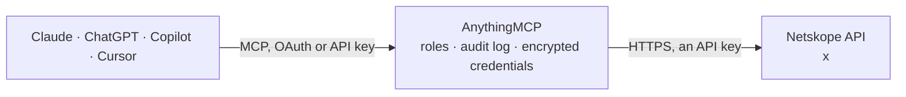

<!-- Generated by scripts/export-github-catalog.mjs in the anythingmcp-website repository. Do not edit by hand. -->

# Netskope MCP connector

Netskope Security Service Edge, read-only: search alerts and events (application, web, network, incident, endpoint DLP), the admin audit log, user risk scores, Cloud Confidence Index lookups, URL … The AnythingMCP connector gives Claude, ChatGPT, Microsoft Copilot, Cursor and Gemini 11 MCP tools for Netskope, all read-only.

**Category:** [Monitoring](../monitoring.md) · **Tools:** 11 · **Setup guide:** [anythingmcp.com](https://anythingmcp.com/guides/netskope-to-mcp) · [Deutsch](https://anythingmcp.com/de/guides/netskope-to-mcp) · [Italiano](https://anythingmcp.com/it/guides/netskope-to-mcp) · [Español](https://anythingmcp.com/es/guides/netskope-to-mcp) · [日本語](https://anythingmcp.com/ja/guides/netskope-to-mcp) · [Русский](https://anythingmcp.com/ru/guides/netskope-to-mcp) · [中文](https://anythingmcp.com/zh/guides/netskope-to-mcp)

## Start without code

No installation and no terminal: AnythingMCP Cloud runs the Netskope connector for you, operated by helpcode.ai in Frankfurt, Germany.

1. **Click the button above** and create an account or sign in. The Netskope connector opens, ready to install.
2. **Paste the API key or token from your Netskope account.** Every click is in the [step-by-step guide](https://anythingmcp.com/guides/netskope-to-mcp).
3. **Click Install.** AnythingMCP shows the address of your MCP server.
4. **Add that address to your assistant:** [Claude](https://anythingmcp.com/guides/connect-netskope-to-claude) · [ChatGPT](https://anythingmcp.com/guides/connect-netskope-to-chatgpt) · [Microsoft Copilot](https://anythingmcp.com/guides/connect-netskope-to-copilot) · [Cursor](https://anythingmcp.com/guides/connect-netskope-to-cursor) · [Gemini CLI](https://anythingmcp.com/guides/connect-netskope-to-gemini) · [Meta Muse](https://anythingmcp.com/guides/connect-netskope-to-muse).
5. **Ask your first question**, for example: *Show the SCIM record for emma@novahealth.io, I need her groups and whether the account is active*

Prefer help with the setup? [Talk to us](https://anythingmcp.com/contact).

## How it works

- **The AI client** speaks MCP (Streamable HTTP) to AnythingMCP and only sees tool names, descriptions and results. It never gets the Netskope credentials.
- **AnythingMCP** checks the client's role, builds the call from the tool definition, adds the credentials (an API key), calls Netskope, logs the call and returns the result.
- **Netskope** sees an ordinary API client with the rights of the account the credentials belong to.

## Tools

| Tool | What it does | Access |
|---|---|---|
| [`netskope_search_alerts`](#netskope_search_alerts) | Search Netskope alerts (DLP, malware, policy, anomaly, compromised credential, UBA...) through the datasearch endpoint: filter with the Netskope query… | read |
| [`netskope_search_events`](#netskope_search_events) | Search Netskope events of one type through the datasearch endpoint: application (cloud app activity), page (web visits), network (firewall and private… | read |
| [`netskope_list_audit_events`](#netskope_list_audit_events) | List the administrator audit log of the tenant (who changed which setting or policy, logins to the console) for a time range, optionally only one audit type. | read |
| [`netskope_get_user_risk_score`](#netskope_get_user_risk_score) | Get the User Confidence Index (UCI, behavior analytics risk score from 0 to 1000) of one user and its changes since a point in time. | read |
| [`netskope_lookup_cloud_app`](#netskope_lookup_cloud_app) | Look up the Cloud Confidence Index (CCI) of a cloud application by its exact name (e.g. Dropbox, Slack): score, Cloud Confidence Level, category, tags and… | read |
| [`netskope_list_url_lists`](#netskope_list_url_lists) | List the URL lists used in policies (allow and block lists): id, name, type (exact or regex), URLs and pending changes. | read |
| [`netskope_get_url_list`](#netskope_get_url_list) | Get one URL list by its numeric id with all its URLs and its type. | read |
| [`netskope_list_publishers`](#netskope_list_publishers) | List the Netskope Private Access publishers: id, name, status (connected or not), version, assessment and the apps they serve. | read |
| [`netskope_list_private_apps`](#netskope_list_private_apps) | List the private applications of Netskope Private Access: name, hosts, protocols and ports, publishers, reachability, clientless access and tags. | read |
| [`netskope_list_scim_users`](#netskope_list_scim_users) | List users provisioned to Netskope over SCIM: id, userName, name, e-mails, active flag and groups. | read |
| [`netskope_list_scim_groups`](#netskope_list_scim_groups) | List groups provisioned to Netskope over SCIM with their members. | read |

## Tool reference

Every parameter as the AI client sees it in `tools/list`. Source: [`packages/backend/src/adapters/intl/netskope.json`](../../../packages/backend/src/adapters/intl/netskope.json).

### `netskope_search_alerts`

Search Netskope alerts (DLP, malware, policy, anomaly, compromised credential, UBA...) through the datasearch endpoint: filter with the Netskope query language and a time range, choose fields, aggregate with groupbys, sort and page. Returns result rows and status.count.

**Access:** read · **Call:** `GET /api/v2/events/datasearch/alert`

| Parameter | Type | Required | Description |
|---|---|---|---|
| `query` | string | no | Filter in the Netskope (Skope IT) query language, e.g. severity eq 'high' and user eq 'alice@example.com', or alert_type in ('DLP','malware'). |
| `fields` | string | no | Comma-separated fields to return, e.g. _id,timestamp,user,app,alert_name. Aggregations work too: count_total:count(_id). |
| `starttime` | integer | no | Start of the period, Unix time in seconds. |
| `endtime` | integer | no | End of the period, Unix time in seconds. |
| `limit` | integer | no | Rows to return (default 100). |
| `offset` | integer | no | Rows to skip, for paging. |
| `groupbys` | string | no | Comma-separated fields to aggregate on, e.g. user,app (use with an aggregation in fields). |
| `orderbys` | string | no | Sort order, e.g. timestamp desc or count_total desc. |

### `netskope_search_events`

Search Netskope events of one type through the datasearch endpoint: application (cloud app activity), page (web visits), network (firewall and private access traffic), incident, clientstatus (Netskope client status of devices) or epdlp (endpoint DLP). Same query language, fields, time range, aggregation and paging as alerts.

**Access:** read · **Call:** `GET /api/v2/events/datasearch/{event_type}`

| Parameter | Type | Required | Description |
|---|---|---|---|
| `event_type` | `application` \| `page` \| `network` \| `incident` \| `clientstatus` \| `epdlp` | yes | Event type to search. |
| `query` | string | no | Filter in the Netskope (Skope IT) query language, e.g. severity eq 'high' and user eq 'alice@example.com', or alert_type in ('DLP','malware'). |
| `fields` | string | no | Comma-separated fields to return, e.g. _id,timestamp,user,app,alert_name. Aggregations work too: count_total:count(_id). |
| `starttime` | integer | no | Start of the period, Unix time in seconds. |
| `endtime` | integer | no | End of the period, Unix time in seconds. |
| `limit` | integer | no | Rows to return (default 100). |
| `offset` | integer | no | Rows to skip, for paging. |
| `groupbys` | string | no | Comma-separated fields to aggregate on, e.g. user,app (use with an aggregation in fields). |
| `orderbys` | string | no | Sort order, e.g. timestamp desc or count_total desc. |

### `netskope_list_audit_events`

List the administrator audit log of the tenant (who changed which setting or policy, logins to the console) for a time range, optionally only one audit type.

**Access:** read · **Call:** `GET /api/v2/events/data/audit`

| Parameter | Type | Required | Description |
|---|---|---|---|
| `starttime` | integer | no | Start of the period, Unix time in seconds. |
| `endtime` | integer | no | End of the period, Unix time in seconds. |
| `type` | string | no | Audit type filter, e.g. admin or user. |
| `fields` | string | no | Comma-separated fields to return. |
| `limit` | integer | no | Rows to return (default 100). |
| `offset` | integer | no | Rows to skip, for paging. |

### `netskope_get_user_risk_score`

Get the User Confidence Index (UCI, behavior analytics risk score from 0 to 1000) of one user and its changes since a point in time. Read-only, sent as POST.

**Access:** read · **Call:** `POST /api/v2/ubadatasvc/user/uci`

| Parameter | Type | Required | Description |
|---|---|---|---|
| `user` | string | yes | User e-mail address as known to Netskope. |
| `from_time` | integer | yes | Start of the window, Unix time in milliseconds (e.g. 7 days ago). |

### `netskope_lookup_cloud_app`

Look up the Cloud Confidence Index (CCI) of a cloud application by its exact name (e.g. Dropbox, Slack): score, Cloud Confidence Level, category, tags and whether it is sanctioned or discovered.

**Access:** read · **Call:** `GET /api/v2/services/cci/app`

| Parameter | Type | Required | Description |
|---|---|---|---|
| `app_name` | string | yes | Exact application name as Netskope lists it; several names separated by semicolons. |
| `category` | string | no | Category filter, e.g. Cloud Storage. |
| `ccl` | `excellent` \| `high` \| `medium` \| `low` \| `poor` | no | Cloud Confidence Level filter. |
| `tag` | string | no | Tag filter. |
| `discovered` | boolean | no | true for discovered (shadow IT) apps only, false for sanctioned only. |
| `limit` | integer | no | Rows to return (default 100). |
| `offset` | integer | no | Rows to skip, for paging. |

### `netskope_list_url_lists`

List the URL lists used in policies (allow and block lists): id, name, type (exact or regex), URLs and pending changes.

**Access:** read · **Call:** `GET /api/v2/policy/urllist`

| Parameter | Type | Required | Description |
|---|---|---|---|
| `limit` | integer | no | Rows to return (default 100). |
| `offset` | integer | no | Rows to skip, for paging. |

### `netskope_get_url_list`

Get one URL list by its numeric id with all its URLs and its type.

**Access:** read · **Call:** `GET /api/v2/policy/urllist/{list_id}`

| Parameter | Type | Required | Description |
|---|---|---|---|
| `list_id` | integer | yes | URL list id, from netskope_list_url_lists. |

### `netskope_list_publishers`

List the Netskope Private Access publishers: id, name, status (connected or not), version, assessment and the apps they serve.

**Access:** read · **Call:** `GET /api/v2/infrastructure/publishers`

| Parameter | Type | Required | Description |
|---|---|---|---|
| `filter` | string | no | Filter expression, e.g. publisher_name eq 'pub-fra-1'. |
| `fields` | string | no | Comma-separated fields to return. |
| `limit` | integer | no | Rows to return (default 100). |
| `offset` | integer | no | Rows to skip, for paging. |

### `netskope_list_private_apps`

List the private applications of Netskope Private Access: name, hosts, protocols and ports, publishers, reachability, clientless access and tags.

**Access:** read · **Call:** `GET /api/v2/steering/apps/private`

| Parameter | Type | Required | Description |
|---|---|---|---|
| `query` | string | no | Search text. |
| `app_name` | string | no | Application name. |
| `publisher_name` | string | no | Publisher name. |
| `host` | string | no | Host name or IP. |
| `limit` | integer | no | Rows to return (default 100). |
| `offset` | integer | no | Rows to skip, for paging. |

### `netskope_list_scim_users`

List users provisioned to Netskope over SCIM: id, userName, name, e-mails, active flag and groups. Filter with a SCIM filter such as userName eq "alice@example.com".

**Access:** read · **Call:** `GET /api/v2/scim/Users`

| Parameter | Type | Required | Description |
|---|---|---|---|
| `filter` | string | no | SCIM filter, e.g. userName eq "alice@example.com". |
| `startIndex` | integer | no | 1-based index of the first result. |
| `count` | integer | no | Results per page. |

### `netskope_list_scim_groups`

List groups provisioned to Netskope over SCIM with their members. Filter with a SCIM filter such as displayName eq "Finance".

**Access:** read · **Call:** `GET /api/v2/scim/Groups`

| Parameter | Type | Required | Description |
|---|---|---|---|
| `filter` | string | no | SCIM filter, e.g. displayName eq "Finance". |
| `startIndex` | integer | no | 1-based index of the first result. |
| `count` | integer | no | Results per page. |

## Run it yourself

AnythingMCP is open source (AGPL-3.0). [Run it with Docker](../../../README.md#run-it-yourself), open **Connectors → Store**, pick **Netskope** and enter `NETSKOPE_TENANT`, `NETSKOPE_API_TOKEN`, then add your MCP server URL to the AI client.

[← Monitoring connectors](../monitoring.md) · [All categories](../README.md)
