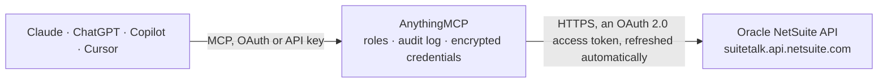

<!-- Generated by scripts/export-github-catalog.mjs in the anythingmcp-website repository. Do not edit by hand. -->

# Oracle NetSuite MCP connector

Let your AI work with Oracle NetSuite: run read-only SuiteQL queries over customers, vendors, items, transactions and the general ledger, read customers, vendors, employees, items, sales orders, … The AnythingMCP connector gives Claude, ChatGPT, Microsoft Copilot, Cursor and Gemini 17 MCP tools for Oracle NetSuite: 14 read and 3 can change data.

**Category:** [ERP](../erp.md) · **Tools:** 17 · **Setup guide:** [anythingmcp.com](https://anythingmcp.com/guides/netsuite-to-mcp) · [Deutsch](https://anythingmcp.com/de/guides/netsuite-to-mcp) · [Italiano](https://anythingmcp.com/it/guides/netsuite-to-mcp) · [Español](https://anythingmcp.com/es/guides/netsuite-to-mcp) · [日本語](https://anythingmcp.com/ja/guides/netsuite-to-mcp) · [Русский](https://anythingmcp.com/ru/guides/netsuite-to-mcp) · [中文](https://anythingmcp.com/zh/guides/netsuite-to-mcp)

## Start without code

No installation and no terminal: AnythingMCP Cloud runs the Oracle NetSuite connector for you, operated by helpcode.ai in Frankfurt, Germany.

1. **Click the button above** and create an account or sign in. The Oracle NetSuite connector opens, ready to install.
2. **Sign in with your Oracle NetSuite account** when AnythingMCP asks. The first time, an admin creates a small app in the Oracle NetSuite developer console. Every click is in the [step-by-step guide](https://anythingmcp.com/guides/netsuite-to-mcp).
3. **Click Install.** AnythingMCP shows the address of your MCP server.
4. **Add that address to your assistant:** [Claude](https://anythingmcp.com/guides/connect-netsuite-to-claude) · [ChatGPT](https://anythingmcp.com/guides/connect-netsuite-to-chatgpt) · [Microsoft Copilot](https://anythingmcp.com/guides/connect-netsuite-to-copilot) · [Cursor](https://anythingmcp.com/guides/connect-netsuite-to-cursor) · [Gemini CLI](https://anythingmcp.com/guides/connect-netsuite-to-gemini) · [Meta Muse](https://anythingmcp.com/guides/connect-netsuite-to-muse).
5. **Ask your first question**, for example: *What are the balance, overdueBalance and creditLimit for customer record with external id LACUS-001?*

Prefer help with the setup? [Talk to us](https://anythingmcp.com/contact).

## How it works

- **The AI client** speaks MCP (Streamable HTTP) to AnythingMCP and only sees tool names, descriptions and results. It never gets the Oracle NetSuite credentials.
- **AnythingMCP** checks the client's role, builds the call from the tool definition, adds the credentials (an OAuth 2.0 access token, refreshed automatically), calls Oracle NetSuite, logs the call and returns the result.
- **Oracle NetSuite** sees an ordinary API client with the rights of the account the credentials belong to.

## Tools

| Tool | What it does | Access |
|---|---|---|
| [`netsuite_suiteql_query`](#netsuite_suiteql_query) | Run one read-only SuiteQL query (NetSuite's SQL over the analytics schema), e.g. "SELECT id, companyname, email FROM customer WHERE isinactive = 'F' ORDER… | read |
| [`netsuite_list_record_types`](#netsuite_list_record_types) | List the record types the REST record API offers in this account (standard and custom, e.g. customer, salesOrder, inventoryItem, customrecord_...), each… | read |
| [`netsuite_describe_record_type`](#netsuite_describe_record_type) | Describe one record type as JSON Schema: every field with its type, title and whether it is read-only, the sublists and their line fields, and the account's… | read |
| [`netsuite_list_records`](#netsuite_list_records) | List the internal ids of one record type, optionally filtered with the record API's q syntax (field, operator, value), e.g. q = email START_WITH "anna",… | read |
| [`netsuite_get_record`](#netsuite_get_record) | Read any record by type and internal id (or eid:<external id>), e.g. contact, account, subsidiary, location, estimate, creditMemo, customerPayment,… | read |
| [`netsuite_get_customer`](#netsuite_get_customer) | Read one customer by internal id (or eid:<external id>): entityId, companyName or person name, email, phone, subsidiary, currency, terms, creditLimit,… | read |
| [`netsuite_get_vendor`](#netsuite_get_vendor) | Read one vendor by internal id (or eid:<external id>): entityId, companyName, email, phone, subsidiary, currency, terms, balance, category, isInactive and… | read |
| [`netsuite_get_employee`](#netsuite_get_employee) | Read one employee by internal id: entityId, name, email, title, department, location, subsidiary, supervisor, hireDate, isInactive and the fields the role… | read |
| [`netsuite_get_item`](#netsuite_get_item) | Read one item by its record type and internal id: itemId, displayName, description, prices, cost, units, quantities on hand where tracked, accounts and… | read |
| [`netsuite_get_sales_order`](#netsuite_get_sales_order) | Read one sales order by internal id: tranId, entity (customer), tranDate, status, orderStatus, currency, subtotal, total, shipping address and, with its… | read |
| [`netsuite_get_invoice`](#netsuite_get_invoice) | Read one customer invoice by internal id: tranId, entity, tranDate, dueDate, status, currency, subtotal, taxTotal, total, amountRemaining, createdFrom (the… | read |
| [`netsuite_get_purchase_order`](#netsuite_get_purchase_order) | Read one purchase order by internal id: tranId, entity (vendor), tranDate, status, currency, total, dueDate and, expanded by default, item.items[] (item,… | read |
| [`netsuite_get_vendor_bill`](#netsuite_get_vendor_bill) | Read one vendor bill by internal id: tranId, entity (vendor), tranDate, dueDate, status, currency, total, approvalStatus and, expanded by default,… | read |
| [`netsuite_get_journal_entry`](#netsuite_get_journal_entry) | Read one journal entry by internal id: tranId, tranDate, postingPeriod, subsidiary, currency, approved, memo and, expanded by default, line.items[]… | read |
| [`netsuite_create_customer`](#netsuite_create_customer) | Create a customer, a company (company_name) or a person (is_person true with first_name and last_name). | write |
| [`netsuite_create_sales_order`](#netsuite_create_sales_order) | Create a sales order for an existing customer, by default in status Pending Approval (A) so nothing is fulfilled before someone approves it. | write |
| [`netsuite_update_record`](#netsuite_update_record) | Change fields of an existing record of any type (PATCH): only the fields given are changed. | write |

## Tool reference

Every parameter as the AI client sees it in `tools/list`. Source: [`packages/backend/src/adapters/intl/netsuite.json`](../../../packages/backend/src/adapters/intl/netsuite.json).

### `netsuite_suiteql_query`

Run one read-only SuiteQL query (NetSuite's SQL over the analytics schema), e.g. "SELECT id, companyname, email FROM customer WHERE isinactive = 'F' ORDER BY id" or "SELECT BUILTIN.DF(entity) AS customer, SUM(foreigntotal) AS total FROM transaction WHERE type = 'CustInvc' AND trandate >= TO_DATE('2026-01-01', 'YYYY-MM-DD') GROUP BY BUILTIN.DF(entity)". Returns items[] (lowercase column names), count, hasMore, offset and totalResults. Up to 1000 rows per call and 100,000 per query; page with limit and offset.

**Access:** read · **Call:** `POST /query/v1/suiteql`

| Parameter | Type | Required | Description |
|---|---|---|---|
| `query` | string | yes | The SELECT statement. Tables: customer, vendor, employee, contact, item, account, subsidiary, department, classification, location, currency, accountingperiod, transaction, transactionline, transactionaccountingline. Use BUILTIN.DF(field) for display names, TO_DATE('YYYY-MM-DD', 'YYYY-MM-DD') for dates, 'T'/'F' for booleans, and ORDER BY a unique column when paging. |
| `limit` | integer | no | Rows per call, 1 to 1000 (default 100). |
| `offset` | integer | no | Rows to skip, a multiple of limit (default 0). The next page is offset + limit while hasMore is true. |

### `netsuite_list_record_types`

List the record types the REST record API offers in this account (standard and custom, e.g. customer, salesOrder, inventoryItem, customrecord_...), each with a link to its metadata. A cheap call to check that the connection works.

**Access:** read · **Call:** `GET /record/v1/metadata-catalog`

| Parameter | Type | Required | Description |
|---|---|---|---|
| `select` | string | no | Only these record types, comma separated, e.g. customer,salesOrder. |

### `netsuite_describe_record_type`

Describe one record type as JSON Schema: every field with its type, title and whether it is read-only, the sublists and their line fields, and the account's custom fields (custentity_, custbody_, custcol_). Large answer; use it to find field names before netsuite_create_customer, netsuite_update_record or a record read with fields.

**Access:** read · **Call:** `GET /record/v1/metadata-catalog/{record_type}`

| Parameter | Type | Required | Description |
|---|---|---|---|
| `record_type` | string | yes | The record type in camelCase, e.g. customer, salesOrder, invoice, vendorBill, inventoryItem. |

### `netsuite_list_records`

List the internal ids of one record type, optionally filtered with the record API's q syntax (field, operator, value), e.g. q = email START_WITH "anna", companyName CONTAIN "Acme", dateCreated ON_OR_AFTER "1/1/2026", or two conditions joined by AND. Returns items[] with id and links only, plus count, hasMore, offset and totalResults; read details with netsuite_get_record, or use netsuite_suiteql_query to get fields in one call.

**Access:** read · **Call:** `GET /record/v1/{record_type}`

| Parameter | Type | Required | Description |
|---|---|---|---|
| `record_type` | string | yes | The record type in camelCase, e.g. customer, salesOrder, invoice. |
| `q` | string | no | Filter, e.g. email START_WITH "anna". Operators include IS, IS_NOT, CONTAIN, START_WITH, EMPTY, EQUAL, GREATER, LESS, ON, BEFORE, AFTER, ON_OR_AFTER, ANY_OF. |
| `limit` | integer | no | Ids per call, 1 to 1000 (default 100). |
| `offset` | integer | no | Ids to skip, a multiple of limit (default 0). |

### `netsuite_get_record`

Read any record by type and internal id (or eid:<external id>), e.g. contact, account, subsidiary, location, estimate, creditMemo, customerPayment, itemFulfillment, or a custom record (customrecord_...). Sublists come as links unless expand_sub_resources is true.

**Access:** read · **Call:** `GET /record/v1/{record_type}/{id}`

| Parameter | Type | Required | Description |
|---|---|---|---|
| `record_type` | string | yes | The record type in camelCase, from netsuite_list_record_types. |
| `id` | string | yes | The internal id, e.g. "1234", or eid: followed by the external id. |
| `expand_sub_resources` | boolean | no | true to include sublists (lines, addresses, contacts) and subrecords in full (default false). |
| `fields` | string | no | Only these fields, comma separated, e.g. companyName,email,balance. |

### `netsuite_get_customer`

Read one customer by internal id (or eid:<external id>): entityId, companyName or person name, email, phone, subsidiary, currency, terms, creditLimit, balance, overdueBalance, salesRep, category, isInactive and custom fields. Addresses and contacts with expand_sub_resources.

**Access:** read · **Call:** `GET /record/v1/customer/{id}`

| Parameter | Type | Required | Description |
|---|---|---|---|
| `id` | string | yes | The customer's internal id, e.g. from SELECT id, companyname FROM customer. |
| `expand_sub_resources` | boolean | no | true to include the address book, contacts and other sublists in full (default false). |

### `netsuite_get_vendor`

Read one vendor by internal id (or eid:<external id>): entityId, companyName, email, phone, subsidiary, currency, terms, balance, category, isInactive and custom fields. Addresses and contacts with expand_sub_resources.

**Access:** read · **Call:** `GET /record/v1/vendor/{id}`

| Parameter | Type | Required | Description |
|---|---|---|---|
| `id` | string | yes | The vendor's internal id, e.g. from SELECT id, companyname FROM vendor. |
| `expand_sub_resources` | boolean | no | true to include the address book and other sublists in full (default false). |

### `netsuite_get_employee`

Read one employee by internal id: entityId, name, email, title, department, location, subsidiary, supervisor, hireDate, isInactive and the fields the role may see (salary fields need extra permissions).

**Access:** read · **Call:** `GET /record/v1/employee/{id}`

| Parameter | Type | Required | Description |
|---|---|---|---|
| `id` | string | yes | The employee's internal id, e.g. from SELECT id, firstname, lastname FROM employee. |

### `netsuite_get_item`

Read one item by its record type and internal id: itemId, displayName, description, prices, cost, units, quantities on hand where tracked, accounts and custom fields. The record type follows the item's kind: find it with SELECT id, itemid, itemtype, subtype FROM item (InvtPart → inventoryItem, Assembly → assemblyItem, Kit → kitItem, NonInvtPart with subtype Sale/Purchase/Resale → nonInventorySaleItem/nonInventoryPurchaseItem/nonInventoryResaleItem, Service → serviceSaleItem/servicePurchaseItem/serviceResaleItem, OthCharge → otherChargeSaleItem and so on, Discount → discountItem).

**Access:** read · **Call:** `GET /record/v1/{item_type}/{id}`

| Parameter | Type | Required | Description |
|---|---|---|---|
| `item_type` | string | yes | The item record type in camelCase, e.g. inventoryItem, nonInventorySaleItem, serviceSaleItem, assemblyItem, kitItem, discountItem. |
| `id` | string | yes | The item's internal id. |
| `expand_sub_resources` | boolean | no | true to include price levels, locations, vendors and other sublists in full (default false). |

### `netsuite_get_sales_order`

Read one sales order by internal id: tranId, entity (customer), tranDate, status, orderStatus, currency, subtotal, total, shipping address and, with its lines expanded by default, item.items[] (item, quantity, rate, amount, quantityFulfilled, quantityBilled).

**Access:** read · **Call:** `GET /record/v1/salesOrder/{id}`

| Parameter | Type | Required | Description |
|---|---|---|---|
| `id` | string | yes | The sales order's internal id, e.g. from SELECT id, tranid FROM transaction WHERE type = 'SalesOrd'. Not the document number (tranId). |
| `expand_lines` | boolean | no | Include the lines and other sublists in full (default true). |

### `netsuite_get_invoice`

Read one customer invoice by internal id: tranId, entity, tranDate, dueDate, status, currency, subtotal, taxTotal, total, amountRemaining, createdFrom (the sales order) and, expanded by default, item.items[] (item, quantity, rate, amount).

**Access:** read · **Call:** `GET /record/v1/invoice/{id}`

| Parameter | Type | Required | Description |
|---|---|---|---|
| `id` | string | yes | The invoice's internal id, e.g. from SELECT id, tranid FROM transaction WHERE type = 'CustInvc'. |
| `expand_lines` | boolean | no | Include the lines and other sublists in full (default true). |

### `netsuite_get_purchase_order`

Read one purchase order by internal id: tranId, entity (vendor), tranDate, status, currency, total, dueDate and, expanded by default, item.items[] (item, quantity, rate, amount, quantityReceived, quantityBilled) and expense.items[].

**Access:** read · **Call:** `GET /record/v1/purchaseOrder/{id}`

| Parameter | Type | Required | Description |
|---|---|---|---|
| `id` | string | yes | The purchase order's internal id, e.g. from SELECT id, tranid FROM transaction WHERE type = 'PurchOrd'. |
| `expand_lines` | boolean | no | Include the lines and other sublists in full (default true). |

### `netsuite_get_vendor_bill`

Read one vendor bill by internal id: tranId, entity (vendor), tranDate, dueDate, status, currency, total, approvalStatus and, expanded by default, item.items[] and expense.items[] (account, amount, memo, department, class).

**Access:** read · **Call:** `GET /record/v1/vendorBill/{id}`

| Parameter | Type | Required | Description |
|---|---|---|---|
| `id` | string | yes | The bill's internal id, e.g. from SELECT id, tranid FROM transaction WHERE type = 'VendBill'. |
| `expand_lines` | boolean | no | Include the lines and other sublists in full (default true). |

### `netsuite_get_journal_entry`

Read one journal entry by internal id: tranId, tranDate, postingPeriod, subsidiary, currency, approved, memo and, expanded by default, line.items[] (account, debit, credit, memo, entity, department, class, location).

**Access:** read · **Call:** `GET /record/v1/journalEntry/{id}`

| Parameter | Type | Required | Description |
|---|---|---|---|
| `id` | string | yes | The journal entry's internal id, e.g. from SELECT id, tranid FROM transaction WHERE type = 'Journal'. |
| `expand_lines` | boolean | no | Include the lines in full (default true). |

### `netsuite_create_customer`

Create a customer, a company (company_name) or a person (is_person true with first_name and last_name). In a OneWorld account pass subsidiary. NetSuite answers 204 without a body; the location header holds the new record's URL, whose last part is the internal id. Confirm the details with the user first.

**Access:** write · **Call:** `POST /record/v1/customer`

| Parameter | Type | Required | Description |
|---|---|---|---|
| `company_name` | string | no | Company name, for a business customer. |
| `is_person` | boolean | no | true for an individual; then first_name and last_name are used instead of company_name. |
| `first_name` | string | no | First name, for an individual. |
| `last_name` | string | no | Last name, for an individual. |
| `email` | string | no | Email address. |
| `phone` | string | no | Phone number. |
| `subsidiary` | object | no | The subsidiary as {"id": "<internal id>"}; required in OneWorld accounts (SELECT id, name FROM subsidiary). |
| `external_id` | string | no | Your own unique key for the customer, readable later as eid:<value>. |
| `fields` | object | no | Further fields in record API form, e.g. {"currency": {"id": "1"}, "terms": {"id": "2"}, "comments": "...", "custentity_region": "EU"}. Field names from netsuite_describe_record_type. |

### `netsuite_create_sales_order`

Create a sales order for an existing customer, by default in status Pending Approval (A) so nothing is fulfilled before someone approves it. NetSuite answers 204 without a body; the location header holds the new order's URL, whose last part is the internal id. Confirm customer, items, quantities and prices with the user first. Installed switched off.

**Access:** write · **Call:** `POST /record/v1/salesOrder`

| Parameter | Type | Required | Description |
|---|---|---|---|
| `customer_id` | string | yes | The customer's internal id. |
| `lines` | object[] | yes | The item lines in record API form, e.g. [{"item": {"id": "45"}, "quantity": 2, "rate": 19.5}]. Without rate NetSuite uses the item's price for the customer. |
| `tran_date` | string | no | Order date, YYYY-MM-DD (default today). |
| `po_number` | string | no | The customer's purchase order number (otherRefNum). |
| `memo` | string | no | Memo on the order. |
| `order_status` | `A` \| `B` | no | A = Pending Approval (default), B = Pending Fulfillment. |
| `fields` | object | no | Further header fields in record API form, e.g. {"location": {"id": "3"}, "department": {"id": "5"}, "shipMethod": {"id": "7"}}. |

### `netsuite_update_record`

Change fields of an existing record of any type (PATCH): only the fields given are changed. Sublist lines given are added or updated, not replaced. Changes to posted transactions affect the books, so read the record first and confirm every change with the user. Installed switched off.

**Access:** write · **Call:** `PATCH /record/v1/{record_type}/{id}`

| Parameter | Type | Required | Description |
|---|---|---|---|
| `record_type` | string | yes | The record type in camelCase, e.g. customer, vendor, salesOrder. |
| `id` | string | yes | The internal id, or eid: followed by the external id. |
| `fields` | object | yes | The fields to change in record API form, e.g. {"email": "ap@example.com", "terms": {"id": "2"}}. |

## Run it yourself

AnythingMCP is open source (AGPL-3.0). [Run it with Docker](../../../README.md#run-it-yourself), open **Connectors → Store**, pick **Oracle NetSuite** and enter `NETSUITE_ACCOUNT_ID`, `NETSUITE_CLIENT_ID`, `NETSUITE_CLIENT_SECRET`, then add your MCP server URL to the AI client.

[← ERP connectors](../erp.md) · [All categories](../README.md)
