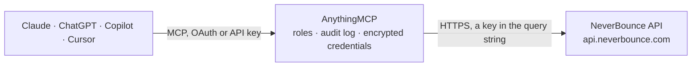

<!-- Generated by scripts/export-github-catalog.mjs in the anythingmcp-website repository. Do not edit by hand. -->

# NeverBounce MCP connector

Validate single emails or run bulk-list verification jobs via NeverBounce. 6 tools, query-string API-key auth. The AnythingMCP connector gives Claude, ChatGPT, Microsoft Copilot, Cursor and Gemini 6 MCP tools for NeverBounce: 5 read and 1 can change data.

**Category:** [Data Enrichment](../enrichment.md) · **Tools:** 6 · **Setup guide:** [anythingmcp.com](https://anythingmcp.com/guides/neverbounce-to-mcp) · [Deutsch](https://anythingmcp.com/de/guides/neverbounce-to-mcp) · [Italiano](https://anythingmcp.com/it/guides/neverbounce-to-mcp) · [Español](https://anythingmcp.com/es/guides/neverbounce-to-mcp) · [日本語](https://anythingmcp.com/ja/guides/neverbounce-to-mcp) · [Русский](https://anythingmcp.com/ru/guides/neverbounce-to-mcp) · [中文](https://anythingmcp.com/zh/guides/neverbounce-to-mcp)

## Start without code

No installation and no terminal: AnythingMCP Cloud runs the NeverBounce connector for you, operated by helpcode.ai in Frankfurt, Germany.

1. **Click the button above** and create an account or sign in. The NeverBounce connector opens, ready to install.
2. **Paste the API key or token from your NeverBounce account.** Every click is in the [step-by-step guide](https://anythingmcp.com/guides/neverbounce-to-mcp).
3. **Click Install.** AnythingMCP shows the address of your MCP server.
4. **Add that address to your assistant:** [Claude](https://anythingmcp.com/guides/connect-neverbounce-to-claude) · [ChatGPT](https://anythingmcp.com/guides/connect-neverbounce-to-chatgpt) · [Microsoft Copilot](https://anythingmcp.com/guides/connect-neverbounce-to-copilot) · [Cursor](https://anythingmcp.com/guides/connect-neverbounce-to-cursor) · [Gemini CLI](https://anythingmcp.com/guides/connect-neverbounce-to-gemini) · [Meta Muse](https://anythingmcp.com/guides/connect-neverbounce-to-muse).
5. **Ask your first question**, for example: *Verify the email for customer support contact anna.keller@solariacorp.de now, any suggested correction?*

Prefer help with the setup? [Talk to us](https://anythingmcp.com/contact).

## How it works

- **The AI client** speaks MCP (Streamable HTTP) to AnythingMCP and only sees tool names, descriptions and results. It never gets the NeverBounce credentials.
- **AnythingMCP** checks the client's role, builds the call from the tool definition, adds the credentials (a key in the query string), calls NeverBounce, logs the call and returns the result.
- **NeverBounce** sees an ordinary API client with the rights of the account the credentials belong to.

## Tools

| Tool | What it does | Access |
|---|---|---|
| [`neverbounce_account_info`](#neverbounce_account_info) | Return account credit balance and details. | read |
| [`neverbounce_single_check`](#neverbounce_single_check) | Verify a single email synchronously. | read |
| [`neverbounce_create_job`](#neverbounce_create_job) | Create a bulk verification job. | write |
| [`neverbounce_job_status`](#neverbounce_job_status) | Poll the status of a bulk verification job. | read |
| [`neverbounce_job_results`](#neverbounce_job_results) | Fetch verification results for a complete job, paginated. | read |
| [`neverbounce_jobs_search`](#neverbounce_jobs_search) | Search past jobs by status, name, date. | read |

## Tool reference

Every parameter as the AI client sees it in `tools/list`. Source: [`packages/backend/src/adapters/intl/neverbounce.json`](../../../packages/backend/src/adapters/intl/neverbounce.json).

### `neverbounce_account_info`

Return account credit balance and details. Use to check remaining credits before bulk operations.

**Access:** read · **Call:** `GET /account/info`

No parameters.

### `neverbounce_single_check`

Verify a single email synchronously. Returns result (valid/invalid/disposable/catchall/unknown), flags (has_dns_mx, smtp_connectable, etc.), suggested_correction (typo fix).

**Access:** read · **Call:** `GET /single/check`

| Parameter | Type | Required | Description |
|---|---|---|---|
| `email` | string | yes | Email to verify. |
| `address_info` | integer | no | 1 = also return parsed address parts. |
| `credits_info` | integer | no | 1 = also return remaining credits in response. |
| `timeout` | integer | no | Max seconds for the check (3-30, default 10). |

### `neverbounce_create_job`

Create a bulk verification job. input.payload is either an array of {email,name?,id?} (max 1k inline) OR a URL to a CSV file. Set auto_parse=true and run_sample=false + auto_start=true to skip the manual parse+start steps.

**Access:** write · **Call:** `POST /jobs/create`

| Parameter | Type | Required | Description |
|---|---|---|---|
| `input_location` | string | yes | 'supplied' (inline array) or 'remote_url' (CSV at the URL). |
| `input` | any | yes | If input_location=supplied: array of {email,name?,id?} objects. If remote_url: the URL string. |
| `filename` | string | no | Optional friendly name for the job. |
| `auto_parse` | boolean | no | If true, NeverBounce auto-parses the input — saves a separate /jobs/parse call. |
| `auto_start` | boolean | no | If true, the job runs immediately after parse. |
| `run_sample` | boolean | no | If true, NeverBounce runs the first ~1000 first as a sample to estimate credit usage. |
| `allow_manual_review` | boolean | no | If true, low-confidence items go to manual review (slower, higher accuracy). |

### `neverbounce_job_status`

Poll the status of a bulk verification job. Returns job_status (queued/waiting/working/complete/failed/parsing/manual_review), progress (0-100), total/processed/valid/invalid counts.

**Access:** read · **Call:** `GET /jobs/status`

| Parameter | Type | Required | Description |
|---|---|---|---|
| `job_id` | integer | yes | Job ID returned by create_job. |

### `neverbounce_job_results`

Fetch verification results for a complete job, paginated. Each result row has email, name, id (your input ID), verification (result code), flags[].

**Access:** read · **Call:** `GET /jobs/results`

| Parameter | Type | Required | Description |
|---|---|---|---|
| `job_id` | integer | yes | Job ID. |
| `page` | integer | no | 1-based page. |
| `items_per_page` | integer | no | Default 10, max 1000. |

### `neverbounce_jobs_search`

Search past jobs by status, name, date. Useful to find historical verification runs.

**Access:** read · **Call:** `GET /jobs/search`

| Parameter | Type | Required | Description |
|---|---|---|---|
| `job_id` | integer | no | Exact job ID. |
| `filename` | string | no | Filename substring. |
| `job_status` | string | no | queued, waiting, working, complete, failed, parsing. |
| `page` | integer | no | Page. |
| `items_per_page` | integer | no | Per page. |

## Run it yourself

AnythingMCP is open source (AGPL-3.0). [Run it with Docker](../../../README.md#run-it-yourself), open **Connectors → Store**, pick **NeverBounce** and enter `NEVERBOUNCE_API_KEY`, then add your MCP server URL to the AI client.

[← Data Enrichment connectors](../enrichment.md) · [All categories](../README.md)
