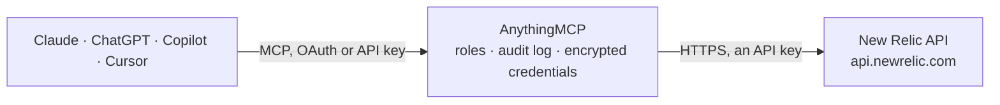

<!-- Generated by scripts/export-github-catalog.mjs in the anythingmcp-website repository. Do not edit by hand. -->

# New Relic MCP connector

Query New Relic (NRQL, alerts, incidents, dashboards, deployments, entities) from any AI agent via NerdGraph + REST. 7 tools, API-key auth. The AnythingMCP connector gives Claude, ChatGPT, Microsoft Copilot, Cursor and Gemini 7 MCP tools for New Relic: 3 read and 4 can change data.

**Category:** [Monitoring](../monitoring.md) · **Tools:** 7 · **Setup guide:** [anythingmcp.com](https://anythingmcp.com/guides/new-relic-to-mcp) · [Deutsch](https://anythingmcp.com/de/guides/new-relic-to-mcp) · [Italiano](https://anythingmcp.com/it/guides/new-relic-to-mcp) · [Español](https://anythingmcp.com/es/guides/new-relic-to-mcp) · [日本語](https://anythingmcp.com/ja/guides/new-relic-to-mcp) · [Русский](https://anythingmcp.com/ru/guides/new-relic-to-mcp) · [中文](https://anythingmcp.com/zh/guides/new-relic-to-mcp)

## Start without code

No installation and no terminal: AnythingMCP Cloud runs the New Relic connector for you, operated by helpcode.ai in Frankfurt, Germany.

1. **Click the button above** and create an account or sign in. The New Relic connector opens, ready to install.
2. **Paste the API key or token from your New Relic account.** Every click is in the [step-by-step guide](https://anythingmcp.com/guides/new-relic-to-mcp).
3. **Click Install.** AnythingMCP shows the address of your MCP server.
4. **Add that address to your assistant:** [Claude](https://anythingmcp.com/guides/connect-new-relic-to-claude) · [ChatGPT](https://anythingmcp.com/guides/connect-new-relic-to-chatgpt) · [Microsoft Copilot](https://anythingmcp.com/guides/connect-new-relic-to-copilot) · [Cursor](https://anythingmcp.com/guides/connect-new-relic-to-cursor) · [Gemini CLI](https://anythingmcp.com/guides/connect-new-relic-to-gemini) · [Meta Muse](https://anythingmcp.com/guides/connect-new-relic-to-muse).
5. **Ask your first question**, for example: *What's the entity GUID and current reporting status for our APM app PaymentsAPI in account 82213?*

Prefer help with the setup? [Talk to us](https://anythingmcp.com/contact).

## How it works

- **The AI client** speaks MCP (Streamable HTTP) to AnythingMCP and only sees tool names, descriptions and results. It never gets the New Relic credentials.
- **AnythingMCP** checks the client's role, builds the call from the tool definition, adds the credentials (an API key), calls New Relic, logs the call and returns the result.
- **New Relic** sees an ordinary API client with the rights of the account the credentials belong to.

## Tools

| Tool | What it does | Access |
|---|---|---|
| [`new_relic_run_nrql`](#new_relic_run_nrql) | Run an NRQL (New Relic Query Language) query against an account. | write |
| [`new_relic_graphql_query`](#new_relic_graphql_query) | Run an arbitrary NerdGraph (GraphQL) query/mutation. | write |
| [`new_relic_search_entities`](#new_relic_search_entities) | Find entities (services, hosts, browsers, mobile apps, dashboards, workloads) by name + domain + type. | read |
| [`new_relic_get_entity`](#new_relic_get_entity) | Fetch an entity by GUID — returns the full entity payload (golden metrics, golden tags, recent issues for APM apps). | read |
| [`new_relic_list_deployments`](#new_relic_list_deployments) | List recent deployments recorded for an APM application via the legacy REST API. | read |
| [`new_relic_create_deployment`](#new_relic_create_deployment) | Record a deployment marker on an APM application's chart. | write |
| [`new_relic_recent_incidents`](#new_relic_recent_incidents) | List recent open incidents for an account from the AI/AIops issue stream. | write |

## Tool reference

Every parameter as the AI client sees it in `tools/list`. Source: [`packages/backend/src/adapters/intl/new-relic.json`](../../../packages/backend/src/adapters/intl/new-relic.json).

### `new_relic_run_nrql`

Run an NRQL (New Relic Query Language) query against an account. Wraps the NerdGraph actor.account.nrql.results pattern — much simpler than authoring raw GraphQL. Use this for 'how many errors in the last hour by service' etc.

**Access:** write · **Call:** `POST /graphql`

| Parameter | Type | Required | Description |
|---|---|---|---|
| `account_id` | integer | yes | New Relic account ID. |
| `nrql` | string | yes | NRQL query, e.g. 'SELECT count(*) FROM Transaction SINCE 1 hour ago FACET appName'. |

### `new_relic_graphql_query`

Run an arbitrary NerdGraph (GraphQL) query/mutation. Use this when run_nrql isn't enough — for entity search, dashboards, workloads, etc.

**Access:** write · **Call:** `POST /graphql`

| Parameter | Type | Required | Description |
|---|---|---|---|
| `query` | string | yes | GraphQL document. |
| `variables` | object | no | Variables map. |

### `new_relic_search_entities`

Find entities (services, hosts, browsers, mobile apps, dashboards, workloads) by name + domain + type. Returns entity GUID, name, accountId, alertSeverity, reporting status.

**Access:** read · **Call:** `POST /graphql`

| Parameter | Type | Required | Description |
|---|---|---|---|
| `query_string` | string | yes | Entity search query, e.g. "name LIKE 'api%' AND domain = 'APM'". |

### `new_relic_get_entity`

Fetch an entity by GUID — returns the full entity payload (golden metrics, golden tags, recent issues for APM apps).

**Access:** read · **Call:** `POST /graphql`

| Parameter | Type | Required | Description |
|---|---|---|---|
| `guid` | string | yes | Entity GUID from entitySearch. |

### `new_relic_list_deployments`

List recent deployments recorded for an APM application via the legacy REST API. Returns each deployment's id, revision, description, user, timestamp.

**Access:** read · **Call:** `GET /v2/applications/{application_id}/deployments.json`

| Parameter | Type | Required | Description |
|---|---|---|---|
| `application_id` | integer | yes | Legacy APM application numeric ID (NOT entity GUID). |

### `new_relic_create_deployment`

Record a deployment marker on an APM application's chart. Useful for correlating regressions with releases.

**Access:** write · **Call:** `POST /v2/applications/{application_id}/deployments.json`

| Parameter | Type | Required | Description |
|---|---|---|---|
| `application_id` | integer | yes | Legacy APM application numeric ID. |
| `revision` | string | yes | Version / git SHA / build number. |
| `description` | string | no | What changed. |
| `user` | string | no | Who deployed (free-text). |
| `changelog` | string | no | Optional release notes. |

### `new_relic_recent_incidents`

List recent open incidents for an account from the AI/AIops issue stream.

**Access:** write · **Call:** `POST /graphql`

| Parameter | Type | Required | Description |
|---|---|---|---|
| `account_id` | integer | yes | Account ID. |

## Run it yourself

AnythingMCP is open source (AGPL-3.0). [Run it with Docker](../../../README.md#run-it-yourself), open **Connectors → Store**, pick **New Relic** and enter `NEW_RELIC_USER_KEY`, then add your MCP server URL to the AI client.

[← Monitoring connectors](../monitoring.md) · [All categories](../README.md)
