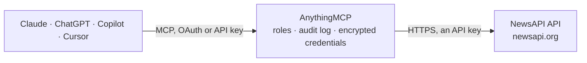

<!-- Generated by scripts/export-github-catalog.mjs in the anythingmcp-website repository. Do not edit by hand. -->

# NewsAPI MCP connector

Search worldwide news headlines, sources and articles from newsapi.org via any AI agent. 3 tools, API-key auth. The AnythingMCP connector gives Claude, ChatGPT, Microsoft Copilot, Cursor and Gemini 3 MCP tools for NewsAPI, all read-only.

**Category:** [Public Data](../data.md) · **Tools:** 3 · **Setup guide:** [anythingmcp.com](https://anythingmcp.com/guides/newsapi-to-mcp) · [Deutsch](https://anythingmcp.com/de/guides/newsapi-to-mcp) · [Italiano](https://anythingmcp.com/it/guides/newsapi-to-mcp) · [Español](https://anythingmcp.com/es/guides/newsapi-to-mcp) · [日本語](https://anythingmcp.com/ja/guides/newsapi-to-mcp) · [Русский](https://anythingmcp.com/ru/guides/newsapi-to-mcp) · [中文](https://anythingmcp.com/zh/guides/newsapi-to-mcp)

## Start without code

No installation and no terminal: AnythingMCP Cloud runs the NewsAPI connector for you, operated by helpcode.ai in Frankfurt, Germany.

1. **Click the button above** and create an account or sign in. The NewsAPI connector opens, ready to install.
2. **Paste the API key or token from your NewsAPI account.** Every click is in the [step-by-step guide](https://anythingmcp.com/guides/newsapi-to-mcp).
3. **Click Install.** AnythingMCP shows the address of your MCP server.
4. **Add that address to your assistant:** [Claude](https://anythingmcp.com/guides/connect-newsapi-to-claude) · [ChatGPT](https://anythingmcp.com/guides/connect-newsapi-to-chatgpt) · [Microsoft Copilot](https://anythingmcp.com/guides/connect-newsapi-to-copilot) · [Cursor](https://anythingmcp.com/guides/connect-newsapi-to-cursor) · [Gemini CLI](https://anythingmcp.com/guides/connect-newsapi-to-gemini) · [Meta Muse](https://anythingmcp.com/guides/connect-newsapi-to-muse).
5. **Ask your first question**, for example: *Any recent news about 'Nordic Solar Oy' mentioning supply delays in October 2026? Return latest article.*

Prefer help with the setup? [Talk to us](https://anythingmcp.com/contact).

## How it works

- **The AI client** speaks MCP (Streamable HTTP) to AnythingMCP and only sees tool names, descriptions and results. It never gets the NewsAPI credentials.
- **AnythingMCP** checks the client's role, builds the call from the tool definition, adds the credentials (an API key), calls NewsAPI, logs the call and returns the result.
- **NewsAPI** sees an ordinary API client with the rights of the account the credentials belong to.

## Tools

| Tool | What it does | Access |
|---|---|---|
| [`newsapi_everything`](#newsapi_everything) | Full-archive search across millions of articles from 80k+ sources. | read |
| [`newsapi_top_headlines`](#newsapi_top_headlines) | Breaking news headlines. | read |
| [`newsapi_sources`](#newsapi_sources) | List all news sources NewsAPI tracks. | read |

## Tool reference

Every parameter as the AI client sees it in `tools/list`. Source: [`packages/backend/src/adapters/intl/newsapi.json`](../../../packages/backend/src/adapters/intl/newsapi.json).

### `newsapi_everything`

Full-archive search across millions of articles from 80k+ sources. Use this when the user wants 'articles about X' or 'news mentioning Y this week'. Requires at least one of `q`, `qInTitle`, `sources`, or `domains`.

**Access:** read · **Call:** `GET /everything`

| Parameter | Type | Required | Description |
|---|---|---|---|
| `q` | string | no | Keywords/phrases. Supports AND/OR/NOT, quotes, parentheses. |
| `qInTitle` | string | no | Same as `q` but only matches against the article title. |
| `sources` | string | no | Comma-separated source IDs (e.g. 'bbc-news,the-verge'). Find IDs via newsapi_sources. |
| `domains` | string | no | Comma-separated domains (e.g. 'bbc.co.uk,nytimes.com'). |
| `excludeDomains` | string | no | Comma-separated domains to EXCLUDE. |
| `from` | string | no | ISO 8601 date or datetime. Oldest article date. |
| `to` | string | no | ISO 8601 date or datetime. Newest article date. |
| `language` | string | no | ISO-639-1: en, it, de, es, fr, ... |
| `sortBy` | string | no | 'relevancy', 'popularity', 'publishedAt'. Default 'publishedAt'. |
| `pageSize` | integer | no | Results per page (1-100). Default 100. |
| `page` | integer | no | 1-based page index. |

### `newsapi_top_headlines`

Breaking news headlines. Filter by `country` + `category` for a country front-page, OR by `sources` for specific outlets, OR by `q` for a topic. You CANNOT combine `country`/`category` with `sources` in one call.

**Access:** read · **Call:** `GET /top-headlines`

| Parameter | Type | Required | Description |
|---|---|---|---|
| `country` | string | no | 2-letter ISO 3166-1 (e.g. 'us', 'it', 'de'). Cannot be used with `sources`. |
| `category` | string | no | business, entertainment, general, health, science, sports, technology. Cannot be used with `sources`. |
| `sources` | string | no | Comma-separated source IDs. Cannot be used with `country`/`category`. |
| `q` | string | no | Keywords/phrases. |
| `pageSize` | integer | no | 1-100. |
| `page` | integer | no | 1-based. |

### `newsapi_sources`

List all news sources NewsAPI tracks. Returns each source's id (used by other endpoints), name, description, url, category, language, country.

**Access:** read · **Call:** `GET /top-headlines/sources`

| Parameter | Type | Required | Description |
|---|---|---|---|
| `category` | string | no | Filter by category. |
| `language` | string | no | ISO-639-1. |
| `country` | string | no | 2-letter ISO 3166-1. |

## Run it yourself

AnythingMCP is open source (AGPL-3.0). [Run it with Docker](../../../README.md#run-it-yourself), open **Connectors → Store**, pick **NewsAPI** and enter `NEWSAPI_API_KEY`, then add your MCP server URL to the AI client.

[← Public Data connectors](../data.md) · [All categories](../README.md)
