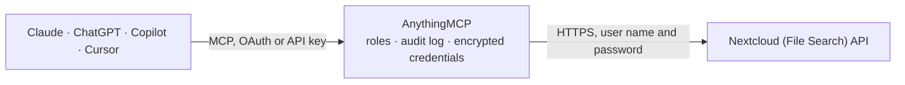

<!-- Generated by scripts/export-github-catalog.mjs in the anythingmcp-website repository. Do not edit by hand. -->

# Nextcloud (File Search) MCP connector

Search inside the files of a Nextcloud from your AI client over WebDAV with an app password: full-text index of PDF, Excel, Word and Outlook files, synced in the background. The AnythingMCP connector gives Claude, ChatGPT, Microsoft Copilot, Cursor and Gemini 10 MCP tools for Nextcloud (File Search).

**Category:** [File Storage](../storage.md) · **Tools:** 10 · **Setup guide:** [anythingmcp.com](https://anythingmcp.com/marketplace/nextcloud-file-search)

## Start without code

No installation and no terminal: AnythingMCP Cloud runs the Nextcloud (File Search) connector for you, operated by helpcode.ai in Frankfurt, Germany.

1. **Click the button above** and create an account or sign in. The Nextcloud (File Search) connector opens, ready to install.
2. **Paste the API key or token from your Nextcloud (File Search) account.** Every click is in the [step-by-step guide](https://anythingmcp.com/marketplace/nextcloud-file-search).
3. **Click Install.** AnythingMCP shows the address of your MCP server.
4. **Add that address to your assistant:** [Claude](https://anythingmcp.com/guides/connect-nextcloud-file-search-to-claude) · [ChatGPT](https://anythingmcp.com/guides/connect-nextcloud-file-search-to-chatgpt) · [Microsoft Copilot](https://anythingmcp.com/guides/connect-nextcloud-file-search-to-copilot) · [Cursor](https://anythingmcp.com/guides/connect-nextcloud-file-search-to-cursor) · [Gemini CLI](https://anythingmcp.com/guides/connect-nextcloud-file-search-to-gemini) · [Meta Muse](https://anythingmcp.com/guides/connect-nextcloud-file-search-to-muse).
5. **Ask your first question**, for example: *Where is the signed contract for customer 'Bergström Elektro AB'—I need the PDF from 2026-02-18, contract number C-2026-014.*

Prefer help with the setup? [Talk to us](https://anythingmcp.com/contact).

## How it works

- **The AI client** speaks MCP (Streamable HTTP) to AnythingMCP and only sees tool names, descriptions and results. It never gets the Nextcloud (File Search) credentials.
- **AnythingMCP** checks the client's role, builds the call from the tool definition, adds the credentials (user name and password), calls Nextcloud (File Search), logs the call and returns the result.
- **Nextcloud (File Search)** sees an ordinary API client with the rights of the account the credentials belong to.

## Run it yourself

AnythingMCP is open source (AGPL-3.0). [Run it with Docker](../../../README.md#run-it-yourself), open **Connectors → Store**, pick **Nextcloud (File Search)**, then add your MCP server URL to the AI client.

[← File Storage connectors](../storage.md) · [All categories](../README.md)
