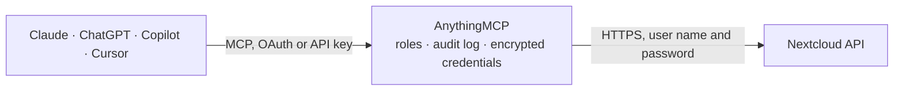

<!-- Generated by scripts/export-github-catalog.mjs in the anythingmcp-website repository. Do not edit by hand. -->

# Nextcloud MCP connector

Nextcloud OCS API: users, groups, file shares, app capabilities and server status on your own Nextcloud. The AnythingMCP connector gives Claude, ChatGPT, Microsoft Copilot, Cursor and Gemini 9 MCP tools for Nextcloud: 8 read and 1 can change data.

**Category:** [File Storage](../storage.md) · **Tools:** 9 · **Setup guide:** [anythingmcp.com](https://anythingmcp.com/guides/nextcloud-to-mcp) · [Deutsch](https://anythingmcp.com/de/guides/nextcloud-to-mcp) · [Italiano](https://anythingmcp.com/it/guides/nextcloud-to-mcp) · [Español](https://anythingmcp.com/es/guides/nextcloud-to-mcp) · [日本語](https://anythingmcp.com/ja/guides/nextcloud-to-mcp) · [Русский](https://anythingmcp.com/ru/guides/nextcloud-to-mcp) · [中文](https://anythingmcp.com/zh/guides/nextcloud-to-mcp)

## Start without code

No installation and no terminal: AnythingMCP Cloud runs the Nextcloud connector for you, operated by helpcode.ai in Frankfurt, Germany.

1. **Click the button above** and create an account or sign in. The Nextcloud connector opens, ready to install.
2. **Paste the API key or token from your Nextcloud account.** Every click is in the [step-by-step guide](https://anythingmcp.com/guides/nextcloud-to-mcp).
3. **Click Install.** AnythingMCP shows the address of your MCP server.
4. **Add that address to your assistant:** [Claude](https://anythingmcp.com/guides/connect-nextcloud-to-claude) · [ChatGPT](https://anythingmcp.com/guides/connect-nextcloud-to-chatgpt) · [Microsoft Copilot](https://anythingmcp.com/guides/connect-nextcloud-to-copilot) · [Cursor](https://anythingmcp.com/guides/connect-nextcloud-to-cursor) · [Gemini CLI](https://anythingmcp.com/guides/connect-nextcloud-to-gemini) · [Meta Muse](https://anythingmcp.com/guides/connect-nextcloud-to-muse).
5. **Ask your first question**, for example: *What's the account status for user marta.hernandez on our Nextcloud? I need quota, used and last login.*

Prefer help with the setup? [Talk to us](https://anythingmcp.com/contact).

## How it works

- **The AI client** speaks MCP (Streamable HTTP) to AnythingMCP and only sees tool names, descriptions and results. It never gets the Nextcloud credentials.
- **AnythingMCP** checks the client's role, builds the call from the tool definition, adds the credentials (user name and password), calls Nextcloud, logs the call and returns the result.
- **Nextcloud** sees an ordinary API client with the rights of the account the credentials belong to.

## Tools

| Tool | What it does | Access |
|---|---|---|
| [`nextcloud_get_capabilities`](#nextcloud_get_capabilities) | Read the server's capabilities: Nextcloud version, enabled apps and their feature flags. | read |
| [`nextcloud_get_user_status`](#nextcloud_get_user_status) | Read the status of the account the app password belongs to: quota, used space, display name, e-mail, groups and last login. | read |
| [`nextcloud_list_users`](#nextcloud_list_users) | List user ids on the instance, optionally filtered by a search fragment. | read |
| [`nextcloud_get_user`](#nextcloud_get_user) | Read one user's details: display name, e-mail, quota, group memberships, last login and whether the account is enabled. | read |
| [`nextcloud_list_groups`](#nextcloud_list_groups) | List the groups defined on the instance, optionally filtered by a search fragment. | read |
| [`nextcloud_list_group_members`](#nextcloud_list_group_members) | List the user ids in one group — who actually has access to whatever is shared with that group. | read |
| [`nextcloud_list_shares`](#nextcloud_list_shares) | List shares the account owns or received, with their type, recipient, permissions, expiry and public link URL. | read |
| [`nextcloud_get_share`](#nextcloud_get_share) | Read one share by its id: exactly who it is shared with, at what permission level, and when it expires. | read |
| [`nextcloud_create_share`](#nextcloud_create_share) | Create a share. | write |

## Tool reference

Every parameter as the AI client sees it in `tools/list`. Source: [`packages/backend/src/adapters/intl/nextcloud.json`](../../../packages/backend/src/adapters/intl/nextcloud.json).

### `nextcloud_get_capabilities`

Read the server's capabilities: Nextcloud version, enabled apps and their feature flags. Works for any authenticated user — the quickest proof the app password is accepted.

**Access:** read · **Call:** `GET /ocs/v2.php/cloud/capabilities`

No parameters.

### `nextcloud_get_user_status`

Read the status of the account the app password belongs to: quota, used space, display name, e-mail, groups and last login.

**Access:** read · **Call:** `GET /ocs/v2.php/cloud/user`

No parameters.

### `nextcloud_list_users`

List user ids on the instance, optionally filtered by a search fragment. Requires an administrator or group-admin account.

**Access:** read · **Call:** `GET /ocs/v1.php/cloud/users`

| Parameter | Type | Required | Description |
|---|---|---|---|
| `search` | string | no | Fragment matched against user id and display name. |
| `limit` | number | no | Maximum ids to return. |
| `offset` | number | no | Ids to skip, for paging. |

### `nextcloud_get_user`

Read one user's details: display name, e-mail, quota, group memberships, last login and whether the account is enabled. Admin only.

**Access:** read · **Call:** `GET /ocs/v1.php/cloud/users/{userId}`

| Parameter | Type | Required | Description |
|---|---|---|---|
| `userId` | string | yes | Nextcloud user id (the login name). |

### `nextcloud_list_groups`

List the groups defined on the instance, optionally filtered by a search fragment. Requires an administrator account.

**Access:** read · **Call:** `GET /ocs/v1.php/cloud/groups`

| Parameter | Type | Required | Description |
|---|---|---|---|
| `search` | string | no | Fragment matched against the group id. |
| `limit` | number | no | Maximum groups to return. |
| `offset` | number | no | Groups to skip, for paging. |

### `nextcloud_list_group_members`

List the user ids in one group — who actually has access to whatever is shared with that group.

**Access:** read · **Call:** `GET /ocs/v1.php/cloud/groups/{groupId}`

| Parameter | Type | Required | Description |
|---|---|---|---|
| `groupId` | string | yes | Group id. |

### `nextcloud_list_shares`

List shares the account owns or received, with their type, recipient, permissions, expiry and public link URL.

**Access:** read · **Call:** `GET /ocs/v2.php/apps/files_sharing/api/v1/shares`

| Parameter | Type | Required | Description |
|---|---|---|---|
| `path` | string | no | Restrict to shares of one path, relative to the user's files root, e.g. /Projects/Acme. |
| `reshares` | boolean | no | When true, include shares made by other users of the same file. |
| `shared_with_me` | boolean | no | When true, list shares received rather than shares made. |
| `subfiles` | boolean | no | When true and path is a folder, list shares of its children. |

### `nextcloud_get_share`

Read one share by its id: exactly who it is shared with, at what permission level, and when it expires.

**Access:** read · **Call:** `GET /ocs/v2.php/apps/files_sharing/api/v1/shares/{shareId}`

| Parameter | Type | Required | Description |
|---|---|---|---|
| `shareId` | number | yes | Numeric share id. |

### `nextcloud_create_share`

Create a share. shareType 0 shares with a user, 1 with a group and 3 creates a public link that anyone with the URL can open — set a password and expireDate for those.

**Access:** write · **Call:** `POST /ocs/v2.php/apps/files_sharing/api/v1/shares`

| Parameter | Type | Required | Description |
|---|---|---|---|
| `path` | string | yes | Path to share, relative to the user's files root, e.g. /Projects/Acme. |
| `shareType` | number | yes | 0 user, 1 group, 3 public link, 4 e-mail, 6 federated cloud. |
| `shareWith` | string | no | User id, group id or e-mail address. Omit for a public link. |
| `permissions` | number | no | Bitmask: 1 read, 2 update, 4 create, 8 delete, 16 share. 1 for read-only. |
| `password` | string | no | Password protecting a public link. |
| `expireDate` | string | no | Expiry date, YYYY-MM-DD. |
| `note` | string | no | Note shown to the recipient. |

## Run it yourself

AnythingMCP is open source (AGPL-3.0). [Run it with Docker](../../../README.md#run-it-yourself), open **Connectors → Store**, pick **Nextcloud** and enter `NEXTCLOUD_URL`, `NEXTCLOUD_USERNAME`, `NEXTCLOUD_APP_PASSWORD`, then add your MCP server URL to the AI client.

[← File Storage connectors](../storage.md) · [All categories](../README.md)
