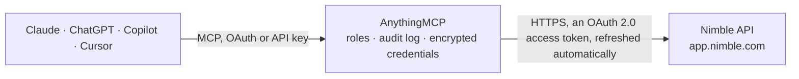

<!-- Generated by scripts/export-github-catalog.mjs in the anythingmcp-website repository. Do not edit by hand. -->

# Nimble MCP connector

Manage Nimble CRM (contacts, activities, deals, tasks, notes) from any AI agent. 9 tools, OAuth2 auth. The AnythingMCP connector gives Claude, ChatGPT, Microsoft Copilot, Cursor and Gemini 9 MCP tools for Nimble: 5 read and 4 can change data.

**Category:** [CRM](../crm.md) · **Tools:** 9 · **Setup guide:** [anythingmcp.com](https://anythingmcp.com/guides/nimble-to-mcp) · [Deutsch](https://anythingmcp.com/de/guides/nimble-to-mcp) · [Italiano](https://anythingmcp.com/it/guides/nimble-to-mcp) · [Español](https://anythingmcp.com/es/guides/nimble-to-mcp) · [日本語](https://anythingmcp.com/ja/guides/nimble-to-mcp) · [Русский](https://anythingmcp.com/ru/guides/nimble-to-mcp) · [中文](https://anythingmcp.com/zh/guides/nimble-to-mcp)

## Start without code

No installation and no terminal: AnythingMCP Cloud runs the Nimble connector for you, operated by helpcode.ai in Frankfurt, Germany.

1. **Click the button above** and create an account or sign in. The Nimble connector opens, ready to install.
2. **Sign in with your Nimble account** when AnythingMCP asks. The first time, an admin creates a small app in the Nimble developer console. Every click is in the [step-by-step guide](https://anythingmcp.com/guides/nimble-to-mcp).
3. **Click Install.** AnythingMCP shows the address of your MCP server.
4. **Add that address to your assistant:** [Claude](https://anythingmcp.com/guides/connect-nimble-to-claude) · [ChatGPT](https://anythingmcp.com/guides/connect-nimble-to-chatgpt) · [Microsoft Copilot](https://anythingmcp.com/guides/connect-nimble-to-copilot) · [Cursor](https://anythingmcp.com/guides/connect-nimble-to-cursor) · [Gemini CLI](https://anythingmcp.com/guides/connect-nimble-to-gemini) · [Meta Muse](https://anythingmcp.com/guides/connect-nimble-to-muse).
5. **Ask your first question**, for example: *Show the Nimble contact record for Marco Dantas at TerraForma SRL*

Prefer help with the setup? [Talk to us](https://anythingmcp.com/contact).

## How it works

- **The AI client** speaks MCP (Streamable HTTP) to AnythingMCP and only sees tool names, descriptions and results. It never gets the Nimble credentials.
- **AnythingMCP** checks the client's role, builds the call from the tool definition, adds the credentials (an OAuth 2.0 access token, refreshed automatically), calls Nimble, logs the call and returns the result.
- **Nimble** sees an ordinary API client with the rights of the account the credentials belong to.

## Tools

| Tool | What it does | Access |
|---|---|---|
| [`nimble_myself`](#nimble_myself) | Return the authenticated user info. | read |
| [`nimble_list_contacts`](#nimble_list_contacts) | List contacts (people + companies). | read |
| [`nimble_get_contact`](#nimble_get_contact) | Get one contact by ID with all fields, tags, social-network links. | read |
| [`nimble_create_contact`](#nimble_create_contact) | Create a contact. | write |
| [`nimble_update_contact`](#nimble_update_contact) | Update a contact (PATCH semantics — supply only fields you want changed). | write |
| [`nimble_delete_contact`](#nimble_delete_contact) | Permanently delete a contact. | write |
| [`nimble_list_activities`](#nimble_list_activities) | List activities (calls, meetings, tasks, emails) for the workspace. | read |
| [`nimble_create_activity`](#nimble_create_activity) | Create an activity (task, call note, meeting log). | write |
| [`nimble_list_deals`](#nimble_list_deals) | List sales deals/opportunities. | read |

## Tool reference

Every parameter as the AI client sees it in `tools/list`. Source: [`packages/backend/src/adapters/intl/nimble.json`](../../../packages/backend/src/adapters/intl/nimble.json).

### `nimble_myself`

Return the authenticated user info.

**Access:** read · **Call:** `GET /myself`

No parameters.

### `nimble_list_contacts`

List contacts (people + companies). Filter by record_type, query, tag.

**Access:** read · **Call:** `GET /contacts`

| Parameter | Type | Required | Description |
|---|---|---|---|
| `record_type` | string | no | person, company, lead. |
| `query` | string | no | Free-text search. |
| `tag` | string | no | Filter by tag name. |
| `page` | integer | no | 1-based. |
| `per_page` | integer | no | Max 30. |
| `sort` | string | no | Field name. Prefix with - for desc. |

### `nimble_get_contact`

Get one contact by ID with all fields, tags, social-network links.

**Access:** read · **Call:** `GET /contact/{id}`

| Parameter | Type | Required | Description |
|---|---|---|---|
| `id` | string | yes | Contact ID. |

### `nimble_create_contact`

Create a contact. `fields` is the Nimble namespaced shape — `{"first name":[{value:'John'}], email:[{value:'a@b.com', modifier:'work'}]}`.

**Access:** write · **Call:** `POST /contact`

| Parameter | Type | Required | Description |
|---|---|---|---|
| `record_type` | string | yes | person or company. |
| `fields` | object | yes | Field-name → array-of-{value, modifier?} map. |
| `tags` | any[] | no | Array of tag names. |

### `nimble_update_contact`

Update a contact (PATCH semantics — supply only fields you want changed).

**Access:** write · **Call:** `PUT /contact/{id}`

| Parameter | Type | Required | Description |
|---|---|---|---|
| `id` | string | yes | Contact ID. |
| `fields` | object | yes | Fields to update. |

### `nimble_delete_contact`

Permanently delete a contact.

**Access:** write · **Call:** `DELETE /contact/{id}`

| Parameter | Type | Required | Description |
|---|---|---|---|
| `id` | string | yes | Contact ID. |

### `nimble_list_activities`

List activities (calls, meetings, tasks, emails) for the workspace.

**Access:** read · **Call:** `GET /activities`

| Parameter | Type | Required | Description |
|---|---|---|---|
| `contact_id` | string | no | Filter to one contact. |
| `type` | string | no | task, event, phone_call, email. |
| `page` | integer | no | 1-based. |
| `per_page` | integer | no | Max 30. |

### `nimble_create_activity`

Create an activity (task, call note, meeting log).

**Access:** write · **Call:** `POST /activity`

| Parameter | Type | Required | Description |
|---|---|---|---|
| `type` | string | yes | task, event, phone_call, email. |
| `subject` | string | yes | Subject / title. |
| `description` | string | no | Body. |
| `contact_id` | string | no | Linked contact. |
| `start_time` | string | no | ISO 8601 start. |
| `end_time` | string | no | ISO 8601 end. |

### `nimble_list_deals`

List sales deals/opportunities.

**Access:** read · **Call:** `GET /deals`

| Parameter | Type | Required | Description |
|---|---|---|---|
| `stage` | string | no | Filter by stage name. |
| `owner` | string | no | Filter by owner ID. |
| `page` | integer | no | 1-based. |
| `per_page` | integer | no | Max 30. |

## Run it yourself

AnythingMCP is open source (AGPL-3.0). [Run it with Docker](../../../README.md#run-it-yourself), open **Connectors → Store**, pick **Nimble** and enter `NIMBLE_CLIENT_ID`, `NIMBLE_CLIENT_SECRET`, then add your MCP server URL to the AI client.

[← CRM connectors](../crm.md) · [All categories](../README.md)
