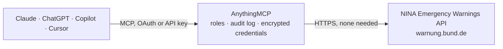

<!-- Generated by scripts/export-github-catalog.mjs in the anythingmcp-website repository. Do not edit by hand. -->

# NINA Emergency Warnings MCP connector

Access official German emergency warnings and alerts from the NINA Warn-App (BBK). The AnythingMCP connector gives Claude, ChatGPT, Microsoft Copilot, Cursor and Gemini 4 MCP tools for NINA Emergency Warnings, all read-only.

**Category:** [Government](../government.md) · **Tools:** 4 · **Setup guide:** [anythingmcp.com](https://anythingmcp.com/guides/nina-warnung-to-mcp) · [Deutsch](https://anythingmcp.com/de/guides/nina-warnung-to-mcp) · [Italiano](https://anythingmcp.com/it/guides/nina-warnung-to-mcp) · [Español](https://anythingmcp.com/es/guides/nina-warnung-to-mcp) · [日本語](https://anythingmcp.com/ja/guides/nina-warnung-to-mcp) · [Русский](https://anythingmcp.com/ru/guides/nina-warnung-to-mcp) · [中文](https://anythingmcp.com/zh/guides/nina-warnung-to-mcp)

## Start without code

No installation and no terminal: AnythingMCP Cloud runs the NINA Emergency Warnings connector for you, operated by helpcode.ai in Frankfurt, Germany.

1. **Click the button above** and create an account or sign in. The NINA Emergency Warnings connector opens, ready to install.
2. **Nothing to enter:** this connector needs no credentials. Every click is in the [step-by-step guide](https://anythingmcp.com/guides/nina-warnung-to-mcp).
3. **Click Install.** AnythingMCP shows the address of your MCP server.
4. **Add that address to your assistant:** [Claude](https://anythingmcp.com/guides/connect-nina-warnung-to-claude) · [ChatGPT](https://anythingmcp.com/guides/connect-nina-warnung-to-chatgpt) · [Microsoft Copilot](https://anythingmcp.com/guides/connect-nina-warnung-to-copilot) · [Cursor](https://anythingmcp.com/guides/connect-nina-warnung-to-cursor) · [Gemini CLI](https://anythingmcp.com/guides/connect-nina-warnung-to-gemini) · [Meta Muse](https://anythingmcp.com/guides/connect-nina-warnung-to-muse).
5. **Ask your first question**, for example: *Are there any current warnings for Wiesbaden district AGS 064140000000 right now?*

Prefer help with the setup? [Talk to us](https://anythingmcp.com/contact).

## How it works

- **The AI client** speaks MCP (Streamable HTTP) to AnythingMCP and only sees tool names, descriptions and results. It never gets the NINA Emergency Warnings credentials.
- **AnythingMCP** checks the client's role, builds the call from the tool definition, adds the credentials (none needed), calls NINA Emergency Warnings, logs the call and returns the result.
- **NINA Emergency Warnings** sees an ordinary API client with the rights of the account the credentials belong to.

## Tools

| Tool | What it does | Access |
|---|---|---|
| [`nina_get_active_warnings`](#nina_get_active_warnings) | All currently active warnings of one source, nationwide: mowas (civil protection / MoWaS), katwarn, biwapp, dwd (severe weather), lhp (flood), police. | read |
| [`nina_get_warnings_by_region`](#nina_get_warnings_by_region) | Get current emergency warnings for a specific German region (Kreis/Stadt) by its AGS code. | read |
| [`nina_get_warning_detail`](#nina_get_warning_detail) | Get detailed information about a specific warning by its ID. | read |
| [`nina_get_covid_rules`](#nina_get_covid_rules) | Get current COVID-19 rules and regulations for a specific German region by AGS code. | read |

## Tool reference

Every parameter as the AI client sees it in `tools/list`. Source: [`packages/backend/src/adapters/de/nina-warnung.json`](../../../packages/backend/src/adapters/de/nina-warnung.json).

### `nina_get_active_warnings`

All currently active warnings of one source, nationwide: mowas (civil protection / MoWaS), katwarn, biwapp, dwd (severe weather), lhp (flood), police. Each item has an id (pass it to nina_get_warning_detail), headline, severity, sent time and affected areas. An empty list means no active warning from that source.

**Access:** read · **Call:** `GET /{source}/mapData.json`

| Parameter | Type | Required | Description |
|---|---|---|---|
| `source` | `mowas` \| `katwarn` \| `biwapp` \| `dwd` \| `lhp` \| `police` | yes | Warning source. |

### `nina_get_warnings_by_region`

Get current emergency warnings for a specific German region (Kreis/Stadt) by its AGS code. AGS is the official municipality key (Amtlicher Gemeindeschlüssel). Use the first 5 digits for Kreis level.

**Access:** read · **Call:** `GET /dashboard/{ags}.json`

| Parameter | Type | Required | Description |
|---|---|---|---|
| `ags` | string | yes | The 12-digit AGS code of the region (e.g. '091620000000' for Munich, '110000000000' for Berlin). Use 5 digits + trailing zeros. |

### `nina_get_warning_detail`

Get detailed information about a specific warning by its ID. Returns the full warning text, affected areas, instructions, and severity level.

**Access:** read · **Call:** `GET /warnings/{warningId}.json`

| Parameter | Type | Required | Description |
|---|---|---|---|
| `warningId` | string | yes | The warning ID (obtained from dashboard or region warnings) |

### `nina_get_covid_rules`

Get current COVID-19 rules and regulations for a specific German region by AGS code.

**Access:** read · **Call:** `GET /appdata/covid/covidrules/DE/{ags}.json`

| Parameter | Type | Required | Description |
|---|---|---|---|
| `ags` | string | yes | The 12-digit AGS code of the region |

## Run it yourself

AnythingMCP is open source (AGPL-3.0). [Run it with Docker](../../../README.md#run-it-yourself), open **Connectors → Store**, pick **NINA Emergency Warnings**, then add your MCP server URL to the AI client.

[← Government connectors](../government.md) · [All categories](../README.md)
