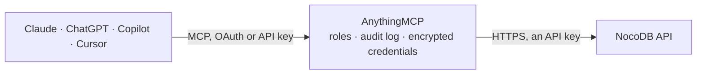

<!-- Generated by scripts/export-github-catalog.mjs in the anythingmcp-website repository. Do not edit by hand. -->

# NocoDB MCP connector

Read NocoDB workspaces, bases, tables, and records from NocoDB Cloud or a self-hosted instance. 7 read-only tools using xc-token API key authentication against the v3 REST API. The AnythingMCP connector gives Claude, ChatGPT, Microsoft Copilot, Cursor and Gemini 7 MCP tools for NocoDB, all read-only.

**Category:** [Public Data](../data.md) · **Tools:** 7 · **Setup guide:** [anythingmcp.com](https://anythingmcp.com/guides/nocodb-to-mcp) · [Deutsch](https://anythingmcp.com/de/guides/nocodb-to-mcp) · [Italiano](https://anythingmcp.com/it/guides/nocodb-to-mcp) · [Español](https://anythingmcp.com/es/guides/nocodb-to-mcp) · [日本語](https://anythingmcp.com/ja/guides/nocodb-to-mcp) · [Русский](https://anythingmcp.com/ru/guides/nocodb-to-mcp) · [中文](https://anythingmcp.com/zh/guides/nocodb-to-mcp)

## Start without code

No installation and no terminal: AnythingMCP Cloud runs the NocoDB connector for you, operated by helpcode.ai in Frankfurt, Germany.

1. **Click the button above** and create an account or sign in. The NocoDB connector opens, ready to install.
2. **Paste the API key or token from your NocoDB account.** Every click is in the [step-by-step guide](https://anythingmcp.com/guides/nocodb-to-mcp).
3. **Click Install.** AnythingMCP shows the address of your MCP server.
4. **Add that address to your assistant:** [Claude](https://anythingmcp.com/guides/connect-nocodb-to-claude) · [ChatGPT](https://anythingmcp.com/guides/connect-nocodb-to-chatgpt) · [Microsoft Copilot](https://anythingmcp.com/guides/connect-nocodb-to-copilot) · [Cursor](https://anythingmcp.com/guides/connect-nocodb-to-cursor) · [Gemini CLI](https://anythingmcp.com/guides/connect-nocodb-to-gemini) · [Meta Muse](https://anythingmcp.com/guides/connect-nocodb-to-muse).
5. **Ask your first question**, for example: *What is the base ID for the Accounting 2026 project in workspace Operations?*

Prefer help with the setup? [Talk to us](https://anythingmcp.com/contact).

## How it works

- **The AI client** speaks MCP (Streamable HTTP) to AnythingMCP and only sees tool names, descriptions and results. It never gets the NocoDB credentials.
- **AnythingMCP** checks the client's role, builds the call from the tool definition, adds the credentials (an API key), calls NocoDB, logs the call and returns the result.
- **NocoDB** sees an ordinary API client with the rights of the account the credentials belong to.

## Tools

| Tool | What it does | Access |
|---|---|---|
| [`nocodb_list_workspaces`](#nocodb_list_workspaces) | List all workspaces visible to the configured API token. | read |
| [`nocodb_list_bases`](#nocodb_list_bases) | List bases (projects) in a NocoDB workspace. | read |
| [`nocodb_list_tables`](#nocodb_list_tables) | List tables in a NocoDB base. | read |
| [`nocodb_get_table`](#nocodb_get_table) | Get the full schema of one NocoDB table: its columns with names, types, and options. | read |
| [`nocodb_list_records`](#nocodb_list_records) | List records from a NocoDB table. | read |
| [`nocodb_get_record`](#nocodb_get_record) | Get one record by its numeric row ID from a NocoDB table. | read |
| [`nocodb_count_records`](#nocodb_count_records) | Count records in a NocoDB table, optionally filtered by a where clause. | read |

## Tool reference

Every parameter as the AI client sees it in `tools/list`. Source: [`packages/backend/src/adapters/intl/nocodb.json`](../../../packages/backend/src/adapters/intl/nocodb.json).

### `nocodb_list_workspaces`

List all workspaces visible to the configured API token. Call this first to discover workspace IDs (prefixed with w) and names, then use a workspace ID with nocodb_list_bases. Read-only.

**Access:** read · **Call:** `GET /meta/workspaces`

No parameters.

### `nocodb_list_bases`

List bases (projects) in a NocoDB workspace. Each base has an ID prefixed with p. Use nocodb_list_workspaces first to get the workspace ID, then pass it here to discover base IDs for nocodb_list_tables. Read-only.

**Access:** read · **Call:** `GET /meta/workspaces/{workspaceId}/bases`

| Parameter | Type | Required | Description |
|---|---|---|---|
| `workspaceId` | string | yes | Workspace ID from nocodb_list_workspaces, prefixed with w, for example w_abc123def. |
| `limit` | integer | no | Maximum number of bases to return per page. |
| `offset` | integer | no | Number of bases to skip for pagination, starting from 0. |

### `nocodb_list_tables`

List tables in a NocoDB base. Each table has an ID prefixed with m or a longer alphanumeric string. Use nocodb_list_bases first to get the base ID, then pass it here. Read-only.

**Access:** read · **Call:** `GET /meta/bases/{baseId}/tables`

| Parameter | Type | Required | Description |
|---|---|---|---|
| `baseId` | string | yes | Base ID from nocodb_list_bases, prefixed with p, for example p_abc123def. |

### `nocodb_get_table`

Get the full schema of one NocoDB table: its columns with names, types, and options. Call this before nocodb_list_records so you have the exact field names needed for where, sort, and fields parameters. Read-only.

**Access:** read · **Call:** `GET /meta/bases/{baseId}/tables/{tableId}`

| Parameter | Type | Required | Description |
|---|---|---|---|
| `baseId` | string | yes | Base ID from nocodb_list_bases, prefixed with p, for example p_abc123def. |
| `tableId` | string | yes | Table ID from nocodb_list_tables, for example m_abc123def. |

### `nocodb_list_records`

List records from a NocoDB table. Call nocodb_get_table first for exact field names, then use them in where, sort and fields. where uses (field,eq,value) joined with ~and or ~or; sort is JSON such as [{"field":"CreatedAt","direction":"desc"}]. Returns records plus pagination links; pageSize is silently capped at 100 on Cloud and 1000 on self-hosted. Read-only.

**Access:** read · **Call:** `GET /data/{baseId}/{tableId}/records`

| Parameter | Type | Required | Description |
|---|---|---|---|
| `baseId` | string | yes | Base ID from nocodb_list_bases, prefixed with p, for example p_abc123def. |
| `tableId` | string | yes | Table ID from nocodb_list_tables, for example m_abc123def. |
| `where` | string | no | NocoDB filter string. Single condition: (field,eq,value). Multiple: (field,eq,value)~and(field,gt,10). Operators: eq, neq, gt, ge, lt, le, like, nlike, is, isnot. Use exact field names from nocodb_get_table. |
| `sort` | string | no | Sort as JSON: one object or an array of objects with field and direction (asc or desc), for example [{"field":"CreatedAt","direction":"desc"}]. Use exact field names from nocodb_get_table. |
| `fields` | string | no | Comma-separated list of field names to include in the response. Use exact names from nocodb_get_table. |
| `page` | integer | no | 1-based page number for pagination. Start with 1. |
| `pageSize` | integer | no | Number of records per page. Silently capped at 100 (Cloud) or 1000 (self-hosted). Use a modest size such as 25. |
| `viewId` | string | no | Optional view ID to read records through a specific view's filters and sorts. |

### `nocodb_get_record`

Get one record by its numeric row ID from a NocoDB table. Use nocodb_list_records to discover row IDs. Optionally limit returned fields. Read-only.

**Access:** read · **Call:** `GET /data/{baseId}/{tableId}/records/{recordId}`

| Parameter | Type | Required | Description |
|---|---|---|---|
| `baseId` | string | yes | Base ID from nocodb_list_bases, prefixed with p, for example p_abc123def. |
| `tableId` | string | yes | Table ID from nocodb_list_tables, for example m_abc123def. |
| `recordId` | integer | yes | Numeric row ID of the record to retrieve. |
| `fields` | string | no | Comma-separated list of field names to include in the response. Use exact names from nocodb_get_table. |

### `nocodb_count_records`

Count records in a NocoDB table, optionally filtered by a where clause. Use this to know the total number of records before paging through a large table with nocodb_list_records. Read-only.

**Access:** read · **Call:** `GET /data/{baseId}/{tableId}/count`

| Parameter | Type | Required | Description |
|---|---|---|---|
| `baseId` | string | yes | Base ID from nocodb_list_bases, prefixed with p, for example p_abc123def. |
| `tableId` | string | yes | Table ID from nocodb_list_tables, for example m_abc123def. |
| `where` | string | no | NocoDB filter string, same syntax as nocodb_list_records. Omit to count all records. |
| `viewId` | string | no | Optional view ID to count records through a specific view's filters. |

## Run it yourself

AnythingMCP is open source (AGPL-3.0). [Run it with Docker](../../../README.md#run-it-yourself), open **Connectors → Store**, pick **NocoDB** and enter `NOCODB_URL`, `NOCODB_API_TOKEN`, then add your MCP server URL to the AI client.

[← Public Data connectors](../data.md) · [All categories](../README.md)
