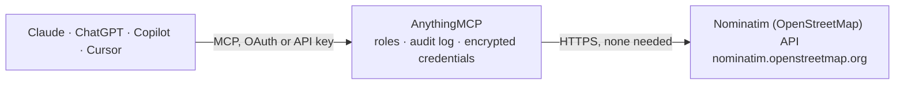

<!-- Generated by scripts/export-github-catalog.mjs in the anythingmcp-website repository. Do not edit by hand. -->

# Nominatim (OpenStreetMap) MCP connector

Free, no-auth geocoding using OpenStreetMap's Nominatim service. The AnythingMCP connector gives Claude, ChatGPT, Microsoft Copilot, Cursor and Gemini 4 MCP tools for Nominatim (OpenStreetMap), all read-only.

**Category:** [Maps](../maps.md) · **Tools:** 4 · **Setup guide:** [anythingmcp.com](https://anythingmcp.com/guides/nominatim-to-mcp) · [Deutsch](https://anythingmcp.com/de/guides/nominatim-to-mcp) · [Italiano](https://anythingmcp.com/it/guides/nominatim-to-mcp) · [Español](https://anythingmcp.com/es/guides/nominatim-to-mcp) · [日本語](https://anythingmcp.com/ja/guides/nominatim-to-mcp) · [Русский](https://anythingmcp.com/ru/guides/nominatim-to-mcp) · [中文](https://anythingmcp.com/zh/guides/nominatim-to-mcp)

## Start without code

No installation and no terminal: AnythingMCP Cloud runs the Nominatim (OpenStreetMap) connector for you, operated by helpcode.ai in Frankfurt, Germany.

1. **Click the button above** and create an account or sign in. The Nominatim (OpenStreetMap) connector opens, ready to install.
2. **Nothing to enter:** this connector needs no credentials. Every click is in the [step-by-step guide](https://anythingmcp.com/guides/nominatim-to-mcp).
3. **Click Install.** AnythingMCP shows the address of your MCP server.
4. **Add that address to your assistant:** [Claude](https://anythingmcp.com/guides/connect-nominatim-to-claude) · [ChatGPT](https://anythingmcp.com/guides/connect-nominatim-to-chatgpt) · [Microsoft Copilot](https://anythingmcp.com/guides/connect-nominatim-to-copilot) · [Cursor](https://anythingmcp.com/guides/connect-nominatim-to-cursor) · [Gemini CLI](https://anythingmcp.com/guides/connect-nominatim-to-gemini) · [Meta Muse](https://anythingmcp.com/guides/connect-nominatim-to-muse).
5. **Ask your first question**, for example: *What's the latitude/longitude for customer delivery address Konzertstraße 12, 80333 München?*

Prefer help with the setup? [Talk to us](https://anythingmcp.com/contact).

## How it works

- **The AI client** speaks MCP (Streamable HTTP) to AnythingMCP and only sees tool names, descriptions and results. It never gets the Nominatim (OpenStreetMap) credentials.
- **AnythingMCP** checks the client's role, builds the call from the tool definition, adds the credentials (none needed), calls Nominatim (OpenStreetMap), logs the call and returns the result.
- **Nominatim (OpenStreetMap)** sees an ordinary API client with the rights of the account the credentials belong to.

## Tools

| Tool | What it does | Access |
|---|---|---|
| [`nominatim_search`](#nominatim_search) | Forward geocode (free-text address → coordinates + structured address). | read |
| [`nominatim_reverse`](#nominatim_reverse) | Reverse geocode (coordinates → address). | read |
| [`nominatim_lookup`](#nominatim_lookup) | Look up known OSM IDs (N1234, W5678, R9012 for nodes/ways/relations). | read |
| [`nominatim_status`](#nominatim_status) | Service status check. | read |

## Tool reference

Every parameter as the AI client sees it in `tools/list`. Source: [`packages/backend/src/adapters/intl/nominatim.json`](../../../packages/backend/src/adapters/intl/nominatim.json).

### `nominatim_search`

Forward geocode (free-text address → coordinates + structured address). Be polite: max 1 req/sec, cache results, set realistic User-Agent.

**Access:** read · **Call:** `GET /search`

| Parameter | Type | Required | Description |
|---|---|---|---|
| `q` | string | yes | Free-text query, e.g. 'Brandenburg Gate, Berlin'. |
| `addressdetails` | integer | no | 1 = include parsed address components. |
| `extratags` | integer | no | 1 = include extra OSM tags. |
| `namedetails` | integer | no | 1 = include localized name variants. |
| `limit` | integer | no | Max results (default 10, max 50). |
| `countrycodes` | string | no | Comma-separated ISO 3166-1 alpha-2 codes (e.g. 'de,fr'). |
| `viewbox` | string | no | Bounding box 'left,top,right,bottom' (lng,lat) to bias. |
| `bounded` | integer | no | If 1 with viewbox, restrict to box. |
| `accept_language` | string | no | Localized output language (e.g. 'de', 'en-US'). |
| `dedupe` | integer | no | 1 = deduplicate (default). |

### `nominatim_reverse`

Reverse geocode (coordinates → address). Returns display_name + address components.

**Access:** read · **Call:** `GET /reverse`

| Parameter | Type | Required | Description |
|---|---|---|---|
| `lat` | number | yes | Latitude in decimal degrees. |
| `lon` | number | yes | Longitude in decimal degrees. |
| `zoom` | integer | no | Address detail level: 3 (country) → 18 (building). Default 18. |
| `addressdetails` | integer | no | 1 = parsed address parts. |
| `accept_language` | string | no | Output language. |

### `nominatim_lookup`

Look up known OSM IDs (N1234, W5678, R9012 for nodes/ways/relations). Comma-separated up to 50.

**Access:** read · **Call:** `GET /lookup`

| Parameter | Type | Required | Description |
|---|---|---|---|
| `osm_ids` | string | yes | Comma-separated OSM IDs prefixed with N/W/R, e.g. 'R146656,W104393803,N240109189'. |
| `addressdetails` | integer | no | 1 = address parts. |
| `accept_language` | string | no | Output language. |

### `nominatim_status`

Service status check. Returns 'OK' if Nominatim is up. Useful health check.

**Access:** read · **Call:** `GET /status`

No parameters.

## Run it yourself

AnythingMCP is open source (AGPL-3.0). [Run it with Docker](../../../README.md#run-it-yourself), open **Connectors → Store**, pick **Nominatim (OpenStreetMap)**, then add your MCP server URL to the AI client.

[← Maps connectors](../maps.md) · [All categories](../README.md)
